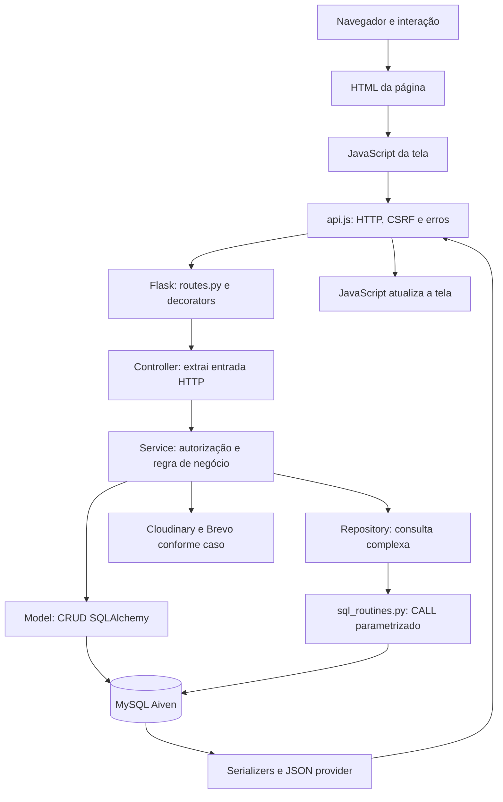

# IFix — guia completo do código para estudo e apresentação

Este documento explica a versão local do projeto, arquivo por arquivo, com os fluxos que conectam interface, API e banco. Foi elaborado a partir dos fontes, suas declarações e chamadas; não é uma confirmação de que cada integração remota está funcionando. Não inclui valores de segredos ou registros do banco. A data desta revisão é 03/11/2026.

## Índice e forma de estudar

1. [Visão do produto e vocabulário](#1-visão-do-produto-e-vocabulário)
2. [Arquitetura e caminho da requisição](#2-arquitetura-e-caminho-da-requisição)
3. [Inicialização, sessão e HTTP](#3-inicialização-sessão-e-http)
4. [Fluxos completos do negócio](#4-fluxos-completos-do-negócio)
5. [Banco, transações e consultas](#5-banco-transações-e-consultas)
6. [JSON, dinheiro, datas e arquivos](#6-json-dinheiro-datas-e-arquivos)
7. [Interface, quebra de texto e nomes](#7-interface-quebra-de-texto-e-nomes)
8. [Mapa de pastas](#8-mapa-de-pastas)
9. [Catálogo de rotas](#9-catálogo-de-rotas)
10. [Dicionário dos 14 modelos](#10-dicionário-dos-14-modelos)
11. [As 23 rotinas MySQL](#11-as-23-rotinas-mysql)
12. [Constantes do negócio](#12-constantes-do-negócio)
13. [Catálogo de todos os arquivos de projeto](#13-catálogo-de-todos-os-arquivos-de-projeto)
14. [Perguntas de apresentação e respostas](#14-perguntas-de-apresentação-e-respostas)
15. [Plano de estudo, validação e limites](#15-plano-de-estudo-validação-e-limites)

Para entender sem decorar: leia primeiro as seções 1–7, acompanhe um único chamado no código e depois use os catálogos para tirar dúvidas. Cada entrada de arquivo apresenta sua finalidade, elementos definidos e ligações com outros componentes. Não é necessário começar pelos scripts administrativos ou ler todo o CSS antes de entender o produto.

## 1. Visão do produto e vocabulário

O problema atendido é organizar a assistência de computador/notebook: encontrar um profissional compatível, comparar propostas e acompanhar o reparo. O sistema possui uma conta e diferentes formas de participação. A mesma pessoa cadastrada como técnico também pode abrir um chamado como cliente; ser técnico não significa ser responsável por todos os chamados.

**Usuário** é a conta com identidade, autenticação e dados pessoais. **Perfil técnico** acrescenta formação, especialidade, região, modalidades, disponibilidade e métricas profissionais. **Cliente** é o proprietário de um chamado. **Técnico convidado** recebeu uma solicitação para avaliar o problema e propor preço/prazo. **Técnico responsável** é o escolhido/atribuído ao chamado. Essas distinções são a base da autorização.

**Serviço ou chamado** é o pedido de assistência. **Solicitação** é o convite do chamado a um profissional. **Atendimento**, no contexto desta implementação, representa também o orçamento/proposta: não significa necessariamente reparo já aceito. **Solicitação de aprovação** é outro conceito: o profissional pede ao cliente permissão para um custo adicional. **Acionamento de garantia** é o registro do problema que voltou dentro da regra de garantia.

**Histórico do chamado** é a linha do tempo de mudanças de status daquele id. **Histórico do aparelho** procura chamados anteriores do mesmo cliente com modelo normalizado. O modelo do aparelho é texto, não um número de série único: não apresentar essa busca como identificação física infalível do equipamento.

### Vocabulário técnico básico

| Termo | Significado no IFix |
|---|---|
| Frontend | HTML/CSS/JavaScript que o navegador interpreta |
| Backend | Código Python que recebe requisições, decide regras e acessa dados |
| API | URLs que trocam dados em JSON com a interface |
| HTTP | Protocolo das requisições: método, URL, cabeçalhos, corpo e resposta |
| Endpoint/rota | Combinação de caminho e método, como POST /api/login |
| Controller | Adapta entrada/saída HTTP e chama os casos de uso |
| Service | Aplica autorização, validação e sequência da operação de negócio |
| Model | Classe SQLAlchemy que mapeia uma tabela e seus relacionamentos |
| Repository | Concentra consultas complexas e chamadas a procedures |
| ORM | SQLAlchemy transforma operações com objetos/consultas em SQL |
| Active Record | O próprio modelo contém salvar/buscar/atualizar, além de representar os dados |
| DTO/projeção | Conjunto explícito de campos que pode atravessar uma fronteira, como o perfil público |
| Serialização | Conversão dos objetos Python/linhas SQL em tipos aceitos pelo JSON |
| Blueprint | Grupo de rotas de um módulo Flask |
| Factory | Função create_app que monta e configura uma instância Flask |
| PK/FK/UNIQUE | Identificador principal, vínculo entre tabelas e restrição contra duplicidade |
| Commit/rollback | Confirmar ou desfazer uma transação SQL |
| Flush | Enviar mudanças pendentes ao banco sem confirmar a transação |
| TLS/CA | Transporte cifrado e autoridade usada para verificar o certificado do servidor |
| CSRF | Proteção contra escritas forjadas usando o cookie da vítima |
| XSS | Execução de HTML/JavaScript indevido ao tratar texto do usuário como código |
| Polling | Consultar a API periodicamente em vez de manter um canal de mensagens aberto |
| Decorator Python | Função que envolve outra, como @login_required ou @atomic |
| List comprehension | Construção de lista como [foto.to_dict() for foto in fotos] |
| Callback | Função guardada para executar depois, por exemplo após commit |
| UTC/fuso de negócio | UTC para instantes persistidos; America/Sao_Paulo para decisões de horário de atendimento |

## 2. Arquitetura e caminho da requisição

O projeto é um **monólito modular**. Há uma aplicação Flask, não um serviço separado para cada pasta. A separação em módulos é organização interna por responsabilidade: usuarios, servicos, atendimentos, chat e notificacoes. O frontend atual não usa framework SPA, e o backend entrega HTML estático, sem renderizar todas as telas por templates Jinja.

### Por que existem essas camadas?

A rota identifica o destino. O controller entende detalhes HTTP, como JSON versus multipart, e transforma a resposta em jsonify/status. O service recebe parâmetros de negócio, valida quem está agindo e decide a sequência. O model organiza a persistência simples e relações; o repository resolve leituras especializadas. Essa divisão evita colocar validação de orçamento no CSS, consulta SQL no navegador ou interpretação de formulário dentro da procedure.

A organização é pragmática: alguns services usam consultas ORM diretamente, e os models têm métodos Active Record. Não chamar a implementação de arquitetura hexagonal ou afirmar que toda consulta é feita por repository. Também não dizer que toda regra vive no banco: ranking e autorização estão principalmente no Python.

### Exemplo de leitura e de escrita

Em GET /api/tecnicos/diretorio, o controller lê filtros, o service valida opções, o repository chama a procedure e o serializer seleciona campos públicos. Em POST de proposta, o service bloqueia o chamado/convite, verifica identidade, valida o valor/prazo, persiste proposta e aviso e confirma uma única transação. Ler uma lista e executar uma mudança não exigem a mesma sequência.

## 3. Inicialização, sessão e HTTP

### O que ocorre quando a Vercel importa backend/app.py

1. app.py resolve caminhos e importa configuração, SQLAlchemy e componentes.
2. create_app cria o Flask com frontend como diretório estático.
3. Config.from_environment lê DATABASE_URL, SECRET_KEY, CA, ambiente e fuso. A validação não executa uma consulta MySQL.
4. A aplicação recebe o JSON provider explícito, inicializa db e instala proteções HTTP.
5. Flask-Login registra carregamento de usuário e resposta de sessão não autenticada.
6. Handlers tratam erros de domínio, erros HTTP e exceções inesperadas.
7. Blueprints e page_routes são registrados.
8. A variável global app recebe a instância para o runtime da Vercel. O bloco if __name__ == '__main__' serve apenas à execução direta local.

Não há criação de tabelas, instalação de rotinas ou seed no startup. O engine/pool pode existir sem abrir imediatamente uma conexão; uma página estática pode funcionar mesmo quando o primeiro SELECT do login falha. Isso explica o caso observado em que o login HTML e /api/csrf retornavam 200, mas cadastro/login retornavam OperationalError.

### Página e API têm contratos diferentes

GET / entrega frontend/index.html quando anônimo e pode redirecionar quando autenticado. GET /cliente/chamados entrega HTML da área protegida; o JavaScript dessa página busca os registros pela API. GET /api/servicos/meus entrega dados JSON, não a página completa.

A resposta de sucesso pode ser array na raiz, objeto na raiz ou envelope com ok:true. Erros usam ok:false e erro. api.js possui seu próprio objeto de resultado com dados/status/erro; esse wrapper é do cliente JavaScript e não altera o contrato do servidor.

### Sessão e CSRF em etapas

O navegador obtém o token em GET /api/csrf; ele fica associado à sessão. api.js inclui X-CSRF-Token nas escritas, inclusive FormData. O servidor compara o token e verifica Origin quando presente. Após login, a sessão é recriada, o vínculo de ambiente é gravado, Flask-Login guarda a identidade e o cliente descarta o token antigo.

O cookie identifica a sessão; a senha MySQL não vai para o navegador. SECRET_KEY assina a sessão e não é a senha do banco. Cookies de Production e Preview possuem nomes/escopos diferentes, e a versão do vínculo impede reaproveitar um id antigo de usuário do Neon. Logout efetivo é POST protegido; GET mostra confirmação.

Autenticação responde **quem é a conta**. Autorização responde **se essa conta pode atuar neste recurso**. @login_required não substitui a comparação com cliente_id, tecnico_id ou convite. O recorte público de um técnico também é diferente do JSON da própria conta, que inclui campos privados necessários à edição.

## 4. Fluxos completos do negócio

### 4.1 Cadastro de cliente e de técnico

Na interface, cadastro.js alterna formulários e aplica máscaras. O backend recebe os dados em UsuarioController, remove formatação quando necessário, valida campos comuns, confere unicidade e gera hash de senha no modelo. A senha original não é gravada como texto simples.

O cadastro técnico inclui os dados profissionais, foto e certificados. CadastrarTecnicoService coordena validação, uploads, Usuario e PerfilTecnico/Diploma. @atomic evita deixar conta SQL incompleta quando uma etapa falha. Upload é externo: se uma operação SQL falhar depois do envio, existe tentativa compensatória de remover o novo asset, não uma transação distribuída perfeita.

ConverterParaTecnicoService trata uma conta cliente já existente, mantendo sua identidade. Não criar uma segunda conta para simular a conversão. Cadastro/login reais dependem de MySQL acessível; Cloudinary é adicional para os arquivos.

### 4.2 Abrir chamado e selecionar técnicos

cliente-abrir-chamado.html apresenta tipo, modelo, categoria, título, descrição, modalidade, valor, garantia/urgência e fotos. O JavaScript valida para melhorar a experiência; CriarServicoService repete a validação no servidor porque o cliente HTTP pode ser manipulado.

O service valida suspensão da conta, dados do chamado e fotos, cria Servico, registra o primeiro histórico e executa SelecionarTecnicosService. O ranking recebe candidatos internos com coordenadas, preço, nota e modalidade; calcula Haversine, filtra compatibilidade e ordena o score. A saída são ids dos candidatos selecionados, não os dados privados de localização.

SolicitarTecnicosService cria os convites, avisos internos e decide e-mails. O chamado pode ser persistido sem candidatos se faltarem coordenadas ou profissionais; o número de técnicos notificados permite à interface distinguir esse resultado. O sistema não inventa atendimento onde não há profissional elegível.

### 4.3 Como calcular o ranking

A proximidade recebe peso 0,5; a avaliação, 0,3; o preço, 0,2. Distância e preço menores favorecem o score; nota maior favorece o score. Um valor ausente recebe tratamento definido no algoritmo, não uma divisão inválida. Disponível agora acrescenta bônus. Modalidade é filtro de compatibilidade, não simples decoração.

O raio inicial é 40 km, com expansão automática conforme mínimo de candidatos e teto configurado. Se não há ninguém no raio, existe fallback entre candidatos disponíveis conforme a função. A ampliação manual do cliente tem limite próprio de 1200 km. Estudar o método _filtrar_por_raio antes de descrever o mecanismo: não afirmar que todos os candidatos da base são sempre notificados. A quantidade final selecionada é limitada a três.

Esses pesos são escolhas do produto. Não há modelo de machine learning, inferência de IA ou fluxo n8n executando esse ranking nesta versão. Comentários sobre automação indicam possibilidade futura.

### 4.4 Convite, fotos e envio de proposta

O painel técnico carrega /api/tecnico/solicitacoes. SolicitacaoRepository recebe dois conjuntos da procedure: convites com dados do problema e fotos relacionadas. query_serializers.requests mantém um recorte autorizado, agora com fotos necessárias ao diagnóstico e orçamento.

O modal em tecnico-home.js já renderiza servico.fotos. Fotos novas usam caminho da API, e api_foto_chamado autoriza proprietário, responsável ou convidado válido de chamado ainda aberto e sem responsável definido. Recusa, cancelamento ou escolha de outro profissional removem a autorização de convidado. Ter uma URL conhecida não autoriza um estranho.

EnviarOrcamentoService exige convite pendente do profissional, chamado ainda aberto, valor positivo e prazo válido quando informado. Até três orçamentos com valor são considerados pelo limite. Proposta acima do teto pode ser registrada e destacada: a decisão econômica é do cliente. O convite passa a orcamento_enviado e o cliente recebe aviso interno.

### 4.5 Escolha, urgência e conflitos

O cliente consulta as propostas por ListarOrcamentosService; a identidade precisa coincidir com o proprietário. A interface compara preço, prazo e nota sem inventar destaque quando há empate ou apenas uma opção.

EscolherOrcamentoService bloqueia o chamado antes dos filhos, valida proposta pendente e ausência de responsável, aceita a vencedora, recusa concorrentes, atribui o técnico e registra histórico/notificação numa transação. O instante do prazo urgente é definido a partir da atribuição, por duas horas. A taxa de urgência é 20%, informada e registrada; o sistema não debita cartão.

Bloquear a linha torna decisões simultâneas sequenciais no banco. O segundo pedido precisa reler o estado e não pode decidir com um objeto antigo em memória. Timeout/deadlock pode gerar 409; não há retry automático indiscriminado. Não declarar concorrência remota comprovada sem a execução correspondente no InnoDB.

### 4.6 Reparo, laudo, teto e autorização de custo

O técnico responsável conduz os estados de acompanhamento. O cliente possui destinos mais restritos e pode confirmar a conclusão conforme os requisitos. Estados terminais não devem ser reabertos pelo mesmo endpoint.

RegistrarLaudoService exige profissional responsável, causa pertencente ao catálogo e texto mínimo. AtualizarStatusServicoService exige estado apropriado, laudo e ausência de aprovação pendente antes de concluir. Histórico guarda a mudança; notificações avisam o outro participante.

Antes da escolha, AumentarTetoServicoService permite ao proprietário melhorar a oferta. Durante o atendimento, custo adicional passa por SolicitarAprovacaoService e ResponderAprovacaoService. Resposta aprovada aumenta o teto naquele valor uma única vez; recusa registra justificativa sem autorizar a despesa. Não confundir teto, proposta, taxa de urgência, garantia e gorjeta: são conceitos diferentes.

### 4.7 Chat e notificações

O chat usa consultas HTTP periódicas e desde_id para buscar mensagens novas. A renderização incremental evita apagar a digitação e reiniciar toda a conversa a cada atualização. O backend verifica participantes e tamanho do conteúdo. O canal continua útil após a conclusão para tratar garantia.

Avisos internos são registros em notificacoes, com destinatário, papel, tipo e leitura. A contagem de não lidas é calculada separadamente da lista recente; uma lista limitada não pode diminuir artificialmente o badge. Somente o destinatário marca suas notificações. Brevo é e-mail externo, não o mecanismo persistido do sino.

### 4.8 Avaliações e comportamento

Após finalização, o cliente avalia tempo, honestidade e preço justo do técnico. A nota compõe a média corrente do PerfilTecnico e sua contagem. O técnico avalia comportamento e colaboração do cliente. Critérios baixos podem gerar alerta; três alertas suspendem a conta conforme a regra existente.

A avaliação é única por autor/chamado. O service bloqueia chamado e usuários em ordem estável antes de inserir; o UNIQUE do banco reforça a regra. Essas duas barreiras atendem a problemas diferentes: validação de negócio orienta a resposta, e constraint protege integridade inclusive diante de disputas.

### 4.9 Garantia e gorjeta

Garantia opcional é informada como +7% e dura dez dias após conclusão. AcionarGarantiaService verifica proprietário, prazo e situação antes de registrar reembolso solicitado ou novo atendimento vinculado ao mesmo técnico. O novo chamado não deve ficar órfão se a operação falhar.

RegistrarGorjetaService aceita valor positivo uma única vez após conclusão, com técnico definido. Nem gorjeta nem reembolso têm processamento financeiro automático. Apresentar a funcionalidade como registro/acordo, sem alegar integração bancária ou cobrança real.

### 4.10 Diretório, perfil e disponibilidade

O diretório aplica busca, categoria, modalidade, nota mínima, disponível agora e ordem. O perfil público reúne informações profissionais, métricas, certificados, janelas e comentários recentes. O serializer usa allowlist: não expande todas as colunas do Usuario.

Janelas semanais são informativas: mostram quando o profissional costuma atender, não uma agenda de reservas. A faixa diária de contato controla o e-mail de solicitação. Disponível agora é temporário, por quatro horas. Especialista verificado combina pelo menos cinco concluídos, nota >=4,5 e certificado; isso não é auditoria documental externa.

### 4.11 Histórico do aparelho e reincidência

A consulta recebe o cliente autenticado, normaliza caixa/espaços do modelo e limita os resultados, excluindo id opcional. O frontend identifica repetição de causa com pelo menos duas ocorrências. Uma ocorrência isolada não constitui reincidência. Histórico de outros clientes não é incluído por conhecer o mesmo texto de modelo.

## 5. Banco, transações e consultas

### Por que manter model e SQL fonte?

models/ define metadados e comportamento ORM; schema_mysql.sql é uma representação gerada da estrutura. procedures.sql contém consultas especializadas. gerar_schema.py --check compara offline o schema com os modelos, sem abrir conexão. Isso não equivale a aplicar migração no Aiven.

O banco já foi inicializado. Inicializador serve somente a um schema vazio explicitamente autorizado; não é uma etapa da apresentação/deploy. Validar metadados existentes não comprova que todo corpo de procedure instalado corresponde à fonte local. A rotina legada fn_listar_tecnicos_com_perfil é um caso importante: a aplicação usa o diretório público existente e não atualizou remotamente aquela definição.

### Transação de negócio

@atomic coloca um estado na sessão. Um service aninhado detecta esse estado e compartilha a unidade. Modelos chamam persist(): dentro da unidade, flush; ao fim, commit único. Em erro, rollback e callbacks de compensação. Chamadas isoladas ao modelo preservam o commit legado; isso é parte do compromisso arquitetural atual.

Flush pode executar INSERT/UPDATE e falhar em constraint, mas não confirma a operação inteira. Commit confirma; rollback desfaz apenas o que ainda não foi confirmado naquela transação. Não prometer rollback de DDL MySQL ou de upload/e-mail externo. Os scripts administrativos tratam esses limites separadamente.

### Locks e consultas atuais

lock_model faz SELECT FOR UPDATE e populate_existing para atualizar a identity map. lock_child descobre o chamado, bloqueia o pai e depois o registro filho. A ordem reduz disputas de lock; não elimina todo deadlock possível. Leituras de contagem que decidem o limite usam lock/current read para não depender de snapshot antigo após aguardar outra transação.

### CALL e múltiplos resultados

call_routine aceita apenas nomes em allowlist e passa valores separadamente em parâmetros. Usa a conexão DBAPI vinculada à sessão SQLAlchemy, envia flush antes da leitura e esgota nextset. Fecha o cursor, não a conexão da sessão, e não faz commit por conta própria. Perfil público retorna quatro conjuntos; solicitações/chamados retornam fotos em conjunto separado. Esquecer de esgotar os conjuntos pode quebrar a reutilização da conexão.

### Exclusões e retenção

Existem FKs CASCADE e SET NULL conforme os modelos originais. retention.py bloqueia exclusão ORM de conta para preservar históricos. Isso não bloqueia DELETE SQL administrativo ou bulk arbitrário. Também existe exclusão de chamado em estados permitidos: não dizer que o projeto não contém nenhuma exclusão. Uma política futura de desativação/anonimização exige decisão própria; nada foi alterado no banco nesta revisão.

## 6. JSON, dinheiro, datas e arquivos

### Serialização explícita

serialization.py registra serializers por classe e normaliza estruturas aninhadas, Mapping/Row, listas, datas e Decimal. Não percorre __dict__ nem serializa automaticamente toda coluna. query_serializers.py traduz linhas de procedures para contratos das telas. A escolha de qual projeção está autorizada acontece antes, nos services.

Usar serializer não resolve autorização sozinho. Um campo permitido na própria conta pode ser indevido num diretório público. Arrays continuam arrays na raiz, e a UI não foi adaptada para um envelope universal diferente.

### Dinheiro e instantes

DECIMAL armazena valores financeiros com precisão definida. money.decimal_value recusa valores inválidos/não finitos. Na resposta, Decimal vira número JSON porque a interface usa formatação numérica; não afirmar que JSON possui tipo decimal exato. Score de ranking e algumas métricas usam float por serem pontuação/média, não cobrança.

Instantes são persistidos em UTC. DATETIME MySQL não carrega por si uma zona; a aplicação interpreta o contrato UTC e o serializer acrescenta +00:00. business_now converte para BUSINESS_TIMEZONE ao decidir horário de contato. As faixas HH:MM são horários de parede informados pelo usuário, não timestamps a converter automaticamente.

### Upload e privacidade

O total da requisição é limitado a 4 MiB, incluindo todos os arquivos/campos; frontend reserva margem de multipart. uploads.py confere extensão/MIME/conteúdo. Imagens são decodificadas, verificadas e regravadas sem EXIF/IPTC; PDF certificado é analisado e recursos ativos são recusados. Isso não representa antivírus ou ocultação de dados pessoais visíveis no documento.

Cloudinary recebe identificador aleatório. Foto de chamado nova é authenticated e fica referenciada por marcador privado; a API autoriza o acesso e baixa o arquivo usando URL temporária que não é entregue ao navegador. Avatar e certificados continuam públicos por funcionalidade. Assets antigos públicos não se tornam privados retroativamente.

### E-mail externo

EmailService agenda envio após commit. A informação no app é a notificação SQL, persistida junto com a ação. E-mail é best-effort: não há outbox durável e uma falha externa pode exigir reconciliação. Não repetir uma escolha de proposta só para reenviar aviso. Interpolações HTML do usuário passam por escape.

## 7. Interface, quebra de texto e nomes

### Por que a especialização ultrapassava o modal?

Uma sequência longa sem espaço não fornecia pontos normais de quebra. Em CSS Grid, 1fr ainda considera o mínimo do conteúdo, e a palavra podia alargar/ultrapassar a coluna. Cortar o texto no banco ou trocar caracteres não resolveria o requisito de mostrar todo o conteúdo.

A correção em dashboard.css usa overflow-wrap:anywhere no perfil, min-width:0 nos filhos e minmax(0,1fr) nas colunas. Em especializações/experiências, white-space:pre-wrap preserva Enter, sem transformar o conteúdo em HTML. No breakpoint estreito, a grade passa a uma coluna. Não é truncamento: o texto continua completo e ganha altura.

perfil-publico-ui.js mantém escaparHtml antes de interpolar textos. Trocar Enter por HTML sem escape abriria outra classe de problema; a apresentação das linhas ficou a cargo do CSS. A regra cobre também textos profissionais longos que compartilham o modal.

### Nomes melhorados nesta revisão

| Antes | Depois | Motivo |
|---|---|---|
| ppFormatarMoeda | formatarMoedaPerfilPublico | Torna explícitos ação e contexto |
| ppFormatarDuracao | formatarDuracaoPerfilPublico | Evita prefixo abreviado sem significado imediato |
| ppEstrelas | formatarEstrelasPerfilPublico | Identifica a formatação da nota |
| ppFormatarMes | formatarMesDeIngressoPerfilPublico | Explica o mês/ano de membro desde |
| ppRenderizarJanelas/Criterios/Certificados/Avaliacoes | renderizar…PerfilPublico | Mantém helpers do componente identificáveis |
| sobre/experiencias/local | informacoesProfissionaisHTML/formacaoComplementarHTML/localizacaoTecnico | Distingue fragmentos HTML de dados e localização |
| KEY em transactions.py | TRANSACTION_STATE_KEY | Explica o que a chave identifica na sessão |
| sets/names/connection locais em sql_routines.py | result_sets/column_names/dbapi_connection | Distingue conjuntos de resultados, nomes de colunas e conexão do driver |

Rotas, nomes de tabelas/colunas, chaves JSON e classes de domínio foram preservados. Não houve uma renomeação massiva de arquivos que exigisse atualizar imports no projeto inteiro. Inglês técnico em bibliotecas continua aparecendo; o glossário ajuda a ler esses termos.

### Como ler os comentários acrescentados

Os cabeçalhos dos módulos explicam o papel do arquivo; docstrings de operações centrais explicam os efeitos e limites. HTML informa qual JavaScript controla a tela. SQL comenta a finalidade de cada rotina. Comentários de CSS explicam por que a grade pode encolher. Comentários não substituem o código: quando uma regra mudar, atualizar também a explicação.

## 8. Mapa de pastas

O catálogo considera os arquivos de código, interface, SQL, configuração e documentação do projeto. .git, .venv, .vercel e caches não são enumerados internamente: são metadados/dependências gerados, não a implementação escrita da aplicação. Arquivos de segredos não são abertos nem reproduzidos. Uploads pessoais também não são inventariados.

| Pasta | Função |
|---|---|
| `./` | Raiz: README, configuração Vercel, ignore e documentos gerais; o index.html raiz é legado. |
| `.git/` | Histórico Git e metadados; não editar manualmente como parte da regra de negócio. |
| `.venv/` | Dependências instaladas localmente; não faz parte do pacote fonte nem do catálogo por módulo. |
| `.vercel/` | Metadados locais da ferramenta Vercel, ignorados no Git. |
| `.vscode/` | Preferências do editor, sem regras do produto. |
| `backend/` | Aplicação Python, componentes compartilhados e módulos de negócio. |
| `backend/certs/` | CA pública opcional e instruções. |
| `backend/database/` | Fontes SQL de schema e rotinas. |
| `backend/modules/` | Monólito separado por domínio, não por serviço remoto. |
| `backend/modules/atendimentos/` | Domínio atendimentos: reúne rotas, casos de uso, dados e consultas do assunto. |
| `backend/modules/atendimentos/controllers/` | Adaptadores HTTP: entrada, service, jsonify e status. |
| `backend/modules/atendimentos/models/` | Mapeamento de tabelas, relações e persistência Active Record. |
| `backend/modules/atendimentos/repositories/` | Leituras especializadas e chamadas a procedures. |
| `backend/modules/atendimentos/services/` | Casos de uso, validação e autorização. |
| `backend/modules/chat/` | Domínio chat: reúne rotas, casos de uso, dados e consultas do assunto. |
| `backend/modules/chat/controllers/` | Adaptadores HTTP: entrada, service, jsonify e status. |
| `backend/modules/chat/models/` | Mapeamento de tabelas, relações e persistência Active Record. |
| `backend/modules/chat/repositories/` | Leituras especializadas e chamadas a procedures. |
| `backend/modules/chat/services/` | Casos de uso, validação e autorização. |
| `backend/modules/notificacoes/` | Domínio notificacoes: reúne rotas, casos de uso, dados e consultas do assunto. |
| `backend/modules/notificacoes/controllers/` | Adaptadores HTTP: entrada, service, jsonify e status. |
| `backend/modules/notificacoes/models/` | Mapeamento de tabelas, relações e persistência Active Record. |
| `backend/modules/notificacoes/services/` | Casos de uso, validação e autorização. |
| `backend/modules/servicos/` | Domínio servicos: reúne rotas, casos de uso, dados e consultas do assunto. |
| `backend/modules/servicos/controllers/` | Adaptadores HTTP: entrada, service, jsonify e status. |
| `backend/modules/servicos/models/` | Mapeamento de tabelas, relações e persistência Active Record. |
| `backend/modules/servicos/repositories/` | Leituras especializadas e chamadas a procedures. |
| `backend/modules/servicos/services/` | Casos de uso, validação e autorização. |
| `backend/modules/usuarios/` | Domínio usuarios: reúne rotas, casos de uso, dados e consultas do assunto. |
| `backend/modules/usuarios/controllers/` | Adaptadores HTTP: entrada, service, jsonify e status. |
| `backend/modules/usuarios/models/` | Mapeamento de tabelas, relações e persistência Active Record. |
| `backend/modules/usuarios/repositories/` | Leituras especializadas e chamadas a procedures. |
| `backend/modules/usuarios/services/` | Casos de uso, validação e autorização. |
| `backend/services/` | Integração de e-mail compartilhada. |
| `docs/` | Documentação de estudo, contratos, configuração e limites. |
| `frontend/` | Interface atual, recursos estáticos e arquivos legados preservados. |
| `frontend/assets/` | Logotipo e ícones públicos. |
| `frontend/css/` | Tema e layout responsivo. |
| `frontend/js/` | Comportamento das telas e componentes reutilizados. |
| `frontend/pages/` | HTML das telas atuais, entregue pelo Flask. |
| `frontend/uploads/` | Diretórios locais de apoio; arquivos pessoais não foram lidos. |
| `frontend/uploads/chamados/` | Apoio local para foto do problema; entrega de produção usa Cloudinary. |
| `frontend/uploads/diplomas/` | Apoio local para certificado; entrega de produção usa Cloudinary. |
| `frontend/uploads/perfil/` | Apoio local para avatar, não armazenamento persistente de produção. |
| `frontend/views/` | Estrutura legada de HTML/CSS, sem participação no fluxo principal atual. |
| `frontend/views/static/` | Recursos da estrutura legada. |
| `frontend/views/static/css/` | CSS legado. |
| `frontend/views/templates/` | HTML legado; não é o mecanismo atual de renderização do sistema. |
| `scripts/` | Manutenção manual de schema/diagnóstico; não é chamada no startup. |

Pastas __pycache__ podem surgir ao importar Python e contêm bytecode descartável. .env.local, quando presente no computador, é um arquivo de variáveis privadas: seu conteúdo não foi lido para este guia. Não projetar esse arquivo na apresentação. O aplicativo lê os.environ; ele não usa automaticamente um loader de .env.

## 9. Catálogo de rotas

As linhas abaixo vêm dos decorators route/get/post presentes no código. HEAD/OPTIONS podem ser adicionados pelo Flask. Login obrigatório é a primeira barreira; autorizações por recurso ficam nos services e no endpoint protegido de fotos.

| Métodos | Caminho | Função de entrada | Proteção declarada na função | Arquivo |
|---|---|---|---|---|
| GET | `/api/csrf` | `api_csrf` | Sem decorator de login nesta função; verificar hooks globais e caso de uso | [backend/http_security.py](../backend/http_security.py) |
| GET | `/api/atendimentos` | `api_atendimentos` | login_required | [backend/modules/atendimentos/routes.py](../backend/modules/atendimentos/routes.py) |
| POST | `/api/servicos/<int:servico_id>/atendimentos` | `api_criar_atendimento` | login_required | [backend/modules/atendimentos/routes.py](../backend/modules/atendimentos/routes.py) |
| PATCH | `/api/atendimentos/<int:atendimento_id>/status` | `api_status_atendimento` | login_required | [backend/modules/atendimentos/routes.py](../backend/modules/atendimentos/routes.py) |
| POST | `/api/atendimentos/<int:atendimento_id>/escolher` | `api_escolher_atendimento` | login_required | [backend/modules/atendimentos/routes.py](../backend/modules/atendimentos/routes.py) |
| GET | `/api/servicos/<int:servico_id>/mensagens` | `api_listar_mensagens` | login_required | [backend/modules/chat/routes.py](../backend/modules/chat/routes.py) |
| POST | `/api/servicos/<int:servico_id>/mensagens` | `api_enviar_mensagem` | login_required | [backend/modules/chat/routes.py](../backend/modules/chat/routes.py) |
| POST | `/api/servicos/<int:servico_id>/mensagens/lidas` | `api_marcar_mensagens_lidas` | login_required | [backend/modules/chat/routes.py](../backend/modules/chat/routes.py) |
| GET | `/api/mensagens/nao-lidas` | `api_mensagens_nao_lidas` | login_required | [backend/modules/chat/routes.py](../backend/modules/chat/routes.py) |
| GET | `/api/notificacoes` | `api_listar_notificacoes` | login_required | [backend/modules/notificacoes/routes.py](../backend/modules/notificacoes/routes.py) |
| POST | `/api/notificacoes/lidas` | `api_marcar_notificacoes_lidas` | login_required | [backend/modules/notificacoes/routes.py](../backend/modules/notificacoes/routes.py) |
| POST | `/api/notificacoes/<int:notificacao_id>/lida` | `api_marcar_notificacao_lida` | login_required | [backend/modules/notificacoes/routes.py](../backend/modules/notificacoes/routes.py) |
| GET | `/api/servicos` | `api_servicos` | login_required | [backend/modules/servicos/routes.py](../backend/modules/servicos/routes.py) |
| GET | `/api/servicos/meus` | `api_servicos_meus` | login_required | [backend/modules/servicos/routes.py](../backend/modules/servicos/routes.py) |
| POST | `/api/servicos` | `api_criar_servico` | login_required | [backend/modules/servicos/routes.py](../backend/modules/servicos/routes.py) |
| GET | `/api/servicos/historico-aparelho` | `api_historico_aparelho` | login_required | [backend/modules/servicos/routes.py](../backend/modules/servicos/routes.py) |
| GET | `/api/servicos/<int:servico_id>` | `api_detalhes_servico` | login_required | [backend/modules/servicos/routes.py](../backend/modules/servicos/routes.py) |
| POST | `/api/servicos/<int:servico_id>/aceitar` | `api_aceitar_servico` | login_required | [backend/modules/servicos/routes.py](../backend/modules/servicos/routes.py) |
| DELETE | `/api/servicos/<int:servico_id>` | `api_excluir_servico` | login_required | [backend/modules/servicos/routes.py](../backend/modules/servicos/routes.py) |
| PATCH | `/api/servicos/<int:servico_id>/status` | `api_status_servico` | login_required | [backend/modules/servicos/routes.py](../backend/modules/servicos/routes.py) |
| PUT | `/api/servicos/<int:servico_id>/laudo` | `api_laudo_servico` | login_required | [backend/modules/servicos/routes.py](../backend/modules/servicos/routes.py) |
| POST | `/api/servicos/<int:servico_id>/aprovacoes` | `api_solicitar_aprovacao` | login_required | [backend/modules/servicos/routes.py](../backend/modules/servicos/routes.py) |
| GET | `/api/servicos/<int:servico_id>/aprovacoes` | `api_listar_aprovacoes` | login_required | [backend/modules/servicos/routes.py](../backend/modules/servicos/routes.py) |
| PATCH | `/api/aprovacoes/<int:aprovacao_id>` | `api_responder_aprovacao` | login_required | [backend/modules/servicos/routes.py](../backend/modules/servicos/routes.py) |
| POST | `/api/servicos/<int:servico_id>/garantia` | `api_acionar_garantia` | login_required | [backend/modules/servicos/routes.py](../backend/modules/servicos/routes.py) |
| GET | `/api/servicos/<int:servico_id>/garantia` | `api_listar_acionamentos_garantia` | login_required | [backend/modules/servicos/routes.py](../backend/modules/servicos/routes.py) |
| POST | `/api/servicos/<int:servico_id>/cancelar` | `api_cancelar_servico` | login_required | [backend/modules/servicos/routes.py](../backend/modules/servicos/routes.py) |
| GET | `/api/servicos/<int:servico_id>/historico` | `api_historico_servico` | login_required | [backend/modules/servicos/routes.py](../backend/modules/servicos/routes.py) |
| GET | `/api/servicos/<int:servico_id>/orcamentos` | `api_orcamentos_servico` | login_required | [backend/modules/servicos/routes.py](../backend/modules/servicos/routes.py) |
| POST | `/api/servicos/<int:servico_id>/avaliar` | `api_avaliar_servico` | login_required | [backend/modules/servicos/routes.py](../backend/modules/servicos/routes.py) |
| GET | `/api/servicos/<int:servico_id>/avaliacoes` | `api_avaliacoes_servico` | login_required | [backend/modules/servicos/routes.py](../backend/modules/servicos/routes.py) |
| POST | `/api/servicos/<int:servico_id>/ampliar-busca` | `api_ampliar_busca` | login_required | [backend/modules/servicos/routes.py](../backend/modules/servicos/routes.py) |
| PATCH | `/api/servicos/<int:servico_id>/teto` | `api_aumentar_teto` | login_required | [backend/modules/servicos/routes.py](../backend/modules/servicos/routes.py) |
| POST | `/api/servicos/<int:servico_id>/gorjeta` | `api_registrar_gorjeta` | login_required | [backend/modules/servicos/routes.py](../backend/modules/servicos/routes.py) |
| POST | `/api/servicos/<int:servico_id>/solicitar-tecnicos` | `api_solicitar_tecnicos` | login_required | [backend/modules/servicos/routes.py](../backend/modules/servicos/routes.py) |
| GET | `/api/tecnico/solicitacoes` | `api_tecnico_solicitacoes` | login_required | [backend/modules/servicos/routes.py](../backend/modules/servicos/routes.py) |
| POST | `/api/tecnico/solicitacoes/<int:solicitacao_id>/aceitar` | `api_tecnico_solicitacao_aceitar` | login_required | [backend/modules/servicos/routes.py](../backend/modules/servicos/routes.py) |
| POST | `/api/tecnico/solicitacoes/<int:solicitacao_id>/recusar` | `api_tecnico_solicitacao_recusar` | login_required | [backend/modules/servicos/routes.py](../backend/modules/servicos/routes.py) |
| POST | `/api/tecnico/solicitacoes/<int:solicitacao_id>/orcamento` | `api_tecnico_solicitacao_orcamento` | login_required | [backend/modules/servicos/routes.py](../backend/modules/servicos/routes.py) |
| GET | `/api/servicos/<int:servico_id>/fotos/<int:foto_id>` | `api_foto_chamado` | login_required | [backend/modules/servicos/routes.py](../backend/modules/servicos/routes.py) |
| POST | `/api/login` | `api_login` | Sem decorator de login nesta função; verificar hooks globais e caso de uso | [backend/modules/usuarios/routes.py](../backend/modules/usuarios/routes.py) |
| POST | `/api/cadastro/cliente` | `api_cadastro_cliente` | Sem decorator de login nesta função; verificar hooks globais e caso de uso | [backend/modules/usuarios/routes.py](../backend/modules/usuarios/routes.py) |
| POST | `/api/cadastro/tecnico` | `api_cadastro_tecnico` | Sem decorator de login nesta função; verificar hooks globais e caso de uso | [backend/modules/usuarios/routes.py](../backend/modules/usuarios/routes.py) |
| GET | `/api/me` | `api_me` | login_required | [backend/modules/usuarios/routes.py](../backend/modules/usuarios/routes.py) |
| PATCH | `/api/me` | `api_atualizar_me` | login_required | [backend/modules/usuarios/routes.py](../backend/modules/usuarios/routes.py) |
| PUT | `/api/me/horario-atendimento` | `api_horario_atendimento` | login_required | [backend/modules/usuarios/routes.py](../backend/modules/usuarios/routes.py) |
| PUT | `/api/me/foto` | `api_definir_foto_perfil` | login_required | [backend/modules/usuarios/routes.py](../backend/modules/usuarios/routes.py) |
| POST | `/api/me/senha` | `api_alterar_senha` | login_required | [backend/modules/usuarios/routes.py](../backend/modules/usuarios/routes.py) |
| GET | `/api/tecnicos` | `api_tecnicos` | login_required | [backend/modules/usuarios/routes.py](../backend/modules/usuarios/routes.py) |
| POST | `/api/conta/tornar-tecnico` | `api_conta_tornar_tecnico` | login_required | [backend/modules/usuarios/routes.py](../backend/modules/usuarios/routes.py) |
| GET | `/api/tecnico/perfil` | `api_perfil_tecnico` | login_required | [backend/modules/usuarios/routes.py](../backend/modules/usuarios/routes.py) |
| PATCH | `/api/tecnico/perfil` | `api_atualizar_perfil_tecnico` | login_required | [backend/modules/usuarios/routes.py](../backend/modules/usuarios/routes.py) |
| GET | `/api/tecnicos/diretorio` | `api_diretorio_tecnicos` | login_required | [backend/modules/usuarios/routes.py](../backend/modules/usuarios/routes.py) |
| GET | `/api/tecnicos/<int:tecnico_id>/perfil-publico` | `api_perfil_publico_tecnico` | login_required | [backend/modules/usuarios/routes.py](../backend/modules/usuarios/routes.py) |
| GET | `/api/tecnico/disponibilidade` | `api_obter_disponibilidade` | login_required | [backend/modules/usuarios/routes.py](../backend/modules/usuarios/routes.py) |
| PUT | `/api/tecnico/disponibilidade` | `api_definir_disponibilidade` | login_required | [backend/modules/usuarios/routes.py](../backend/modules/usuarios/routes.py) |
| PUT | `/api/tecnico/disponivel-agora` | `api_definir_disponivel_agora` | login_required | [backend/modules/usuarios/routes.py](../backend/modules/usuarios/routes.py) |
| GET | `/` | `index` | Sem decorator de login nesta função; verificar hooks globais e caso de uso | [backend/page_routes.py](../backend/page_routes.py) |
| GET | `/cadastro` | `cadastro` | Sem decorator de login nesta função; verificar hooks globais e caso de uso | [backend/page_routes.py](../backend/page_routes.py) |
| GET | `/cliente/home` | `cliente_home` | login_required | [backend/page_routes.py](../backend/page_routes.py) |
| GET | `/tecnico/home` | `tecnico_home` | login_required | [backend/page_routes.py](../backend/page_routes.py) |
| GET | `/cliente/chamados` | `cliente_chamados` | login_required | [backend/page_routes.py](../backend/page_routes.py) |
| GET | `/cliente/abrir-chamado` | `cliente_abrir_chamado` | login_required | [backend/page_routes.py](../backend/page_routes.py) |
| GET | `/cliente/tecnicos` | `cliente_tecnicos` | login_required | [backend/page_routes.py](../backend/page_routes.py) |
| GET | `/perfil` | `perfil` | login_required | [backend/page_routes.py](../backend/page_routes.py) |
| GET | `/cliente/tornar-tecnico` | `cliente_tornar_tecnico` | login_required | [backend/page_routes.py](../backend/page_routes.py) |
| GET, POST | `/logout` | `logout` | login_required | [backend/page_routes.py](../backend/page_routes.py) |

Total de declarações de rota encontradas: **67**. Endpoints públicos de autenticação/cadastro continuam sujeitos ao CSRF global para escrita; não confundir ausência de login_required com ausência de validação.

## 10. Dicionário dos 14 modelos

Os nomes e tipos a seguir são obtidos das declarações SQLAlchemy. Colunas sem nullable explícito seguem o padrão do ORM; o DDL gerado é a referência para conferir detalhes de constraints no schema. Defaults Python e server defaults não são a mesma coisa: o gerador traduz apenas os padrões suportados para o SQL.

### Atendimento → atendimentos

[backend/modules/atendimentos/models/atendimento.py](../backend/modules/atendimentos/models/atendimento.py)

Orçamento enviado por um técnico pra um chamado. Vários técnicos podem enviar orçamento (um Atendimento cada) pro mesmo Servico — quando o cliente escolhe um (EscolherOrcamentoService), os demais viram ORCAMENTO_RECUSADO automaticamente.

| Coluna | Tipo declarado | Opções | Referência FK |
|---|---|---|---|
| `id` | `db.Integer` | `primary_key=True` | — |
| `titulo` | `db.String(150)` | `nullable=False` | — |
| `descricao` | `db.Text` | `nullable=False` | — |
| `status` | `db.String(30)` | `nullable=False, default=ORCAMENTO_PENDENTE` | — |
| `valor_orcamento` | `db.Numeric(10, 2)` | `nullable=True` | — |
| `prazo_estimado_dias` | `db.Integer` | `opções padrão do ORM` | — |
| `cliente_id` | `db.Integer` | `nullable=False` | `db.ForeignKey('usuarios.id', ondelete='CASCADE')` |
| `tecnico_id` | `db.Integer` | `opções padrão do ORM` | `db.ForeignKey('usuarios.id', ondelete='CASCADE')` |
| `servico_id` | `db.Integer` | `nullable=False` | `db.ForeignKey('servicos.id', ondelete='CASCADE')` |
| `criado_em` | `db.DateTime().with_variant(DATETIME(fsp=6), 'mysql')` | `default=lambda: datetime.now(timezone.utc)` | — |
| `atualizado_em` | `db.DateTime().with_variant(DATETIME(fsp=6), 'mysql')` | `default=lambda: datetime.now(timezone.utc), onupdate=lambda: datetime.now(timezone.utc)` | — |

**Relacionamentos ORM:**

- `cliente`: `db.relationship('Usuario', foreign_keys=[cliente_id], back_populates='atendimentos_cliente')`.
- `tecnico`: `db.relationship('Usuario', foreign_keys=[tecnico_id], back_populates='atendimentos_tecnico')`.
- `servico`: `db.relationship('Servico', back_populates='atendimentos')`.

### Avaliacao → avaliacoes

[backend/modules/atendimentos/models/avaliacao.py](../backend/modules/atendimentos/models/avaliacao.py)

Avaliação mútua (nota + comentário opcional) entre cliente e técnico de um chamado finalizado — cada um avalia o outro uma única vez por chamado (uq_avaliacao_servico_autor). Os critérios são diferentes pra cada direção (não faz sentido pedir "preço justo" pro técnico avaliar o cliente): quando o autor é o CLIENTE avaliando o técnico, preenche nota_tempo/nota_honestidade/nota_preco_justo; quando o autor é o TÉCNICO avaliando o cliente, preenche nota_comportamento/ nota_colaboracao — os campos do outro conjunto ficam nulos. `nota` é a nota geral, média dos critérios que se aplicam — quando o avaliado é o técnico, alimenta PerfilTecnico.nota_media (ver AvaliarService), usado pelo ranking em SelecionarTecnicosService; quando o avaliado é o cliente, uma nota de comportamento muito baixa pode gerar um alerta (ver Usuario.registrar_alerta_comportamento).

| Coluna | Tipo declarado | Opções | Referência FK |
|---|---|---|---|
| `id` | `db.Integer` | `primary_key=True` | — |
| `servico_id` | `db.Integer` | `nullable=False` | `db.ForeignKey('servicos.id', ondelete='CASCADE')` |
| `autor_id` | `db.Integer` | `nullable=False` | `db.ForeignKey('usuarios.id', ondelete='CASCADE')` |
| `avaliado_id` | `db.Integer` | `nullable=False` | `db.ForeignKey('usuarios.id', ondelete='CASCADE')` |
| `nota` | `db.Integer` | `nullable=False` | — |
| `nota_tempo` | `db.Integer` | `opções padrão do ORM` | — |
| `nota_honestidade` | `db.Integer` | `opções padrão do ORM` | — |
| `nota_preco_justo` | `db.Integer` | `opções padrão do ORM` | — |
| `nota_comportamento` | `db.Integer` | `opções padrão do ORM` | — |
| `nota_colaboracao` | `db.Integer` | `opções padrão do ORM` | — |
| `comentario` | `db.Text` | `opções padrão do ORM` | — |
| `criado_em` | `db.DateTime().with_variant(DATETIME(fsp=6), 'mysql')` | `default=lambda: datetime.now(timezone.utc)` | — |

**Relacionamentos ORM:**

- `servico`: `db.relationship('Servico')`.
- `autor`: `db.relationship('Usuario', foreign_keys=[autor_id])`.
- `avaliado`: `db.relationship('Usuario', foreign_keys=[avaliado_id])`.

**Constraints adicionais:** `(db.UniqueConstraint('servico_id', 'autor_id', name='uq_avaliacao_servico_autor'),)`.

### MensagemChamado → mensagens_chamado

[backend/modules/chat/models/mensagem.py](../backend/modules/chat/models/mensagem.py)

Mensagem trocada entre o cliente e o técnico de um chamado.  O chat é sempre por chamado, não por par de pessoas: o assunto é o aparelho, e as duas partes só têm relação por causa dele. Isso também dá o controle de acesso de graça — quem pode ler é quem participa daquele Servico (ver ListarMensagensService).

| Coluna | Tipo declarado | Opções | Referência FK |
|---|---|---|---|
| `id` | `db.Integer` | `primary_key=True` | — |
| `servico_id` | `db.Integer` | `nullable=False, index=True` | `db.ForeignKey('servicos.id', ondelete='CASCADE')` |
| `autor_id` | `db.Integer` | `nullable=False` | `db.ForeignKey('usuarios.id', ondelete='CASCADE')` |
| `conteudo` | `db.Text` | `nullable=False` | — |
| `lida_em` | `db.DateTime().with_variant(DATETIME(fsp=6), 'mysql')` | `opções padrão do ORM` | — |
| `criado_em` | `db.DateTime().with_variant(DATETIME(fsp=6), 'mysql')` | `default=lambda: datetime.now(timezone.utc)` | — |

**Relacionamentos ORM:**

- `autor`: `db.relationship('Usuario', foreign_keys=[autor_id])`.

### Notificacao → notificacoes

[backend/modules/notificacoes/models/notificacao.py](../backend/modules/notificacoes/models/notificacao.py)

Aviso dentro do app (funcionalidade 9) sobre um evento do chamado.  É o canal que não depende de plataforma externa: o e-mail continua existindo, mas quem está com o iFix aberto vê o sino mudar no mesmo polling dos painéis. `papel` diz em qual painel o aviso faz sentido — a mesma conta pode ser cliente de um chamado e técnico de outro.

| Coluna | Tipo declarado | Opções | Referência FK |
|---|---|---|---|
| `id` | `db.Integer` | `primary_key=True` | — |
| `usuario_id` | `db.Integer` | `nullable=False, index=True` | `db.ForeignKey('usuarios.id', ondelete='CASCADE')` |
| `servico_id` | `db.Integer` | `opções padrão do ORM` | `db.ForeignKey('servicos.id', ondelete='CASCADE')` |
| `papel` | `db.String(10)` | `nullable=False` | — |
| `tipo` | `db.String(40)` | `nullable=False` | — |
| `titulo` | `db.String(120)` | `nullable=False` | — |
| `mensagem` | `db.String(300)` | `nullable=False` | — |
| `lida_em` | `db.DateTime().with_variant(DATETIME(fsp=6), 'mysql')` | `opções padrão do ORM` | — |
| `criado_em` | `db.DateTime().with_variant(DATETIME(fsp=6), 'mysql')` | `default=lambda: datetime.now(timezone.utc)` | — |

### SolicitacaoAprovacao → solicitacoes_aprovacao

[backend/modules/servicos/models/aprovacao.py](../backend/modules/servicos/models/aprovacao.py)

Pedido de autorização de custo adicional (funcionalidades 6 e 7).  Quando o técnico encontra um problema novo durante o reparo, ele não executa nada por conta própria: descreve o que achou, informa quanto custa a mais e espera o cliente autorizar remotamente. É o mecanismo que faz o teto de gasto (Servico.valor_maximo_aprovado) valer de verdade — sem ele, o limite seria só um número informativo.

| Coluna | Tipo declarado | Opções | Referência FK |
|---|---|---|---|
| `id` | `db.Integer` | `primary_key=True` | — |
| `servico_id` | `db.Integer` | `nullable=False` | `db.ForeignKey('servicos.id', ondelete='CASCADE')` |
| `tecnico_id` | `db.Integer` | `nullable=False` | `db.ForeignKey('usuarios.id', ondelete='CASCADE')` |
| `descricao` | `db.Text` | `nullable=False` | — |
| `valor_adicional` | `db.Numeric(10, 2)` | `nullable=False` | — |
| `status` | `db.String(20)` | `nullable=False, default=APROVACAO_PENDENTE` | — |
| `justificativa_recusa` | `db.Text` | `opções padrão do ORM` | — |
| `criado_em` | `db.DateTime().with_variant(DATETIME(fsp=6), 'mysql')` | `default=lambda: datetime.now(timezone.utc)` | — |
| `respondido_em` | `db.DateTime().with_variant(DATETIME(fsp=6), 'mysql')` | `opções padrão do ORM` | — |

**Relacionamentos ORM:**

- `servico`: `db.relationship('Servico', back_populates='aprovacoes')`.
- `tecnico`: `db.relationship('Usuario')`.

### AcionamentoGarantia → acionamentos_garantia

[backend/modules/servicos/models/garantia.py](../backend/modules/servicos/models/garantia.py)

Acionamento da garantia contratada (funcionalidade 2).  O cliente que pagou os +7% tem GARANTIA_DIAS após a finalização pra dizer que o problema voltou, e escolhe entre reembolso ou um novo atendimento gratuito. No caso de novo atendimento, um chamado novo é aberto já atribuído ao mesmo técnico e com preço zero — servico_novo_id guarda essa ligação, pra dar pra navegar do acionamento até o reparo que ele gerou.

| Coluna | Tipo declarado | Opções | Referência FK |
|---|---|---|---|
| `id` | `db.Integer` | `primary_key=True` | — |
| `servico_id` | `db.Integer` | `nullable=False` | `db.ForeignKey('servicos.id', ondelete='CASCADE')` |
| `cliente_id` | `db.Integer` | `nullable=False` | `db.ForeignKey('usuarios.id', ondelete='CASCADE')` |
| `descricao_problema` | `db.Text` | `nullable=False` | — |
| `tipo_solicitado` | `db.String(20)` | `nullable=False` | — |
| `status` | `db.String(20)` | `nullable=False, default=GARANTIA_STATUS_PENDENTE` | — |
| `servico_novo_id` | `db.Integer` | `opções padrão do ORM` | `db.ForeignKey('servicos.id', ondelete='SET NULL')` |
| `criado_em` | `db.DateTime().with_variant(DATETIME(fsp=6), 'mysql')` | `default=lambda: datetime.now(timezone.utc)` | — |
| `respondido_em` | `db.DateTime().with_variant(DATETIME(fsp=6), 'mysql')` | `opções padrão do ORM` | — |

**Relacionamentos ORM:**

- `servico`: `db.relationship('Servico', foreign_keys=[servico_id], back_populates='acionamentos_garantia')`.
- `servico_novo`: `db.relationship('Servico', foreign_keys=[servico_novo_id])`.
- `cliente`: `db.relationship('Usuario')`.

### HistoricoServico → historico_servicos

[backend/modules/servicos/models/historico.py](../backend/modules/servicos/models/historico.py)

Log append-only de mudanças de status de um Servico, com data/hora e quem alterou — usado pela timeline no painel do técnico e em "Acompanhar chamado" do cliente.

| Coluna | Tipo declarado | Opções | Referência FK |
|---|---|---|---|
| `id` | `db.Integer` | `primary_key=True` | — |
| `servico_id` | `db.Integer` | `nullable=False` | `db.ForeignKey('servicos.id', ondelete='CASCADE')` |
| `status_anterior` | `db.String(30)` | `opções padrão do ORM` | — |
| `status_novo` | `db.String(30)` | `nullable=False` | — |
| `alterado_por_id` | `db.Integer` | `opções padrão do ORM` | `db.ForeignKey('usuarios.id', ondelete='SET NULL')` |
| `alterado_em` | `db.DateTime().with_variant(DATETIME(fsp=6), 'mysql')` | `default=lambda: datetime.now(timezone.utc)` | — |

**Relacionamentos ORM:**

- `servico`: `db.relationship('Servico', back_populates='historico')`.
- `alterado_por`: `db.relationship('Usuario')`.

### Servico → servicos

[backend/modules/servicos/models/servico.py](../backend/modules/servicos/models/servico.py)

Chamado do cliente e suas fotos; reúne estado, participantes, valores, laudo e garantia.

| Coluna | Tipo declarado | Opções | Referência FK |
|---|---|---|---|
| `id` | `db.Integer` | `primary_key=True` | — |
| `titulo` | `db.String(150)` | `nullable=False` | — |
| `descricao` | `db.Text` | `nullable=False` | — |
| `categoria` | `db.String(50)` | `nullable=False` | — |
| `tipo_equipamento` | `db.String(20)` | `nullable=False, default='notebook'` | — |
| `equipamento` | `db.String(150)` | `opções padrão do ORM` | — |
| `preco_estimado` | `db.Numeric(10, 2)` | `nullable=False, default=0` | — |
| `valor_maximo_aprovado` | `db.Numeric(10, 2)` | `opções padrão do ORM` | — |
| `gorjeta` | `db.Numeric(10, 2)` | `opções padrão do ORM` | — |
| `garantia` | `db.Boolean` | `nullable=False, default=False` | — |
| `status` | `db.String(30)` | `nullable=False, default='aberto'` | — |
| `urgente` | `db.Boolean` | `nullable=False, default=False` | — |
| `urgencia_prazo_em` | `db.DateTime().with_variant(DATETIME(fsp=6), 'mysql')` | `opções padrão do ORM` | — |
| `modalidade` | `db.String(20)` | `nullable=False, default=MODALIDADE_LOJA` | — |
| `raio_busca_km` | `db.Integer` | `opções padrão do ORM` | — |
| `causa_defeito` | `db.String(50)` | `opções padrão do ORM` | — |
| `laudo_tecnico` | `db.Text` | `opções padrão do ORM` | — |
| `solucao_aplicada` | `db.Text` | `opções padrão do ORM` | — |
| `finalizado_em` | `db.DateTime().with_variant(DATETIME(fsp=6), 'mysql')` | `opções padrão do ORM` | — |
| `latitude` | `db.Float().with_variant(DOUBLE(), 'mysql')` | `opções padrão do ORM` | — |
| `longitude` | `db.Float().with_variant(DOUBLE(), 'mysql')` | `opções padrão do ORM` | — |
| `cliente_id` | `db.Integer` | `nullable=False` | `db.ForeignKey('usuarios.id', ondelete='CASCADE')` |
| `tecnico_id` | `db.Integer` | `opções padrão do ORM` | `db.ForeignKey('usuarios.id', ondelete='CASCADE')` |
| `criado_em` | `db.DateTime().with_variant(DATETIME(fsp=6), 'mysql')` | `default=lambda: datetime.now(timezone.utc)` | — |
| `atualizado_em` | `db.DateTime().with_variant(DATETIME(fsp=6), 'mysql')` | `default=lambda: datetime.now(timezone.utc), onupdate=lambda: datetime.now(timezone.utc)` | — |

**Relacionamentos ORM:**

- `cliente`: `db.relationship('Usuario', foreign_keys=[cliente_id], back_populates='servicos_criados')`.
- `tecnico`: `db.relationship('Usuario', foreign_keys=[tecnico_id], back_populates='servicos_atendidos')`.
- `atendimentos`: `db.relationship('Atendimento', back_populates='servico', cascade='all, delete-orphan')`.
- `solicitacoes`: `db.relationship('SolicitacaoTecnico', back_populates='servico', cascade='all, delete-orphan', order_by='SolicitacaoTecnico.criado_em')`.
- `historico`: `db.relationship('HistoricoServico', back_populates='servico', cascade='all, delete-orphan', order_by='HistoricoServico.alterado_em')`.
- `fotos`: `db.relationship('FotoServico', back_populates='servico', cascade='all, delete-orphan', order_by='FotoServico.enviado_em')`.
- `aprovacoes`: `db.relationship('SolicitacaoAprovacao', back_populates='servico', cascade='all, delete-orphan', order_by='SolicitacaoAprovacao.criado_em.desc()')`.
- `acionamentos_garantia`: `db.relationship('AcionamentoGarantia', foreign_keys='AcionamentoGarantia.servico_id', back_populates='servico', cascade='all, delete-orphan', order_by='AcionamentoGarantia.criado_em.desc()')`.

### FotoServico → fotos_servicos

[backend/modules/servicos/models/servico.py](../backend/modules/servicos/models/servico.py)

Referência a uma foto anexada a um chamado — o upload vai pro Cloudinary (ver utils.salvar_arquivo) e o banco guarda a URL pública completa retornada por ele, não um nome de arquivo local.

| Coluna | Tipo declarado | Opções | Referência FK |
|---|---|---|---|
| `id` | `db.Integer` | `primary_key=True` | — |
| `servico_id` | `db.Integer` | `nullable=False` | `db.ForeignKey('servicos.id', ondelete='CASCADE')` |
| `arquivo` | `db.String(255)` | `nullable=False` | — |
| `enviado_em` | `db.DateTime().with_variant(DATETIME(fsp=6), 'mysql')` | `default=lambda: datetime.now(timezone.utc)` | — |

**Relacionamentos ORM:**

- `servico`: `db.relationship('Servico', back_populates='fotos')`.

### SolicitacaoTecnico → solicitacoes_tecnicos

[backend/modules/servicos/models/solicitacao.py](../backend/modules/servicos/models/solicitacao.py)

Chamado oferecido a um técnico específico, aguardando aceite/recusa — fica na área "Solicitações pendentes" do painel do técnico, separada dos chamados já aceitos (Servico.tecnico_id só é preenchido depois que uma dessas é aceita).

| Coluna | Tipo declarado | Opções | Referência FK |
|---|---|---|---|
| `id` | `db.Integer` | `primary_key=True` | — |
| `servico_id` | `db.Integer` | `nullable=False` | `db.ForeignKey('servicos.id', ondelete='CASCADE')` |
| `tecnico_id` | `db.Integer` | `nullable=False` | `db.ForeignKey('usuarios.id', ondelete='CASCADE')` |
| `status` | `db.String(20)` | `nullable=False, default=SOLICITACAO_PENDENTE` | — |
| `criado_em` | `db.DateTime().with_variant(DATETIME(fsp=6), 'mysql')` | `default=lambda: datetime.now(timezone.utc)` | — |
| `respondido_em` | `db.DateTime().with_variant(DATETIME(fsp=6), 'mysql')` | `opções padrão do ORM` | — |

**Relacionamentos ORM:**

- `servico`: `db.relationship('Servico', back_populates='solicitacoes')`.
- `tecnico`: `db.relationship('Usuario')`.

### JanelaDisponibilidade → janelas_disponibilidade

[backend/modules/usuarios/models/disponibilidade.py](../backend/modules/usuarios/models/disponibilidade.py)

Faixa de horário em que o técnico atende num dia da semana (funcionalidade 3). O cliente só consulta — não há agendamento: serve pra ele saber quando o técnico costuma estar disponível.  dia_semana segue o Python (0 = segunda ... 6 = domingo); inicio/fim são "HH:MM" em string pelo mesmo motivo de Usuario.horario_*_atendimento.

| Coluna | Tipo declarado | Opções | Referência FK |
|---|---|---|---|
| `id` | `db.Integer` | `primary_key=True` | — |
| `tecnico_id` | `db.Integer` | `nullable=False, index=True` | `db.ForeignKey('usuarios.id', ondelete='CASCADE')` |
| `dia_semana` | `db.Integer` | `nullable=False` | — |
| `inicio` | `db.String(5)` | `nullable=False` | — |
| `fim` | `db.String(5)` | `nullable=False` | — |

### PerfilTecnico → perfis_tecnicos

[backend/modules/usuarios/models/tecnico.py](../backend/modules/usuarios/models/tecnico.py)

Perfil profissional e certificados associados à conta, com métricas e disponibilidade temporária.

| Coluna | Tipo declarado | Opções | Referência FK |
|---|---|---|---|
| `id` | `db.Integer` | `primary_key=True` | — |
| `usuario_id` | `db.Integer` | `nullable=False, unique=True` | `db.ForeignKey('usuarios.id', ondelete='CASCADE')` |
| `especialidade` | `db.String(100)` | `nullable=False` | — |
| `escolaridade` | `db.String(50)` | `nullable=False` | — |
| `curso_superior` | `db.String(100)` | `opções padrão do ORM` | — |
| `regiao_atendimento` | `db.String(150)` | `nullable=False` | — |
| `cursos_experiencias` | `db.Text` | `opções padrão do ORM` | — |
| `especializacoes` | `db.Text` | `opções padrão do ORM` | — |
| `foto_perfil` | `db.String(255)` | `nullable=False` | — |
| `valor_medio` | `db.Numeric(10, 2)` | `opções padrão do ORM` | — |
| `nota_media` | `db.Numeric(3, 2)` | `opções padrão do ORM` | — |
| `total_avaliacoes` | `db.Integer` | `nullable=False, default=0` | — |
| `modalidades` | `db.String(60)` | `opções padrão do ORM` | — |
| `disponivel_ate` | `db.DateTime().with_variant(DATETIME(fsp=6), 'mysql')` | `opções padrão do ORM` | — |

**Relacionamentos ORM:**

- `usuario`: `db.relationship('Usuario', back_populates='perfil_tecnico')`.
- `diplomas`: `db.relationship('Diploma', back_populates='perfil_tecnico', cascade='all, delete-orphan')`.

### Diploma → diplomas

[backend/modules/usuarios/models/tecnico.py](../backend/modules/usuarios/models/tecnico.py)

Perfil profissional e certificados associados à conta, com métricas e disponibilidade temporária.

| Coluna | Tipo declarado | Opções | Referência FK |
|---|---|---|---|
| `id` | `db.Integer` | `primary_key=True` | — |
| `perfil_tecnico_id` | `db.Integer` | `nullable=False` | `db.ForeignKey('perfis_tecnicos.id', ondelete='CASCADE')` |
| `arquivo` | `db.String(255)` | `nullable=False` | — |
| `enviado_em` | `db.DateTime().with_variant(DATETIME(fsp=6), 'mysql')` | `default=lambda: datetime.now(timezone.utc)` | — |

**Relacionamentos ORM:**

- `perfil_tecnico`: `db.relationship('PerfilTecnico', back_populates='diplomas')`.

### Usuario → usuarios

[backend/modules/usuarios/models/usuario.py](../backend/modules/usuarios/models/usuario.py)

Conta, identidade, senha em hash e dados pessoais; pode exercer papel de cliente ou técnico.

| Coluna | Tipo declarado | Opções | Referência FK |
|---|---|---|---|
| `id` | `db.Integer` | `primary_key=True` | — |
| `nome` | `db.String(100)` | `nullable=False` | — |
| `email` | `db.String(120)` | `nullable=False, unique=True, index=True` | — |
| `telefone` | `db.String(20)` | `nullable=False` | — |
| `cpf` | `db.String(11)` | `nullable=False, unique=True, index=True` | — |
| `data_nascimento` | `db.Date` | `nullable=False` | — |
| `senha_hash` | `db.String(255)` | `nullable=False` | — |
| `role` | `db.String(20)` | `nullable=False` | — |
| `foto_perfil` | `db.String(255)` | `opções padrão do ORM` | — |
| `pais` | `db.String(50)` | `nullable=False, default='Brasil'` | — |
| `cep` | `db.String(9)` | `opções padrão do ORM` | — |
| `estado` | `db.String(2)` | `opções padrão do ORM` | — |
| `cidade` | `db.String(100)` | `opções padrão do ORM` | — |
| `bairro` | `db.String(100)` | `opções padrão do ORM` | — |
| `endereco` | `db.String(150)` | `opções padrão do ORM` | — |
| `numero` | `db.String(10)` | `opções padrão do ORM` | — |
| `complemento` | `db.String(150)` | `opções padrão do ORM` | — |
| `latitude` | `db.Float().with_variant(DOUBLE(), 'mysql')` | `opções padrão do ORM` | — |
| `longitude` | `db.Float().with_variant(DOUBLE(), 'mysql')` | `opções padrão do ORM` | — |
| `alertas_comportamento` | `db.Integer` | `nullable=False, default=0` | — |
| `suspenso` | `db.Boolean` | `nullable=False, default=False` | — |
| `horario_inicio_atendimento` | `db.String(5)` | `nullable=False, default=HORARIO_ATENDIMENTO_PADRAO_INICIO` | — |
| `horario_fim_atendimento` | `db.String(5)` | `nullable=False, default=HORARIO_ATENDIMENTO_PADRAO_FIM` | — |
| `criado_em` | `db.DateTime().with_variant(DATETIME(fsp=6), 'mysql')` | `default=lambda: datetime.now(timezone.utc)` | — |

**Relacionamentos ORM:**

- `perfil_tecnico`: `db.relationship('PerfilTecnico', back_populates='usuario', uselist=False, cascade='all, delete-orphan')`.
- `servicos_criados`: `db.relationship('Servico', foreign_keys='Servico.cliente_id', back_populates='cliente', cascade='all, delete-orphan')`.
- `servicos_atendidos`: `db.relationship('Servico', foreign_keys='Servico.tecnico_id', back_populates='tecnico', cascade='all, delete-orphan')`.
- `atendimentos_cliente`: `db.relationship('Atendimento', foreign_keys='Atendimento.cliente_id', back_populates='cliente', cascade='all, delete-orphan')`.
- `atendimentos_tecnico`: `db.relationship('Atendimento', foreign_keys='Atendimento.tecnico_id', back_populates='tecnico', cascade='all, delete-orphan')`.

## 11. As 23 rotinas MySQL

A fonte abaixo é procedures.sql, não uma consulta ao servidor. As funções devolvem um valor; procedures são chamadas via CALL e podem devolver vários conjuntos. SQL SECURITY INVOKER usa permissões do chamador. Nomes históricos fn_ não determinam o tipo real.

| Tipo | Nome e assinatura | Finalidade |
|---|---|---|
| FUNCTION | `fn_garantia_dias()` | Duração contratual fixa da garantia em dias; acompanha constants.GARANTIA_DIAS. |
| FUNCTION | `fn_garantia_expira_em(p_garantia BOOLEAN, p_finalizado_em DATETIME(6)) RETURNS DATETIME(6)` | Calcula a data de expiração apenas quando há garantia e conclusão. |
| FUNCTION | `fn_rotulo_causa_defeito(p_causa VARCHAR(50) CHARACTER SET utf8mb4 COLLATE utf8mb4_0900_as_ci) RETURNS VARCHAR(80)` | Traduz o código padronizado da causa para o rótulo mostrado ao usuário. |
| FUNCTION | `fn_urgencia_taxa_percentual()` | Percentual informado na modalidade urgente; não processa cobrança. |
| FUNCTION | `fn_rotulo_modalidade(p_modalidade VARCHAR(20) CHARACTER SET utf8mb4 COLLATE utf8mb4_0900_as_ci) RETURNS VARCHAR(80)` | Traduz loja/domicilio/remoto em texto de apresentação. |
| FUNCTION | `fn_modalidades_json(p_modalidades VARCHAR(60) CHARACTER SET utf8mb4 COLLATE utf8mb4_0900_as_ci) RETURNS VARCHAR(60)` | Nome legado: retorna CSV e não JSON; o Python converte para lista. |
| FUNCTION | `fn_tecnico_disponivel_agora(p_disponivel_ate DATETIME(6))` | Compara o prazo temporário do perfil com o instante UTC no servidor. |
| FUNCTION | `fn_tecnico_atendimentos_concluidos(p_usuario_id INT)` | Conta os chamados finalizados atribuídos ao técnico. |
| FUNCTION | `fn_tecnico_taxa_sucesso(p_usuario_id INT) RETURNS DECIMAL(5,0)` | Percentual de finalizados entre finalizados/cancelados do técnico. |
| FUNCTION | `fn_tecnico_tempo_medio_horas(p_usuario_id INT) RETURNS DECIMAL(14,1)` | Média entre início registrado em histórico e conclusão dos chamados. |
| FUNCTION | `fn_tecnico_eh_especialista(p_usuario_id INT)` | Combina quantidade de concluídos, nota mínima e presença de certificado. |
| PROCEDURE | `fn_listar_tecnicos_com_perfil()` | Listagem legada sem uso no endpoint atual; fonte local com projeção pública. |
| PROCEDURE | `fn_listar_tecnicos_para_ranking()` | Dados internos de localização/preço/nota para cálculo do ranking em Python. |
| PROCEDURE | `fn_listar_orcamentos_por_servico(IN p_servico_id INT)` | Propostas e dados do técnico para comparação autorizada pelo proprietário. |
| PROCEDURE | `fn_listar_aprovacoes_por_servico(IN p_servico_id INT)` | Pedidos de custo adicional com identificação do profissional solicitante. |
| PROCEDURE | `fn_listar_servicos_participante(IN p_usuario_id INT, IN p_como VARCHAR(20) CHARACTER SET utf8mb4 COLLATE utf8mb4_0900_as_ci, IN p_status VARCHAR(30) CHARACTER SET utf8mb4 COLLATE utf8mb4_0900_as_ci)` | Chamados filtrados pelo participante; segundo conjunto contém fotos desses chamados. |
| PROCEDURE | `fn_listar_solicitacoes_pendentes(IN p_tecnico_id INT)` | Convites pendentes do técnico; segundo conjunto contém fotos para preparar orçamento. |
| PROCEDURE | `fn_listar_mensagens_chamado(IN p_servico_id INT, IN p_desde_id INT)` | Mensagens ordenadas por id; desde_id permite sincronização incremental. |
| PROCEDURE | `fn_contar_mensagens_nao_lidas(IN p_usuario_id INT)` | Contadores por chamado para o usuário, excluindo mensagens próprias já lidas. |
| PROCEDURE | `fn_listar_avaliacoes_por_servico(IN p_servico_id INT)` | Avaliações do chamado com nomes do autor e do avaliado. |
| PROCEDURE | `fn_listar_tecnicos_diretorio(IN p_busca VARCHAR(60) CHARACTER SET utf8mb4 COLLATE utf8mb4_0900_as_ci, IN p_categoria VARCHAR(50) CHARACTER SET utf8mb4 COLLATE utf8mb4_0900_as_ci, IN p_modalidade VARCHAR(20) CHARACTER SET utf8mb4 COLLATE utf8mb4_0900_as_ci, IN p_nota_minima DECIMAL(3,2), IN p_disponivel BOOLEAN, IN p_ordem VARCHAR(20) CHARACTER SET utf8mb4 COLLATE utf8mb4_0900_as_ci)` | Projeção pública com busca, categoria, modalidade, nota, disponibilidade e ordenação. |
| PROCEDURE | `fn_perfil_publico_tecnico(IN p_usuario_id INT)` | Quatro conjuntos: perfil/métricas, certificados, janelas e comentários recentes. |
| PROCEDURE | `fn_historico_aparelho(IN p_cliente_id INT, IN p_equipamento VARCHAR(150) CHARACTER SET utf8mb4 COLLATE utf8mb4_0900_as_ci, IN p_excluir_id INT)` | Histórico do cliente por modelo normalizado; exclui id opcional e limita resultados. |

Exemplos para explicar: fn_garantia_dias é escalar; fn_listar_tecnicos_diretorio é uma consulta pública com filtros; fn_perfil_publico_tecnico devolve quatro conjuntos. fn_modalidades_json conserva o nome legado, mas devolve CSV que Python converte em lista. A procedure de ranking contém coordenadas internas; não é um endpoint público de localização.

## 12. Constantes do negócio

Este inventário vem de constants.py. Referências a outras constantes não foram executadas para montar a tabela. Os valores são escolhas do produto; não alterá-los só para facilitar demonstração.

| Nome | Expressão no código |
|---|---|
| `STATUS_ABERTO` | `'aberto'` |
| `STATUS_AGUARDANDO` | `'aguardando'` |
| `STATUS_EM_ANALISE` | `'em_analise'` |
| `STATUS_EM_REPARO` | `'em_reparo'` |
| `STATUS_FINALIZADO` | `'finalizado'` |
| `STATUS_CANCELADO` | `'cancelado'` |
| `STATUS_TECNICO_CHOICES` | `(STATUS_AGUARDANDO, STATUS_EM_ANALISE, STATUS_EM_REPARO, STATUS_FINALIZADO)` |
| `STATUS_CLIENTE_CHOICES` | `(STATUS_FINALIZADO,)` |
| `STATUS_MINIMO_PARA_FINALIZAR` | `STATUS_EM_REPARO` |
| `STATUS_TERMINAIS` | `(STATUS_FINALIZADO, STATUS_CANCELADO)` |
| `STATUS_LABELS_EMAIL` | `{STATUS_ABERTO: 'Aguardando técnico', STATUS_AGUARDANDO: 'Aguardando início', STATUS_EM_ANALISE: 'Em análise', STATUS_EM_REPARO: 'Em reparo', STATUS_FINALIZADO: 'Finalizado', STATUS_CANCELADO: 'Cancelado'}` |
| `SOLICITACAO_PENDENTE` | `'pendente'` |
| `SOLICITACAO_ORCAMENTO_ENVIADO` | `'orcamento_enviado'` |
| `SOLICITACAO_ACEITA` | `'aceita'` |
| `SOLICITACAO_RECUSADA` | `'recusada'` |
| `ORCAMENTO_PENDENTE` | `'pendente'` |
| `ORCAMENTO_ACEITO` | `'aceito'` |
| `ORCAMENTO_RECUSADO` | `'recusado'` |
| `TIPO_NOTEBOOK` | `'notebook'` |
| `TIPO_DESKTOP` | `'desktop'` |
| `TIPOS_EQUIPAMENTO` | `(TIPO_NOTEBOOK, TIPO_DESKTOP)` |
| `CATEGORIA_HARDWARE` | `'hardware'` |
| `CATEGORIA_SOFTWARE` | `'software'` |
| `CATEGORIAS_PROBLEMA` | `(CATEGORIA_HARDWARE, CATEGORIA_SOFTWARE)` |
| `MAX_FOTOS_CHAMADO` | `5` |
| `MAX_BYTES_FOTO_CHAMADO` | `4 * 1024 * 1024` |
| `GARANTIA_PERCENTUAL` | `0.07` |
| `GARANTIA_DIAS` | `10` |
| `RAIO_SELECAO_TECNICOS_KM` | `40` |
| `RAIO_SELECAO_TECNICOS_KM_MAXIMO` | `600` |
| `RAIO_AMPLIACAO_MAXIMO_KM` | `1200` |
| `MINUTOS_PARA_SUGERIR_AMPLIAR_BUSCA` | `15` |
| `TECNICOS_SELECIONADOS_MIN` | `2` |
| `TECNICOS_SELECIONADOS_MAX` | `3` |
| `PESO_DISTANCIA` | `0.5` |
| `PESO_AVALIACAO` | `0.3` |
| `PESO_PRECO` | `0.2` |
| `NOTA_COMPORTAMENTO_LIMITE` | `2` |
| `LIMITE_ALERTAS_COMPORTAMENTO` | `3` |
| `CAUSA_COMPONENTE_DEFEITUOSO` | `'componente_defeituoso'` |
| `CAUSA_SUPERAQUECIMENTO` | `'superaquecimento'` |
| `CAUSA_DANO_POR_LIQUIDO` | `'dano_por_liquido'` |
| `CAUSA_SOFTWARE_CORROMPIDO` | `'software_corrompido'` |
| `CAUSA_MALWARE` | `'malware'` |
| `CAUSA_DESGASTE_NATURAL` | `'desgaste_natural'` |
| `CAUSA_MAU_USO` | `'mau_uso'` |
| `CAUSA_OUTRO` | `'outro'` |
| `CAUSAS_DEFEITO` | `(CAUSA_COMPONENTE_DEFEITUOSO, CAUSA_SUPERAQUECIMENTO, CAUSA_DANO_POR_LIQUIDO, CAUSA_SOFTWARE_CORROMPIDO, CAUSA_MALWARE, CAUSA_DESGASTE_NATURAL, CAUSA_MAU_USO, CAUSA_OUTRO)` |
| `CAUSAS_DEFEITO_LABELS` | `{CAUSA_COMPONENTE_DEFEITUOSO: 'Componente defeituoso', CAUSA_SUPERAQUECIMENTO: 'Superaquecimento', CAUSA_DANO_POR_LIQUIDO: 'Dano por líquido', CAUSA_SOFTWARE_CORROMPIDO: 'Software corrompido', CAUSA_MALWARE: 'Vírus / malware', CAUSA_DESGASTE_NATURAL: 'Desgaste natural', CAUSA_MAU_USO: 'Mau uso', CAUSA_OUTRO: 'Outro'}` |
| `MIN_CARACTERES_LAUDO` | `20` |
| `HORARIO_ATENDIMENTO_PADRAO_INICIO` | `'08:00'` |
| `HORARIO_ATENDIMENTO_PADRAO_FIM` | `'18:00'` |
| `APROVACAO_PENDENTE` | `'pendente'` |
| `APROVACAO_APROVADA` | `'aprovada'` |
| `APROVACAO_RECUSADA` | `'recusada'` |
| `APROVACAO_STATUS_RESPOSTA` | `(APROVACAO_APROVADA, APROVACAO_RECUSADA)` |
| `MIN_CARACTERES_DESCRICAO_APROVACAO` | `15` |
| `GARANTIA_TIPO_REEMBOLSO` | `'reembolso'` |
| `GARANTIA_TIPO_NOVO_ATENDIMENTO` | `'novo_atendimento'` |
| `GARANTIA_TIPOS` | `(GARANTIA_TIPO_REEMBOLSO, GARANTIA_TIPO_NOVO_ATENDIMENTO)` |
| `GARANTIA_TIPOS_LABELS` | `{GARANTIA_TIPO_REEMBOLSO: 'Reembolso', GARANTIA_TIPO_NOVO_ATENDIMENTO: 'Novo atendimento gratuito'}` |
| `GARANTIA_STATUS_PENDENTE` | `'pendente'` |
| `GARANTIA_STATUS_APROVADO` | `'aprovado'` |
| `GARANTIA_STATUS_RECUSADO` | `'recusado'` |
| `GARANTIA_STATUS_CONCLUIDO` | `'concluido'` |
| `MIN_CARACTERES_DESCRICAO_GARANTIA` | `15` |
| `URGENCIA_TAXA_PERCENTUAL` | `20` |
| `URGENCIA_PRAZO_HORAS` | `2` |
| `MODALIDADE_LOJA` | `'loja'` |
| `MODALIDADE_DOMICILIO` | `'domicilio'` |
| `MODALIDADE_REMOTO` | `'remoto'` |
| `MODALIDADES` | `(MODALIDADE_LOJA, MODALIDADE_DOMICILIO, MODALIDADE_REMOTO)` |
| `MODALIDADES_LABELS` | `{MODALIDADE_LOJA: 'Na loja do técnico', MODALIDADE_DOMICILIO: 'Visita domiciliar', MODALIDADE_REMOTO: 'Suporte remoto'}` |
| `DIAS_SEMANA_LABELS` | `('Segunda-feira', 'Terça-feira', 'Quarta-feira', 'Quinta-feira', 'Sexta-feira', 'Sábado', 'Domingo')` |
| `MAX_JANELAS_DISPONIBILIDADE` | `14` |
| `DISPONIVEL_AGORA_VALIDADE_HORAS` | `4` |
| `BONUS_DISPONIVEL_AGORA` | `0.05` |
| `SELO_MIN_ATENDIMENTOS` | `5` |
| `SELO_NOTA_MINIMA` | `4.5` |
| `SELO_MIN_CERTIFICADOS` | `1` |
| `MAX_ORCAMENTOS_POR_CHAMADO` | `3` |
| `NOTIFICACAO_NOVA_SOLICITACAO` | `'nova_solicitacao'` |
| `NOTIFICACAO_ORCAMENTO_RECEBIDO` | `'orcamento_recebido'` |
| `NOTIFICACAO_TECNICO_DEFINIDO` | `'tecnico_definido'` |
| `NOTIFICACAO_STATUS` | `'status_atualizado'` |
| `NOTIFICACAO_AUTORIZACAO_PEDIDA` | `'autorizacao_pedida'` |
| `NOTIFICACAO_AUTORIZACAO_RESPONDIDA` | `'autorizacao_respondida'` |
| `MAX_NOTIFICACOES_LISTADAS` | `30` |
| `MIN_CARACTERES_MODELO_HISTORICO` | `2` |

## 13. Catálogo de todos os arquivos de projeto

O catálogo contém **204 arquivos** de fonte, configuração, imagens e documentação, com **14 modelos** e **23 rotinas SQL** identificados. Bibliotecas instaladas, metadados Git/Vercel, caches, segredos e uploads pessoais foram excluídos do detalhamento, conforme a seção de escopo. Os arquivos não foram renomeados; as melhorias de nomes são internas e estão listadas na seção 7.

### .gitignore

**Arquivo:** [.gitignore](../.gitignore)

**Responsabilidade:** Exclui do versionamento segredos, ambientes virtuais, caches e uploads locais.

Documento/configuração: não é executado como endpoint. Ler em conjunto com o README e as fontes referenciadas.

### MIGRACAO_MYSQL.md

**Arquivo:** [MIGRACAO_MYSQL.md](../MIGRACAO_MYSQL.md)

**Responsabilidade:** Resumo da migração concluída e referências operacionais; não executa nada.

Documento/configuração: não é executado como endpoint. Ler em conjunto com o README e as fontes referenciadas.

### README.md

**Arquivo:** [README.md](../README.md)

**Responsabilidade:** Visão inicial, mapa da arquitetura e roteiro curto de apresentação.

Documento/configuração: não é executado como endpoint. Ler em conjunto com o README e as fontes referenciadas.

### RELATORIO_MIGRACAO.md

**Arquivo:** [RELATORIO_MIGRACAO.md](../RELATORIO_MIGRACAO.md)

**Responsabilidade:** Registro do estado da migração e links para a configuração atual.

Documento/configuração: não é executado como endpoint. Ler em conjunto com o README e as fontes referenciadas.

### backend/access.py

**Arquivo:** [backend/access.py](../backend/access.py)

**Responsabilidade:** Autorização por recurso e recorte de convites antes da serialização.

**Dependências diretas declaradas:** exceptions → RecursoNaoEncontradoError; modules.servicos.models.servico → Servico; modules.servicos.models.solicitacao → SolicitacaoTecnico.

| Função/método e parâmetros | Papel | Decorators |
|---|---|---|
| `service_access(servico_id, user, allow_invited=False)` | Implementa service access. Consultar as chamadas, os parâmetros e as decisões no corpo para acompanhar o efeito exato. | — |
| `invited_payload(source)` | Implementa invited payload. Consultar as chamadas, os parâmetros e as decisões no corpo para acompanhar o efeito exato. | — |

**Como se liga ao restante do código:**

- `service_access(servico_id, user, allow_invited=False)`
  - **Chamadas observáveis:** `Servico.buscar_por_id`, `RecursoNaoEncontradoError`, `SolicitacaoTecnico.buscar_por_servico_e_tecnico`.
  - **Retornos declarados:** `(servico, False)`; `(servico, True)`.
- `invited_payload(source)`
  - **Chamadas observáveis:** `source.get`, `INVITED_FIELDS.split`.
  - **Retornos declarados:** `{key: source.get(key) for key in INVITED_FIELDS.split()}`.

### backend/app.py

**Arquivo:** [backend/app.py](../backend/app.py)

**Responsabilidade:** Inicializa Flask, sessão, rotas e erros HTTP; não cria schema ou registros no startup.

**Dependências diretas declaradas:** os; socket; sys; flask → Flask, jsonify, redirect, request; flask_login → LoginManager; config → Config; database → db; exceptions → DominioError; modules.usuarios.models.usuario → Usuario.

| Função/método e parâmetros | Papel | Decorators |
|---|---|---|
| `create_app(config_override=None)` | Implementa create app. Consultar as chamadas, os parâmetros e as decisões no corpo para acompanhar o efeito exato. | — |
| `get_local_ip()` | Descobre o IP da máquina na rede local, só pra exibir no console ao iniciar. | — |

**Como se liga ao restante do código:**

- `create_app(config_override=None)`
  - **Chamadas observáveis:** `Flask`, `app.config.from_mapping`, `IFixJSONProvider`, `db.init_app`, `app.config.setdefault`, `install_security`, `LoginManager`, `login_manager.init_app`, `app.errorhandler`, `app.register_blueprint`, `request.path.startswith`, `redirect`, `jsonify`, `error.get_headers`, `db.session.rollback`, `mysql_error_info`, `isinstance`, `os.environ.get`, `os.makedirs`, `Config.from_environment`, `session.get`, `session_scope`, `db.session.get`, `Map`, `api_map.bind(request.host).match`, `messages.get`, `app.logger.error`, `os.path.join`, `int`, `key.lower`, `rule.empty`, `api_map.bind`, `type`, `app.url_map.iter_rules`.
  - **Retornos declarados:** `app`; `redirect('/')`; `(jsonify({'ok': False, 'erro': erro.mensagem, **erro.extra}), erro.status_code)`; `response`; `('Não foi possível abrir esta página.', status)`; `None`; `db.session.get(Usuario, int(user_id))`; `(jsonify(ok=False, erro='Não autenticado.'), 401)`; `error`; `(jsonify(ok=False, erro='Operação concorrente. Tente novamente.' if status == 409 else 'Não foi possível concluir a operação.'), status)`.
- `get_local_ip()`
  - **Chamadas observáveis:** `socket.socket`, `sock.connect`, `sock.close`, `sock.getsockname`.
  - **Retornos declarados:** `sock.getsockname()[0]`; `'127.0.0.1'`.

**Atenção:** hooks e handlers definidos dentro de create_app complementam a lista de métodos: inicializam CSRF, carregam usuário, preservam JSON/HTML e ocultam detalhes internos. A instância global app é o ponto de entrada importado pela Vercel.

### backend/business_time.py

**Arquivo:** [backend/business_time.py](../backend/business_time.py)

**Responsabilidade:** Horário de negócio independente do fuso do servidor da Vercel.

**Dependências diretas declaradas:** datetime → datetime, timezone; zoneinfo → ZoneInfo; flask → current_app.

| Função/método e parâmetros | Papel | Decorators |
|---|---|---|
| `business_now(now=None)` | Converte um instante para BUSINESS_TIMEZONE, padrão America/Sao_Paulo. Recebe opcionalmente um datetime com fuso. A persistência continua em UTC; este horário serve às decisões de negócio, como a faixa de envio de e-mail. | — |

**Como se liga ao restante do código:**

- `business_now(now=None)`
  - **Chamadas observáveis:** `ZoneInfo`, `instante.astimezone`, `datetime.now`, `current_app.config.get`.
  - **Retornos declarados:** `instante.astimezone(fuso_negocio)`.

### backend/certs/README.md

**Arquivo:** [backend/certs/README.md](../backend/certs/README.md)

**Responsabilidade:** Instruções para CA pública opcional; a alternativa atual usa variável PEM na Vercel.

Documento/configuração: não é executado como endpoint. Ler em conjunto com o README e as fontes referenciadas.

### backend/config.py

**Arquivo:** [backend/config.py](../backend/config.py)

**Responsabilidade:** Configuração por ambiente, sem .env e sem abrir conexões.

**Dependências diretas declaradas:** os; pathlib → Path; datetime → timedelta; zoneinfo → ZoneInfo; sqlalchemy.engine → make_url; mysql_tls → tls_context.

**Classe `Config`:** bases `object`.

| Função/método e parâmetros | Papel | Decorators |
|---|---|---|
| `Config.from_environment()` | Implementa from environment. Consultar as chamadas, os parâmetros e as decisões no corpo para acompanhar o efeito exato. | staticmethod |

**Como se liga ao restante do código:**

- `Config.from_environment()`
  - **Chamadas observáveis:** `os.environ.get`, `bool`, `make_url`, `url.set`, `ZoneInfo`, `RuntimeError`, `timedelta`, `str`, `len`, `tls_context`.
  - **Retornos declarados:** `{'SECRET_KEY': secret or 'dev-secret-key-troque-em-producao', 'SECRET_KEY_FALLBACKS': [], 'SESSION_SCOPE': scope, 'SESSION_COOKIE_NAME': ('__Host-ifix-' if on_vercel else 'ifix-') + scope, 'SESSION_COOKIE_DOMAIN': None, 'REMEMBER_COOKIE_NAME': ('__Host-ifix-remember-' if on_vercel else 'ifix-remember-') + scope, 'REMEMBER_COOKIE_HTTPONLY': True, 'REMEMBER_COOKIE_SECURE': on_vercel, 'REMEMBER_COOKIE_SAMESITE': 'Lax', 'SESSION_COOKIE_PATH': '/', 'PERMANENT_SESSION_LIFETIME': timedelta(hours=12), 'CSRF_ENABLED': True, 'BUSINESS_TIMEZONE': timezone_name, 'ON_VERCEL': on_vercel, 'TRUSTED_HOSTS': [host for host in (os.environ.get('VERCEL_URL'), os.environ.get('VERCEL_PROJECT_PRODUCTION_URL'), 'ifix-main.vercel.app' if environment == 'production' else None) if host] if on_vercel else None, 'SQLALCHEMY_DATABASE_URI': url, 'SQLALCHEMY_TRACK_MODIFICATIONS': False, 'SQLALCHEMY_ENGINE_OPTIONS': {'pool_pre_ping': True, 'pool_recycle': 240, 'pool_size': 2, 'max_overflow': 0, 'pool_timeout': 10, 'connect_args': {'ssl': tls_context(), 'charset': 'utf8mb4', 'connect_timeout': 10, 'read_timeout': 20, 'write_timeout': 20, 'init_command': "SET time_zone = '+00:00'"}}, 'SESSION_COOKIE_HTTPONLY': True, 'SESSION_COOKIE_SAMESITE': 'Lax', 'SESSION_COOKIE_SECURE': bool(os.environ.get('VERCEL')), 'UPLOAD_FOLDER': str(FRONTEND_DIR / 'uploads'), 'MAX_CONTENT_LENGTH': 4 * 1024 * 1024}`.

### backend/constants.py

**Arquivo:** [backend/constants.py](../backend/constants.py)

**Responsabilidade:** Catálogo compartilhado de estados, percentuais, limites e rótulos das regras de negócio.

### backend/create_db.py

**Arquivo:** [backend/create_db.py](../backend/create_db.py)

**Responsabilidade:** Entrada legada: não importa app nem executa DDL ao ser importada.

### backend/database.py

**Arquivo:** [backend/database.py](../backend/database.py)

**Responsabilidade:** Instância SQLAlchemy compartilhada; a conexão é configurada pela factory da aplicação.

**Dependências diretas declaradas:** flask_sqlalchemy → SQLAlchemy.

### backend/database/procedures.sql

**Arquivo:** [backend/database/procedures.sql](../backend/database/procedures.sql)

**Responsabilidade:** Fonte das 23 rotinas MySQL, com SQL SECURITY INVOKER; não aplicar no deploy existente.

**Objetos declarados:** `fn_garantia_dias`, `fn_garantia_expira_em`, `fn_rotulo_causa_defeito`, `fn_urgencia_taxa_percentual`, `fn_rotulo_modalidade`, `fn_modalidades_json`, `fn_tecnico_disponivel_agora`, `fn_tecnico_atendimentos_concluidos`, `fn_tecnico_taxa_sucesso`, `fn_tecnico_tempo_medio_horas`, `fn_tecnico_eh_especialista`, `fn_listar_tecnicos_com_perfil`, `fn_listar_tecnicos_para_ranking`, `fn_listar_orcamentos_por_servico`, `fn_listar_aprovacoes_por_servico`, `fn_listar_servicos_participante`, `fn_listar_solicitacoes_pendentes`, `fn_listar_mensagens_chamado`, `fn_contar_mensagens_nao_lidas`, `fn_listar_avaliacoes_por_servico`, `fn_listar_tecnicos_diretorio`, `fn_perfil_publico_tecnico`, `fn_historico_aparelho`.

**Uso seguro:** arquivo de referência/manutenção. Não executado ao carregar página ou importar Flask. O banco existente não deve ser recriado para uma mudança de interface.

### backend/database/schema_mysql.sql

**Arquivo:** [backend/database/schema_mysql.sql](../backend/database/schema_mysql.sql)

**Responsabilidade:** DDL gerado dos 14 modelos. Referência de schema e fonte do inicializador manual, sem dados.

**Objetos declarados:** `usuarios`, `janelas_disponibilidade`, `perfis_tecnicos`, `servicos`, `acionamentos_garantia`, `atendimentos`, `avaliacoes`, `diplomas`, `fotos_servicos`, `historico_servicos`, `mensagens_chamado`, `notificacoes`, `solicitacoes_aprovacao`, `solicitacoes_tecnicos`.

**Uso seguro:** arquivo de referência/manutenção. Não executado ao carregar página ou importar Flask. O banco existente não deve ser recriado para uma mudança de interface.

### backend/database_errors.py

**Arquivo:** [backend/database_errors.py](../backend/database_errors.py)

**Responsabilidade:** Diagnóstico MySQL com campos fixos, sem mensagens/SQL/credenciais.

**Dependências diretas declaradas:** ssl.

| Função/método e parâmetros | Papel | Decorators |
|---|---|---|
| `mysql_error_info(error)` | Implementa mysql error info. Consultar as chamadas, os parâmetros e as decisões no corpo para acompanhar o efeito exato. | — |

**Como se liga ao restante do código:**

- `mysql_error_info(error)`
  - **Chamadas observáveis:** `getattr`, `CATEGORIES.get`, `set`, `visited.add`, `isinstance`, `id`, `type`.
  - **Retornos declarados:** `(code, category)`.

### backend/decorators.py

**Arquivo:** [backend/decorators.py](../backend/decorators.py)

**Responsabilidade:** Restrições de papel reutilizáveis; não substituem autorização de cada chamado no service.

**Dependências diretas declaradas:** functools → wraps; flask → jsonify; flask_login → current_user.

| Função/método e parâmetros | Papel | Decorators |
|---|---|---|
| `apenas_tecnico(funcao)` | Libera o endpoint só pra quem tem perfil técnico (Usuario.eh_tecnico cobre tanto role="tecnico" quanto a conta cliente que virou técnica). | — |

**Como se liga ao restante do código:**

- `apenas_tecnico(funcao)`
  - **Chamadas observáveis:** `wraps`, `funcao`, `jsonify`.
  - **Retornos declarados:** `wrapper`; `funcao(*args, **kwargs)`; `(jsonify({'ok': False, 'erro': 'Acesso negado.'}), 403)`.

### backend/exceptions.py

**Arquivo:** [backend/exceptions.py](../backend/exceptions.py)

**Responsabilidade:** Exceções de domínio com mensagem pública, status HTTP e extras explícitos quando necessários.

**Classe `DominioError`:** bases `Exception`.

**Classe `ValidacaoError`:** bases `DominioError`.

**Classe `RecursoNaoEncontradoError`:** bases `DominioError`.

**Classe `PermissaoNegadaError`:** bases `DominioError`.

**Classe `ContaClienteExistenteError`:** bases `DominioError`.

**Classe `SolicitacaoJaRespondidaError`:** bases `DominioError`.

**Classe `CredenciaisInvalidasError`:** bases `DominioError`.

**Classe `ConflitoError`:** bases `DominioError`.

| Função/método e parâmetros | Papel | Decorators |
|---|---|---|
| `DominioError.__init__(self, mensagem, **extra)` | Prepara atributos e colaboradores da instância. As chamadas concretas estão na coluna de integração. | — |
| `ContaClienteExistenteError.__init__(self, mensagem)` | Prepara atributos e colaboradores da instância. As chamadas concretas estão na coluna de integração. | — |

**Como se liga ao restante do código:**

- `DominioError.__init__(self, mensagem, **extra)`
  - **Chamadas observáveis:** `super().__init__`, `super`.
- `ContaClienteExistenteError.__init__(self, mensagem)`
  - **Chamadas observáveis:** `super().__init__`, `super`.

### backend/http_security.py

**Arquivo:** [backend/http_security.py](../backend/http_security.py)

**Responsabilidade:** Proteção CSRF, isolamento da sessão e cabeçalhos HTTP.

**Dependências diretas declaradas:** hmac; secrets; flask → current_app, jsonify, request, session, g; werkzeug.exceptions → Forbidden.

| Função/método e parâmetros | Papel | Decorators |
|---|---|---|
| `session_scope()` | Implementa session scope. Consultar as chamadas, os parâmetros e as decisões no corpo para acompanhar o efeito exato. | — |
| `csrf_token()` | Implementa csrf token. Consultar as chamadas, os parâmetros e as decisões no corpo para acompanhar o efeito exato. | — |
| `login_session()` | Implementa login session. Consultar as chamadas, os parâmetros e as decisões no corpo para acompanhar o efeito exato. | — |
| `install_security(app)` | Implementa install security. Consultar as chamadas, os parâmetros e as decisões no corpo para acompanhar o efeito exato. | — |

**Como se liga ao restante do código:**

- `session_scope()`
  - **Chamadas observáveis:** `current_app.config.get`.
  - **Retornos declarados:** `current_app.config.get('SESSION_SCOPE', 'local-mysql-v3')`.
- `csrf_token()`
  - **Chamadas observáveis:** `secrets.token_urlsafe`.
  - **Retornos declarados:** `session['_csrf']`.
- `login_session()`
  - **Chamadas observáveis:** `session.clear`, `session_scope`, `csrf_token`.
- `install_security(app)`
  - **Chamadas observáveis:** `app.get`, `g.pop`, `request.path.startswith`, `app.config.get`, `jsonify`, `session.clear`, `session.get`, `request.headers.get`, `session_scope`, `request.form.get`, `Forbidden`, `request.host_url.rstrip`, `csrf_token`, `isinstance`, `hmac.compare_digest`, `origin.rstrip`.
  - **Retornos declarados:** `response`; `None`.

### backend/model_registry.py

**Arquivo:** [backend/model_registry.py](../backend/model_registry.py)

**Responsabilidade:** Todos os 14 modelos, sem app nem conexão.

**Dependências diretas declaradas:** modules.usuarios.models.usuario → Usuario; modules.usuarios.models.tecnico → PerfilTecnico, Diploma; modules.usuarios.models.disponibilidade → JanelaDisponibilidade; modules.servicos.models.servico → Servico, FotoServico; modules.servicos.models.solicitacao → SolicitacaoTecnico; modules.servicos.models.historico → HistoricoServico; modules.servicos.models.aprovacao → SolicitacaoAprovacao; modules.servicos.models.garantia → AcionamentoGarantia; modules.atendimentos.models.atendimento → Atendimento; modules.atendimentos.models.avaliacao → Avaliacao; modules.chat.models.mensagem → MensagemChamado; modules.notificacoes.models.notificacao → Notificacao.

### backend/modules/__init__.py

**Arquivo:** [backend/modules/__init__.py](../backend/modules/__init__.py)

**Responsabilidade:** Pacote backend.modules. Organiza imports; não inicializa a aplicação.

Este arquivo marca/explica um pacote. Não possui caso de uso próprio nem deve abrir conexão por ser importado.

### backend/modules/atendimentos/__init__.py

**Arquivo:** [backend/modules/atendimentos/__init__.py](../backend/modules/atendimentos/__init__.py)

**Responsabilidade:** Pacote backend.modules.atendimentos. Organiza imports; não inicializa a aplicação.

Este arquivo marca/explica um pacote. Não possui caso de uso próprio nem deve abrir conexão por ser importado.

### backend/modules/atendimentos/controllers/__init__.py

**Arquivo:** [backend/modules/atendimentos/controllers/__init__.py](../backend/modules/atendimentos/controllers/__init__.py)

**Responsabilidade:** Pacote backend.modules.atendimentos.controllers. Organiza imports; não inicializa a aplicação.

Este arquivo marca/explica um pacote. Não possui caso de uso próprio nem deve abrir conexão por ser importado.

### backend/modules/atendimentos/controllers/atendimento_controller.py

**Arquivo:** [backend/modules/atendimentos/controllers/atendimento_controller.py](../backend/modules/atendimentos/controllers/atendimento_controller.py)

**Responsabilidade:** Controller HTTP: lê a requisição, chama os services de atendimentos e devolve o contrato JSON da API.

**Dependências diretas declaradas:** flask → jsonify, request; flask_login → current_user, login_required; decorators → apenas_tecnico; exceptions → DominioError; modules.atendimentos.services.atualizar_status_atendimento_service → AtualizarStatusAtendimentoService; modules.atendimentos.services.criar_ou_atualizar_atendimento_service → CriarOuAtualizarAtendimentoService; modules.atendimentos.services.escolher_orcamento_service → EscolherOrcamentoService; modules.atendimentos.services.listar_atendimentos_service → ListarAtendimentosService; utils → corpo_json.

**Classe `AtendimentoController`:** bases `object`.

| Função/método e parâmetros | Papel | Decorators |
|---|---|---|
| `AtendimentoController.__init__(self)` | Prepara atributos e colaboradores da instância. As chamadas concretas estão na coluna de integração. | — |
| `AtendimentoController.listar(self)` | Consulta ou agrega listar. Ver filtros, chamadas e retorno abaixo; conhecimento do id sozinho não autoriza acesso. | login_required |
| `AtendimentoController.criar(self, servico_id)` | Constrói o registro com os parâmetros recebidos e o encaminha à persistência. A autorização de negócio pertence ao service. | login_required |
| `AtendimentoController.escolher(self, atendimento_id)` | Implementa escolher. Consultar as chamadas, os parâmetros e as decisões no corpo para acompanhar o efeito exato. | login_required |
| `AtendimentoController.atualizar_status(self, atendimento_id)` | Executa a operação atualizar status. A persistência e as verificações concretas são descritas pelas chamadas e pelo service responsável. | login_required |

**Como se liga ao restante do código:**

- `AtendimentoController.__init__(self)`
  - **Chamadas observáveis:** `CriarOuAtualizarAtendimentoService`, `ListarAtendimentosService`, `AtualizarStatusAtendimentoService`, `EscolherOrcamentoService`.
- `AtendimentoController.listar(self)`
  - **Chamadas observáveis:** `self.listar_atendimentos_service.executar`, `jsonify`, `atendimento.to_dict`.
  - **Retornos declarados:** `jsonify([atendimento.to_dict() for atendimento in atendimentos])`; `(jsonify({'ok': False, 'erro': 'Acesso negado.'}), 403)`.
- `AtendimentoController.criar(self, servico_id)`
  - **Chamadas observáveis:** `corpo_json`, `self.criar_ou_atualizar_atendimento_service.executar`, `jsonify`, `atendimento.to_dict`.
  - **Retornos declarados:** `jsonify({'ok': True, 'atendimento': atendimento.to_dict()})`; `(jsonify({'ok': False, 'erro': 'Acesso negado.'}), 403)`.
- `AtendimentoController.escolher(self, atendimento_id)`
  - **Chamadas observáveis:** `jsonify`, `self.escolher_orcamento_service.executar`, `servico.to_dict`.
  - **Retornos declarados:** `jsonify({'ok': True, 'servico': servico.to_dict()})`; `(jsonify({'ok': False, 'erro': 'Acesso negado.'}), 403)`; `(jsonify({'ok': False, 'erro': erro.mensagem}), erro.status_code)`.
- `AtendimentoController.atualizar_status(self, atendimento_id)`
  - **Chamadas observáveis:** `corpo_json`, `jsonify`, `self.atualizar_status_atendimento_service.executar`, `atendimento.to_dict`.
  - **Retornos declarados:** `jsonify({'ok': True, 'atendimento': atendimento.to_dict()})`; `(jsonify({'ok': False, 'erro': erro.mensagem}), erro.status_code)`.

### backend/modules/atendimentos/models/__init__.py

**Arquivo:** [backend/modules/atendimentos/models/__init__.py](../backend/modules/atendimentos/models/__init__.py)

**Responsabilidade:** Pacote backend.modules.atendimentos.models. Organiza imports; não inicializa a aplicação.

**Dependências diretas declaradas:** atendimento → Atendimento; avaliacao → Avaliacao.

Este arquivo marca/explica um pacote. Não possui caso de uso próprio nem deve abrir conexão por ser importado.

### backend/modules/atendimentos/models/atendimento.py

**Arquivo:** [backend/modules/atendimentos/models/atendimento.py](../backend/modules/atendimentos/models/atendimento.py)

**Responsabilidade:** Proposta/orçamento associado ao chamado, com cliente, técnico, valor, prazo e estado.

**Dependências diretas declaradas:** transactions → persist; sqlalchemy.dialects.mysql → DATETIME, DOUBLE; datetime → datetime, timezone; constants → ORCAMENTO_ACEITO, ORCAMENTO_PENDENTE, ORCAMENTO_RECUSADO; database → db.

**Classe `Atendimento`:** bases `db.Model`. Orçamento enviado por um técnico pra um chamado. Vários técnicos podem enviar orçamento (um Atendimento cada) pro mesmo Servico — quando o cliente escolhe um (EscolherOrcamentoService), os demais viram ORCAMENTO_RECUSADO automaticamente.

| Função/método e parâmetros | Papel | Decorators |
|---|---|---|
| `Atendimento.salvar(self)` | Adiciona o objeto à sessão e delega a confirmação/flush a persist conforme a transação ativa. | — |
| `Atendimento.atualizar(self, dados)` | Aplica os campos aceitos pelo modelo/caso de uso e encaminha a atualização à persistência. | — |
| `Atendimento.remover(self)` | Solicita exclusão ORM e persiste conforme a unidade de trabalho; constraints/cascatas e bloqueio de conta continuam relevantes. | — |
| `Atendimento.buscar_por_id(cls, atendimento_id)` | Consulta ou agrega buscar por id. Ver filtros, chamadas e retorno abaixo; conhecimento do id sozinho não autoriza acesso. | classmethod |
| `Atendimento.listar_todos(cls)` | Consulta ou agrega listar todos. Ver filtros, chamadas e retorno abaixo; conhecimento do id sozinho não autoriza acesso. | classmethod |
| `Atendimento.criar(cls, dados, servico_id, usuario_id, role)` | Constrói o registro com os parâmetros recebidos e o encaminha à persistência. A autorização de negócio pertence ao service. | classmethod |
| `Atendimento.buscar_por_servico(cls, servico_id)` | Consulta ou agrega buscar por servico. Ver filtros, chamadas e retorno abaixo; conhecimento do id sozinho não autoriza acesso. | classmethod |
| `Atendimento.buscar_por_servico_e_tecnico(cls, servico_id, tecnico_id)` | Consulta ou agrega buscar por servico e tecnico. Ver filtros, chamadas e retorno abaixo; conhecimento do id sozinho não autoriza acesso. | classmethod |
| `Atendimento.contar_orcamentos_do_servico(cls, servico_id)` | Orçamentos já enviados (com valor) pro chamado — usado pelo limite de MAX_ORCAMENTOS_POR_CHAMADO em EnviarOrcamentoService. | classmethod |
| `Atendimento.listar_por_servico(cls, servico_id)` | Consulta ou agrega listar por servico. Ver filtros, chamadas e retorno abaixo; conhecimento do id sozinho não autoriza acesso. | classmethod |
| `Atendimento.listar_por_usuario(cls, usuario_id, role)` | Consulta ou agrega listar por usuario. Ver filtros, chamadas e retorno abaixo; conhecimento do id sozinho não autoriza acesso. | classmethod |
| `Atendimento.definir_responsavel(self, usuario_id, role)` | Executa a operação definir responsavel. A persistência e as verificações concretas são descritas pelas chamadas e pelo service responsável. | — |
| `Atendimento.marcar_aceito(self)` | Executa a operação marcar aceito. A persistência e as verificações concretas são descritas pelas chamadas e pelo service responsável. | — |
| `Atendimento.marcar_recusado(self)` | Executa a operação marcar recusado. A persistência e as verificações concretas são descritas pelas chamadas e pelo service responsável. | — |
| `Atendimento.to_dict(self)` | Produz a representação explícita para serialização, sem expandir automaticamente todas as colunas. | — |

**Como se liga ao restante do código:**

- `Atendimento.salvar(self)`
  - **Chamadas observáveis:** `db.session.add`, `persist`.
  - **Retornos declarados:** `self`.
- `Atendimento.atualizar(self, dados)`
  - **Chamadas observáveis:** `self.salvar`, `setattr`.
  - **Retornos declarados:** `self.salvar()`.
- `Atendimento.remover(self)`
  - **Chamadas observáveis:** `db.session.delete`, `persist`.
- `Atendimento.buscar_por_id(cls, atendimento_id)`
  - **Chamadas observáveis:** `db.session.get`.
  - **Retornos declarados:** `db.session.get(cls, atendimento_id)`.
- `Atendimento.listar_todos(cls)`
  - **Chamadas observáveis:** `cls.query.all`.
  - **Retornos declarados:** `cls.query.all()`.
- `Atendimento.criar(cls, dados, servico_id, usuario_id, role)`
  - **Chamadas observáveis:** `cls`, `atendimento.salvar`, `dados.get`.
  - **Retornos declarados:** `atendimento.salvar()`.
- `Atendimento.buscar_por_servico(cls, servico_id)`
  - **Chamadas observáveis:** `cls.query.filter_by(servico_id=servico_id).with_for_update().populate_existing().first`, `cls.query.filter_by(servico_id=servico_id).with_for_update().populate_existing`, `cls.query.filter_by(servico_id=servico_id).with_for_update`, `cls.query.filter_by`.
  - **Retornos declarados:** `cls.query.filter_by(servico_id=servico_id).with_for_update().populate_existing().first()`.
- `Atendimento.buscar_por_servico_e_tecnico(cls, servico_id, tecnico_id)`
  - **Chamadas observáveis:** `cls.query.filter_by(servico_id=servico_id, tecnico_id=tecnico_id).with_for_update().populate_existing().first`, `cls.query.filter_by(servico_id=servico_id, tecnico_id=tecnico_id).with_for_update().populate_existing`, `cls.query.filter_by(servico_id=servico_id, tecnico_id=tecnico_id).with_for_update`, `cls.query.filter_by`.
  - **Retornos declarados:** `cls.query.filter_by(servico_id=servico_id, tecnico_id=tecnico_id).with_for_update().populate_existing().first()`.
- `Atendimento.contar_orcamentos_do_servico(cls, servico_id)`
  - **Chamadas observáveis:** `len`, `cls.query.with_entities(cls.id).filter(cls.servico_id == servico_id, cls.valor_orcamento.isnot(None)).with_for_update().all`, `cls.query.with_entities(cls.id).filter(cls.servico_id == servico_id, cls.valor_orcamento.isnot(None)).with_for_update`, `cls.query.with_entities(cls.id).filter`, `cls.valor_orcamento.isnot`, `cls.query.with_entities`.
  - **Retornos declarados:** `len(cls.query.with_entities(cls.id).filter(cls.servico_id == servico_id, cls.valor_orcamento.isnot(None)).with_for_update().all())`.
- `Atendimento.listar_por_servico(cls, servico_id)`
  - **Chamadas observáveis:** `cls.query.filter_by(servico_id=servico_id).order_by(cls.criado_em).with_for_update().populate_existing().all`, `cls.query.filter_by(servico_id=servico_id).order_by(cls.criado_em).with_for_update().populate_existing`, `cls.query.filter_by(servico_id=servico_id).order_by(cls.criado_em).with_for_update`, `cls.query.filter_by(servico_id=servico_id).order_by`, `cls.query.filter_by`.
  - **Retornos declarados:** `cls.query.filter_by(servico_id=servico_id).order_by(cls.criado_em).with_for_update().populate_existing().all()`.
- `Atendimento.listar_por_usuario(cls, usuario_id, role)`
  - **Chamadas observáveis:** `cls.query.filter_by(tecnico_id=usuario_id).order_by(cls.criado_em.desc()).all`, `cls.query.filter_by(cliente_id=usuario_id).order_by(cls.criado_em.desc()).all`, `cls.query.filter_by(tecnico_id=usuario_id).order_by`, `cls.query.filter_by(cliente_id=usuario_id).order_by`, `cls.criado_em.desc`, `cls.query.filter_by`.
  - **Retornos declarados:** `[]`; `cls.query.filter_by(tecnico_id=usuario_id).order_by(cls.criado_em.desc()).all()`; `cls.query.filter_by(cliente_id=usuario_id).order_by(cls.criado_em.desc()).all()`.
- `Atendimento.definir_responsavel(self, usuario_id, role)`
  - **Chamadas observáveis:** `self.salvar`.
  - **Retornos declarados:** `self.salvar()`.
- `Atendimento.marcar_aceito(self)`
  - **Chamadas observáveis:** `self.salvar`.
  - **Retornos declarados:** `self.salvar()`.
- `Atendimento.marcar_recusado(self)`
  - **Chamadas observáveis:** `self.salvar`.
  - **Retornos declarados:** `self.salvar()`.
- `Atendimento.to_dict(self)`
  - **Chamadas observáveis:** `to_jsonable`.
  - **Retornos declarados:** `to_jsonable(self)`.

### backend/modules/atendimentos/models/avaliacao.py

**Arquivo:** [backend/modules/atendimentos/models/avaliacao.py](../backend/modules/atendimentos/models/avaliacao.py)

**Responsabilidade:** Avaliação entre participantes após conclusão; uma por autor em cada chamado.

**Dependências diretas declaradas:** transactions → persist; sqlalchemy.dialects.mysql → DATETIME, DOUBLE; datetime → datetime, timezone; database → db.

**Classe `Avaliacao`:** bases `db.Model`. Avaliação mútua (nota + comentário opcional) entre cliente e técnico de um chamado finalizado — cada um avalia o outro uma única vez por chamado (uq_avaliacao_servico_autor). Os critérios são diferentes pra cada direção (não faz sentido pedir "preço justo" pro técnico avaliar o cliente): quando o autor é o CLIENTE avaliando o técnico, preenche nota_tempo/nota_honestidade/nota_preco_justo; quando o autor é o TÉCNICO avaliando o cliente, preenche nota_comportamento/ nota_colaboracao — os campos do outro conjunto ficam nulos. `nota` é a nota geral, média dos critérios que se aplicam — quando o avaliado é o técnico, alimenta PerfilTecnico.nota_media (ver AvaliarService), usado pelo ranking em SelecionarTecnicosService; quando o avaliado é o cliente, uma nota de comportamento muito baixa pode gerar um alerta (ver Usuario.registrar_alerta_comportamento).

| Função/método e parâmetros | Papel | Decorators |
|---|---|---|
| `Avaliacao.salvar(self)` | Adiciona o objeto à sessão e delega a confirmação/flush a persist conforme a transação ativa. | — |
| `Avaliacao.buscar_por_id(cls, avaliacao_id)` | Consulta ou agrega buscar por id. Ver filtros, chamadas e retorno abaixo; conhecimento do id sozinho não autoriza acesso. | classmethod |
| `Avaliacao.criar(cls, servico_id, autor_id, avaliado_id, nota, comentario, nota_tempo=None, nota_honestidade=None, nota_preco_justo=None, nota_comportamento=None, nota_colaboracao=None)` | Constrói o registro com os parâmetros recebidos e o encaminha à persistência. A autorização de negócio pertence ao service. | classmethod |
| `Avaliacao.buscar_por_servico_e_autor(cls, servico_id, autor_id)` | Consulta ou agrega buscar por servico e autor. Ver filtros, chamadas e retorno abaixo; conhecimento do id sozinho não autoriza acesso. | classmethod |
| `Avaliacao.listar_por_servico(cls, servico_id)` | Consulta ou agrega listar por servico. Ver filtros, chamadas e retorno abaixo; conhecimento do id sozinho não autoriza acesso. | classmethod |
| `Avaliacao.to_dict(self)` | Produz a representação explícita para serialização, sem expandir automaticamente todas as colunas. | — |

**Como se liga ao restante do código:**

- `Avaliacao.salvar(self)`
  - **Chamadas observáveis:** `db.session.add`, `persist`.
  - **Retornos declarados:** `self`.
- `Avaliacao.buscar_por_id(cls, avaliacao_id)`
  - **Chamadas observáveis:** `db.session.get`.
  - **Retornos declarados:** `db.session.get(cls, avaliacao_id)`.
- `Avaliacao.criar(cls, servico_id, autor_id, avaliado_id, nota, comentario, nota_tempo=None, nota_honestidade=None, nota_preco_justo=None, nota_comportamento=None, nota_colaboracao=None)`
  - **Chamadas observáveis:** `cls(servico_id=servico_id, autor_id=autor_id, avaliado_id=avaliado_id, nota=nota, nota_tempo=nota_tempo, nota_honestidade=nota_honestidade, nota_preco_justo=nota_preco_justo, nota_comportamento=nota_comportamento, nota_colaboracao=nota_colaboracao, comentario=comentario or None).salvar`, `cls`.
  - **Retornos declarados:** `cls(servico_id=servico_id, autor_id=autor_id, avaliado_id=avaliado_id, nota=nota, nota_tempo=nota_tempo, nota_honestidade=nota_honestidade, nota_preco_justo=nota_preco_justo, nota_comportamento=nota_comportamento, nota_colaboracao=nota_colaboracao, comentario=comentario or None).salvar()`.
- `Avaliacao.buscar_por_servico_e_autor(cls, servico_id, autor_id)`
  - **Chamadas observáveis:** `cls.query.filter_by(servico_id=servico_id, autor_id=autor_id).with_for_update().populate_existing().first`, `cls.query.filter_by(servico_id=servico_id, autor_id=autor_id).with_for_update().populate_existing`, `cls.query.filter_by(servico_id=servico_id, autor_id=autor_id).with_for_update`, `cls.query.filter_by`.
  - **Retornos declarados:** `cls.query.filter_by(servico_id=servico_id, autor_id=autor_id).with_for_update().populate_existing().first()`.
- `Avaliacao.listar_por_servico(cls, servico_id)`
  - **Chamadas observáveis:** `cls.query.filter_by(servico_id=servico_id).order_by(cls.criado_em).all`, `cls.query.filter_by(servico_id=servico_id).order_by`, `cls.query.filter_by`.
  - **Retornos declarados:** `cls.query.filter_by(servico_id=servico_id).order_by(cls.criado_em).all()`.
- `Avaliacao.to_dict(self)`
  - **Chamadas observáveis:** `to_jsonable`.
  - **Retornos declarados:** `to_jsonable(self)`.

### backend/modules/atendimentos/repositories/__init__.py

**Arquivo:** [backend/modules/atendimentos/repositories/__init__.py](../backend/modules/atendimentos/repositories/__init__.py)

**Responsabilidade:** Pacote backend.modules.atendimentos.repositories. Organiza imports; não inicializa a aplicação.

Este arquivo marca/explica um pacote. Não possui caso de uso próprio nem deve abrir conexão por ser importado.

### backend/modules/atendimentos/repositories/atendimento_repository.py

**Arquivo:** [backend/modules/atendimentos/repositories/atendimento_repository.py](../backend/modules/atendimentos/repositories/atendimento_repository.py)

**Responsabilidade:** Consultas do módulo atendimentos: chama rotinas MySQL parametrizadas e aplica projeções explícitas.

**Dependências diretas declaradas:** sql_routines → call_routine; query_serializers → budgets.

**Classe `AtendimentoRepository`:** bases `object`.

| Função/método e parâmetros | Papel | Decorators |
|---|---|---|
| `AtendimentoRepository.listar_por_servico_com_tecnico(self, servico_id)` | Consulta ou agrega listar por servico com tecnico. Ver filtros, chamadas e retorno abaixo; conhecimento do id sozinho não autoriza acesso. | — |

**Como se liga ao restante do código:**

- `AtendimentoRepository.listar_por_servico_com_tecnico(self, servico_id)`
  - **Chamadas observáveis:** `budgets`, `call_routine`.
  - **Retornos declarados:** `budgets(call_routine('fn_listar_orcamentos_por_servico', servico_id)[0])`.

### backend/modules/atendimentos/repositories/avaliacao_repository.py

**Arquivo:** [backend/modules/atendimentos/repositories/avaliacao_repository.py](../backend/modules/atendimentos/repositories/avaliacao_repository.py)

**Responsabilidade:** Consultas do módulo atendimentos: chama rotinas MySQL parametrizadas e aplica projeções explícitas.

**Dependências diretas declaradas:** sql_routines → call_routine; query_serializers → project, REVIEW_FIELDS.

**Classe `AvaliacaoRepository`:** bases `object`.

| Função/método e parâmetros | Papel | Decorators |
|---|---|---|
| `AvaliacaoRepository.listar_por_servico(self, servico_id)` | Consulta ou agrega listar por servico. Ver filtros, chamadas e retorno abaixo; conhecimento do id sozinho não autoriza acesso. | — |

**Como se liga ao restante do código:**

- `AvaliacaoRepository.listar_por_servico(self, servico_id)`
  - **Chamadas observáveis:** `project`, `call_routine`.
  - **Retornos declarados:** `[project(row, REVIEW_FIELDS) for row in call_routine('fn_listar_avaliacoes_por_servico', servico_id)[0]]`.

### backend/modules/atendimentos/routes.py

**Arquivo:** [backend/modules/atendimentos/routes.py](../backend/modules/atendimentos/routes.py)

**Responsabilidade:** Rotas HTTP do módulo atendimentos: aplica autenticação inicial e encaminha ao controller.

**Dependências diretas declaradas:** flask → Blueprint; flask_login → login_required; modules.atendimentos.controllers.atendimento_controller → AtendimentoController.

| Função/método e parâmetros | Papel | Decorators |
|---|---|---|
| `api_atendimentos()` | Implementa api atendimentos. Consultar as chamadas, os parâmetros e as decisões no corpo para acompanhar o efeito exato. | atendimentos_bp.route('/api/atendimentos', methods=['GET']), login_required |
| `api_criar_atendimento(servico_id)` | Implementa api criar atendimento. Consultar as chamadas, os parâmetros e as decisões no corpo para acompanhar o efeito exato. | atendimentos_bp.route('/api/servicos/<int:servico_id>/atendimentos', methods=['POST']), login_required |
| `api_status_atendimento(atendimento_id)` | Implementa api status atendimento. Consultar as chamadas, os parâmetros e as decisões no corpo para acompanhar o efeito exato. | atendimentos_bp.route('/api/atendimentos/<int:atendimento_id>/status', methods=['PATCH']), login_required |
| `api_escolher_atendimento(atendimento_id)` | Implementa api escolher atendimento. Consultar as chamadas, os parâmetros e as decisões no corpo para acompanhar o efeito exato. | atendimentos_bp.route('/api/atendimentos/<int:atendimento_id>/escolher', methods=['POST']), login_required |

**Como se liga ao restante do código:**

- `api_atendimentos()`
  - **Chamadas observáveis:** `atendimentos_bp.route`, `AtendimentoController().listar`, `AtendimentoController`.
  - **Retornos declarados:** `AtendimentoController().listar()`.
- `api_criar_atendimento(servico_id)`
  - **Chamadas observáveis:** `atendimentos_bp.route`, `AtendimentoController().criar`, `AtendimentoController`.
  - **Retornos declarados:** `AtendimentoController().criar(servico_id)`.
- `api_status_atendimento(atendimento_id)`
  - **Chamadas observáveis:** `atendimentos_bp.route`, `AtendimentoController().atualizar_status`, `AtendimentoController`.
  - **Retornos declarados:** `AtendimentoController().atualizar_status(atendimento_id)`.
- `api_escolher_atendimento(atendimento_id)`
  - **Chamadas observáveis:** `atendimentos_bp.route`, `AtendimentoController().escolher`, `AtendimentoController`.
  - **Retornos declarados:** `AtendimentoController().escolher(atendimento_id)`.

### backend/modules/atendimentos/services/__init__.py

**Arquivo:** [backend/modules/atendimentos/services/__init__.py](../backend/modules/atendimentos/services/__init__.py)

**Responsabilidade:** Pacote backend.modules.atendimentos.services. Organiza imports; não inicializa a aplicação.

Este arquivo marca/explica um pacote. Não possui caso de uso próprio nem deve abrir conexão por ser importado.

### backend/modules/atendimentos/services/atualizar_status_atendimento_service.py

**Arquivo:** [backend/modules/atendimentos/services/atualizar_status_atendimento_service.py](../backend/modules/atendimentos/services/atualizar_status_atendimento_service.py)

**Responsabilidade:** Autoriza escolha/recusa de proposta legada sem alterar indevidamente o responsável.

**Dependências diretas declaradas:** transactions → atomic, lock_child; exceptions → RecursoNaoEncontradoError, ValidacaoError; modules.atendimentos.models.atendimento → Atendimento; modules.atendimentos.services.escolher_orcamento_service → EscolherOrcamentoService.

**Classe `AtualizarStatusAtendimentoService`:** bases `object`.

| Função/método e parâmetros | Papel | Decorators |
|---|---|---|
| `AtualizarStatusAtendimentoService.executar(self, atendimento_id, dados, usuario)` | Autoriza escolha/recusa de proposta legada sem alterar indevidamente o responsável. | atomic |

**Como se liga ao restante do código:**

- `AtualizarStatusAtendimentoService.executar(self, atendimento_id, dados, usuario)`
  - **Chamadas observáveis:** `lock_child`, `atendimento.marcar_recusado`, `SolicitacaoTecnico.buscar_por_servico_e_tecnico`, `RecursoNaoEncontradoError`, `set`, `ValidacaoError`, `EscolherOrcamentoService().executar`, `convite.marcar_recusada`, `EscolherOrcamentoService`.
  - **Retornos declarados:** `atendimento`.

**Regras visíveis nas recusas do caso de uso:**

- `'Atendimento não encontrado.'`.
- `'Esta operação altera apenas o status da proposta.'`.
- `'Esta proposta já foi decidida ou o chamado encerrado.'`.
- `'Transição inválida de status da proposta.'`.

### backend/modules/atendimentos/services/avaliar_service.py

**Arquivo:** [backend/modules/atendimentos/services/avaliar_service.py](../backend/modules/atendimentos/services/avaliar_service.py)

**Responsabilidade:** Registra avaliação única pós-conclusão e atualiza médias ou alertas do participante avaliado.

**Dependências diretas declaradas:** transactions → atomic, lock_model, lock_child; sqlalchemy.exc → IntegrityError; constants → NOTA_COMPORTAMENTO_LIMITE, STATUS_FINALIZADO; database → db; exceptions → PermissaoNegadaError, RecursoNaoEncontradoError, ValidacaoError; modules.atendimentos.models.avaliacao → Avaliacao; modules.servicos.models.servico → Servico; modules.usuarios.models.tecnico → PerfilTecnico; modules.usuarios.models.usuario → Usuario.

**Classe `AvaliarService`:** bases `object`. Avaliação mútua pós-chamado, uma vez cada, só depois do chamado finalizado — mas com critérios diferentes por direção, porque avaliar o SERVIÇO do técnico e avaliar o COMPORTAMENTO do cliente são coisas diferentes: - Cliente avalia o técnico: tempo de atendimento, honestidade, preço   justo. Alimenta PerfilTecnico.nota_media (via registrar_avaliacao),   o critério de avaliação usado por SelecionarTecnicosService. - Técnico avalia o cliente: comportamento, colaboração/não   interferência no atendimento. Nota baixa nesses critérios gera um   alerta de comportamento (ver Usuario.registrar_alerta_comportamento)   que, acumulado, suspende a conta do cliente.

| Função/método e parâmetros | Papel | Decorators |
|---|---|---|
| `AvaliarService.executar(self, servico_id, autor, dados)` | Registra avaliação única pós-conclusão e atualiza médias ou alertas do participante avaliado. | atomic |
| `AvaliarService._avaliar_tecnico(self, servico_id, autor_id, tecnico_id, dados, comentario)` | Implementa avaliar tecnico. Consultar as chamadas, os parâmetros e as decisões no corpo para acompanhar o efeito exato. | — |
| `AvaliarService._avaliar_cliente(self, servico_id, autor_id, cliente_id, dados, comentario)` | Implementa avaliar cliente. Consultar as chamadas, os parâmetros e as decisões no corpo para acompanhar o efeito exato. | — |
| `AvaliarService._parse_nota(valor, nome_criterio)` | Valida/converte parse nota, recusando formatos ou valores não aceitos conforme as condições do corpo. | staticmethod |

**Como se liga ao restante do código:**

- `AvaliarService.executar(self, servico_id, autor, dados)`
  - **Chamadas observáveis:** `lock_model`, `sorted`, `Avaliacao.buscar_por_servico_e_autor`, `(dados.get('comentario') or '').strip`, `self._avaliar_tecnico`, `RecursoNaoEncontradoError`, `ValidacaoError`, `PermissaoNegadaError`, `self._avaliar_cliente`, `dados.get`.
  - **Retornos declarados:** `self._avaliar_tecnico(servico_id, autor.id, avaliado_id, dados, comentario)`; `self._avaliar_cliente(servico_id, autor.id, avaliado_id, dados, comentario)`.
- `AvaliarService._avaliar_tecnico(self, servico_id, autor_id, tecnico_id, dados, comentario)`
  - **Chamadas observáveis:** `self._parse_nota`, `round`, `Avaliacao.criar`, `lock_model`, `db.session.execute(select(PerfilTecnico).where(PerfilTecnico.usuario_id == tecnico_id).with_for_update().execution_options(populate_existing=True)).scalar_one_or_none`, `dados.get`, `perfil.registrar_avaliacao`, `print`, `db.session.execute`, `select(PerfilTecnico).where(PerfilTecnico.usuario_id == tecnico_id).with_for_update().execution_options`, `select(PerfilTecnico).where(PerfilTecnico.usuario_id == tecnico_id).with_for_update`, `select(PerfilTecnico).where`, `select`.
  - **Retornos declarados:** `avaliacao`.
- `AvaliarService._avaliar_cliente(self, servico_id, autor_id, cliente_id, dados, comentario)`
  - **Chamadas observáveis:** `self._parse_nota`, `round`, `Avaliacao.criar`, `dados.get`, `min`, `lock_model`, `cliente.registrar_alerta_comportamento`.
  - **Retornos declarados:** `avaliacao`.
- `AvaliarService._parse_nota(valor, nome_criterio)`
  - **Chamadas observáveis:** `int`, `ValidacaoError`.
  - **Retornos declarados:** `nota`.

**Regras visíveis nas recusas do caso de uso:**

- `'Chamado não encontrado.'`.
- `'Só é possível avaliar um chamado finalizado.'`.
- `'Acesso negado.'`.
- `'Chamado sem técnico atribuído.'`.
- `'Você já avaliou este chamado.'`.
- `f'A nota de {nome_criterio} deve ser entre 1 e 5.'`.
- `f'Informe uma nota válida para {nome_criterio} (1 a 5).'`.

### backend/modules/atendimentos/services/criar_ou_atualizar_atendimento_service.py

**Arquivo:** [backend/modules/atendimentos/services/criar_ou_atualizar_atendimento_service.py](../backend/modules/atendimentos/services/criar_ou_atualizar_atendimento_service.py)

**Responsabilidade:** Autoriza o fluxo legado e reaproveita as regras de orçamento em vez de trocar participantes.

**Dependências diretas declaradas:** transactions → atomic, lock_model; database → db; exceptions → RecursoNaoEncontradoError, ValidacaoError; modules.servicos.models.servico → Servico; modules.servicos.models.solicitacao → SolicitacaoTecnico; modules.usuarios.models.usuario → Usuario; modules.atendimentos.models.atendimento → Atendimento; modules.atendimentos.services.enviar_orcamento_service → EnviarOrcamentoService.

**Classe `CriarOuAtualizarAtendimentoService`:** bases `object`.

| Função/método e parâmetros | Papel | Decorators |
|---|---|---|
| `CriarOuAtualizarAtendimentoService.executar(self, dados, servico_id, usuario_id, role)` | Autoriza o fluxo legado e reaproveita as regras de orçamento em vez de trocar participantes. | atomic |

**Como se liga ao restante do código:**

- `CriarOuAtualizarAtendimentoService.executar(self, dados, servico_id, usuario_id, role)`
  - **Chamadas observáveis:** `db.session.get`, `lock_model`, `any`, `EnviarOrcamentoService().executar`, `RecursoNaoEncontradoError`, `ValidacaoError`, `dados.get`, `Atendimento.query.filter_by(servico_id=servico.id, cliente_id=usuario.id, tecnico_id=None).first`, `SolicitacaoTecnico.buscar_pendente`, `atendimento.atualizar`, `Atendimento.criar`, `EnviarOrcamentoService`, `Atendimento.query.filter_by`.
  - **Retornos declarados:** `EnviarOrcamentoService().executar(convite.id, usuario.id, {'valor_orcamento': dados.get('valor_orcamento'), 'prazo_estimado_dias': dados.get('prazo_estimado_dias'), 'observacoes': dados.get('descricao') or dados.get('observacoes')})`; `atendimento.atualizar(limpos) if atendimento else Atendimento.criar(limpos, servico.id, usuario.id, 'cliente')`.

**Regras visíveis nas recusas do caso de uso:**

- `'Chamado não encontrado.'`.
- `'Participantes não podem ser alterados por esta operação.'`.
- `'Use as ações específicas para decidir uma proposta.'`.
- `'Este chamado não recebe mais propostas.'`.
- `'O valor de uma proposta deve ser informado pelo técnico convidado.'`.

### backend/modules/atendimentos/services/enviar_orcamento_service.py

**Arquivo:** [backend/modules/atendimentos/services/enviar_orcamento_service.py](../backend/modules/atendimentos/services/enviar_orcamento_service.py)

**Responsabilidade:** Valida convite, valor e prazo; limita propostas e notifica o cliente na mesma transação.

**Dependências diretas declaradas:** transactions → atomic, lock_model, lock_child; money → decimal_value; constants → MAX_ORCAMENTOS_POR_CHAMADO, NOTIFICACAO_ORCAMENTO_RECEBIDO, ORCAMENTO_PENDENTE, SOLICITACAO_PENDENTE; exceptions → PermissaoNegadaError, RecursoNaoEncontradoError, SolicitacaoJaRespondidaError, ValidacaoError; modules.atendimentos.models.atendimento → Atendimento; modules.notificacoes.services.registrar_notificacao_service → RegistrarNotificacaoService; modules.servicos.models.solicitacao → SolicitacaoTecnico.

**Classe `EnviarOrcamentoService`:** bases `object`. Ação do técnico ao analisar uma solicitação pendente: em vez de simplesmente aceitar, envia valor + prazo + observações. Fica registrado como Atendimento (reaproveitando a Model já usada pra "orçamento ligado a um chamado"). Vários técnicos podem enviar orçamento pro mesmo chamado — quem assume de fato só é decidido depois, pelo cliente (EscolherOrcamentoService).

| Função/método e parâmetros | Papel | Decorators |
|---|---|---|
| `EnviarOrcamentoService.executar(self, solicitacao_id, tecnico_id, dados)` | Valida convite, valor e prazo; limita propostas e notifica o cliente na mesma transação. | atomic |
| `EnviarOrcamentoService._parse_valor(valor)` | Valida/converte parse valor, recusando formatos ou valores não aceitos conforme as condições do corpo. | staticmethod |
| `EnviarOrcamentoService._parse_prazo(prazo)` | Valida/converte parse prazo, recusando formatos ou valores não aceitos conforme as condições do corpo. | staticmethod |

**Como se liga ao restante do código:**

- `EnviarOrcamentoService.executar(self, solicitacao_id, tecnico_id, dados)`
  - **Chamadas observáveis:** `lock_child`, `self._parse_valor`, `self._parse_prazo`, `(dados.get('observacoes') or '').strip`, `Atendimento.buscar_por_servico_e_tecnico`, `solicitacao.marcar_orcamento_enviado`, `RegistrarNotificacaoService.executar`, `RecursoNaoEncontradoError`, `PermissaoNegadaError`, `SolicitacaoJaRespondidaError`, `dados.get`, `ValidacaoError`, `servico.cabe_no_teto`, `atendimento_existente.atualizar`, `Atendimento.criar`, `Atendimento.contar_orcamentos_do_servico`.
  - **Retornos declarados:** `atendimento`.
- `EnviarOrcamentoService._parse_valor(valor)`
  - **Chamadas observáveis:** `decimal_value`, `ValidacaoError`.
  - **Retornos declarados:** `valor`.
- `EnviarOrcamentoService._parse_prazo(prazo)`
  - **Chamadas observáveis:** `int`, `ValidacaoError`.
  - **Retornos declarados:** `prazo`; `None`.

**Regras visíveis nas recusas do caso de uso:**

- `'Solicitação não encontrada.'`.
- `'Esta solicitação não pertence a este técnico.'`.
- `'Esta solicitação já foi respondida.'`.
- `'Este chamado já foi decidido ou encerrado.'`.
- `f'Este chamado já recebeu o máximo de {MAX_ORCAMENTOS_POR_CHAMADO} orçamentos.'`.
- `'O valor do orçamento deve ser maior que zero.'`.
- `'O prazo estimado deve ser maior que zero.'`.
- `'Informe um valor de orçamento válido.'`.
- `'Informe um prazo estimado válido (em dias).'`.

### backend/modules/atendimentos/services/escolher_orcamento_service.py

**Arquivo:** [backend/modules/atendimentos/services/escolher_orcamento_service.py](../backend/modules/atendimentos/services/escolher_orcamento_service.py)

**Responsabilidade:** Escolhe uma proposta, recusa concorrentes e atribui o responsável com histórico/notificação.

**Dependências diretas declaradas:** transactions → atomic, lock_model, lock_child; constants → NOTIFICACAO_TECNICO_DEFINIDO, ORCAMENTO_PENDENTE, STATUS_AGUARDANDO; exceptions → PermissaoNegadaError, RecursoNaoEncontradoError, ValidacaoError; modules.atendimentos.models.atendimento → Atendimento; modules.notificacoes.services.registrar_notificacao_service → RegistrarNotificacaoService; modules.servicos.models.historico → HistoricoServico; modules.servicos.models.solicitacao → SolicitacaoTecnico.

**Classe `EscolherOrcamentoService`:** bases `object`. Ação do cliente ao decidir qual orçamento aceitar: atribui o técnico ao chamado (reaproveitando Servico.atribuir_tecnico, o mesmo método do fluxo antigo de aceite direto), avança o status e registra no histórico (reaproveitando HistoricoServico). Os demais técnicos que enviaram solicitação/orçamento pro mesmo chamado são recusados automaticamente — a única forma de "notificação" hoje é a mudança de status, sem push/e-mail externo.

| Função/método e parâmetros | Papel | Decorators |
|---|---|---|
| `EscolherOrcamentoService.executar(self, atendimento_id, cliente)` | Escolhe uma proposta, recusa concorrentes e atribui o responsável com histórico/notificação. | atomic |

**Como se liga ao restante do código:**

- `EscolherOrcamentoService.executar(self, atendimento_id, cliente)`
  - **Chamadas observáveis:** `lock_child`, `atendimento.marcar_aceito`, `Atendimento.listar_por_servico`, `SolicitacaoTecnico.buscar_por_servico_e_tecnico`, `SolicitacaoTecnico.listar_abertas_por_servico`, `servico.atribuir_tecnico`, `HistoricoServico.registrar`, `RegistrarNotificacaoService.executar`, `RecursoNaoEncontradoError`, `PermissaoNegadaError`, `ValidacaoError`, `solicitacao_vencedora.marcar_aceita`, `outra.marcar_recusada`, `outro.marcar_recusado`.
  - **Retornos declarados:** `servico`.

**Regras visíveis nas recusas do caso de uso:**

- `'Orçamento não encontrado.'`.
- `'Apenas o cliente dono do chamado pode escolher um orçamento.'`.
- `'Este chamado não está aberto para escolha.'`.
- `'Este orçamento já foi decidido.'`.
- `'Este chamado já tem um técnico atribuído.'`.

### backend/modules/atendimentos/services/listar_atendimentos_service.py

**Arquivo:** [backend/modules/atendimentos/services/listar_atendimentos_service.py](../backend/modules/atendimentos/services/listar_atendimentos_service.py)

**Responsabilidade:** Lista atendimentos pertencentes ao usuário autenticado no papel solicitado.

**Dependências diretas declaradas:** modules.atendimentos.models.atendimento → Atendimento.

**Classe `ListarAtendimentosService`:** bases `object`.

| Função/método e parâmetros | Papel | Decorators |
|---|---|---|
| `ListarAtendimentosService.executar(self, usuario_id, role)` | Lista atendimentos pertencentes ao usuário autenticado no papel solicitado. | — |

**Como se liga ao restante do código:**

- `ListarAtendimentosService.executar(self, usuario_id, role)`
  - **Chamadas observáveis:** `Atendimento.listar_por_usuario`.
  - **Retornos declarados:** `Atendimento.listar_por_usuario(usuario_id, role)`.

### backend/modules/atendimentos/services/listar_avaliacoes_service.py

**Arquivo:** [backend/modules/atendimentos/services/listar_avaliacoes_service.py](../backend/modules/atendimentos/services/listar_avaliacoes_service.py)

**Responsabilidade:** Autoriza cliente/responsável a consultar avaliações do chamado.

**Dependências diretas declaradas:** exceptions → PermissaoNegadaError, RecursoNaoEncontradoError; modules.atendimentos.repositories.avaliacao_repository → AvaliacaoRepository; modules.servicos.models.servico → Servico.

**Classe `ListarAvaliacoesService`:** bases `object`.

| Função/método e parâmetros | Papel | Decorators |
|---|---|---|
| `ListarAvaliacoesService.__init__(self)` | Prepara atributos e colaboradores da instância. As chamadas concretas estão na coluna de integração. | — |
| `ListarAvaliacoesService.executar(self, servico_id, usuario)` | Autoriza cliente/responsável a consultar avaliações do chamado. | — |

**Como se liga ao restante do código:**

- `ListarAvaliacoesService.__init__(self)`
  - **Chamadas observáveis:** `AvaliacaoRepository`.
- `ListarAvaliacoesService.executar(self, servico_id, usuario)`
  - **Chamadas observáveis:** `Servico.buscar_por_id`, `self.avaliacao_repository.listar_por_servico`, `RecursoNaoEncontradoError`, `PermissaoNegadaError`.
  - **Retornos declarados:** `self.avaliacao_repository.listar_por_servico(servico_id)`.

**Regras visíveis nas recusas do caso de uso:**

- `'Chamado não encontrado.'`.
- `'Acesso negado.'`.

### backend/modules/atendimentos/services/listar_orcamentos_service.py

**Arquivo:** [backend/modules/atendimentos/services/listar_orcamentos_service.py](../backend/modules/atendimentos/services/listar_orcamentos_service.py)

**Responsabilidade:** Autoriza o proprietário antes de consultar as propostas com dados dos técnicos.

**Dependências diretas declaradas:** exceptions → PermissaoNegadaError, RecursoNaoEncontradoError; modules.atendimentos.repositories.atendimento_repository → AtendimentoRepository; modules.servicos.models.servico → Servico.

**Classe `ListarOrcamentosService`:** bases `object`.

| Função/método e parâmetros | Papel | Decorators |
|---|---|---|
| `ListarOrcamentosService.__init__(self)` | Prepara atributos e colaboradores da instância. As chamadas concretas estão na coluna de integração. | — |
| `ListarOrcamentosService.executar(self, servico_id, cliente)` | Autoriza o proprietário antes de consultar as propostas com dados dos técnicos. | — |

**Como se liga ao restante do código:**

- `ListarOrcamentosService.__init__(self)`
  - **Chamadas observáveis:** `AtendimentoRepository`.
- `ListarOrcamentosService.executar(self, servico_id, cliente)`
  - **Chamadas observáveis:** `Servico.buscar_por_id`, `self.atendimento_repository.listar_por_servico_com_tecnico`, `RecursoNaoEncontradoError`, `PermissaoNegadaError`.
  - **Retornos declarados:** `self.atendimento_repository.listar_por_servico_com_tecnico(servico_id)`.

**Regras visíveis nas recusas do caso de uso:**

- `'Chamado não encontrado.'`.
- `'Apenas o cliente dono do chamado pode ver os orçamentos.'`.

### backend/modules/chat/__init__.py

**Arquivo:** [backend/modules/chat/__init__.py](../backend/modules/chat/__init__.py)

**Responsabilidade:** Pacote backend.modules.chat. Organiza imports; não inicializa a aplicação.

Este arquivo marca/explica um pacote. Não possui caso de uso próprio nem deve abrir conexão por ser importado.

### backend/modules/chat/controllers/__init__.py

**Arquivo:** [backend/modules/chat/controllers/__init__.py](../backend/modules/chat/controllers/__init__.py)

**Responsabilidade:** Pacote backend.modules.chat.controllers. Organiza imports; não inicializa a aplicação.

Este arquivo marca/explica um pacote. Não possui caso de uso próprio nem deve abrir conexão por ser importado.

### backend/modules/chat/controllers/chat_controller.py

**Arquivo:** [backend/modules/chat/controllers/chat_controller.py](../backend/modules/chat/controllers/chat_controller.py)

**Responsabilidade:** Controller HTTP: lê a requisição, chama os services de chat e devolve o contrato JSON da API.

**Dependências diretas declaradas:** flask → jsonify, request; flask_login → current_user, login_required; modules.chat.services.enviar_mensagem_service → EnviarMensagemService, MarcarMensagensLidasService; modules.chat.services.listar_mensagens_service → ContarMensagensNaoLidasService, ListarMensagensService; utils → corpo_json.

**Classe `ChatController`:** bases `object`. Sem try/except de DominioError: o errorhandler global registrado em app.py já traduz a exceção no status e na mensagem certos.

| Função/método e parâmetros | Papel | Decorators |
|---|---|---|
| `ChatController.__init__(self)` | Prepara atributos e colaboradores da instância. As chamadas concretas estão na coluna de integração. | — |
| `ChatController.listar(self, servico_id)` | Consulta ou agrega listar. Ver filtros, chamadas e retorno abaixo; conhecimento do id sozinho não autoriza acesso. | login_required |
| `ChatController.enviar(self, servico_id)` | Implementa enviar. Consultar as chamadas, os parâmetros e as decisões no corpo para acompanhar o efeito exato. | login_required |
| `ChatController.marcar_lidas(self, servico_id)` | Executa a operação marcar lidas. A persistência e as verificações concretas são descritas pelas chamadas e pelo service responsável. | login_required |
| `ChatController.nao_lidas(self)` | Implementa nao lidas. Consultar as chamadas, os parâmetros e as decisões no corpo para acompanhar o efeito exato. | login_required |

**Como se liga ao restante do código:**

- `ChatController.__init__(self)`
  - **Chamadas observáveis:** `ListarMensagensService`, `EnviarMensagemService`, `MarcarMensagensLidasService`, `ContarMensagensNaoLidasService`.
- `ChatController.listar(self, servico_id)`
  - **Chamadas observáveis:** `request.args.get`, `self.listar_mensagens_service.executar`, `jsonify`.
  - **Retornos declarados:** `jsonify(mensagens)`.
- `ChatController.enviar(self, servico_id)`
  - **Chamadas observáveis:** `corpo_json`, `self.enviar_mensagem_service.executar`, `jsonify`, `mensagem.to_dict`.
  - **Retornos declarados:** `(jsonify({'ok': True, 'mensagem': mensagem.to_dict()}), 201)`.
- `ChatController.marcar_lidas(self, servico_id)`
  - **Chamadas observáveis:** `self.marcar_mensagens_lidas_service.executar`, `jsonify`.
  - **Retornos declarados:** `jsonify({'ok': True, 'marcadas': total})`.
- `ChatController.nao_lidas(self)`
  - **Chamadas observáveis:** `jsonify`, `self.contar_nao_lidas_service.executar`.
  - **Retornos declarados:** `jsonify(self.contar_nao_lidas_service.executar(current_user))`.

### backend/modules/chat/models/__init__.py

**Arquivo:** [backend/modules/chat/models/__init__.py](../backend/modules/chat/models/__init__.py)

**Responsabilidade:** Pacote backend.modules.chat.models. Organiza imports; não inicializa a aplicação.

Este arquivo marca/explica um pacote. Não possui caso de uso próprio nem deve abrir conexão por ser importado.

### backend/modules/chat/models/mensagem.py

**Arquivo:** [backend/modules/chat/models/mensagem.py](../backend/modules/chat/models/mensagem.py)

**Responsabilidade:** Mensagem do chat do chamado, autor e instante de leitura.

**Dependências diretas declaradas:** transactions → persist; sqlalchemy.dialects.mysql → DATETIME, DOUBLE; datetime → datetime, timezone; database → db.

**Classe `MensagemChamado`:** bases `db.Model`. Mensagem trocada entre o cliente e o técnico de um chamado.  O chat é sempre por chamado, não por par de pessoas: o assunto é o aparelho, e as duas partes só têm relação por causa dele. Isso também dá o controle de acesso de graça — quem pode ler é quem participa daquele Servico (ver ListarMensagensService).

| Função/método e parâmetros | Papel | Decorators |
|---|---|---|
| `MensagemChamado.salvar(self)` | Adiciona o objeto à sessão e delega a confirmação/flush a persist conforme a transação ativa. | — |
| `MensagemChamado.buscar_por_id(cls, mensagem_id)` | Consulta ou agrega buscar por id. Ver filtros, chamadas e retorno abaixo; conhecimento do id sozinho não autoriza acesso. | classmethod |
| `MensagemChamado.criar(cls, servico_id, autor_id, conteudo)` | Constrói o registro com os parâmetros recebidos e o encaminha à persistência. A autorização de negócio pertence ao service. | classmethod |
| `MensagemChamado.marcar_lidas(cls, servico_id, destinatario_id)` | Marca como lidas as mensagens que o destinatário recebeu (ou seja, as que NÃO são dele) — chamado quando ele abre o chat. | classmethod |
| `MensagemChamado.to_dict(self)` | Produz a representação explícita para serialização, sem expandir automaticamente todas as colunas. | — |

**Como se liga ao restante do código:**

- `MensagemChamado.salvar(self)`
  - **Chamadas observáveis:** `db.session.add`, `persist`.
  - **Retornos declarados:** `self`.
- `MensagemChamado.buscar_por_id(cls, mensagem_id)`
  - **Chamadas observáveis:** `db.session.get`.
  - **Retornos declarados:** `db.session.get(cls, mensagem_id)`.
- `MensagemChamado.criar(cls, servico_id, autor_id, conteudo)`
  - **Chamadas observáveis:** `cls(servico_id=servico_id, autor_id=autor_id, conteudo=conteudo).salvar`, `cls`.
  - **Retornos declarados:** `cls(servico_id=servico_id, autor_id=autor_id, conteudo=conteudo).salvar()`.
- `MensagemChamado.marcar_lidas(cls, servico_id, destinatario_id)`
  - **Chamadas observáveis:** `datetime.now`, `cls.query.filter(cls.servico_id == servico_id, cls.autor_id != destinatario_id, cls.lida_em.is_(None)).update`, `persist`, `cls.query.filter`, `cls.lida_em.is_`.
  - **Retornos declarados:** `atualizadas`.
- `MensagemChamado.to_dict(self)`
  - **Chamadas observáveis:** `to_jsonable`.
  - **Retornos declarados:** `to_jsonable(self)`.

### backend/modules/chat/repositories/__init__.py

**Arquivo:** [backend/modules/chat/repositories/__init__.py](../backend/modules/chat/repositories/__init__.py)

**Responsabilidade:** Pacote backend.modules.chat.repositories. Organiza imports; não inicializa a aplicação.

Este arquivo marca/explica um pacote. Não possui caso de uso próprio nem deve abrir conexão por ser importado.

### backend/modules/chat/repositories/mensagem_repository.py

**Arquivo:** [backend/modules/chat/repositories/mensagem_repository.py](../backend/modules/chat/repositories/mensagem_repository.py)

**Responsabilidade:** Consultas do módulo chat: chama rotinas MySQL parametrizadas e aplica projeções explícitas.

**Dependências diretas declaradas:** sql_routines → call_routine; query_serializers → project.

**Classe `MensagemRepository`:** bases `object`.

| Função/método e parâmetros | Papel | Decorators |
|---|---|---|
| `MensagemRepository.listar_por_servico(self, servico_id, desde_id=None)` | Consulta ou agrega listar por servico. Ver filtros, chamadas e retorno abaixo; conhecimento do id sozinho não autoriza acesso. | — |
| `MensagemRepository.contar_nao_lidas_por_servico(self, usuario_id)` | Consulta ou agrega contar nao lidas por servico. Ver filtros, chamadas e retorno abaixo; conhecimento do id sozinho não autoriza acesso. | — |

**Como se liga ao restante do código:**

- `MensagemRepository.listar_por_servico(self, servico_id, desde_id=None)`
  - **Chamadas observáveis:** `project`, `call_routine`.
  - **Retornos declarados:** `[project(row, 'id servico_id autor_id autor_nome autor_foto conteudo lida_em criado_em') for row in call_routine('fn_listar_mensagens_chamado', servico_id, desde_id)[0]]`.
- `MensagemRepository.contar_nao_lidas_por_servico(self, usuario_id)`
  - **Chamadas observáveis:** `int`, `call_routine`.
  - **Retornos declarados:** `{row['servico_id']: int(row['nao_lidas']) for row in call_routine('fn_contar_mensagens_nao_lidas', usuario_id)[0]}`.

### backend/modules/chat/routes.py

**Arquivo:** [backend/modules/chat/routes.py](../backend/modules/chat/routes.py)

**Responsabilidade:** Rotas HTTP do módulo chat: aplica autenticação inicial e encaminha ao controller.

**Dependências diretas declaradas:** flask → Blueprint; flask_login → login_required; modules.chat.controllers.chat_controller → ChatController.

| Função/método e parâmetros | Papel | Decorators |
|---|---|---|
| `api_listar_mensagens(servico_id)` | Implementa api listar mensagens. Consultar as chamadas, os parâmetros e as decisões no corpo para acompanhar o efeito exato. | chat_bp.route('/api/servicos/<int:servico_id>/mensagens', methods=['GET']), login_required |
| `api_enviar_mensagem(servico_id)` | Implementa api enviar mensagem. Consultar as chamadas, os parâmetros e as decisões no corpo para acompanhar o efeito exato. | chat_bp.route('/api/servicos/<int:servico_id>/mensagens', methods=['POST']), login_required |
| `api_marcar_mensagens_lidas(servico_id)` | Implementa api marcar mensagens lidas. Consultar as chamadas, os parâmetros e as decisões no corpo para acompanhar o efeito exato. | chat_bp.route('/api/servicos/<int:servico_id>/mensagens/lidas', methods=['POST']), login_required |
| `api_mensagens_nao_lidas()` | Implementa api mensagens nao lidas. Consultar as chamadas, os parâmetros e as decisões no corpo para acompanhar o efeito exato. | chat_bp.route('/api/mensagens/nao-lidas', methods=['GET']), login_required |

**Como se liga ao restante do código:**

- `api_listar_mensagens(servico_id)`
  - **Chamadas observáveis:** `chat_bp.route`, `ChatController().listar`, `ChatController`.
  - **Retornos declarados:** `ChatController().listar(servico_id)`.
- `api_enviar_mensagem(servico_id)`
  - **Chamadas observáveis:** `chat_bp.route`, `ChatController().enviar`, `ChatController`.
  - **Retornos declarados:** `ChatController().enviar(servico_id)`.
- `api_marcar_mensagens_lidas(servico_id)`
  - **Chamadas observáveis:** `chat_bp.route`, `ChatController().marcar_lidas`, `ChatController`.
  - **Retornos declarados:** `ChatController().marcar_lidas(servico_id)`.
- `api_mensagens_nao_lidas()`
  - **Chamadas observáveis:** `chat_bp.route`, `ChatController().nao_lidas`, `ChatController`.
  - **Retornos declarados:** `ChatController().nao_lidas()`.

### backend/modules/chat/services/__init__.py

**Arquivo:** [backend/modules/chat/services/__init__.py](../backend/modules/chat/services/__init__.py)

**Responsabilidade:** Pacote backend.modules.chat.services. Organiza imports; não inicializa a aplicação.

Este arquivo marca/explica um pacote. Não possui caso de uso próprio nem deve abrir conexão por ser importado.

### backend/modules/chat/services/enviar_mensagem_service.py

**Arquivo:** [backend/modules/chat/services/enviar_mensagem_service.py](../backend/modules/chat/services/enviar_mensagem_service.py)

**Responsabilidade:** Valida participação e conteúdo; registra mensagens ou marca como lidas no chat do chamado.

**Dependências diretas declaradas:** transactions → atomic, lock_model, lock_child; exceptions → ValidacaoError; modules.chat.models.mensagem → MAX_CARACTERES_MENSAGEM, MensagemChamado; modules.chat.services.listar_mensagens_service → garantir_acesso_ao_chat.

**Classe `EnviarMensagemService`:** bases `object`. Grava uma mensagem do chat do chamado.  Não dispara e-mail de propósito: uma conversa gera muitas mensagens seguidas, e avisar a cada uma transformaria a caixa de entrada do outro lado em ruído — e o ruído acaba fazendo ignorar também os avisos que importam (status, autorização de custo, garantia). O aviso aqui é o badge de não lidas no painel, que o polling já atualiza.

**Classe `MarcarMensagensLidasService`:** bases `object`.

| Função/método e parâmetros | Papel | Decorators |
|---|---|---|
| `EnviarMensagemService.executar(self, servico_id, autor, dados)` | Valida participação e conteúdo; registra mensagens ou marca como lidas no chat do chamado. | atomic |
| `MarcarMensagensLidasService.executar(self, servico_id, usuario)` | Valida participação e conteúdo; registra mensagens ou marca como lidas no chat do chamado. | atomic |

**Como se liga ao restante do código:**

- `EnviarMensagemService.executar(self, servico_id, autor, dados)`
  - **Chamadas observáveis:** `garantir_acesso_ao_chat`, `(dados.get('conteudo') or '').strip`, `MensagemChamado.criar`, `ValidacaoError`, `len`, `dados.get`.
  - **Retornos declarados:** `MensagemChamado.criar(servico_id, autor.id, conteudo)`.
- `MarcarMensagensLidasService.executar(self, servico_id, usuario)`
  - **Chamadas observáveis:** `garantir_acesso_ao_chat`, `MensagemChamado.marcar_lidas`.
  - **Retornos declarados:** `MensagemChamado.marcar_lidas(servico_id, usuario.id)`.

**Regras visíveis nas recusas do caso de uso:**

- `'A conversa fica disponível depois que você escolher um orçamento.'`.
- `'Escreva uma mensagem antes de enviar.'`.
- `f'A mensagem deve ter no máximo {MAX_CARACTERES_MENSAGEM} caracteres.'`.

### backend/modules/chat/services/listar_mensagens_service.py

**Arquivo:** [backend/modules/chat/services/listar_mensagens_service.py](../backend/modules/chat/services/listar_mensagens_service.py)

**Responsabilidade:** Autoriza a conversa e consulta mensagens incrementais ou contadores de não lidas.

**Dependências diretas declaradas:** exceptions → PermissaoNegadaError, RecursoNaoEncontradoError; modules.chat.repositories.mensagem_repository → MensagemRepository; modules.servicos.models.servico → Servico.

**Classe `ListarMensagensService`:** bases `object`.

**Classe `ContarMensagensNaoLidasService`:** bases `object`.

| Função/método e parâmetros | Papel | Decorators |
|---|---|---|
| `garantir_acesso_ao_chat(servico_id, usuario)` | Regra de acesso compartilhada pelos Services do chat. Lê e escreve quem participa do chamado. O chat existe a partir do momento em que há um técnico definido (antes disso não há com quem conversar) e continua aberto depois de finalizado — é o canal natural para tratar a garantia, que só faz sentido depois do fim. | — |
| `ListarMensagensService.__init__(self)` | Prepara atributos e colaboradores da instância. As chamadas concretas estão na coluna de integração. | — |
| `ListarMensagensService.executar(self, servico_id, usuario, desde_id=None)` | Autoriza a conversa e consulta mensagens incrementais ou contadores de não lidas. | — |
| `ContarMensagensNaoLidasService.__init__(self)` | Prepara atributos e colaboradores da instância. As chamadas concretas estão na coluna de integração. | — |
| `ContarMensagensNaoLidasService.executar(self, usuario)` | Autoriza a conversa e consulta mensagens incrementais ou contadores de não lidas. | — |

**Como se liga ao restante do código:**

- `garantir_acesso_ao_chat(servico_id, usuario)`
  - **Chamadas observáveis:** `Servico.buscar_por_id`, `RecursoNaoEncontradoError`, `PermissaoNegadaError`.
  - **Retornos declarados:** `servico`.
- `ListarMensagensService.__init__(self)`
  - **Chamadas observáveis:** `MensagemRepository`.
- `ListarMensagensService.executar(self, servico_id, usuario, desde_id=None)`
  - **Chamadas observáveis:** `garantir_acesso_ao_chat`, `self.mensagem_repository.listar_por_servico`.
  - **Retornos declarados:** `self.mensagem_repository.listar_por_servico(servico_id, desde_id)`.
- `ContarMensagensNaoLidasService.__init__(self)`
  - **Chamadas observáveis:** `MensagemRepository`.
- `ContarMensagensNaoLidasService.executar(self, usuario)`
  - **Chamadas observáveis:** `self.mensagem_repository.contar_nao_lidas_por_servico`.
  - **Retornos declarados:** `self.mensagem_repository.contar_nao_lidas_por_servico(usuario.id)`.

**Regras visíveis nas recusas do caso de uso:**

- `'Chamado não encontrado.'`.
- `'Acesso negado.'`.

### backend/modules/notificacoes/__init__.py

**Arquivo:** [backend/modules/notificacoes/__init__.py](../backend/modules/notificacoes/__init__.py)

**Responsabilidade:** Pacote backend.modules.notificacoes. Organiza imports; não inicializa a aplicação.

Este arquivo marca/explica um pacote. Não possui caso de uso próprio nem deve abrir conexão por ser importado.

### backend/modules/notificacoes/controllers/__init__.py

**Arquivo:** [backend/modules/notificacoes/controllers/__init__.py](../backend/modules/notificacoes/controllers/__init__.py)

**Responsabilidade:** Pacote backend.modules.notificacoes.controllers. Organiza imports; não inicializa a aplicação.

Este arquivo marca/explica um pacote. Não possui caso de uso próprio nem deve abrir conexão por ser importado.

### backend/modules/notificacoes/controllers/notificacao_controller.py

**Arquivo:** [backend/modules/notificacoes/controllers/notificacao_controller.py](../backend/modules/notificacoes/controllers/notificacao_controller.py)

**Responsabilidade:** Controller HTTP: lê a requisição, chama os services de notificacoes e devolve o contrato JSON da API.

**Dependências diretas declaradas:** flask → jsonify; flask_login → current_user, login_required; modules.notificacoes.services.listar_notificacoes_service → ListarNotificacoesService; modules.notificacoes.services.marcar_notificacoes_lidas_service → MarcarNotificacoesLidasService.

**Classe `NotificacaoController`:** bases `object`. Sem try/except de DominioError: o errorhandler global de app.py traduz.

| Função/método e parâmetros | Papel | Decorators |
|---|---|---|
| `NotificacaoController.__init__(self)` | Prepara atributos e colaboradores da instância. As chamadas concretas estão na coluna de integração. | — |
| `NotificacaoController.listar(self)` | Consulta ou agrega listar. Ver filtros, chamadas e retorno abaixo; conhecimento do id sozinho não autoriza acesso. | login_required |
| `NotificacaoController.marcar_todas_lidas(self)` | Executa a operação marcar todas lidas. A persistência e as verificações concretas são descritas pelas chamadas e pelo service responsável. | login_required |
| `NotificacaoController.marcar_lida(self, notificacao_id)` | Executa a operação marcar lida. A persistência e as verificações concretas são descritas pelas chamadas e pelo service responsável. | login_required |

**Como se liga ao restante do código:**

- `NotificacaoController.__init__(self)`
  - **Chamadas observáveis:** `ListarNotificacoesService`, `MarcarNotificacoesLidasService`.
- `NotificacaoController.listar(self)`
  - **Chamadas observáveis:** `jsonify`, `self.listar_notificacoes_service.executar`.
  - **Retornos declarados:** `jsonify(self.listar_notificacoes_service.executar(current_user))`.
- `NotificacaoController.marcar_todas_lidas(self)`
  - **Chamadas observáveis:** `self.marcar_notificacoes_lidas_service.executar_todas`, `jsonify`.
  - **Retornos declarados:** `jsonify({'ok': True, 'marcadas': total})`.
- `NotificacaoController.marcar_lida(self, notificacao_id)`
  - **Chamadas observáveis:** `self.marcar_notificacoes_lidas_service.executar_uma`, `jsonify`.
  - **Retornos declarados:** `jsonify({'ok': True})`.

### backend/modules/notificacoes/models/__init__.py

**Arquivo:** [backend/modules/notificacoes/models/__init__.py](../backend/modules/notificacoes/models/__init__.py)

**Responsabilidade:** Pacote backend.modules.notificacoes.models. Organiza imports; não inicializa a aplicação.

Este arquivo marca/explica um pacote. Não possui caso de uso próprio nem deve abrir conexão por ser importado.

### backend/modules/notificacoes/models/notificacao.py

**Arquivo:** [backend/modules/notificacoes/models/notificacao.py](../backend/modules/notificacoes/models/notificacao.py)

**Responsabilidade:** Aviso interno para um destinatário, com papel, tipo, leitura e chamado opcional.

**Dependências diretas declaradas:** transactions → persist; sqlalchemy.dialects.mysql → DATETIME, DOUBLE; datetime → datetime, timezone; database → db.

**Classe `Notificacao`:** bases `db.Model`. Aviso dentro do app (funcionalidade 9) sobre um evento do chamado.  É o canal que não depende de plataforma externa: o e-mail continua existindo, mas quem está com o iFix aberto vê o sino mudar no mesmo polling dos painéis. `papel` diz em qual painel o aviso faz sentido — a mesma conta pode ser cliente de um chamado e técnico de outro.

| Função/método e parâmetros | Papel | Decorators |
|---|---|---|
| `Notificacao.salvar(self)` | Adiciona o objeto à sessão e delega a confirmação/flush a persist conforme a transação ativa. | — |
| `Notificacao.buscar_por_id(cls, notificacao_id)` | Consulta ou agrega buscar por id. Ver filtros, chamadas e retorno abaixo; conhecimento do id sozinho não autoriza acesso. | classmethod |
| `Notificacao.criar(cls, usuario_id, papel, tipo, titulo, mensagem, servico_id=None)` | Constrói o registro com os parâmetros recebidos e o encaminha à persistência. A autorização de negócio pertence ao service. | classmethod |
| `Notificacao.listar_recentes(cls, usuario_id, limite)` | Consulta ou agrega listar recentes. Ver filtros, chamadas e retorno abaixo; conhecimento do id sozinho não autoriza acesso. | classmethod |
| `Notificacao.contar_nao_lidas(cls, usuario_id)` | Consulta ou agrega contar nao lidas. Ver filtros, chamadas e retorno abaixo; conhecimento do id sozinho não autoriza acesso. | classmethod |
| `Notificacao.marcar_todas_lidas(cls, usuario_id)` | Executa a operação marcar todas lidas. A persistência e as verificações concretas são descritas pelas chamadas e pelo service responsável. | classmethod |
| `Notificacao.marcar_lida(self)` | Executa a operação marcar lida. A persistência e as verificações concretas são descritas pelas chamadas e pelo service responsável. | — |
| `Notificacao.to_dict(self)` | Produz a representação explícita para serialização, sem expandir automaticamente todas as colunas. | — |

**Como se liga ao restante do código:**

- `Notificacao.salvar(self)`
  - **Chamadas observáveis:** `db.session.add`, `persist`.
  - **Retornos declarados:** `self`.
- `Notificacao.buscar_por_id(cls, notificacao_id)`
  - **Chamadas observáveis:** `db.session.get`.
  - **Retornos declarados:** `db.session.get(cls, notificacao_id)`.
- `Notificacao.criar(cls, usuario_id, papel, tipo, titulo, mensagem, servico_id=None)`
  - **Chamadas observáveis:** `cls(usuario_id=usuario_id, servico_id=servico_id, papel=papel, tipo=tipo, titulo=titulo[:120], mensagem=mensagem[:300]).salvar`, `cls`.
  - **Retornos declarados:** `cls(usuario_id=usuario_id, servico_id=servico_id, papel=papel, tipo=tipo, titulo=titulo[:120], mensagem=mensagem[:300]).salvar()`.
- `Notificacao.listar_recentes(cls, usuario_id, limite)`
  - **Chamadas observáveis:** `cls.query.filter_by(usuario_id=usuario_id).order_by(cls.criado_em.desc(), cls.id.desc()).limit(limite).all`, `cls.query.filter_by(usuario_id=usuario_id).order_by(cls.criado_em.desc(), cls.id.desc()).limit`, `cls.query.filter_by(usuario_id=usuario_id).order_by`, `cls.criado_em.desc`, `cls.id.desc`, `cls.query.filter_by`.
  - **Retornos declarados:** `cls.query.filter_by(usuario_id=usuario_id).order_by(cls.criado_em.desc(), cls.id.desc()).limit(limite).all()`.
- `Notificacao.contar_nao_lidas(cls, usuario_id)`
  - **Chamadas observáveis:** `cls.query.filter(cls.usuario_id == usuario_id, cls.lida_em.is_(None)).count`, `cls.query.filter`, `cls.lida_em.is_`.
  - **Retornos declarados:** `cls.query.filter(cls.usuario_id == usuario_id, cls.lida_em.is_(None)).count()`.
- `Notificacao.marcar_todas_lidas(cls, usuario_id)`
  - **Chamadas observáveis:** `cls.query.filter(cls.usuario_id == usuario_id, cls.lida_em.is_(None)).update`, `persist`, `cls.query.filter`, `datetime.now`, `cls.lida_em.is_`.
  - **Retornos declarados:** `atualizadas`.
- `Notificacao.marcar_lida(self)`
  - **Chamadas observáveis:** `datetime.now`, `self.salvar`.
  - **Retornos declarados:** `self`.
- `Notificacao.to_dict(self)`
  - **Chamadas observáveis:** `to_jsonable`.
  - **Retornos declarados:** `to_jsonable(self)`.

### backend/modules/notificacoes/routes.py

**Arquivo:** [backend/modules/notificacoes/routes.py](../backend/modules/notificacoes/routes.py)

**Responsabilidade:** Rotas HTTP do módulo notificacoes: aplica autenticação inicial e encaminha ao controller.

**Dependências diretas declaradas:** flask → Blueprint; flask_login → login_required; modules.notificacoes.controllers.notificacao_controller → NotificacaoController.

| Função/método e parâmetros | Papel | Decorators |
|---|---|---|
| `api_listar_notificacoes()` | Implementa api listar notificacoes. Consultar as chamadas, os parâmetros e as decisões no corpo para acompanhar o efeito exato. | notificacoes_bp.route('/api/notificacoes', methods=['GET']), login_required |
| `api_marcar_notificacoes_lidas()` | Implementa api marcar notificacoes lidas. Consultar as chamadas, os parâmetros e as decisões no corpo para acompanhar o efeito exato. | notificacoes_bp.route('/api/notificacoes/lidas', methods=['POST']), login_required |
| `api_marcar_notificacao_lida(notificacao_id)` | Implementa api marcar notificacao lida. Consultar as chamadas, os parâmetros e as decisões no corpo para acompanhar o efeito exato. | notificacoes_bp.route('/api/notificacoes/<int:notificacao_id>/lida', methods=['POST']), login_required |

**Como se liga ao restante do código:**

- `api_listar_notificacoes()`
  - **Chamadas observáveis:** `notificacoes_bp.route`, `NotificacaoController().listar`, `NotificacaoController`.
  - **Retornos declarados:** `NotificacaoController().listar()`.
- `api_marcar_notificacoes_lidas()`
  - **Chamadas observáveis:** `notificacoes_bp.route`, `NotificacaoController().marcar_todas_lidas`, `NotificacaoController`.
  - **Retornos declarados:** `NotificacaoController().marcar_todas_lidas()`.
- `api_marcar_notificacao_lida(notificacao_id)`
  - **Chamadas observáveis:** `notificacoes_bp.route`, `NotificacaoController().marcar_lida`, `NotificacaoController`.
  - **Retornos declarados:** `NotificacaoController().marcar_lida(notificacao_id)`.

### backend/modules/notificacoes/services/__init__.py

**Arquivo:** [backend/modules/notificacoes/services/__init__.py](../backend/modules/notificacoes/services/__init__.py)

**Responsabilidade:** Pacote backend.modules.notificacoes.services. Organiza imports; não inicializa a aplicação.

Este arquivo marca/explica um pacote. Não possui caso de uso próprio nem deve abrir conexão por ser importado.

### backend/modules/notificacoes/services/listar_notificacoes_service.py

**Arquivo:** [backend/modules/notificacoes/services/listar_notificacoes_service.py](../backend/modules/notificacoes/services/listar_notificacoes_service.py)

**Responsabilidade:** Retorna avisos recentes do próprio usuário e a contagem total de não lidos.

**Dependências diretas declaradas:** constants → MAX_NOTIFICACOES_LISTADAS; modules.notificacoes.models.notificacao → Notificacao.

**Classe `ListarNotificacoesService`:** bases `object`. Notificações mais recentes do usuário logado + quantas ainda não foram vistas. O total vem de uma contagem própria, e não do tamanho da lista: com mais não lidas do que o limite listado, o sino ainda mostra o número certo.

| Função/método e parâmetros | Papel | Decorators |
|---|---|---|
| `ListarNotificacoesService.executar(self, usuario)` | Retorna avisos recentes do próprio usuário e a contagem total de não lidos. | — |

**Como se liga ao restante do código:**

- `ListarNotificacoesService.executar(self, usuario)`
  - **Chamadas observáveis:** `Notificacao.contar_nao_lidas`, `notificacao.to_dict`, `Notificacao.listar_recentes`.
  - **Retornos declarados:** `{'notificacoes': [notificacao.to_dict() for notificacao in Notificacao.listar_recentes(usuario.id, MAX_NOTIFICACOES_LISTADAS)], 'nao_lidas': Notificacao.contar_nao_lidas(usuario.id)}`.

### backend/modules/notificacoes/services/marcar_notificacoes_lidas_service.py

**Arquivo:** [backend/modules/notificacoes/services/marcar_notificacoes_lidas_service.py](../backend/modules/notificacoes/services/marcar_notificacoes_lidas_service.py)

**Responsabilidade:** Marca avisos do próprio usuário como lidos sem permitir alterar o destinatário.

**Dependências diretas declaradas:** transactions → atomic; exceptions → PermissaoNegadaError, RecursoNaoEncontradoError; modules.notificacoes.models.notificacao → Notificacao.

**Classe `MarcarNotificacoesLidasService`:** bases `object`. Marca como vistas todas as notificações do usuário, ou só uma.

| Função/método e parâmetros | Papel | Decorators |
|---|---|---|
| `MarcarNotificacoesLidasService.executar_todas(self, usuario)` | Marca avisos do próprio usuário como lidos sem permitir alterar o destinatário. | atomic |
| `MarcarNotificacoesLidasService.executar_uma(self, notificacao_id, usuario)` | Marca avisos do próprio usuário como lidos sem permitir alterar o destinatário. | atomic |

**Como se liga ao restante do código:**

- `MarcarNotificacoesLidasService.executar_todas(self, usuario)`
  - **Chamadas observáveis:** `Notificacao.marcar_todas_lidas`.
  - **Retornos declarados:** `Notificacao.marcar_todas_lidas(usuario.id)`.
- `MarcarNotificacoesLidasService.executar_uma(self, notificacao_id, usuario)`
  - **Chamadas observáveis:** `Notificacao.buscar_por_id`, `notificacao.marcar_lida`, `RecursoNaoEncontradoError`, `PermissaoNegadaError`.
  - **Retornos declarados:** `notificacao.marcar_lida()`.

**Regras visíveis nas recusas do caso de uso:**

- `'Notificação não encontrada.'`.
- `'Acesso negado.'`.

### backend/modules/notificacoes/services/registrar_notificacao_service.py

**Arquivo:** [backend/modules/notificacoes/services/registrar_notificacao_service.py](../backend/modules/notificacoes/services/registrar_notificacao_service.py)

**Responsabilidade:** Persiste o aviso interno como parte da transação de negócio que o originou.

**Dependências diretas declaradas:** transactions → atomic; modules.notificacoes.models.notificacao → Notificacao.

**Classe `RegistrarNotificacaoService`:** bases `object`.

| Função/método e parâmetros | Papel | Decorators |
|---|---|---|
| `RegistrarNotificacaoService.executar(usuario_id, papel, tipo, titulo, mensagem, servico_id=None)` | Persiste o aviso interno como parte da transação de negócio que o originou. | staticmethod, atomic |

**Como se liga ao restante do código:**

- `RegistrarNotificacaoService.executar(usuario_id, papel, tipo, titulo, mensagem, servico_id=None)`
  - **Chamadas observáveis:** `Notificacao.criar`.
  - **Retornos declarados:** `Notificacao.criar(usuario_id, papel, tipo, titulo, mensagem, servico_id)`; `None`.

### backend/modules/servicos/__init__.py

**Arquivo:** [backend/modules/servicos/__init__.py](../backend/modules/servicos/__init__.py)

**Responsabilidade:** Pacote backend.modules.servicos. Organiza imports; não inicializa a aplicação.

Este arquivo marca/explica um pacote. Não possui caso de uso próprio nem deve abrir conexão por ser importado.

### backend/modules/servicos/controllers/__init__.py

**Arquivo:** [backend/modules/servicos/controllers/__init__.py](../backend/modules/servicos/controllers/__init__.py)

**Responsabilidade:** Pacote backend.modules.servicos.controllers. Organiza imports; não inicializa a aplicação.

Este arquivo marca/explica um pacote. Não possui caso de uso próprio nem deve abrir conexão por ser importado.

### backend/modules/servicos/controllers/servico_controller.py

**Arquivo:** [backend/modules/servicos/controllers/servico_controller.py](../backend/modules/servicos/controllers/servico_controller.py)

**Responsabilidade:** Controller HTTP: lê a requisição, chama os services de servicos e devolve o contrato JSON da API.

**Dependências diretas declaradas:** flask → jsonify, request; flask_login → current_user, login_required; decorators → apenas_tecnico; exceptions → DominioError; modules.atendimentos.services.avaliar_service → AvaliarService; modules.atendimentos.services.listar_avaliacoes_service → ListarAvaliacoesService; modules.atendimentos.services.listar_orcamentos_service → ListarOrcamentosService; modules.servicos.services.ampliar_busca_tecnicos_service → AmpliarBuscaTecnicosService; modules.servicos.services.atribuir_tecnico_service → AtribuirTecnicoService; modules.servicos.services.aumentar_teto_servico_service → AumentarTetoServicoService; modules.servicos.services.atualizar_status_servico_service → AtualizarStatusServicoService; modules.servicos.services.cancelar_servico_service → CancelarServicoService, ExcluirServicoService; modules.servicos.services.criar_servico_service → CriarServicoService; modules.servicos.services.acionar_garantia_service → AcionarGarantiaService; modules.servicos.services.listar_acionamentos_garantia_service → ListarAcionamentosGarantiaService; modules.servicos.services.listar_aprovacoes_service → ListarAprovacoesService; modules.servicos.services.listar_meus_servicos_service → ListarMeusServicosService; modules.servicos.services.obter_historico_aparelho_service → ObterHistoricoAparelhoService; modules.servicos.services.obter_detalhes_servico_service → ObterDetalhesServicoService; modules.servicos.services.obter_historico_servico_service → ObterHistoricoServicoService; modules.servicos.services.registrar_gorjeta_service → RegistrarGorjetaService; modules.servicos.services.registrar_laudo_service → RegistrarLaudoService; modules.servicos.services.responder_aprovacao_service → ResponderAprovacaoService; modules.servicos.services.solicitar_aprovacao_service → SolicitarAprovacaoService; modules.servicos.services.solicitar_tecnicos_service → SolicitarTecnicosService; utils → corpo_json.

**Classe `ServicoController`:** bases `object`.

| Função/método e parâmetros | Papel | Decorators |
|---|---|---|
| `ServicoController.__init__(self)` | Prepara atributos e colaboradores da instância. As chamadas concretas estão na coluna de integração. | — |
| `ServicoController.meus(self)` | Implementa meus. Consultar as chamadas, os parâmetros e as decisões no corpo para acompanhar o efeito exato. | login_required |
| `ServicoController.historico_aparelho(self)` | Implementa historico aparelho. Consultar as chamadas, os parâmetros e as decisões no corpo para acompanhar o efeito exato. | login_required |
| `ServicoController.criar(self)` | Constrói o registro com os parâmetros recebidos e o encaminha à persistência. A autorização de negócio pertence ao service. | login_required |
| `ServicoController.detalhes(self, servico_id)` | Implementa detalhes. Consultar as chamadas, os parâmetros e as decisões no corpo para acompanhar o efeito exato. | login_required |
| `ServicoController.atualizar_status(self, servico_id)` | Executa a operação atualizar status. A persistência e as verificações concretas são descritas pelas chamadas e pelo service responsável. | login_required |
| `ServicoController.registrar_laudo(self, servico_id)` | Executa a operação registrar laudo. A persistência e as verificações concretas são descritas pelas chamadas e pelo service responsável. | login_required, apenas_tecnico |
| `ServicoController.solicitar_aprovacao(self, servico_id)` | Implementa solicitar aprovacao. Consultar as chamadas, os parâmetros e as decisões no corpo para acompanhar o efeito exato. | login_required, apenas_tecnico |
| `ServicoController.responder_aprovacao(self, aprovacao_id)` | Implementa responder aprovacao. Consultar as chamadas, os parâmetros e as decisões no corpo para acompanhar o efeito exato. | login_required |
| `ServicoController.aprovacoes(self, servico_id)` | Implementa aprovacoes. Consultar as chamadas, os parâmetros e as decisões no corpo para acompanhar o efeito exato. | login_required |
| `ServicoController.ampliar_busca(self, servico_id)` | Executa a operação ampliar busca. A persistência e as verificações concretas são descritas pelas chamadas e pelo service responsável. | login_required |
| `ServicoController.aumentar_teto(self, servico_id)` | Implementa aumentar teto. Consultar as chamadas, os parâmetros e as decisões no corpo para acompanhar o efeito exato. | login_required |
| `ServicoController.registrar_gorjeta(self, servico_id)` | Executa a operação registrar gorjeta. A persistência e as verificações concretas são descritas pelas chamadas e pelo service responsável. | login_required |
| `ServicoController.acionar_garantia(self, servico_id)` | Implementa acionar garantia. Consultar as chamadas, os parâmetros e as decisões no corpo para acompanhar o efeito exato. | login_required |
| `ServicoController.acionamentos_garantia(self, servico_id)` | Implementa acionamentos garantia. Consultar as chamadas, os parâmetros e as decisões no corpo para acompanhar o efeito exato. | login_required |
| `ServicoController.cancelar(self, servico_id)` | Implementa cancelar. Consultar as chamadas, os parâmetros e as decisões no corpo para acompanhar o efeito exato. | login_required |
| `ServicoController.excluir(self, servico_id)` | Implementa excluir. Consultar as chamadas, os parâmetros e as decisões no corpo para acompanhar o efeito exato. | login_required |
| `ServicoController.historico(self, servico_id)` | Implementa historico. Consultar as chamadas, os parâmetros e as decisões no corpo para acompanhar o efeito exato. | login_required |
| `ServicoController.orcamentos(self, servico_id)` | Implementa orcamentos. Consultar as chamadas, os parâmetros e as decisões no corpo para acompanhar o efeito exato. | login_required |
| `ServicoController.avaliar(self, servico_id)` | Implementa avaliar. Consultar as chamadas, os parâmetros e as decisões no corpo para acompanhar o efeito exato. | login_required |
| `ServicoController.avaliacoes(self, servico_id)` | Implementa avaliacoes. Consultar as chamadas, os parâmetros e as decisões no corpo para acompanhar o efeito exato. | login_required |
| `ServicoController.solicitar(self, servico_id)` | Implementa solicitar. Consultar as chamadas, os parâmetros e as decisões no corpo para acompanhar o efeito exato. | login_required |
| `ServicoController.atribuir_tecnico(self, servico_id)` | Legado — ver AtribuirTecnicoService. | login_required, apenas_tecnico |

**Como se liga ao restante do código:**

- `ServicoController.__init__(self)`
  - **Chamadas observáveis:** `CriarServicoService`, `ListarMeusServicosService`, `ObterHistoricoAparelhoService`, `ObterDetalhesServicoService`, `AtualizarStatusServicoService`, `ObterHistoricoServicoService`, `RegistrarLaudoService`, `SolicitarAprovacaoService`, `ResponderAprovacaoService`, `ListarAprovacoesService`, `AcionarGarantiaService`, `ListarAcionamentosGarantiaService`, `SolicitarTecnicosService`, `AmpliarBuscaTecnicosService`, `AumentarTetoServicoService`, `RegistrarGorjetaService`, `AtribuirTecnicoService`, `CancelarServicoService`, `ExcluirServicoService`, `ListarOrcamentosService`, `AvaliarService`, `ListarAvaliacoesService`.
- `ServicoController.meus(self)`
  - **Chamadas observáveis:** `request.args.get`, `(request.args.get('como') or current_user.role or '').strip().lower`, `self.listar_meus_servicos_service.executar`, `jsonify`, `(request.args.get('como') or current_user.role or '').strip`.
  - **Retornos declarados:** `jsonify(servicos)`; `(jsonify({'ok': False, 'erro': "Parâmetro 'como' inválido."}), 400)`; `(jsonify({'ok': False, 'erro': 'Acesso negado.'}), 403)`.
- `ServicoController.historico_aparelho(self)`
  - **Chamadas observáveis:** `self.obter_historico_aparelho_service.executar`, `jsonify`, `request.args.get`.
  - **Retornos declarados:** `jsonify(historico)`.
- `ServicoController.criar(self)`
  - **Chamadas observáveis:** `jsonify`, `corpo_json`, `self.criar_servico_service.executar`, `(request.form.get('tipo_equipamento') or '').strip`, `(request.form.get('categoria') or '').strip`, `(request.form.get('equipamento') or '').strip`, `(request.form.get('titulo') or '').strip`, `(request.form.get('descricao') or '').strip`, `request.form.get`, `(request.form.get('modalidade') or '').strip`, `servico.to_dict`, `request.files.getlist`.
  - **Retornos declarados:** `jsonify({'ok': True, 'servico': servico.to_dict(), 'tecnicos_notificados': tecnicos_notificados})`; `(jsonify({'ok': False, 'erro': erro.mensagem}), erro.status_code)`.
- `ServicoController.detalhes(self, servico_id)`
  - **Chamadas observáveis:** `jsonify`, `self.obter_detalhes_servico_service.executar`.
  - **Retornos declarados:** `jsonify(payload)`; `(jsonify({'ok': False, 'erro': erro.mensagem}), erro.status_code)`.
- `ServicoController.atualizar_status(self, servico_id)`
  - **Chamadas observáveis:** `corpo_json`, `dados.get`, `jsonify`, `self.atualizar_status_servico_service.executar`, `servico.to_dict`.
  - **Retornos declarados:** `jsonify({'ok': True, 'servico': servico.to_dict()})`; `(jsonify({'ok': False, 'erro': 'Status é obrigatório.'}), 400)`; `(jsonify({'ok': False, 'erro': erro.mensagem}), erro.status_code)`.
- `ServicoController.registrar_laudo(self, servico_id)`
  - **Chamadas observáveis:** `corpo_json`, `self.registrar_laudo_service.executar`, `jsonify`, `servico.to_dict`.
  - **Retornos declarados:** `jsonify({'ok': True, 'servico': servico.to_dict()})`.
- `ServicoController.solicitar_aprovacao(self, servico_id)`
  - **Chamadas observáveis:** `corpo_json`, `self.solicitar_aprovacao_service.executar`, `jsonify`, `aprovacao.to_dict`.
  - **Retornos declarados:** `(jsonify({'ok': True, 'aprovacao': aprovacao.to_dict()}), 201)`.
- `ServicoController.responder_aprovacao(self, aprovacao_id)`
  - **Chamadas observáveis:** `corpo_json`, `self.responder_aprovacao_service.executar`, `jsonify`, `aprovacao.to_dict`.
  - **Retornos declarados:** `jsonify({'ok': True, 'aprovacao': aprovacao.to_dict()})`.
- `ServicoController.aprovacoes(self, servico_id)`
  - **Chamadas observáveis:** `self.listar_aprovacoes_service.executar`, `jsonify`.
  - **Retornos declarados:** `jsonify(aprovacoes)`.
- `ServicoController.ampliar_busca(self, servico_id)`
  - **Chamadas observáveis:** `self.ampliar_busca_tecnicos_service.executar`, `jsonify`.
  - **Retornos declarados:** `jsonify({'ok': True, **resultado})`.
- `ServicoController.aumentar_teto(self, servico_id)`
  - **Chamadas observáveis:** `corpo_json`, `self.aumentar_teto_servico_service.executar`, `jsonify`, `dados.get`, `servico.to_dict`.
  - **Retornos declarados:** `jsonify({'ok': True, 'servico': servico.to_dict()})`.
- `ServicoController.registrar_gorjeta(self, servico_id)`
  - **Chamadas observáveis:** `corpo_json`, `self.registrar_gorjeta_service.executar`, `jsonify`, `servico.to_dict`.
  - **Retornos declarados:** `jsonify({'ok': True, 'servico': servico.to_dict()})`.
- `ServicoController.acionar_garantia(self, servico_id)`
  - **Chamadas observáveis:** `corpo_json`, `self.acionar_garantia_service.executar`, `jsonify`, `acionamento.to_dict`.
  - **Retornos declarados:** `(jsonify({'ok': True, 'acionamento': acionamento.to_dict()}), 201)`.
- `ServicoController.acionamentos_garantia(self, servico_id)`
  - **Chamadas observáveis:** `self.listar_acionamentos_garantia_service.executar`, `jsonify`, `acionamento.to_dict`.
  - **Retornos declarados:** `jsonify([acionamento.to_dict() for acionamento in acionamentos])`.
- `ServicoController.cancelar(self, servico_id)`
  - **Chamadas observáveis:** `jsonify`, `self.cancelar_servico_service.executar`, `servico.to_dict`.
  - **Retornos declarados:** `jsonify({'ok': True, 'servico': servico.to_dict()})`; `(jsonify({'ok': False, 'erro': erro.mensagem}), erro.status_code)`.
- `ServicoController.excluir(self, servico_id)`
  - **Chamadas observáveis:** `jsonify`, `self.excluir_servico_service.executar`.
  - **Retornos declarados:** `jsonify({'ok': True, 'excluido': True})`; `(jsonify({'ok': False, 'erro': erro.mensagem}), erro.status_code)`.
- `ServicoController.historico(self, servico_id)`
  - **Chamadas observáveis:** `jsonify`, `self.obter_historico_servico_service.executar`, `entrada.to_dict`.
  - **Retornos declarados:** `jsonify([entrada.to_dict() for entrada in entradas])`; `(jsonify({'ok': False, 'erro': erro.mensagem}), erro.status_code)`.
- `ServicoController.orcamentos(self, servico_id)`
  - **Chamadas observáveis:** `jsonify`, `self.listar_orcamentos_service.executar`.
  - **Retornos declarados:** `jsonify(atendimentos)`; `(jsonify({'ok': False, 'erro': erro.mensagem}), erro.status_code)`.
- `ServicoController.avaliar(self, servico_id)`
  - **Chamadas observáveis:** `corpo_json`, `jsonify`, `self.avaliar_service.executar`, `avaliacao.to_dict`.
  - **Retornos declarados:** `jsonify({'ok': True, 'avaliacao': avaliacao.to_dict()})`; `(jsonify({'ok': False, 'erro': erro.mensagem}), erro.status_code)`.
- `ServicoController.avaliacoes(self, servico_id)`
  - **Chamadas observáveis:** `jsonify`, `self.listar_avaliacoes_service.executar`.
  - **Retornos declarados:** `jsonify(avaliacoes)`; `(jsonify({'ok': False, 'erro': erro.mensagem}), erro.status_code)`.
- `ServicoController.solicitar(self, servico_id)`
  - **Chamadas observáveis:** `corpo_json`, `jsonify`, `dados.get`, `self.solicitar_tecnicos_service.executar`, `solicitacao.to_dict`.
  - **Retornos declarados:** `jsonify({'ok': True, 'solicitacoes': [solicitacao.to_dict() for solicitacao in solicitacoes]})`; `(jsonify({'ok': False, 'erro': 'Informe ao menos um tecnico_id.'}), 400)`; `(jsonify({'ok': False, 'erro': erro.mensagem}), erro.status_code)`.
- `ServicoController.atribuir_tecnico(self, servico_id)`
  - **Chamadas observáveis:** `jsonify`, `self.atribuir_tecnico_service.executar`, `servico.to_dict`.
  - **Retornos declarados:** `jsonify({'ok': True, 'servico': servico.to_dict()})`; `(jsonify({'ok': False, 'erro': erro.mensagem}), erro.status_code)`.

### backend/modules/servicos/controllers/solicitacao_controller.py

**Arquivo:** [backend/modules/servicos/controllers/solicitacao_controller.py](../backend/modules/servicos/controllers/solicitacao_controller.py)

**Responsabilidade:** Controller HTTP: lê a requisição, chama os services de servicos e devolve o contrato JSON da API.

**Dependências diretas declaradas:** flask → jsonify, request; flask_login → current_user, login_required; decorators → apenas_tecnico; exceptions → DominioError; modules.atendimentos.services.enviar_orcamento_service → EnviarOrcamentoService; modules.servicos.services.aceitar_solicitacao_service → AceitarSolicitacaoService; modules.servicos.services.listar_solicitacoes_pendentes_service → ListarSolicitacoesPendentesService; modules.servicos.services.recusar_solicitacao_service → RecusarSolicitacaoService; utils → corpo_json.

**Classe `SolicitacaoController`:** bases `object`.

| Função/método e parâmetros | Papel | Decorators |
|---|---|---|
| `SolicitacaoController.__init__(self)` | Prepara atributos e colaboradores da instância. As chamadas concretas estão na coluna de integração. | — |
| `SolicitacaoController.listar(self)` | Consulta ou agrega listar. Ver filtros, chamadas e retorno abaixo; conhecimento do id sozinho não autoriza acesso. | login_required, apenas_tecnico |
| `SolicitacaoController.aceitar(self, solicitacao_id)` | Implementa aceitar. Consultar as chamadas, os parâmetros e as decisões no corpo para acompanhar o efeito exato. | login_required, apenas_tecnico |
| `SolicitacaoController.enviar_orcamento(self, solicitacao_id)` | Implementa enviar orcamento. Consultar as chamadas, os parâmetros e as decisões no corpo para acompanhar o efeito exato. | login_required, apenas_tecnico |
| `SolicitacaoController.recusar(self, solicitacao_id)` | Executa a operação recusar. A persistência e as verificações concretas são descritas pelas chamadas e pelo service responsável. | login_required, apenas_tecnico |

**Como se liga ao restante do código:**

- `SolicitacaoController.__init__(self)`
  - **Chamadas observáveis:** `ListarSolicitacoesPendentesService`, `AceitarSolicitacaoService`, `RecusarSolicitacaoService`, `EnviarOrcamentoService`.
- `SolicitacaoController.listar(self)`
  - **Chamadas observáveis:** `self.listar_solicitacoes_pendentes_service.executar`, `jsonify`.
  - **Retornos declarados:** `jsonify(solicitacoes)`.
- `SolicitacaoController.aceitar(self, solicitacao_id)`
  - **Chamadas observáveis:** `jsonify`, `self.aceitar_solicitacao_service.executar`, `solicitacao.to_dict`.
  - **Retornos declarados:** `jsonify({'ok': True, 'solicitacao': solicitacao.to_dict()})`; `(jsonify({'ok': False, 'erro': erro.mensagem}), erro.status_code)`.
- `SolicitacaoController.enviar_orcamento(self, solicitacao_id)`
  - **Chamadas observáveis:** `corpo_json`, `jsonify`, `self.enviar_orcamento_service.executar`, `atendimento.to_dict`.
  - **Retornos declarados:** `jsonify({'ok': True, 'atendimento': atendimento.to_dict()})`; `(jsonify({'ok': False, 'erro': erro.mensagem}), erro.status_code)`.
- `SolicitacaoController.recusar(self, solicitacao_id)`
  - **Chamadas observáveis:** `jsonify`, `self.recusar_solicitacao_service.executar`, `solicitacao.to_dict`.
  - **Retornos declarados:** `jsonify({'ok': True, 'solicitacao': solicitacao.to_dict()})`; `(jsonify({'ok': False, 'erro': erro.mensagem}), erro.status_code)`.

### backend/modules/servicos/models/__init__.py

**Arquivo:** [backend/modules/servicos/models/__init__.py](../backend/modules/servicos/models/__init__.py)

**Responsabilidade:** Pacote backend.modules.servicos.models. Organiza imports; não inicializa a aplicação.

**Dependências diretas declaradas:** servico → Servico, FotoServico; solicitacao → SolicitacaoTecnico; historico → HistoricoServico; aprovacao → SolicitacaoAprovacao; garantia → AcionamentoGarantia.

Este arquivo marca/explica um pacote. Não possui caso de uso próprio nem deve abrir conexão por ser importado.

### backend/modules/servicos/models/aprovacao.py

**Arquivo:** [backend/modules/servicos/models/aprovacao.py](../backend/modules/servicos/models/aprovacao.py)

**Responsabilidade:** Solicitação de custo adicional aguardando decisão do cliente.

**Dependências diretas declaradas:** transactions → persist; sqlalchemy.dialects.mysql → DATETIME, DOUBLE; money → decimal_value; datetime → datetime, timezone; constants → APROVACAO_APROVADA, APROVACAO_PENDENTE, APROVACAO_RECUSADA; database → db.

**Classe `SolicitacaoAprovacao`:** bases `db.Model`. Pedido de autorização de custo adicional (funcionalidades 6 e 7).  Quando o técnico encontra um problema novo durante o reparo, ele não executa nada por conta própria: descreve o que achou, informa quanto custa a mais e espera o cliente autorizar remotamente. É o mecanismo que faz o teto de gasto (Servico.valor_maximo_aprovado) valer de verdade — sem ele, o limite seria só um número informativo.

| Função/método e parâmetros | Papel | Decorators |
|---|---|---|
| `SolicitacaoAprovacao.salvar(self)` | Adiciona o objeto à sessão e delega a confirmação/flush a persist conforme a transação ativa. | — |
| `SolicitacaoAprovacao.remover(self)` | Solicita exclusão ORM e persiste conforme a unidade de trabalho; constraints/cascatas e bloqueio de conta continuam relevantes. | — |
| `SolicitacaoAprovacao.buscar_por_id(cls, aprovacao_id)` | Consulta ou agrega buscar por id. Ver filtros, chamadas e retorno abaixo; conhecimento do id sozinho não autoriza acesso. | classmethod |
| `SolicitacaoAprovacao.listar_todos(cls)` | Consulta ou agrega listar todos. Ver filtros, chamadas e retorno abaixo; conhecimento do id sozinho não autoriza acesso. | classmethod |
| `SolicitacaoAprovacao.criar(cls, servico_id, tecnico_id, descricao, valor_adicional)` | Constrói o registro com os parâmetros recebidos e o encaminha à persistência. A autorização de negócio pertence ao service. | classmethod |
| `SolicitacaoAprovacao.buscar_pendente_do_servico(cls, servico_id)` | Consulta ou agrega buscar pendente do servico. Ver filtros, chamadas e retorno abaixo; conhecimento do id sozinho não autoriza acesso. | classmethod |
| `SolicitacaoAprovacao.listar_por_servico(cls, servico_id)` | Consulta ou agrega listar por servico. Ver filtros, chamadas e retorno abaixo; conhecimento do id sozinho não autoriza acesso. | classmethod |
| `SolicitacaoAprovacao.somar_aprovadas(cls, servico_id)` | Total já autorizado a mais neste chamado — é o que o teto do cliente absorveu além do orçamento original. | classmethod |
| `SolicitacaoAprovacao.aprovar(self)` | Executa a operação aprovar. A persistência e as verificações concretas são descritas pelas chamadas e pelo service responsável. | — |
| `SolicitacaoAprovacao.recusar(self, justificativa=None)` | Executa a operação recusar. A persistência e as verificações concretas são descritas pelas chamadas e pelo service responsável. | — |
| `SolicitacaoAprovacao.pendente(self)` | Propriedade de consulta do estado pendente. | property |
| `SolicitacaoAprovacao.to_dict(self)` | Produz a representação explícita para serialização, sem expandir automaticamente todas as colunas. | — |

**Como se liga ao restante do código:**

- `SolicitacaoAprovacao.salvar(self)`
  - **Chamadas observáveis:** `db.session.add`, `persist`.
  - **Retornos declarados:** `self`.
- `SolicitacaoAprovacao.remover(self)`
  - **Chamadas observáveis:** `db.session.delete`, `persist`.
- `SolicitacaoAprovacao.buscar_por_id(cls, aprovacao_id)`
  - **Chamadas observáveis:** `db.session.get`.
  - **Retornos declarados:** `db.session.get(cls, aprovacao_id)`.
- `SolicitacaoAprovacao.listar_todos(cls)`
  - **Chamadas observáveis:** `cls.query.order_by(cls.criado_em.desc()).all`, `cls.query.order_by`, `cls.criado_em.desc`.
  - **Retornos declarados:** `cls.query.order_by(cls.criado_em.desc()).all()`.
- `SolicitacaoAprovacao.criar(cls, servico_id, tecnico_id, descricao, valor_adicional)`
  - **Chamadas observáveis:** `cls(servico_id=servico_id, tecnico_id=tecnico_id, descricao=descricao, valor_adicional=valor_adicional, status=APROVACAO_PENDENTE).salvar`, `cls`.
  - **Retornos declarados:** `cls(servico_id=servico_id, tecnico_id=tecnico_id, descricao=descricao, valor_adicional=valor_adicional, status=APROVACAO_PENDENTE).salvar()`.
- `SolicitacaoAprovacao.buscar_pendente_do_servico(cls, servico_id)`
  - **Chamadas observáveis:** `cls.query.filter_by(servico_id=servico_id, status=APROVACAO_PENDENTE).with_for_update().populate_existing().first`, `cls.query.filter_by(servico_id=servico_id, status=APROVACAO_PENDENTE).with_for_update().populate_existing`, `cls.query.filter_by(servico_id=servico_id, status=APROVACAO_PENDENTE).with_for_update`, `cls.query.filter_by`.
  - **Retornos declarados:** `cls.query.filter_by(servico_id=servico_id, status=APROVACAO_PENDENTE).with_for_update().populate_existing().first()`.
- `SolicitacaoAprovacao.listar_por_servico(cls, servico_id)`
  - **Chamadas observáveis:** `cls.query.filter_by(servico_id=servico_id).order_by(cls.criado_em.desc()).all`, `cls.query.filter_by(servico_id=servico_id).order_by`, `cls.criado_em.desc`, `cls.query.filter_by`.
  - **Retornos declarados:** `cls.query.filter_by(servico_id=servico_id).order_by(cls.criado_em.desc()).all()`.
- `SolicitacaoAprovacao.somar_aprovadas(cls, servico_id)`
  - **Chamadas observáveis:** `db.session.query(db.func.coalesce(db.func.sum(cls.valor_adicional), 0)).filter_by(servico_id=servico_id, status=APROVACAO_APROVADA).scalar`, `decimal_value`, `db.session.query(db.func.coalesce(db.func.sum(cls.valor_adicional), 0)).filter_by`, `db.session.query`, `db.func.coalesce`, `db.func.sum`.
  - **Retornos declarados:** `decimal_value(total or 0)`.
- `SolicitacaoAprovacao.aprovar(self)`
  - **Chamadas observáveis:** `datetime.now`, `self.salvar`.
  - **Retornos declarados:** `self.salvar()`.
- `SolicitacaoAprovacao.recusar(self, justificativa=None)`
  - **Chamadas observáveis:** `datetime.now`, `self.salvar`.
  - **Retornos declarados:** `self.salvar()`.
- `SolicitacaoAprovacao.pendente(self)`
  - **Retornos declarados:** `self.status == APROVACAO_PENDENTE`.
- `SolicitacaoAprovacao.to_dict(self)`
  - **Chamadas observáveis:** `to_jsonable`.
  - **Retornos declarados:** `to_jsonable(self)`.

### backend/modules/servicos/models/garantia.py

**Arquivo:** [backend/modules/servicos/models/garantia.py](../backend/modules/servicos/models/garantia.py)

**Responsabilidade:** Acionamento da garantia e eventual vínculo com o novo chamado de reparo.

**Dependências diretas declaradas:** transactions → persist; sqlalchemy.dialects.mysql → DATETIME, DOUBLE; datetime → datetime, timezone; constants → GARANTIA_STATUS_APROVADO, GARANTIA_STATUS_CONCLUIDO, GARANTIA_STATUS_PENDENTE, GARANTIA_STATUS_RECUSADO, GARANTIA_TIPOS_LABELS; database → db.

**Classe `AcionamentoGarantia`:** bases `db.Model`. Acionamento da garantia contratada (funcionalidade 2).  O cliente que pagou os +7% tem GARANTIA_DIAS após a finalização pra dizer que o problema voltou, e escolhe entre reembolso ou um novo atendimento gratuito. No caso de novo atendimento, um chamado novo é aberto já atribuído ao mesmo técnico e com preço zero — servico_novo_id guarda essa ligação, pra dar pra navegar do acionamento até o reparo que ele gerou.

| Função/método e parâmetros | Papel | Decorators |
|---|---|---|
| `AcionamentoGarantia.salvar(self)` | Adiciona o objeto à sessão e delega a confirmação/flush a persist conforme a transação ativa. | — |
| `AcionamentoGarantia.remover(self)` | Solicita exclusão ORM e persiste conforme a unidade de trabalho; constraints/cascatas e bloqueio de conta continuam relevantes. | — |
| `AcionamentoGarantia.buscar_por_id(cls, acionamento_id)` | Consulta ou agrega buscar por id. Ver filtros, chamadas e retorno abaixo; conhecimento do id sozinho não autoriza acesso. | classmethod |
| `AcionamentoGarantia.listar_todos(cls)` | Consulta ou agrega listar todos. Ver filtros, chamadas e retorno abaixo; conhecimento do id sozinho não autoriza acesso. | classmethod |
| `AcionamentoGarantia.criar(cls, servico_id, cliente_id, descricao_problema, tipo_solicitado)` | Constrói o registro com os parâmetros recebidos e o encaminha à persistência. A autorização de negócio pertence ao service. | classmethod |
| `AcionamentoGarantia.buscar_em_andamento_do_servico(cls, servico_id)` | Acionamento que ainda não se encerrou. "Aprovado" conta como em andamento: o novo atendimento já foi aberto e ainda está rodando — só "concluído" e "recusado" liberam um acionamento novo. | classmethod |
| `AcionamentoGarantia.listar_por_servico(cls, servico_id)` | Consulta ou agrega listar por servico. Ver filtros, chamadas e retorno abaixo; conhecimento do id sozinho não autoriza acesso. | classmethod |
| `AcionamentoGarantia.vincular_servico_novo(self, servico_novo_id)` | Executa a operação vincular servico novo. A persistência e as verificações concretas são descritas pelas chamadas e pelo service responsável. | — |
| `AcionamentoGarantia.marcar_concluido(self)` | Executa a operação marcar concluido. A persistência e as verificações concretas são descritas pelas chamadas e pelo service responsável. | — |
| `AcionamentoGarantia.recusar(self)` | Executa a operação recusar. A persistência e as verificações concretas são descritas pelas chamadas e pelo service responsável. | — |
| `AcionamentoGarantia.to_dict(self)` | Produz a representação explícita para serialização, sem expandir automaticamente todas as colunas. | — |

**Como se liga ao restante do código:**

- `AcionamentoGarantia.salvar(self)`
  - **Chamadas observáveis:** `db.session.add`, `persist`.
  - **Retornos declarados:** `self`.
- `AcionamentoGarantia.remover(self)`
  - **Chamadas observáveis:** `db.session.delete`, `persist`.
- `AcionamentoGarantia.buscar_por_id(cls, acionamento_id)`
  - **Chamadas observáveis:** `db.session.get`.
  - **Retornos declarados:** `db.session.get(cls, acionamento_id)`.
- `AcionamentoGarantia.listar_todos(cls)`
  - **Chamadas observáveis:** `cls.query.order_by(cls.criado_em.desc()).all`, `cls.query.order_by`, `cls.criado_em.desc`.
  - **Retornos declarados:** `cls.query.order_by(cls.criado_em.desc()).all()`.
- `AcionamentoGarantia.criar(cls, servico_id, cliente_id, descricao_problema, tipo_solicitado)`
  - **Chamadas observáveis:** `cls(servico_id=servico_id, cliente_id=cliente_id, descricao_problema=descricao_problema, tipo_solicitado=tipo_solicitado, status=GARANTIA_STATUS_PENDENTE).salvar`, `cls`.
  - **Retornos declarados:** `cls(servico_id=servico_id, cliente_id=cliente_id, descricao_problema=descricao_problema, tipo_solicitado=tipo_solicitado, status=GARANTIA_STATUS_PENDENTE).salvar()`.
- `AcionamentoGarantia.buscar_em_andamento_do_servico(cls, servico_id)`
  - **Chamadas observáveis:** `cls.query.filter(cls.servico_id == servico_id, cls.status.in_((GARANTIA_STATUS_PENDENTE, GARANTIA_STATUS_APROVADO))).with_for_update().populate_existing().first`, `cls.query.filter(cls.servico_id == servico_id, cls.status.in_((GARANTIA_STATUS_PENDENTE, GARANTIA_STATUS_APROVADO))).with_for_update().populate_existing`, `cls.query.filter(cls.servico_id == servico_id, cls.status.in_((GARANTIA_STATUS_PENDENTE, GARANTIA_STATUS_APROVADO))).with_for_update`, `cls.query.filter`, `cls.status.in_`.
  - **Retornos declarados:** `cls.query.filter(cls.servico_id == servico_id, cls.status.in_((GARANTIA_STATUS_PENDENTE, GARANTIA_STATUS_APROVADO))).with_for_update().populate_existing().first()`.
- `AcionamentoGarantia.listar_por_servico(cls, servico_id)`
  - **Chamadas observáveis:** `cls.query.filter_by(servico_id=servico_id).order_by(cls.criado_em.desc()).all`, `cls.query.filter_by(servico_id=servico_id).order_by`, `cls.criado_em.desc`, `cls.query.filter_by`.
  - **Retornos declarados:** `cls.query.filter_by(servico_id=servico_id).order_by(cls.criado_em.desc()).all()`.
- `AcionamentoGarantia.vincular_servico_novo(self, servico_novo_id)`
  - **Chamadas observáveis:** `datetime.now`, `self.salvar`.
  - **Retornos declarados:** `self.salvar()`.
- `AcionamentoGarantia.marcar_concluido(self)`
  - **Chamadas observáveis:** `datetime.now`, `self.salvar`.
  - **Retornos declarados:** `self.salvar()`.
- `AcionamentoGarantia.recusar(self)`
  - **Chamadas observáveis:** `datetime.now`, `self.salvar`.
  - **Retornos declarados:** `self.salvar()`.
- `AcionamentoGarantia.to_dict(self)`
  - **Chamadas observáveis:** `to_jsonable`.
  - **Retornos declarados:** `to_jsonable(self)`.

### backend/modules/servicos/models/historico.py

**Arquivo:** [backend/modules/servicos/models/historico.py](../backend/modules/servicos/models/historico.py)

**Responsabilidade:** Eventos da linha do tempo de um chamado: estado anterior/novo, autor e instante.

**Dependências diretas declaradas:** transactions → persist; sqlalchemy.dialects.mysql → DATETIME, DOUBLE; datetime → datetime, timezone; database → db.

**Classe `HistoricoServico`:** bases `db.Model`. Log append-only de mudanças de status de um Servico, com data/hora e quem alterou — usado pela timeline no painel do técnico e em "Acompanhar chamado" do cliente.

| Função/método e parâmetros | Papel | Decorators |
|---|---|---|
| `HistoricoServico.salvar(self)` | Adiciona o objeto à sessão e delega a confirmação/flush a persist conforme a transação ativa. | — |
| `HistoricoServico.remover(self)` | Solicita exclusão ORM e persiste conforme a unidade de trabalho; constraints/cascatas e bloqueio de conta continuam relevantes. | — |
| `HistoricoServico.buscar_por_id(cls, historico_id)` | Consulta ou agrega buscar por id. Ver filtros, chamadas e retorno abaixo; conhecimento do id sozinho não autoriza acesso. | classmethod |
| `HistoricoServico.listar_todos(cls)` | Consulta ou agrega listar todos. Ver filtros, chamadas e retorno abaixo; conhecimento do id sozinho não autoriza acesso. | classmethod |
| `HistoricoServico.registrar(cls, servico_id, status_anterior, status_novo, alterado_por_id)` | Executa a operação registrar. A persistência e as verificações concretas são descritas pelas chamadas e pelo service responsável. | classmethod |
| `HistoricoServico.listar_por_servico(cls, servico_id)` | Consulta ou agrega listar por servico. Ver filtros, chamadas e retorno abaixo; conhecimento do id sozinho não autoriza acesso. | classmethod |
| `HistoricoServico.to_dict(self)` | Produz a representação explícita para serialização, sem expandir automaticamente todas as colunas. | — |

**Como se liga ao restante do código:**

- `HistoricoServico.salvar(self)`
  - **Chamadas observáveis:** `db.session.add`, `persist`.
  - **Retornos declarados:** `self`.
- `HistoricoServico.remover(self)`
  - **Chamadas observáveis:** `db.session.delete`, `persist`.
- `HistoricoServico.buscar_por_id(cls, historico_id)`
  - **Chamadas observáveis:** `db.session.get`.
  - **Retornos declarados:** `db.session.get(cls, historico_id)`.
- `HistoricoServico.listar_todos(cls)`
  - **Chamadas observáveis:** `cls.query.all`.
  - **Retornos declarados:** `cls.query.all()`.
- `HistoricoServico.registrar(cls, servico_id, status_anterior, status_novo, alterado_por_id)`
  - **Chamadas observáveis:** `cls(servico_id=servico_id, status_anterior=status_anterior, status_novo=status_novo, alterado_por_id=alterado_por_id).salvar`, `cls`.
  - **Retornos declarados:** `cls(servico_id=servico_id, status_anterior=status_anterior, status_novo=status_novo, alterado_por_id=alterado_por_id).salvar()`.
- `HistoricoServico.listar_por_servico(cls, servico_id)`
  - **Chamadas observáveis:** `cls.query.filter_by(servico_id=servico_id).order_by(cls.alterado_em).all`, `cls.query.filter_by(servico_id=servico_id).order_by`, `cls.query.filter_by`.
  - **Retornos declarados:** `cls.query.filter_by(servico_id=servico_id).order_by(cls.alterado_em).all()`.
- `HistoricoServico.to_dict(self)`
  - **Chamadas observáveis:** `to_jsonable`.
  - **Retornos declarados:** `to_jsonable(self)`.

### backend/modules/servicos/models/servico.py

**Arquivo:** [backend/modules/servicos/models/servico.py](../backend/modules/servicos/models/servico.py)

**Responsabilidade:** Chamado do cliente e suas fotos; reúne estado, participantes, valores, laudo e garantia.

**Dependências diretas declaradas:** transactions → persist; sqlalchemy.dialects.mysql → DATETIME, DOUBLE; money → decimal_value; datetime → datetime, timedelta, timezone; constants → CAUSAS_DEFEITO_LABELS, GARANTIA_DIAS, MODALIDADE_LOJA, MODALIDADES_LABELS, STATUS_FINALIZADO, URGENCIA_PRAZO_HORAS, URGENCIA_TAXA_PERCENTUAL; database → db.

**Classe `Servico`:** bases `db.Model`.

**Classe `FotoServico`:** bases `db.Model`. Referência a uma foto anexada a um chamado — o upload vai pro Cloudinary (ver utils.salvar_arquivo) e o banco guarda a URL pública completa retornada por ele, não um nome de arquivo local.

| Função/método e parâmetros | Papel | Decorators |
|---|---|---|
| `Servico.salvar(self)` | Adiciona o objeto à sessão e delega a confirmação/flush a persist conforme a transação ativa. | — |
| `Servico.atualizar(self, dados)` | Aplica os campos aceitos pelo modelo/caso de uso e encaminha a atualização à persistência. | — |
| `Servico.remover(self)` | Solicita exclusão ORM e persiste conforme a unidade de trabalho; constraints/cascatas e bloqueio de conta continuam relevantes. | — |
| `Servico.buscar_por_id(cls, servico_id)` | Consulta ou agrega buscar por id. Ver filtros, chamadas e retorno abaixo; conhecimento do id sozinho não autoriza acesso. | classmethod |
| `Servico.listar_todos(cls)` | Consulta ou agrega listar todos. Ver filtros, chamadas e retorno abaixo; conhecimento do id sozinho não autoriza acesso. | classmethod |
| `Servico.criar(cls, dados, cliente_id)` | Constrói o registro com os parâmetros recebidos e o encaminha à persistência. A autorização de negócio pertence ao service. | classmethod |
| `Servico.listar_por_status(cls, status=None)` | Consulta ou agrega listar por status. Ver filtros, chamadas e retorno abaixo; conhecimento do id sozinho não autoriza acesso. | classmethod |
| `Servico.atualizar_status(self, novo_status)` | Executa a operação atualizar status. A persistência e as verificações concretas são descritas pelas chamadas e pelo service responsável. | — |
| `Servico.atribuir_tecnico(self, tecnico_id, novo_status)` | Executa a operação atribuir tecnico. A persistência e as verificações concretas são descritas pelas chamadas e pelo service responsável. | — |
| `Servico.ampliar_raio_busca(self, novo_raio_km)` | Executa a operação ampliar raio busca. A persistência e as verificações concretas são descritas pelas chamadas e pelo service responsável. | — |
| `Servico.registrar_gorjeta(self, valor)` | Executa a operação registrar gorjeta. A persistência e as verificações concretas são descritas pelas chamadas e pelo service responsável. | — |
| `Servico.tem_gorjeta(self)` | Implementa tem gorjeta. Consultar as chamadas, os parâmetros e as decisões no corpo para acompanhar o efeito exato. | property |
| `Servico.registrar_laudo(self, causa_defeito, laudo_tecnico, solucao_aplicada=None)` | Executa a operação registrar laudo. A persistência e as verificações concretas são descritas pelas chamadas e pelo service responsável. | — |
| `Servico.tem_laudo(self)` | Implementa tem laudo. Consultar as chamadas, os parâmetros e as decisões no corpo para acompanhar o efeito exato. | property |
| `Servico.elevar_teto(self, valor_adicional)` | Soma ao teto o valor que o cliente acabou de autorizar. Sem teto definido não há o que elevar — o chamado segue sem limite. | — |
| `Servico.tem_teto(self)` | Implementa tem teto. Consultar as chamadas, os parâmetros e as decisões no corpo para acompanhar o efeito exato. | property |
| `Servico.cabe_no_teto(self, valor)` | Sem teto definido, tudo cabe — o cliente optou por não limitar. | — |
| `Servico.garantia_expira_em(self)` | Implementa garantia expira em. Consultar as chamadas, os parâmetros e as decisões no corpo para acompanhar o efeito exato. | property |
| `Servico.garantia_ativa(self)` | Implementa garantia ativa. Consultar as chamadas, os parâmetros e as decisões no corpo para acompanhar o efeito exato. | property |
| `Servico.garantia_dias_restantes(self)` | Implementa garantia dias restantes. Consultar as chamadas, os parâmetros e as decisões no corpo para acompanhar o efeito exato. | property |
| `Servico._sem_fuso(momento)` | Implementa sem fuso. Consultar as chamadas, os parâmetros e as decisões no corpo para acompanhar o efeito exato. | staticmethod |
| `Servico.codigo(self)` | Calcula o código visível a partir do id do chamado. | property |
| `Servico.to_dict(self)` | Produz a representação explícita para serialização, sem expandir automaticamente todas as colunas. | — |
| `FotoServico.salvar(self)` | Adiciona o objeto à sessão e delega a confirmação/flush a persist conforme a transação ativa. | — |
| `FotoServico.remover(self)` | Solicita exclusão ORM e persiste conforme a unidade de trabalho; constraints/cascatas e bloqueio de conta continuam relevantes. | — |
| `FotoServico.criar(cls, servico_id, nome_arquivo)` | Constrói o registro com os parâmetros recebidos e o encaminha à persistência. A autorização de negócio pertence ao service. | classmethod |
| `FotoServico.to_dict(self)` | Produz a representação explícita para serialização, sem expandir automaticamente todas as colunas. | — |

**Como se liga ao restante do código:**

- `Servico.salvar(self)`
  - **Chamadas observáveis:** `db.session.add`, `persist`.
  - **Retornos declarados:** `self`.
- `Servico.atualizar(self, dados)`
  - **Chamadas observáveis:** `self.salvar`, `setattr`.
  - **Retornos declarados:** `self.salvar()`.
- `Servico.remover(self)`
  - **Chamadas observáveis:** `db.session.delete`, `persist`.
- `Servico.buscar_por_id(cls, servico_id)`
  - **Chamadas observáveis:** `db.session.get`.
  - **Retornos declarados:** `db.session.get(cls, servico_id)`.
- `Servico.listar_todos(cls)`
  - **Chamadas observáveis:** `cls.query.order_by(cls.criado_em.desc()).all`, `cls.query.order_by`, `cls.criado_em.desc`.
  - **Retornos declarados:** `cls.query.order_by(cls.criado_em.desc()).all()`.
- `Servico.criar(cls, dados, cliente_id)`
  - **Chamadas observáveis:** `cls`, `servico.salvar`, `dados.get`, `bool`.
  - **Retornos declarados:** `servico.salvar()`.
- `Servico.listar_por_status(cls, status=None)`
  - **Chamadas observáveis:** `query.order_by(cls.criado_em.desc()).all`, `query.filter_by`, `query.order_by`, `cls.criado_em.desc`.
  - **Retornos declarados:** `query.order_by(cls.criado_em.desc()).all()`.
- `Servico.atualizar_status(self, novo_status)`
  - **Chamadas observáveis:** `self.salvar`, `datetime.now`.
  - **Retornos declarados:** `self.salvar()`.
- `Servico.atribuir_tecnico(self, tecnico_id, novo_status)`
  - **Chamadas observáveis:** `self.salvar`, `datetime.now`, `timedelta`.
  - **Retornos declarados:** `self.salvar()`.
- `Servico.ampliar_raio_busca(self, novo_raio_km)`
  - **Chamadas observáveis:** `self.salvar`.
  - **Retornos declarados:** `self.salvar()`.
- `Servico.registrar_gorjeta(self, valor)`
  - **Chamadas observáveis:** `self.salvar`.
  - **Retornos declarados:** `self.salvar()`.
- `Servico.tem_gorjeta(self)`
  - **Retornos declarados:** `self.gorjeta is not None`.
- `Servico.registrar_laudo(self, causa_defeito, laudo_tecnico, solucao_aplicada=None)`
  - **Chamadas observáveis:** `self.salvar`.
  - **Retornos declarados:** `self.salvar()`.
- `Servico.tem_laudo(self)`
  - **Chamadas observáveis:** `bool`.
  - **Retornos declarados:** `bool(self.causa_defeito and self.laudo_tecnico)`.
- `Servico.elevar_teto(self, valor_adicional)`
  - **Chamadas observáveis:** `self.salvar`, `decimal_value`.
  - **Retornos declarados:** `self.salvar()`; `self`.
- `Servico.tem_teto(self)`
  - **Retornos declarados:** `self.valor_maximo_aprovado is not None`.
- `Servico.cabe_no_teto(self, valor)`
  - **Chamadas observáveis:** `decimal_value`.
  - **Retornos declarados:** `decimal_value(valor) <= decimal_value(self.valor_maximo_aprovado)`; `True`.
- `Servico.garantia_expira_em(self)`
  - **Chamadas observáveis:** `timedelta`.
  - **Retornos declarados:** `self.finalizado_em + timedelta(days=GARANTIA_DIAS)`; `None`.
- `Servico.garantia_ativa(self)`
  - **Chamadas observáveis:** `datetime.now(timezone.utc).replace`, `self._sem_fuso`, `datetime.now`.
  - **Retornos declarados:** `datetime.now(timezone.utc).replace(tzinfo=None) <= self._sem_fuso(expira_em)`; `False`.
- `Servico.garantia_dias_restantes(self)`
  - **Chamadas observáveis:** `max`, `self._sem_fuso`, `datetime.now(timezone.utc).replace`, `datetime.now`.
  - **Retornos declarados:** `max(restantes, 0)`; `None`.
- `Servico._sem_fuso(momento)`
  - **Chamadas observáveis:** `momento.replace`.
  - **Retornos declarados:** `momento.replace(tzinfo=None) if momento.tzinfo else momento`.
- `Servico.codigo(self)`
  - **Retornos declarados:** `f'IFX-{1000 + self.id}'`.
- `Servico.to_dict(self)`
  - **Chamadas observáveis:** `to_jsonable`.
  - **Retornos declarados:** `to_jsonable(self)`.
- `FotoServico.salvar(self)`
  - **Chamadas observáveis:** `db.session.add`, `persist`.
  - **Retornos declarados:** `self`.
- `FotoServico.remover(self)`
  - **Chamadas observáveis:** `db.session.delete`, `persist`.
- `FotoServico.criar(cls, servico_id, nome_arquivo)`
  - **Chamadas observáveis:** `cls(servico_id=servico_id, arquivo=nome_arquivo).salvar`, `cls`.
  - **Retornos declarados:** `cls(servico_id=servico_id, arquivo=nome_arquivo).salvar()`.
- `FotoServico.to_dict(self)`
  - **Chamadas observáveis:** `to_jsonable`.
  - **Retornos declarados:** `to_jsonable(self)`.

### backend/modules/servicos/models/solicitacao.py

**Arquivo:** [backend/modules/servicos/models/solicitacao.py](../backend/modules/servicos/models/solicitacao.py)

**Responsabilidade:** Convite de um chamado a um técnico e o estado da resposta/orçamento.

**Dependências diretas declaradas:** transactions → persist; sqlalchemy.dialects.mysql → DATETIME, DOUBLE; datetime → datetime, timezone; constants → SOLICITACAO_ACEITA, SOLICITACAO_ORCAMENTO_ENVIADO, SOLICITACAO_PENDENTE, SOLICITACAO_RECUSADA; database → db.

**Classe `SolicitacaoTecnico`:** bases `db.Model`. Chamado oferecido a um técnico específico, aguardando aceite/recusa — fica na área "Solicitações pendentes" do painel do técnico, separada dos chamados já aceitos (Servico.tecnico_id só é preenchido depois que uma dessas é aceita).

| Função/método e parâmetros | Papel | Decorators |
|---|---|---|
| `SolicitacaoTecnico.salvar(self)` | Adiciona o objeto à sessão e delega a confirmação/flush a persist conforme a transação ativa. | — |
| `SolicitacaoTecnico.remover(self)` | Solicita exclusão ORM e persiste conforme a unidade de trabalho; constraints/cascatas e bloqueio de conta continuam relevantes. | — |
| `SolicitacaoTecnico.buscar_por_id(cls, solicitacao_id)` | Consulta ou agrega buscar por id. Ver filtros, chamadas e retorno abaixo; conhecimento do id sozinho não autoriza acesso. | classmethod |
| `SolicitacaoTecnico.listar_todos(cls)` | Consulta ou agrega listar todos. Ver filtros, chamadas e retorno abaixo; conhecimento do id sozinho não autoriza acesso. | classmethod |
| `SolicitacaoTecnico.criar(cls, servico_id, tecnico_id)` | Constrói o registro com os parâmetros recebidos e o encaminha à persistência. A autorização de negócio pertence ao service. | classmethod |
| `SolicitacaoTecnico.buscar_pendente(cls, servico_id, tecnico_id)` | Consulta ou agrega buscar pendente. Ver filtros, chamadas e retorno abaixo; conhecimento do id sozinho não autoriza acesso. | classmethod |
| `SolicitacaoTecnico.buscar_por_servico_e_tecnico(cls, servico_id, tecnico_id)` | Consulta ou agrega buscar por servico e tecnico. Ver filtros, chamadas e retorno abaixo; conhecimento do id sozinho não autoriza acesso. | classmethod |
| `SolicitacaoTecnico.listar_pendentes_por_tecnico(cls, tecnico_id)` | Consulta ou agrega listar pendentes por tecnico. Ver filtros, chamadas e retorno abaixo; conhecimento do id sozinho não autoriza acesso. | classmethod |
| `SolicitacaoTecnico.listar_ids_tecnicos_do_servico(cls, servico_id)` | Todo técnico que já foi acionado neste chamado, em qualquer status. Usado pela ampliação de busca pra não reenviar a mesma solicitação — inclusive pra quem já recusou, que seria incômodo e inútil. | classmethod |
| `SolicitacaoTecnico.contar_por_servico(cls, servico_id)` | Consulta ou agrega contar por servico. Ver filtros, chamadas e retorno abaixo; conhecimento do id sozinho não autoriza acesso. | classmethod |
| `SolicitacaoTecnico.listar_pendentes_por_servico(cls, servico_id, excluir_id=None)` | Consulta ou agrega listar pendentes por servico. Ver filtros, chamadas e retorno abaixo; conhecimento do id sozinho não autoriza acesso. | classmethod |
| `SolicitacaoTecnico.listar_abertas_por_servico(cls, servico_id, excluir_tecnico_id=None)` | Solicitações ainda "vivas" pro chamado (pendente ou já com orçamento enviado, mas nenhuma decisão do cliente ainda) — usado pra recusar os demais técnicos quando o cliente escolhe um orçamento. | classmethod |
| `SolicitacaoTecnico.marcar_aceita(self)` | Executa a operação marcar aceita. A persistência e as verificações concretas são descritas pelas chamadas e pelo service responsável. | — |
| `SolicitacaoTecnico.marcar_recusada(self)` | Executa a operação marcar recusada. A persistência e as verificações concretas são descritas pelas chamadas e pelo service responsável. | — |
| `SolicitacaoTecnico.marcar_orcamento_enviado(self)` | Executa a operação marcar orcamento enviado. A persistência e as verificações concretas são descritas pelas chamadas e pelo service responsável. | — |
| `SolicitacaoTecnico.to_dict(self)` | Produz a representação explícita para serialização, sem expandir automaticamente todas as colunas. | — |

**Como se liga ao restante do código:**

- `SolicitacaoTecnico.salvar(self)`
  - **Chamadas observáveis:** `db.session.add`, `persist`.
  - **Retornos declarados:** `self`.
- `SolicitacaoTecnico.remover(self)`
  - **Chamadas observáveis:** `db.session.delete`, `persist`.
- `SolicitacaoTecnico.buscar_por_id(cls, solicitacao_id)`
  - **Chamadas observáveis:** `db.session.get`.
  - **Retornos declarados:** `db.session.get(cls, solicitacao_id)`.
- `SolicitacaoTecnico.listar_todos(cls)`
  - **Chamadas observáveis:** `cls.query.all`.
  - **Retornos declarados:** `cls.query.all()`.
- `SolicitacaoTecnico.criar(cls, servico_id, tecnico_id)`
  - **Chamadas observáveis:** `cls(servico_id=servico_id, tecnico_id=tecnico_id).salvar`, `cls`.
  - **Retornos declarados:** `cls(servico_id=servico_id, tecnico_id=tecnico_id).salvar()`.
- `SolicitacaoTecnico.buscar_pendente(cls, servico_id, tecnico_id)`
  - **Chamadas observáveis:** `cls.query.filter_by(servico_id=servico_id, tecnico_id=tecnico_id, status=SOLICITACAO_PENDENTE).with_for_update().populate_existing().first`, `cls.query.filter_by(servico_id=servico_id, tecnico_id=tecnico_id, status=SOLICITACAO_PENDENTE).with_for_update().populate_existing`, `cls.query.filter_by(servico_id=servico_id, tecnico_id=tecnico_id, status=SOLICITACAO_PENDENTE).with_for_update`, `cls.query.filter_by`.
  - **Retornos declarados:** `cls.query.filter_by(servico_id=servico_id, tecnico_id=tecnico_id, status=SOLICITACAO_PENDENTE).with_for_update().populate_existing().first()`.
- `SolicitacaoTecnico.buscar_por_servico_e_tecnico(cls, servico_id, tecnico_id)`
  - **Chamadas observáveis:** `cls.query.filter_by(servico_id=servico_id, tecnico_id=tecnico_id).with_for_update().populate_existing().first`, `cls.query.filter_by(servico_id=servico_id, tecnico_id=tecnico_id).with_for_update().populate_existing`, `cls.query.filter_by(servico_id=servico_id, tecnico_id=tecnico_id).with_for_update`, `cls.query.filter_by`.
  - **Retornos declarados:** `cls.query.filter_by(servico_id=servico_id, tecnico_id=tecnico_id).with_for_update().populate_existing().first()`.
- `SolicitacaoTecnico.listar_pendentes_por_tecnico(cls, tecnico_id)`
  - **Chamadas observáveis:** `cls.query.filter_by(tecnico_id=tecnico_id, status=SOLICITACAO_PENDENTE).order_by(cls.criado_em.desc()).all`, `cls.query.filter_by(tecnico_id=tecnico_id, status=SOLICITACAO_PENDENTE).order_by`, `cls.criado_em.desc`, `cls.query.filter_by`.
  - **Retornos declarados:** `cls.query.filter_by(tecnico_id=tecnico_id, status=SOLICITACAO_PENDENTE).order_by(cls.criado_em.desc()).all()`.
- `SolicitacaoTecnico.listar_ids_tecnicos_do_servico(cls, servico_id)`
  - **Chamadas observáveis:** `cls.query.with_entities(cls.tecnico_id).filter_by(servico_id=servico_id).all`, `cls.query.with_entities(cls.tecnico_id).filter_by`, `cls.query.with_entities`.
  - **Retornos declarados:** `[linha[0] for linha in linhas]`.
- `SolicitacaoTecnico.contar_por_servico(cls, servico_id)`
  - **Chamadas observáveis:** `cls.query.filter_by(servico_id=servico_id).count`, `cls.query.filter_by`.
  - **Retornos declarados:** `cls.query.filter_by(servico_id=servico_id).count()`.
- `SolicitacaoTecnico.listar_pendentes_por_servico(cls, servico_id, excluir_id=None)`
  - **Chamadas observáveis:** `cls.query.filter`, `query.with_for_update().populate_existing().all`, `query.filter`, `query.with_for_update().populate_existing`, `query.with_for_update`.
  - **Retornos declarados:** `query.with_for_update().populate_existing().all()`.
- `SolicitacaoTecnico.listar_abertas_por_servico(cls, servico_id, excluir_tecnico_id=None)`
  - **Chamadas observáveis:** `cls.query.filter`, `query.with_for_update().populate_existing().all`, `cls.status.in_`, `query.filter`, `query.with_for_update().populate_existing`, `query.with_for_update`.
  - **Retornos declarados:** `query.with_for_update().populate_existing().all()`.
- `SolicitacaoTecnico.marcar_aceita(self)`
  - **Chamadas observáveis:** `datetime.now`, `self.salvar`.
  - **Retornos declarados:** `self.salvar()`.
- `SolicitacaoTecnico.marcar_recusada(self)`
  - **Chamadas observáveis:** `datetime.now`, `self.salvar`.
  - **Retornos declarados:** `self.salvar()`.
- `SolicitacaoTecnico.marcar_orcamento_enviado(self)`
  - **Chamadas observáveis:** `datetime.now`, `self.salvar`.
  - **Retornos declarados:** `self.salvar()`.
- `SolicitacaoTecnico.to_dict(self)`
  - **Chamadas observáveis:** `to_jsonable`.
  - **Retornos declarados:** `to_jsonable(self)`.

### backend/modules/servicos/repositories/__init__.py

**Arquivo:** [backend/modules/servicos/repositories/__init__.py](../backend/modules/servicos/repositories/__init__.py)

**Responsabilidade:** Pacote backend.modules.servicos.repositories. Organiza imports; não inicializa a aplicação.

Este arquivo marca/explica um pacote. Não possui caso de uso próprio nem deve abrir conexão por ser importado.

### backend/modules/servicos/repositories/aprovacao_repository.py

**Arquivo:** [backend/modules/servicos/repositories/aprovacao_repository.py](../backend/modules/servicos/repositories/aprovacao_repository.py)

**Responsabilidade:** Consultas do módulo servicos: chama rotinas MySQL parametrizadas e aplica projeções explícitas.

**Dependências diretas declaradas:** sql_routines → call_routine; query_serializers → project, APPROVAL_FIELDS.

**Classe `AprovacaoRepository`:** bases `object`.

| Função/método e parâmetros | Papel | Decorators |
|---|---|---|
| `AprovacaoRepository.listar_por_servico(self, servico_id)` | Consulta ou agrega listar por servico. Ver filtros, chamadas e retorno abaixo; conhecimento do id sozinho não autoriza acesso. | — |

**Como se liga ao restante do código:**

- `AprovacaoRepository.listar_por_servico(self, servico_id)`
  - **Chamadas observáveis:** `project`, `call_routine`.
  - **Retornos declarados:** `[project(row, APPROVAL_FIELDS) for row in call_routine('fn_listar_aprovacoes_por_servico', servico_id)[0]]`.

### backend/modules/servicos/repositories/servico_repository.py

**Arquivo:** [backend/modules/servicos/repositories/servico_repository.py](../backend/modules/servicos/repositories/servico_repository.py)

**Responsabilidade:** Consultas do módulo servicos: chama rotinas MySQL parametrizadas e aplica projeções explícitas.

**Dependências diretas declaradas:** sql_routines → call_routine; query_serializers → services, device_history.

**Classe `ServicoRepository`:** bases `object`.

| Função/método e parâmetros | Papel | Decorators |
|---|---|---|
| `ServicoRepository.buscar_meus_com_participantes(self, usuario_id, como, status=None)` | Consulta ou agrega buscar meus com participantes. Ver filtros, chamadas e retorno abaixo; conhecimento do id sozinho não autoriza acesso. | — |
| `ServicoRepository.buscar_historico_aparelho(self, cliente_id, equipamento, excluir_servico_id=None)` | Consulta ou agrega buscar historico aparelho. Ver filtros, chamadas e retorno abaixo; conhecimento do id sozinho não autoriza acesso. | — |

**Como se liga ao restante do código:**

- `ServicoRepository.buscar_meus_com_participantes(self, usuario_id, como, status=None)`
  - **Chamadas observáveis:** `services`, `call_routine`.
  - **Retornos declarados:** `services(call_routine('fn_listar_servicos_participante', usuario_id, como, status))`.
- `ServicoRepository.buscar_historico_aparelho(self, cliente_id, equipamento, excluir_servico_id=None)`
  - **Chamadas observáveis:** `device_history`, `call_routine`.
  - **Retornos declarados:** `device_history(call_routine('fn_historico_aparelho', cliente_id, equipamento, excluir_servico_id)[0])`.

### backend/modules/servicos/repositories/solicitacao_repository.py

**Arquivo:** [backend/modules/servicos/repositories/solicitacao_repository.py](../backend/modules/servicos/repositories/solicitacao_repository.py)

**Responsabilidade:** Consultas do módulo servicos: chama rotinas MySQL parametrizadas e aplica projeções explícitas.

**Dependências diretas declaradas:** sql_routines → call_routine; query_serializers → requests.

**Classe `SolicitacaoRepository`:** bases `object`.

| Função/método e parâmetros | Papel | Decorators |
|---|---|---|
| `SolicitacaoRepository.buscar_pendentes_com_detalhes(self, tecnico_id)` | Consulta ou agrega buscar pendentes com detalhes. Ver filtros, chamadas e retorno abaixo; conhecimento do id sozinho não autoriza acesso. | — |

**Como se liga ao restante do código:**

- `SolicitacaoRepository.buscar_pendentes_com_detalhes(self, tecnico_id)`
  - **Chamadas observáveis:** `requests`, `call_routine`.
  - **Retornos declarados:** `requests(call_routine('fn_listar_solicitacoes_pendentes', tecnico_id))`.

### backend/modules/servicos/routes.py

**Arquivo:** [backend/modules/servicos/routes.py](../backend/modules/servicos/routes.py)

**Responsabilidade:** Rotas HTTP do módulo servicos: aplica autenticação inicial e encaminha ao controller.

**Dependências diretas declaradas:** flask → Blueprint; flask_login → login_required; modules.servicos.controllers.servico_controller → ServicoController; modules.servicos.controllers.solicitacao_controller → SolicitacaoController.

| Função/método e parâmetros | Papel | Decorators |
|---|---|---|
| `api_servicos()` | Implementa api servicos. Consultar as chamadas, os parâmetros e as decisões no corpo para acompanhar o efeito exato. | servicos_bp.route('/api/servicos', methods=['GET']), login_required |
| `api_servicos_meus()` | Implementa api servicos meus. Consultar as chamadas, os parâmetros e as decisões no corpo para acompanhar o efeito exato. | servicos_bp.route('/api/servicos/meus', methods=['GET']), login_required |
| `api_criar_servico()` | Implementa api criar servico. Consultar as chamadas, os parâmetros e as decisões no corpo para acompanhar o efeito exato. | servicos_bp.route('/api/servicos', methods=['POST']), login_required |
| `api_historico_aparelho()` | Implementa api historico aparelho. Consultar as chamadas, os parâmetros e as decisões no corpo para acompanhar o efeito exato. | servicos_bp.route('/api/servicos/historico-aparelho', methods=['GET']), login_required |
| `api_detalhes_servico(servico_id)` | Implementa api detalhes servico. Consultar as chamadas, os parâmetros e as decisões no corpo para acompanhar o efeito exato. | servicos_bp.route('/api/servicos/<int:servico_id>'), login_required |
| `api_aceitar_servico(servico_id)` | Implementa api aceitar servico. Consultar as chamadas, os parâmetros e as decisões no corpo para acompanhar o efeito exato. | servicos_bp.route('/api/servicos/<int:servico_id>/aceitar', methods=['POST']), login_required |
| `api_excluir_servico(servico_id)` | Implementa api excluir servico. Consultar as chamadas, os parâmetros e as decisões no corpo para acompanhar o efeito exato. | servicos_bp.route('/api/servicos/<int:servico_id>', methods=['DELETE']), login_required |
| `api_status_servico(servico_id)` | Implementa api status servico. Consultar as chamadas, os parâmetros e as decisões no corpo para acompanhar o efeito exato. | servicos_bp.route('/api/servicos/<int:servico_id>/status', methods=['PATCH']), login_required |
| `api_laudo_servico(servico_id)` | Implementa api laudo servico. Consultar as chamadas, os parâmetros e as decisões no corpo para acompanhar o efeito exato. | servicos_bp.route('/api/servicos/<int:servico_id>/laudo', methods=['PUT']), login_required |
| `api_solicitar_aprovacao(servico_id)` | Implementa api solicitar aprovacao. Consultar as chamadas, os parâmetros e as decisões no corpo para acompanhar o efeito exato. | servicos_bp.route('/api/servicos/<int:servico_id>/aprovacoes', methods=['POST']), login_required |
| `api_listar_aprovacoes(servico_id)` | Implementa api listar aprovacoes. Consultar as chamadas, os parâmetros e as decisões no corpo para acompanhar o efeito exato. | servicos_bp.route('/api/servicos/<int:servico_id>/aprovacoes', methods=['GET']), login_required |
| `api_responder_aprovacao(aprovacao_id)` | Implementa api responder aprovacao. Consultar as chamadas, os parâmetros e as decisões no corpo para acompanhar o efeito exato. | servicos_bp.route('/api/aprovacoes/<int:aprovacao_id>', methods=['PATCH']), login_required |
| `api_acionar_garantia(servico_id)` | Implementa api acionar garantia. Consultar as chamadas, os parâmetros e as decisões no corpo para acompanhar o efeito exato. | servicos_bp.route('/api/servicos/<int:servico_id>/garantia', methods=['POST']), login_required |
| `api_listar_acionamentos_garantia(servico_id)` | Implementa api listar acionamentos garantia. Consultar as chamadas, os parâmetros e as decisões no corpo para acompanhar o efeito exato. | servicos_bp.route('/api/servicos/<int:servico_id>/garantia', methods=['GET']), login_required |
| `api_cancelar_servico(servico_id)` | Implementa api cancelar servico. Consultar as chamadas, os parâmetros e as decisões no corpo para acompanhar o efeito exato. | servicos_bp.route('/api/servicos/<int:servico_id>/cancelar', methods=['POST']), login_required |
| `api_historico_servico(servico_id)` | Implementa api historico servico. Consultar as chamadas, os parâmetros e as decisões no corpo para acompanhar o efeito exato. | servicos_bp.route('/api/servicos/<int:servico_id>/historico', methods=['GET']), login_required |
| `api_orcamentos_servico(servico_id)` | Implementa api orcamentos servico. Consultar as chamadas, os parâmetros e as decisões no corpo para acompanhar o efeito exato. | servicos_bp.route('/api/servicos/<int:servico_id>/orcamentos', methods=['GET']), login_required |
| `api_avaliar_servico(servico_id)` | Implementa api avaliar servico. Consultar as chamadas, os parâmetros e as decisões no corpo para acompanhar o efeito exato. | servicos_bp.route('/api/servicos/<int:servico_id>/avaliar', methods=['POST']), login_required |
| `api_avaliacoes_servico(servico_id)` | Implementa api avaliacoes servico. Consultar as chamadas, os parâmetros e as decisões no corpo para acompanhar o efeito exato. | servicos_bp.route('/api/servicos/<int:servico_id>/avaliacoes', methods=['GET']), login_required |
| `api_ampliar_busca(servico_id)` | Implementa api ampliar busca. Consultar as chamadas, os parâmetros e as decisões no corpo para acompanhar o efeito exato. | servicos_bp.route('/api/servicos/<int:servico_id>/ampliar-busca', methods=['POST']), login_required |
| `api_aumentar_teto(servico_id)` | Implementa api aumentar teto. Consultar as chamadas, os parâmetros e as decisões no corpo para acompanhar o efeito exato. | servicos_bp.route('/api/servicos/<int:servico_id>/teto', methods=['PATCH']), login_required |
| `api_registrar_gorjeta(servico_id)` | Implementa api registrar gorjeta. Consultar as chamadas, os parâmetros e as decisões no corpo para acompanhar o efeito exato. | servicos_bp.route('/api/servicos/<int:servico_id>/gorjeta', methods=['POST']), login_required |
| `api_solicitar_tecnicos(servico_id)` | Implementa api solicitar tecnicos. Consultar as chamadas, os parâmetros e as decisões no corpo para acompanhar o efeito exato. | servicos_bp.route('/api/servicos/<int:servico_id>/solicitar-tecnicos', methods=['POST']), login_required |
| `api_tecnico_solicitacoes()` | Implementa api tecnico solicitacoes. Consultar as chamadas, os parâmetros e as decisões no corpo para acompanhar o efeito exato. | servicos_bp.route('/api/tecnico/solicitacoes', methods=['GET']), login_required |
| `api_tecnico_solicitacao_aceitar(solicitacao_id)` | Implementa api tecnico solicitacao aceitar. Consultar as chamadas, os parâmetros e as decisões no corpo para acompanhar o efeito exato. | servicos_bp.route('/api/tecnico/solicitacoes/<int:solicitacao_id>/aceitar', methods=['POST']), login_required |
| `api_tecnico_solicitacao_recusar(solicitacao_id)` | Implementa api tecnico solicitacao recusar. Consultar as chamadas, os parâmetros e as decisões no corpo para acompanhar o efeito exato. | servicos_bp.route('/api/tecnico/solicitacoes/<int:solicitacao_id>/recusar', methods=['POST']), login_required |
| `api_tecnico_solicitacao_orcamento(solicitacao_id)` | Implementa api tecnico solicitacao orcamento. Consultar as chamadas, os parâmetros e as decisões no corpo para acompanhar o efeito exato. | servicos_bp.route('/api/tecnico/solicitacoes/<int:solicitacao_id>/orcamento', methods=['POST']), login_required |
| `api_foto_chamado(servico_id, foto_id)` | Implementa api foto chamado. Consultar as chamadas, os parâmetros e as decisões no corpo para acompanhar o efeito exato. | servicos_bp.route('/api/servicos/<int:servico_id>/fotos/<int:foto_id>', methods=['GET']), login_required |

**Como se liga ao restante do código:**

- `api_servicos()`
  - **Chamadas observáveis:** `servicos_bp.route`, `ServicoController().meus`, `ServicoController`.
  - **Retornos declarados:** `ServicoController().meus()`.
- `api_servicos_meus()`
  - **Chamadas observáveis:** `servicos_bp.route`, `ServicoController().meus`, `ServicoController`.
  - **Retornos declarados:** `ServicoController().meus()`.
- `api_criar_servico()`
  - **Chamadas observáveis:** `servicos_bp.route`, `ServicoController().criar`, `ServicoController`.
  - **Retornos declarados:** `ServicoController().criar()`.
- `api_historico_aparelho()`
  - **Chamadas observáveis:** `servicos_bp.route`, `ServicoController().historico_aparelho`, `ServicoController`.
  - **Retornos declarados:** `ServicoController().historico_aparelho()`.
- `api_detalhes_servico(servico_id)`
  - **Chamadas observáveis:** `servicos_bp.route`, `ServicoController().detalhes`, `ServicoController`.
  - **Retornos declarados:** `ServicoController().detalhes(servico_id)`.
- `api_aceitar_servico(servico_id)`
  - **Chamadas observáveis:** `servicos_bp.route`, `ServicoController().atribuir_tecnico`, `ServicoController`.
  - **Retornos declarados:** `ServicoController().atribuir_tecnico(servico_id)`.
- `api_excluir_servico(servico_id)`
  - **Chamadas observáveis:** `servicos_bp.route`, `ServicoController().excluir`, `ServicoController`.
  - **Retornos declarados:** `ServicoController().excluir(servico_id)`.
- `api_status_servico(servico_id)`
  - **Chamadas observáveis:** `servicos_bp.route`, `ServicoController().atualizar_status`, `ServicoController`.
  - **Retornos declarados:** `ServicoController().atualizar_status(servico_id)`.
- `api_laudo_servico(servico_id)`
  - **Chamadas observáveis:** `servicos_bp.route`, `ServicoController().registrar_laudo`, `ServicoController`.
  - **Retornos declarados:** `ServicoController().registrar_laudo(servico_id)`.
- `api_solicitar_aprovacao(servico_id)`
  - **Chamadas observáveis:** `servicos_bp.route`, `ServicoController().solicitar_aprovacao`, `ServicoController`.
  - **Retornos declarados:** `ServicoController().solicitar_aprovacao(servico_id)`.
- `api_listar_aprovacoes(servico_id)`
  - **Chamadas observáveis:** `servicos_bp.route`, `ServicoController().aprovacoes`, `ServicoController`.
  - **Retornos declarados:** `ServicoController().aprovacoes(servico_id)`.
- `api_responder_aprovacao(aprovacao_id)`
  - **Chamadas observáveis:** `servicos_bp.route`, `ServicoController().responder_aprovacao`, `ServicoController`.
  - **Retornos declarados:** `ServicoController().responder_aprovacao(aprovacao_id)`.
- `api_acionar_garantia(servico_id)`
  - **Chamadas observáveis:** `servicos_bp.route`, `ServicoController().acionar_garantia`, `ServicoController`.
  - **Retornos declarados:** `ServicoController().acionar_garantia(servico_id)`.
- `api_listar_acionamentos_garantia(servico_id)`
  - **Chamadas observáveis:** `servicos_bp.route`, `ServicoController().acionamentos_garantia`, `ServicoController`.
  - **Retornos declarados:** `ServicoController().acionamentos_garantia(servico_id)`.
- `api_cancelar_servico(servico_id)`
  - **Chamadas observáveis:** `servicos_bp.route`, `ServicoController().cancelar`, `ServicoController`.
  - **Retornos declarados:** `ServicoController().cancelar(servico_id)`.
- `api_historico_servico(servico_id)`
  - **Chamadas observáveis:** `servicos_bp.route`, `ServicoController().historico`, `ServicoController`.
  - **Retornos declarados:** `ServicoController().historico(servico_id)`.
- `api_orcamentos_servico(servico_id)`
  - **Chamadas observáveis:** `servicos_bp.route`, `ServicoController().orcamentos`, `ServicoController`.
  - **Retornos declarados:** `ServicoController().orcamentos(servico_id)`.
- `api_avaliar_servico(servico_id)`
  - **Chamadas observáveis:** `servicos_bp.route`, `ServicoController().avaliar`, `ServicoController`.
  - **Retornos declarados:** `ServicoController().avaliar(servico_id)`.
- `api_avaliacoes_servico(servico_id)`
  - **Chamadas observáveis:** `servicos_bp.route`, `ServicoController().avaliacoes`, `ServicoController`.
  - **Retornos declarados:** `ServicoController().avaliacoes(servico_id)`.
- `api_ampliar_busca(servico_id)`
  - **Chamadas observáveis:** `servicos_bp.route`, `ServicoController().ampliar_busca`, `ServicoController`.
  - **Retornos declarados:** `ServicoController().ampliar_busca(servico_id)`.
- `api_aumentar_teto(servico_id)`
  - **Chamadas observáveis:** `servicos_bp.route`, `ServicoController().aumentar_teto`, `ServicoController`.
  - **Retornos declarados:** `ServicoController().aumentar_teto(servico_id)`.
- `api_registrar_gorjeta(servico_id)`
  - **Chamadas observáveis:** `servicos_bp.route`, `ServicoController().registrar_gorjeta`, `ServicoController`.
  - **Retornos declarados:** `ServicoController().registrar_gorjeta(servico_id)`.
- `api_solicitar_tecnicos(servico_id)`
  - **Chamadas observáveis:** `servicos_bp.route`, `ServicoController().solicitar`, `ServicoController`.
  - **Retornos declarados:** `ServicoController().solicitar(servico_id)`.
- `api_tecnico_solicitacoes()`
  - **Chamadas observáveis:** `servicos_bp.route`, `SolicitacaoController().listar`, `SolicitacaoController`.
  - **Retornos declarados:** `SolicitacaoController().listar()`.
- `api_tecnico_solicitacao_aceitar(solicitacao_id)`
  - **Chamadas observáveis:** `servicos_bp.route`, `SolicitacaoController().aceitar`, `SolicitacaoController`.
  - **Retornos declarados:** `SolicitacaoController().aceitar(solicitacao_id)`.
- `api_tecnico_solicitacao_recusar(solicitacao_id)`
  - **Chamadas observáveis:** `servicos_bp.route`, `SolicitacaoController().recusar`, `SolicitacaoController`.
  - **Retornos declarados:** `SolicitacaoController().recusar(solicitacao_id)`.
- `api_tecnico_solicitacao_orcamento(solicitacao_id)`
  - **Chamadas observáveis:** `servicos_bp.route`, `SolicitacaoController().enviar_orcamento`, `SolicitacaoController`.
  - **Retornos declarados:** `SolicitacaoController().enviar_orcamento(solicitacao_id)`.
- `api_foto_chamado(servico_id, foto_id)`
  - **Chamadas observáveis:** `servicos_bp.route`, `service_access`, `db.session.get`, `photo.arquivo.split`, `cloudinary.utils.private_download_url`, `RecursoNaoEncontradoError`, `photo.arquivo.startswith`, `requests.get`, `result.raise_for_status`, `result.iter_content`, `Response`, `redirect`, `len`, `chunks.append`, `b''.join`, `int`, `{'png': 'image/png', 'jpg': 'image/jpeg', 'jpeg': 'image/jpeg', 'webp': 'image/webp'}.get`, `time.time`.
  - **Retornos declarados:** `response`; `redirect(photo.arquivo)`.

### backend/modules/servicos/services/__init__.py

**Arquivo:** [backend/modules/servicos/services/__init__.py](../backend/modules/servicos/services/__init__.py)

**Responsabilidade:** Pacote backend.modules.servicos.services. Organiza imports; não inicializa a aplicação.

Este arquivo marca/explica um pacote. Não possui caso de uso próprio nem deve abrir conexão por ser importado.

### backend/modules/servicos/services/aceitar_solicitacao_service.py

**Arquivo:** [backend/modules/servicos/services/aceitar_solicitacao_service.py](../backend/modules/servicos/services/aceitar_solicitacao_service.py)

**Responsabilidade:** Preserva o aceite direto legado, exigindo convite válido e chamado ainda não decidido.

**Dependências diretas declaradas:** transactions → atomic, lock_model, lock_child; constants → NOTIFICACAO_TECNICO_DEFINIDO, STATUS_AGUARDANDO; exceptions → PermissaoNegadaError, RecursoNaoEncontradoError, SolicitacaoJaRespondidaError, ValidacaoError; modules.notificacoes.services.registrar_notificacao_service → RegistrarNotificacaoService; modules.servicos.models.historico → HistoricoServico; modules.servicos.models.solicitacao → SolicitacaoTecnico.

**Classe `AceitarSolicitacaoService`:** bases `object`.

| Função/método e parâmetros | Papel | Decorators |
|---|---|---|
| `AceitarSolicitacaoService.executar(self, solicitacao_id, tecnico_id)` | Preserva o aceite direto legado, exigindo convite válido e chamado ainda não decidido. | atomic |

**Como se liga ao restante do código:**

- `AceitarSolicitacaoService.executar(self, solicitacao_id, tecnico_id)`
  - **Chamadas observáveis:** `lock_child`, `solicitacao.marcar_aceita`, `servico.atribuir_tecnico`, `HistoricoServico.registrar`, `SolicitacaoTecnico.listar_pendentes_por_servico`, `RegistrarNotificacaoService.executar`, `RecursoNaoEncontradoError`, `PermissaoNegadaError`, `SolicitacaoJaRespondidaError`, `ValidacaoError`, `outra.marcar_recusada`.
  - **Retornos declarados:** `solicitacao`.

**Regras visíveis nas recusas do caso de uso:**

- `'Solicitação não encontrada.'`.
- `'Esta solicitação não pertence a este técnico.'`.
- `'Esta solicitação já foi respondida.'`.
- `'Este chamado já foi decidido ou encerrado.'`.

### backend/modules/servicos/services/acionar_garantia_service.py

**Arquivo:** [backend/modules/servicos/services/acionar_garantia_service.py](../backend/modules/servicos/services/acionar_garantia_service.py)

**Responsabilidade:** Valida a garantia vigente e registra reembolso solicitado ou novo atendimento vinculado.

**Dependências diretas declaradas:** html → escape; transactions → atomic, lock_model, lock_child; constants → GARANTIA_DIAS, GARANTIA_TIPO_NOVO_ATENDIMENTO, GARANTIA_TIPOS, MIN_CARACTERES_DESCRICAO_GARANTIA, STATUS_ABERTO, STATUS_AGUARDANDO, STATUS_FINALIZADO; exceptions → PermissaoNegadaError, RecursoNaoEncontradoError, ValidacaoError; modules.servicos.models.garantia → AcionamentoGarantia; modules.servicos.models.historico → HistoricoServico; modules.servicos.models.servico → Servico; services.email_service → EmailService.

**Classe `AcionarGarantiaService`:** bases `object`. Acionamento da garantia contratada (funcionalidade 2).  Quem pagou os +7% na abertura tem GARANTIA_DIAS após a finalização pra dizer que o problema voltou. Duas saídas, escolhidas pelo cliente:  - reembolso: registra o pedido e avisa o técnico; a devolução em si   depende do meio de pagamento, que ainda não existe no sistema (ver o   ponto de extensão marcado em constants.py), então o acionamento fica   como pendente pra tratativa. - novo atendimento: abre na hora um chamado novo, gratuito e já   atribuído ao mesmo técnico que fez o reparo — é ele que tem o   histórico do aparelho e responde pelo serviço que não resolveu.  O chamado novo não tem garantia própria: ela já foi paga e consumida no chamado original, e renovar a cada acionamento daria garantia infinita.

| Função/método e parâmetros | Papel | Decorators |
|---|---|---|
| `AcionarGarantiaService.executar(self, servico_id, cliente, dados)` | Valida a garantia vigente e registra reembolso solicitado ou novo atendimento vinculado. | atomic |
| `AcionarGarantiaService._abrir_chamado_de_garantia(servico, descricao, cliente)` | Chamado novo herdando equipamento e localização do original, já atribuído ao mesmo técnico e sem custo — o cliente não passa de novo pela seleção de técnico nem por orçamento. | staticmethod |
| `AcionarGarantiaService._parse_descricao(valor)` | Valida/converte parse descricao, recusando formatos ou valores não aceitos conforme as condições do corpo. | staticmethod |
| `AcionarGarantiaService._parse_tipo(valor)` | Valida/converte parse tipo, recusando formatos ou valores não aceitos conforme as condições do corpo. | staticmethod |
| `AcionarGarantiaService._notificar_tecnico(servico, acionamento)` | Prepara o aviso ao participante apropriado; notificações internas e e-mails externos têm efeitos diferentes. | staticmethod |

**Como se liga ao restante do código:**

- `AcionarGarantiaService.executar(self, servico_id, cliente, dados)`
  - **Chamadas observáveis:** `lock_model`, `AcionamentoGarantia.buscar_em_andamento_do_servico`, `self._parse_descricao`, `self._parse_tipo`, `AcionamentoGarantia.criar`, `self._notificar_tecnico`, `RecursoNaoEncontradoError`, `PermissaoNegadaError`, `ValidacaoError`, `dados.get`, `self._abrir_chamado_de_garantia`, `acionamento.vincular_servico_novo`.
  - **Retornos declarados:** `acionamento`.
- `AcionarGarantiaService._abrir_chamado_de_garantia(servico, descricao, cliente)`
  - **Chamadas observáveis:** `Servico(titulo=f'[Garantia] {servico.titulo}', descricao=descricao, categoria=servico.categoria, tipo_equipamento=servico.tipo_equipamento, equipamento=servico.equipamento, modalidade=servico.modalidade, preco_estimado=0, valor_maximo_aprovado=0, garantia=False, latitude=servico.latitude, longitude=servico.longitude, cliente_id=cliente.id, tecnico_id=servico.tecnico_id, status=STATUS_AGUARDANDO if servico.tecnico_id else STATUS_ABERTO).salvar`, `HistoricoServico.registrar`, `Servico`.
  - **Retornos declarados:** `servico_novo`.
- `AcionarGarantiaService._parse_descricao(valor)`
  - **Chamadas observáveis:** `(valor or '').strip`, `len`, `ValidacaoError`.
  - **Retornos declarados:** `descricao`.
- `AcionarGarantiaService._parse_tipo(valor)`
  - **Chamadas observáveis:** `(valor or '').strip().lower`, `ValidacaoError`, `(valor or '').strip`.
  - **Retornos declarados:** `tipo`.
- `AcionarGarantiaService._notificar_tecnico(servico, acionamento)`
  - **Chamadas observáveis:** `EmailService.enviar_email`, `escape`, `str`.
  - **Retornos declarados:** `None`.

**Regras visíveis nas recusas do caso de uso:**

- `'Chamado não encontrado.'`.
- `'Apenas o cliente dono do chamado pode acionar a garantia.'`.
- `'Este chamado não possui garantia contratada.'`.
- `'A garantia só pode ser acionada em um chamado finalizado.'`.
- `f'O prazo de garantia de {GARANTIA_DIAS} dias após a finalização já expirou.'`.
- `'Já existe um acionamento de garantia em andamento para este chamado.'`.
- `f'Descreva o que voltou a acontecer com pelo menos {MIN_CARACTERES_DESCRICAO_GARANTIA} caracteres.'`.
- `'Escolha entre reembolso ou novo atendimento.'`.

### backend/modules/servicos/services/ampliar_busca_tecnicos_service.py

**Arquivo:** [backend/modules/servicos/services/ampliar_busca_tecnicos_service.py](../backend/modules/servicos/services/ampliar_busca_tecnicos_service.py)

**Responsabilidade:** Amplia o raio de busca do chamado aberto e convida somente novos candidatos.

**Dependências diretas declaradas:** transactions → atomic, lock_model, lock_child; constants → RAIO_AMPLIACAO_MAXIMO_KM, RAIO_SELECAO_TECNICOS_KM, STATUS_ABERTO; exceptions → PermissaoNegadaError, RecursoNaoEncontradoError, ValidacaoError; modules.servicos.models.servico → Servico; modules.servicos.models.solicitacao → SolicitacaoTecnico; modules.servicos.services.selecionar_tecnicos_service → SelecionarTecnicosService; modules.servicos.services.solicitar_tecnicos_service → SolicitarTecnicosService.

**Classe `AmpliarBuscaTecnicosService`:** bases `object`. Amplia manualmente o alcance da busca por técnicos de um chamado que ainda não recebeu ninguém.  A expansão automática de SelecionarTecnicosService só dispara quando há menos de TECNICOS_SELECIONADOS_MIN candidatos — ou seja, ela resolve "não achei ninguém", mas não resolve "achei dois e nenhum respondeu". Esse segundo caso é justamente o que deixava o cliente parado, sem nada para fazer além de esperar. Aqui ele dobra o raio por conta própria, e só entram técnicos que ainda não foram acionados neste chamado.

| Função/método e parâmetros | Papel | Decorators |
|---|---|---|
| `AmpliarBuscaTecnicosService.__init__(self)` | Prepara atributos e colaboradores da instância. As chamadas concretas estão na coluna de integração. | — |
| `AmpliarBuscaTecnicosService.executar(self, servico_id, cliente)` | Amplia o raio de busca do chamado aberto e convida somente novos candidatos. | atomic |

**Como se liga ao restante do código:**

- `AmpliarBuscaTecnicosService.__init__(self)`
  - **Chamadas observáveis:** `SelecionarTecnicosService`, `SolicitarTecnicosService`.
- `AmpliarBuscaTecnicosService.executar(self, servico_id, cliente)`
  - **Chamadas observáveis:** `lock_model`, `min`, `servico.ampliar_raio_busca`, `SolicitacaoTecnico.listar_ids_tecnicos_do_servico`, `self.selecionar_tecnicos_service.executar`, `RecursoNaoEncontradoError`, `PermissaoNegadaError`, `ValidacaoError`, `self.solicitar_tecnicos_service.executar`, `len`.
  - **Retornos declarados:** `{'raio_km': novo_raio, 'tecnicos_notificados': len(tecnico_ids)}`.

**Regras visíveis nas recusas do caso de uso:**

- `'Chamado não encontrado.'`.
- `'Apenas o cliente dono do chamado pode ampliar a busca.'`.
- `'Este chamado já tem técnico definido — não há busca para ampliar.'`.
- `'Este chamado não tem localização, então não dá para medir distância. Atualize sua localização no perfil e abra o chamado novamente.'`.
- `f'A busca já está no alcance máximo de {RAIO_AMPLIACAO_MAXIMO_KM} km.'`.

### backend/modules/servicos/services/atribuir_tecnico_service.py

**Arquivo:** [backend/modules/servicos/services/atribuir_tecnico_service.py](../backend/modules/servicos/services/atribuir_tecnico_service.py)

**Responsabilidade:** Encaminha a atribuição legada ao aceite de convite autorizado, sem permitir apropriação.

**Dependências diretas declaradas:** transactions → atomic, lock_model; modules.servicos.models.servico → Servico; modules.servicos.models.solicitacao → SolicitacaoTecnico; modules.servicos.services.aceitar_solicitacao_service → AceitarSolicitacaoService; exceptions → RecursoNaoEncontradoError.

**Classe `AtribuirTecnicoService`:** bases `object`.

| Função/método e parâmetros | Papel | Decorators |
|---|---|---|
| `AtribuirTecnicoService.executar(self, servico_id, tecnico_id)` | Encaminha a atribuição legada ao aceite de convite autorizado, sem permitir apropriação. | atomic |

**Como se liga ao restante do código:**

- `AtribuirTecnicoService.executar(self, servico_id, tecnico_id)`
  - **Chamadas observáveis:** `lock_model`, `AceitarSolicitacaoService().executar`, `SolicitacaoTecnico.buscar_pendente`, `RecursoNaoEncontradoError`, `AceitarSolicitacaoService`.
  - **Retornos declarados:** `servico`.

**Regras visíveis nas recusas do caso de uso:**

- `'Chamado não encontrado.'`.

### backend/modules/servicos/services/atualizar_status_servico_service.py

**Arquivo:** [backend/modules/servicos/services/atualizar_status_servico_service.py](../backend/modules/servicos/services/atualizar_status_servico_service.py)

**Responsabilidade:** Autoriza a transição, exige requisitos de conclusão e grava histórico/notificação juntos.

**Dependências diretas declaradas:** html → escape; transactions → atomic, lock_model, lock_child; constants → NOTIFICACAO_STATUS, STATUS_CLIENTE_CHOICES, STATUS_FINALIZADO, STATUS_LABELS_EMAIL, STATUS_MINIMO_PARA_FINALIZAR, STATUS_TECNICO_CHOICES, STATUS_TERMINAIS; exceptions → PermissaoNegadaError, RecursoNaoEncontradoError, ValidacaoError; modules.notificacoes.services.registrar_notificacao_service → RegistrarNotificacaoService; modules.servicos.models.aprovacao → SolicitacaoAprovacao; modules.servicos.models.historico → HistoricoServico; modules.servicos.models.servico → Servico; services.email_service → EmailService.

**Classe `AtualizarStatusServicoService`:** bases `object`. Transição de status do chamado, com o conjunto de destinos permitidos dependendo de QUEM está pedindo (ver STATUS_TECNICO_CHOICES e STATUS_CLIENTE_CHOICES em constants.py):  - técnico responsável: conduz o reparo e pode concluí-lo; - cliente dono: pode confirmar a conclusão ("finalizado").  As duas travas de finalização (autorização de custo pendente e laudo ausente) valem para os dois participantes.

| Função/método e parâmetros | Papel | Decorators |
|---|---|---|
| `AtualizarStatusServicoService.executar(self, servico_id, novo_status, usuario)` | Autoriza a transição, exige requisitos de conclusão e grava histórico/notificação juntos. | atomic |
| `AtualizarStatusServicoService._motivo_status_negado(novo_status)` | Implementa motivo status negado. Consultar as chamadas, os parâmetros e as decisões no corpo para acompanhar o efeito exato. | staticmethod |
| `AtualizarStatusServicoService._validar_conclusao(servico, eh_tecnico)` | Valida/converte validar conclusao, recusando formatos ou valores não aceitos conforme as condições do corpo. | staticmethod |
| `AtualizarStatusServicoService._notificar_outro_participante(servico, novo_status, autor)` | Quem recebe o aviso é sempre o outro lado do chamado. | staticmethod |

**Como se liga ao restante do código:**

- `AtualizarStatusServicoService.executar(self, servico_id, novo_status, usuario)`
  - **Chamadas observáveis:** `lock_model`, `servico.atualizar_status`, `HistoricoServico.registrar`, `self._notificar_outro_participante`, `RecursoNaoEncontradoError`, `ValidacaoError`, `self._validar_conclusao`, `PermissaoNegadaError`, `self._motivo_status_negado`.
  - **Retornos declarados:** `servico`.
- `AtualizarStatusServicoService._motivo_status_negado(novo_status)`
  - **Retornos declarados:** `f'Status inválido: {novo_status}'`.
- `AtualizarStatusServicoService._validar_conclusao(servico, eh_tecnico)`
  - **Chamadas observáveis:** `SolicitacaoAprovacao.buscar_pendente_do_servico`, `ValidacaoError`.
- `AtualizarStatusServicoService._notificar_outro_participante(servico, novo_status, autor)`
  - **Chamadas observáveis:** `STATUS_LABELS_EMAIL.get`, `RegistrarNotificacaoService.executar`, `EmailService.enviar_email`, `escape`, `rotulo.lower`, `str`.
  - **Retornos declarados:** `None`.

**Regras visíveis nas recusas do caso de uso:**

- `'Chamado não encontrado.'`.
- `'Este chamado já foi encerrado e não pode mudar de status.'`.
- `'O chamado só pode ser concluído depois que o técnico colocá-lo em reparo.'`.
- `'Apenas o cliente e o técnico deste chamado podem alterá-lo.'`.

### backend/modules/servicos/services/aumentar_teto_servico_service.py

**Arquivo:** [backend/modules/servicos/services/aumentar_teto_servico_service.py](../backend/modules/servicos/services/aumentar_teto_servico_service.py)

**Responsabilidade:** Permite ao proprietário elevar a oferta enquanto aberto e avisa os técnicos já convidados.

**Dependências diretas declaradas:** html → escape; transactions → atomic, lock_model, lock_child; money → decimal_value; constants → STATUS_ABERTO; exceptions → PermissaoNegadaError, RecursoNaoEncontradoError, ValidacaoError; modules.servicos.models.servico → Servico; modules.servicos.models.solicitacao → SolicitacaoTecnico; modules.usuarios.models.usuario → Usuario; services.email_service → EmailService; utils → formatar_moeda_brl.

**Classe `AumentarTetoServicoService`:** bases `object`. Eleva o teto de gasto de um chamado que ainda não foi aceito, e avisa quem já tinha sido acionado.  Serve ao caso em que o chamado ficou sem resposta porque o valor não compensava o deslocamento: em vez de só esperar, o cliente melhora a oferta. Só vale enquanto o chamado está aberto — depois de escolhido um orçamento, mudar o teto por fora contornaria a autorização de custo adicional (funcionalidades 6 e 7), que existe justamente pra isso.

| Função/método e parâmetros | Papel | Decorators |
|---|---|---|
| `AumentarTetoServicoService.executar(self, servico_id, novo_valor, cliente)` | Permite ao proprietário elevar a oferta enquanto aberto e avisa os técnicos já convidados. | atomic |
| `AumentarTetoServicoService._parse_valor(valor)` | Valida/converte parse valor, recusando formatos ou valores não aceitos conforme as condições do corpo. | staticmethod |
| `AumentarTetoServicoService._notificar_tecnicos_acionados(servico, valor)` | Aumentar o teto sem avisar ninguém não muda nada: quem já tinha visto o chamado e decidido não orçar não voltaria pra olhar de novo. | staticmethod |

**Como se liga ao restante do código:**

- `AumentarTetoServicoService.executar(self, servico_id, novo_valor, cliente)`
  - **Chamadas observáveis:** `lock_model`, `self._parse_valor`, `servico.salvar`, `self._notificar_tecnicos_acionados`, `RecursoNaoEncontradoError`, `PermissaoNegadaError`, `ValidacaoError`, `decimal_value`, `formatar_moeda_brl`.
  - **Retornos declarados:** `servico`.
- `AumentarTetoServicoService._parse_valor(valor)`
  - **Chamadas observáveis:** `round`, `decimal_value`, `ValidacaoError`, `str(valor).replace`, `str`.
  - **Retornos declarados:** `round(numero, 2)`.
- `AumentarTetoServicoService._notificar_tecnicos_acionados(servico, valor)`
  - **Chamadas observáveis:** `SolicitacaoTecnico.listar_ids_tecnicos_do_servico`, `Usuario.buscar_por_id`, `EmailService.enviar_email`, `escape`, `str`, `formatar_moeda_brl`.

**Regras visíveis nas recusas do caso de uso:**

- `'Chamado não encontrado.'`.
- `'Apenas o cliente dono do chamado pode alterar o valor.'`.
- `'Este chamado já tem técnico definido. Custos a mais passam pela autorização de custo adicional.'`.
- `f'O novo valor precisa ser maior que o atual ({formatar_moeda_brl(teto_atual)}).'`.
- `'O valor precisa ser maior que zero.'`.
- `'Informe um valor válido.'`.

### backend/modules/servicos/services/cancelar_servico_service.py

**Arquivo:** [backend/modules/servicos/services/cancelar_servico_service.py](../backend/modules/servicos/services/cancelar_servico_service.py)

**Responsabilidade:** Autoriza cancelamento ou exclusão do chamado conforme proprietário e estados permitidos.

**Dependências diretas declaradas:** transactions → atomic, lock_model, lock_child; constants → STATUS_ABERTO, STATUS_AGUARDANDO, STATUS_CANCELADO; exceptions → PermissaoNegadaError, RecursoNaoEncontradoError, ValidacaoError; modules.servicos.models.historico → HistoricoServico; modules.servicos.models.servico → Servico.

**Classe `CancelarServicoService`:** bases `object`.

**Classe `ExcluirServicoService`:** bases `object`.

| Função/método e parâmetros | Papel | Decorators |
|---|---|---|
| `CancelarServicoService.executar(self, servico_id, usuario)` | Autoriza cancelamento ou exclusão do chamado conforme proprietário e estados permitidos. | atomic |
| `ExcluirServicoService.executar(self, servico_id, usuario)` | Autoriza cancelamento ou exclusão do chamado conforme proprietário e estados permitidos. | atomic |

**Como se liga ao restante do código:**

- `CancelarServicoService.executar(self, servico_id, usuario)`
  - **Chamadas observáveis:** `lock_model`, `servico.salvar`, `HistoricoServico.registrar`, `RecursoNaoEncontradoError`, `PermissaoNegadaError`, `ValidacaoError`.
  - **Retornos declarados:** `servico`.
- `ExcluirServicoService.executar(self, servico_id, usuario)`
  - **Chamadas observáveis:** `lock_model`, `servico.remover`, `RecursoNaoEncontradoError`, `PermissaoNegadaError`, `ValidacaoError`.
  - **Retornos declarados:** `True`.

**Regras visíveis nas recusas do caso de uso:**

- `'Chamado não encontrado.'`.
- `'Apenas o cliente dono do chamado pode cancelar este chamado.'`.
- `'Só é possível cancelar chamados ainda abertos ou aguardando atendimento.'`.
- `'Apenas o cliente dono do chamado pode excluir este chamado.'`.
- `'Só é possível excluir chamados ainda abertos, aguardando ou cancelados.'`.

### backend/modules/servicos/services/criar_servico_service.py

**Arquivo:** [backend/modules/servicos/services/criar_servico_service.py](../backend/modules/servicos/services/criar_servico_service.py)

**Responsabilidade:** Valida chamado/fotos, persiste histórico e coordena ranking, convites e notificações.

**Dependências diretas declaradas:** transactions → atomic, lock_model, lock_child; money → decimal_value; flask → current_app; constants → CATEGORIAS_PROBLEMA, MAX_BYTES_FOTO_CHAMADO, MAX_FOTOS_CHAMADO, MODALIDADES, STATUS_ABERTO, TIPOS_EQUIPAMENTO; exceptions → PermissaoNegadaError, ValidacaoError; modules.servicos.models.historico → HistoricoServico; modules.servicos.models.servico → FotoServico, Servico; modules.servicos.services.selecionar_tecnicos_service → SelecionarTecnicosService; modules.servicos.services.solicitar_tecnicos_service → SolicitarTecnicosService; utils → IMAGE_EXTENSIONS, extensao_permitida, parsear_coordenada, salvar_arquivo.

**Classe `CriarServicoService`:** bases `object`.

| Função/método e parâmetros | Papel | Decorators |
|---|---|---|
| `CriarServicoService.__init__(self)` | Prepara atributos e colaboradores da instância. As chamadas concretas estão na coluna de integração. | — |
| `CriarServicoService.executar(self, dados, cliente, fotos=None)` | Valida chamado/fotos, persiste histórico e coordena ranking, convites e notificações. | atomic |
| `CriarServicoService._validar_dados(self, dados, cliente)` | Valida/converte validar dados, recusando formatos ou valores não aceitos conforme as condições do corpo. | — |
| `CriarServicoService._parse_bool(valor)` | Valida/converte parse bool, recusando formatos ou valores não aceitos conforme as condições do corpo. | staticmethod |
| `CriarServicoService._validar_fotos(self, fotos)` | Valida/converte validar fotos, recusando formatos ou valores não aceitos conforme as condições do corpo. | — |

**Como se liga ao restante do código:**

- `CriarServicoService.__init__(self)`
  - **Chamadas observáveis:** `SelecionarTecnicosService`, `SolicitarTecnicosService`.
- `CriarServicoService.executar(self, dados, cliente, fotos=None)`
  - **Chamadas observáveis:** `self._validar_dados`, `self._validar_fotos`, `Servico.criar`, `HistoricoServico.registrar`, `self.selecionar_tecnicos_service.executar`, `PermissaoNegadaError`, `self.solicitar_tecnicos_service.executar`, `Servico.buscar_por_id`, `len`, `salvar_arquivo`, `FotoServico.criar`.
  - **Retornos declarados:** `(Servico.buscar_por_id(servico.id), len(tecnico_ids))`.
- `CriarServicoService._validar_dados(self, dados, cliente)`
  - **Chamadas observáveis:** `(dados.get('tipo_equipamento') or '').strip().lower`, `(dados.get('categoria') or '').strip().lower`, `(dados.get('equipamento') or '').strip`, `(dados.get('titulo') or '').strip`, `(dados.get('descricao') or '').strip`, `self._parse_bool`, `(dados.get('modalidade') or '').strip().lower`, `dados.get`, `parsear_coordenada`, `ValidacaoError`, `decimal_value`, `(dados.get('tipo_equipamento') or '').strip`, `(dados.get('categoria') or '').strip`, `(dados.get('modalidade') or '').strip`, `len`.
  - **Retornos declarados:** `{'tipo_equipamento': tipo, 'categoria': categoria, 'equipamento': equipamento, 'titulo': titulo, 'descricao': descricao, 'preco_estimado': preco, 'valor_maximo_aprovado': valor_maximo, 'garantia': garantia, 'urgente': urgente, 'modalidade': modalidade, 'latitude': latitude, 'longitude': longitude}`.
- `CriarServicoService._parse_bool(valor)`
  - **Chamadas observáveis:** `isinstance`, `str(valor).strip().lower`, `str(valor).strip`, `str`.
  - **Retornos declarados:** `str(valor).strip().lower() in {'1', 'true', 'on', 'yes', 'sim'}`; `valor`; `False`.
- `CriarServicoService._validar_fotos(self, fotos)`
  - **Chamadas observáveis:** `len`, `ValidacaoError`, `arquivo.stream.tell`, `arquivo.stream.seek`, `validadas.append`, `extensao_permitida`.
  - **Retornos declarados:** `validadas`.

**Regras visíveis nas recusas do caso de uso:**

- `'Sua conta está suspensa por avaliações de comportamento negativas. Entre em contato com o suporte.'`.
- `'Selecione o tipo de computador (notebook ou desktop).'`.
- `'Selecione a categoria do problema (hardware ou software).'`.
- `'Selecione a modalidade de atendimento (loja, visita domiciliar ou remoto).'`.
- `'Informe o modelo do equipamento.'`.
- `'Informe um título curto para o problema.'`.
- `'Descreva o problema com mais detalhes.'`.
- `'O valor estimado não pode ser negativo.'`.
- `f'Envie no máximo {MAX_FOTOS_CHAMADO} fotos.'`.
- `'As fotos devem ser png, jpg, jpeg ou webp.'`.
- `f'Cada foto deve ter no máximo {MAX_BYTES_FOTO_CHAMADO // (1024 * 1024)} MB.'`.

### backend/modules/servicos/services/listar_acionamentos_garantia_service.py

**Arquivo:** [backend/modules/servicos/services/listar_acionamentos_garantia_service.py](../backend/modules/servicos/services/listar_acionamentos_garantia_service.py)

**Responsabilidade:** Autoriza os participantes a consultar os acionamentos de garantia daquele chamado.

**Dependências diretas declaradas:** exceptions → PermissaoNegadaError, RecursoNaoEncontradoError; modules.servicos.models.garantia → AcionamentoGarantia; modules.servicos.models.servico → Servico.

**Classe `ListarAcionamentosGarantiaService`:** bases `object`. Acionamentos de garantia de um chamado, para os dois lados: o cliente acompanha o que pediu, o técnico vê o que precisa resolver.

| Função/método e parâmetros | Papel | Decorators |
|---|---|---|
| `ListarAcionamentosGarantiaService.executar(self, servico_id, usuario)` | Autoriza os participantes a consultar os acionamentos de garantia daquele chamado. | — |

**Como se liga ao restante do código:**

- `ListarAcionamentosGarantiaService.executar(self, servico_id, usuario)`
  - **Chamadas observáveis:** `Servico.buscar_por_id`, `AcionamentoGarantia.listar_por_servico`, `RecursoNaoEncontradoError`, `PermissaoNegadaError`.
  - **Retornos declarados:** `AcionamentoGarantia.listar_por_servico(servico_id)`.

**Regras visíveis nas recusas do caso de uso:**

- `'Chamado não encontrado.'`.
- `'Acesso negado.'`.

### backend/modules/servicos/services/listar_aprovacoes_service.py

**Arquivo:** [backend/modules/servicos/services/listar_aprovacoes_service.py](../backend/modules/servicos/services/listar_aprovacoes_service.py)

**Responsabilidade:** Autoriza os participantes a consultar solicitações de custo adicional daquele chamado.

**Dependências diretas declaradas:** exceptions → PermissaoNegadaError, RecursoNaoEncontradoError; modules.servicos.models.servico → Servico; modules.servicos.repositories.aprovacao_repository → AprovacaoRepository.

**Classe `ListarAprovacoesService`:** bases `object`. Autorizações de custo adicional de um chamado, para os dois lados: o cliente vê o que precisa responder, o técnico acompanha o que pediu.

| Função/método e parâmetros | Papel | Decorators |
|---|---|---|
| `ListarAprovacoesService.__init__(self)` | Prepara atributos e colaboradores da instância. As chamadas concretas estão na coluna de integração. | — |
| `ListarAprovacoesService.executar(self, servico_id, usuario)` | Autoriza os participantes a consultar solicitações de custo adicional daquele chamado. | — |

**Como se liga ao restante do código:**

- `ListarAprovacoesService.__init__(self)`
  - **Chamadas observáveis:** `AprovacaoRepository`.
- `ListarAprovacoesService.executar(self, servico_id, usuario)`
  - **Chamadas observáveis:** `Servico.buscar_por_id`, `self.aprovacao_repository.listar_por_servico`, `RecursoNaoEncontradoError`, `PermissaoNegadaError`.
  - **Retornos declarados:** `self.aprovacao_repository.listar_por_servico(servico_id)`.

**Regras visíveis nas recusas do caso de uso:**

- `'Chamado não encontrado.'`.
- `'Acesso negado.'`.

### backend/modules/servicos/services/listar_meus_servicos_service.py

**Arquivo:** [backend/modules/servicos/services/listar_meus_servicos_service.py](../backend/modules/servicos/services/listar_meus_servicos_service.py)

**Responsabilidade:** Consulta chamados filtrados pelo id autenticado, papel exercido e status opcional.

**Dependências diretas declaradas:** modules.servicos.repositories.servico_repository → ServicoRepository.

**Classe `ListarMeusServicosService`:** bases `object`.

| Função/método e parâmetros | Papel | Decorators |
|---|---|---|
| `ListarMeusServicosService.__init__(self)` | Prepara atributos e colaboradores da instância. As chamadas concretas estão na coluna de integração. | — |
| `ListarMeusServicosService.executar(self, usuario_id, como, status=None)` | como: 'cliente' lista chamados abertos pelo usuário; 'tecnico' lista chamados que ele atende. | — |

**Como se liga ao restante do código:**

- `ListarMeusServicosService.__init__(self)`
  - **Chamadas observáveis:** `ServicoRepository`.
- `ListarMeusServicosService.executar(self, usuario_id, como, status=None)`
  - **Chamadas observáveis:** `self.servico_repository.buscar_meus_com_participantes`.
  - **Retornos declarados:** `self.servico_repository.buscar_meus_com_participantes(usuario_id, como, status)`.

### backend/modules/servicos/services/listar_solicitacoes_pendentes_service.py

**Arquivo:** [backend/modules/servicos/services/listar_solicitacoes_pendentes_service.py](../backend/modules/servicos/services/listar_solicitacoes_pendentes_service.py)

**Responsabilidade:** Consulta os convites do técnico com descrição e fotos necessárias ao orçamento.

**Dependências diretas declaradas:** modules.servicos.repositories.solicitacao_repository → SolicitacaoRepository.

**Classe `ListarSolicitacoesPendentesService`:** bases `object`.

| Função/método e parâmetros | Papel | Decorators |
|---|---|---|
| `ListarSolicitacoesPendentesService.__init__(self)` | Prepara atributos e colaboradores da instância. As chamadas concretas estão na coluna de integração. | — |
| `ListarSolicitacoesPendentesService.executar(self, tecnico_id)` | Consulta os convites do técnico com descrição e fotos necessárias ao orçamento. | — |

**Como se liga ao restante do código:**

- `ListarSolicitacoesPendentesService.__init__(self)`
  - **Chamadas observáveis:** `SolicitacaoRepository`.
- `ListarSolicitacoesPendentesService.executar(self, tecnico_id)`
  - **Chamadas observáveis:** `self.solicitacao_repository.buscar_pendentes_com_detalhes`.
  - **Retornos declarados:** `self.solicitacao_repository.buscar_pendentes_com_detalhes(tecnico_id)`.

### backend/modules/servicos/services/obter_detalhes_servico_service.py

**Arquivo:** [backend/modules/servicos/services/obter_detalhes_servico_service.py](../backend/modules/servicos/services/obter_detalhes_servico_service.py)

**Responsabilidade:** Autoriza o chamado e escolhe a projeção completa ou reduzida conforme a participação.

**Dependências diretas declaradas:** access → service_access, invited_payload; serialization → to_jsonable.

**Classe `ObterDetalhesServicoService`:** bases `object`.

| Função/método e parâmetros | Papel | Decorators |
|---|---|---|
| `ObterDetalhesServicoService.executar(self, servico_id, usuario)` | Autoriza o chamado e escolhe a projeção completa ou reduzida conforme a participação. | — |

**Como se liga ao restante do código:**

- `ObterDetalhesServicoService.executar(self, servico_id, usuario)`
  - **Chamadas observáveis:** `service_access`, `servico.to_dict`, `MODALIDADES_LABELS.get`, `to_jsonable`, `a.to_dict`, `getattr`, `foto.to_dict`, `invited_payload`, `fields.split`.
  - **Retornos declarados:** `payload`; `to_jsonable(invited_payload(payload))`.

### backend/modules/servicos/services/obter_historico_aparelho_service.py

**Arquivo:** [backend/modules/servicos/services/obter_historico_aparelho_service.py](../backend/modules/servicos/services/obter_historico_aparelho_service.py)

**Responsabilidade:** Busca histórico do modelo de aparelho somente entre os chamados do cliente autenticado.

**Dependências diretas declaradas:** constants → MIN_CARACTERES_MODELO_HISTORICO; modules.servicos.repositories.servico_repository → ServicoRepository.

**Classe `ObterHistoricoAparelhoService`:** bases `object`. Chamados anteriores do mesmo cliente para o mesmo aparelho (funcionalidade 10): mostra, antes e durante um novo chamado, o que já aconteceu com aquele modelo e qual foi a causa registrada no laudo.  Só enxerga os chamados do próprio usuário — o cliente_id vem da sessão e nunca da requisição, então não há como consultar o histórico de outra pessoa. Modelo curto demais devolve lista vazia (e não erro): o front consulta enquanto o cliente ainda está digitando.

| Função/método e parâmetros | Papel | Decorators |
|---|---|---|
| `ObterHistoricoAparelhoService.__init__(self)` | Prepara atributos e colaboradores da instância. As chamadas concretas estão na coluna de integração. | — |
| `ObterHistoricoAparelhoService.executar(self, cliente, equipamento, excluir_servico_id=None)` | Busca histórico do modelo de aparelho somente entre os chamados do cliente autenticado. | — |

**Como se liga ao restante do código:**

- `ObterHistoricoAparelhoService.__init__(self)`
  - **Chamadas observáveis:** `ServicoRepository`.
- `ObterHistoricoAparelhoService.executar(self, cliente, equipamento, excluir_servico_id=None)`
  - **Chamadas observáveis:** `(equipamento or '').strip`, `self.servico_repository.buscar_historico_aparelho`, `len`.
  - **Retornos declarados:** `self.servico_repository.buscar_historico_aparelho(cliente.id, modelo, excluir_servico_id)`; `[]`.

### backend/modules/servicos/services/obter_historico_servico_service.py

**Arquivo:** [backend/modules/servicos/services/obter_historico_servico_service.py](../backend/modules/servicos/services/obter_historico_servico_service.py)

**Responsabilidade:** Autoriza os participantes a consultar a linha do tempo de estados do chamado.

**Dependências diretas declaradas:** exceptions → PermissaoNegadaError, RecursoNaoEncontradoError; modules.servicos.models.historico → HistoricoServico; modules.servicos.models.servico → Servico.

**Classe `ObterHistoricoServicoService`:** bases `object`.

| Função/método e parâmetros | Papel | Decorators |
|---|---|---|
| `ObterHistoricoServicoService.executar(self, servico_id, usuario)` | Autoriza os participantes a consultar a linha do tempo de estados do chamado. | — |

**Como se liga ao restante do código:**

- `ObterHistoricoServicoService.executar(self, servico_id, usuario)`
  - **Chamadas observáveis:** `Servico.buscar_por_id`, `HistoricoServico.listar_por_servico`, `RecursoNaoEncontradoError`, `PermissaoNegadaError`.
  - **Retornos declarados:** `HistoricoServico.listar_por_servico(servico_id)`.

**Regras visíveis nas recusas do caso de uso:**

- `'Chamado não encontrado.'`.
- `'Acesso negado.'`.

### backend/modules/servicos/services/recusar_solicitacao_service.py

**Arquivo:** [backend/modules/servicos/services/recusar_solicitacao_service.py](../backend/modules/servicos/services/recusar_solicitacao_service.py)

**Responsabilidade:** Valida o técnico dono do convite antes de registrar a recusa.

**Dependências diretas declaradas:** transactions → atomic, lock_model, lock_child; exceptions → PermissaoNegadaError, RecursoNaoEncontradoError, SolicitacaoJaRespondidaError; modules.servicos.models.solicitacao → SolicitacaoTecnico.

**Classe `RecusarSolicitacaoService`:** bases `object`.

| Função/método e parâmetros | Papel | Decorators |
|---|---|---|
| `RecusarSolicitacaoService.executar(self, solicitacao_id, tecnico_id)` | Valida o técnico dono do convite antes de registrar a recusa. | atomic |

**Como se liga ao restante do código:**

- `RecusarSolicitacaoService.executar(self, solicitacao_id, tecnico_id)`
  - **Chamadas observáveis:** `lock_child`, `solicitacao.marcar_recusada`, `RecursoNaoEncontradoError`, `PermissaoNegadaError`, `SolicitacaoJaRespondidaError`.
  - **Retornos declarados:** `solicitacao.marcar_recusada()`.

**Regras visíveis nas recusas do caso de uso:**

- `'Solicitação não encontrada.'`.
- `'Esta solicitação não pertence a este técnico.'`.
- `'Esta solicitação já foi respondida.'`.

### backend/modules/servicos/services/registrar_gorjeta_service.py

**Arquivo:** [backend/modules/servicos/services/registrar_gorjeta_service.py](../backend/modules/servicos/services/registrar_gorjeta_service.py)

**Responsabilidade:** Registra a gorjeta combinada após conclusão; não executa cobrança ou transferência financeira.

**Dependências diretas declaradas:** html → escape; transactions → atomic, lock_model, lock_child; money → decimal_value; constants → STATUS_FINALIZADO; exceptions → PermissaoNegadaError, RecursoNaoEncontradoError, ValidacaoError; modules.servicos.models.servico → Servico; services.email_service → EmailService; utils → formatar_moeda_brl.

**Classe `RegistrarGorjetaService`:** bases `object`. Gorjeta opcional do cliente ao técnico, depois do chamado concluído.  PAGAMENTO: aqui só registramos o valor e avisamos o técnico — a cobrança depende do meio de pagamento, que ainda não existe no sistema (mesmo ponto de extensão marcado em constants.py, antes de STATUS_FINALIZADO). Por isso a gorjeta é combinada diretamente entre os dois, e o registro serve de acordo explícito, não de cobrança.

| Função/método e parâmetros | Papel | Decorators |
|---|---|---|
| `RegistrarGorjetaService.executar(self, servico_id, cliente, dados)` | Registra a gorjeta combinada após conclusão; não executa cobrança ou transferência financeira. | atomic |
| `RegistrarGorjetaService._parse_valor(valor)` | Valida/converte parse valor, recusando formatos ou valores não aceitos conforme as condições do corpo. | staticmethod |
| `RegistrarGorjetaService._notificar_tecnico(servico, valor)` | Prepara o aviso ao participante apropriado; notificações internas e e-mails externos têm efeitos diferentes. | staticmethod |

**Como se liga ao restante do código:**

- `RegistrarGorjetaService.executar(self, servico_id, cliente, dados)`
  - **Chamadas observáveis:** `lock_model`, `self._parse_valor`, `servico.registrar_gorjeta`, `self._notificar_tecnico`, `RecursoNaoEncontradoError`, `PermissaoNegadaError`, `ValidacaoError`, `dados.get`.
  - **Retornos declarados:** `servico`.
- `RegistrarGorjetaService._parse_valor(valor)`
  - **Chamadas observáveis:** `round`, `decimal_value`, `ValidacaoError`, `str(valor).replace`, `str`.
  - **Retornos declarados:** `round(numero, 2)`.
- `RegistrarGorjetaService._notificar_tecnico(servico, valor)`
  - **Chamadas observáveis:** `EmailService.enviar_email`, `escape`, `str`, `formatar_moeda_brl`.
  - **Retornos declarados:** `None`.

**Regras visíveis nas recusas do caso de uso:**

- `'Chamado não encontrado.'`.
- `'Apenas o cliente do chamado pode deixar uma gorjeta.'`.
- `'A gorjeta só pode ser registrada depois que o chamado for concluído.'`.
- `'Este chamado não teve técnico atribuído.'`.
- `'Você já registrou uma gorjeta neste chamado.'`.
- `'A gorjeta precisa ser maior que zero.'`.
- `'Informe um valor de gorjeta válido.'`.

### backend/modules/servicos/services/registrar_laudo_service.py

**Arquivo:** [backend/modules/servicos/services/registrar_laudo_service.py](../backend/modules/servicos/services/registrar_laudo_service.py)

**Responsabilidade:** Valida técnico responsável, causa padronizada e explicação do reparo antes de salvar o laudo.

**Dependências diretas declaradas:** html → escape; transactions → atomic, lock_model, lock_child; constants → CAUSAS_DEFEITO, CAUSAS_DEFEITO_LABELS, MIN_CARACTERES_LAUDO, STATUS_ABERTO, STATUS_AGUARDANDO, STATUS_CANCELADO; exceptions → PermissaoNegadaError, RecursoNaoEncontradoError, ValidacaoError; modules.servicos.models.servico → Servico; services.email_service → EmailService.

**Classe `RegistrarLaudoService`:** bases `object`. Relatório técnico simplificado (funcionalidade 8): o técnico registra a causa do defeito, a explicação em linguagem de cliente e o que foi feito pra resolver.  A causa vem de um catálogo fechado (constants.CAUSAS_DEFEITO) em vez de texto livre porque é ela que permite detectar reincidência de um mesmo defeito por modelo de aparelho — texto livre não agrupa.  Pode ser registrado (e corrigido) enquanto o chamado está em andamento; AtualizarStatusServicoService exige que exista antes de finalizar.

| Função/método e parâmetros | Papel | Decorators |
|---|---|---|
| `RegistrarLaudoService.executar(self, servico_id, usuario, dados)` | Valida técnico responsável, causa padronizada e explicação do reparo antes de salvar o laudo. | atomic |
| `RegistrarLaudoService._parse_causa(valor)` | Valida/converte parse causa, recusando formatos ou valores não aceitos conforme as condições do corpo. | staticmethod |
| `RegistrarLaudoService._parse_laudo(valor)` | Valida/converte parse laudo, recusando formatos ou valores não aceitos conforme as condições do corpo. | staticmethod |
| `RegistrarLaudoService._notificar_cliente(servico)` | Prepara o aviso ao participante apropriado; notificações internas e e-mails externos têm efeitos diferentes. | staticmethod |

**Como se liga ao restante do código:**

- `RegistrarLaudoService.executar(self, servico_id, usuario, dados)`
  - **Chamadas observáveis:** `lock_model`, `self._parse_causa`, `self._parse_laudo`, `servico.registrar_laudo`, `RecursoNaoEncontradoError`, `PermissaoNegadaError`, `ValidacaoError`, `dados.get`, `(dados.get('solucao_aplicada') or '').strip`, `self._notificar_cliente`.
  - **Retornos declarados:** `servico`.
- `RegistrarLaudoService._parse_causa(valor)`
  - **Chamadas observáveis:** `(valor or '').strip().lower`, `ValidacaoError`, `(valor or '').strip`.
  - **Retornos declarados:** `causa`.
- `RegistrarLaudoService._parse_laudo(valor)`
  - **Chamadas observáveis:** `(valor or '').strip`, `len`, `ValidacaoError`.
  - **Retornos declarados:** `laudo`.
- `RegistrarLaudoService._notificar_cliente(servico)`
  - **Chamadas observáveis:** `CAUSAS_DEFEITO_LABELS.get`, `EmailService.enviar_email`, `escape`, `str`.
  - **Retornos declarados:** `None`.

**Regras visíveis nas recusas do caso de uso:**

- `'Chamado não encontrado.'`.
- `'Apenas o técnico responsável pode registrar o laudo.'`.
- `'Inicie a análise do chamado antes de registrar o laudo.'`.
- `'Não é possível registrar laudo em um chamado cancelado.'`.
- `'Selecione uma causa de defeito válida.'`.
- `f'Explique a causa do defeito com pelo menos {MIN_CARACTERES_LAUDO} caracteres.'`.

### backend/modules/servicos/services/responder_aprovacao_service.py

**Arquivo:** [backend/modules/servicos/services/responder_aprovacao_service.py](../backend/modules/servicos/services/responder_aprovacao_service.py)

**Responsabilidade:** Permite ao cliente responder uma aprovação pendente e elevar o teto uma única vez.

**Dependências diretas declaradas:** html → escape; transactions → atomic, lock_model, lock_child; constants → APROVACAO_APROVADA, APROVACAO_STATUS_RESPOSTA, NOTIFICACAO_AUTORIZACAO_RESPONDIDA; exceptions → PermissaoNegadaError, RecursoNaoEncontradoError, ValidacaoError; modules.notificacoes.services.registrar_notificacao_service → RegistrarNotificacaoService; modules.servicos.models.aprovacao → SolicitacaoAprovacao; services.email_service → EmailService; utils → formatar_moeda_brl.

**Classe `ResponderAprovacaoService`:** bases `object`. Cliente autoriza ou recusa remotamente a continuidade do serviço (funcionalidade 7), sem precisar estar presente onde o aparelho está.  Aprovar eleva o teto de gasto do chamado no valor autorizado — assim o limite continua valendo pro que vier depois, em vez de virar um cheque em branco a partir da primeira autorização.

| Função/método e parâmetros | Papel | Decorators |
|---|---|---|
| `ResponderAprovacaoService.executar(self, aprovacao_id, cliente, dados)` | Permite ao cliente responder uma aprovação pendente e elevar o teto uma única vez. | atomic |
| `ResponderAprovacaoService._notificar_tecnico(servico, aprovacao)` | Prepara o aviso ao participante apropriado; notificações internas e e-mails externos têm efeitos diferentes. | staticmethod |

**Como se liga ao restante do código:**

- `ResponderAprovacaoService.executar(self, aprovacao_id, cliente, dados)`
  - **Chamadas observáveis:** `lock_child`, `(dados.get('status') or '').strip().lower`, `RegistrarNotificacaoService.executar`, `self._notificar_tecnico`, `RecursoNaoEncontradoError`, `PermissaoNegadaError`, `ValidacaoError`, `aprovacao.aprovar`, `servico.elevar_teto`, `aprovacao.recusar`, `(dados.get('status') or '').strip`, `(dados.get('justificativa_recusa') or '').strip`, `dados.get`.
  - **Retornos declarados:** `aprovacao`.
- `ResponderAprovacaoService._notificar_tecnico(servico, aprovacao)`
  - **Chamadas observáveis:** `EmailService.enviar_email`, `escape`, `str`, `formatar_moeda_brl`.
  - **Retornos declarados:** `None`.

**Regras visíveis nas recusas do caso de uso:**

- `'Solicitação de autorização não encontrada.'`.
- `'Apenas o cliente dono do chamado pode responder.'`.
- `'Esta autorização já foi respondida.'`.
- `'Informe se autoriza ou recusa a continuidade.'`.

### backend/modules/servicos/services/selecionar_tecnicos_service.py

**Arquivo:** [backend/modules/servicos/services/selecionar_tecnicos_service.py](../backend/modules/servicos/services/selecionar_tecnicos_service.py)

**Responsabilidade:** Calcula ranking por distância, nota, preço e disponibilidade, respeitando modalidade.

**Dependências diretas declaradas:** constants → BONUS_DISPONIVEL_AGORA, PESO_AVALIACAO, PESO_DISTANCIA, PESO_PRECO, RAIO_SELECAO_TECNICOS_KM, RAIO_SELECAO_TECNICOS_KM_MAXIMO, TECNICOS_SELECIONADOS_MAX, TECNICOS_SELECIONADOS_MIN; modules.usuarios.repositories.usuario_repository → UsuarioRepository; utils → haversine_km.

**Classe `SelecionarTecnicosService`:** bases `object`. Base do fluxo automático de chamado: dado um Servico recém-criado, calcula a distância (Haversine) até cada técnico cadastrado, combina isso com avaliação média e preço médio num score único, e devolve os IDs dos melhores candidatos dentro de um raio configurável — sem IA e sem serviço externo de geolocalização, só Python + SQLAlchemy.

| Função/método e parâmetros | Papel | Decorators |
|---|---|---|
| `SelecionarTecnicosService.__init__(self)` | Prepara atributos e colaboradores da instância. As chamadas concretas estão na coluna de integração. | — |
| `SelecionarTecnicosService.executar(self, servico, raio_inicial_km=None, ignorar_ids=())` | `raio_inicial_km` sobrescreve o raio padrão — é como AmpliarBuscaTecnicosService reaproveita esta seleção com um alcance maior. `ignorar_ids` tira do lote quem já foi solicitado, pra a ampliação devolver só gente nova. | — |
| `SelecionarTecnicosService._calcular_distancias(self, servico)` | Implementa calcular distancias. Consultar as chamadas, os parâmetros e as decisões no corpo para acompanhar o efeito exato. | — |
| `SelecionarTecnicosService._atende_modalidade(candidato, modalidade)` | Técnico sem modalidade configurada (nulo/vazio) atende todas. | staticmethod |
| `SelecionarTecnicosService._filtrar_por_raio(self, candidatos, raio_inicial_km=None)` | Implementa filtrar por raio. Consultar as chamadas, os parâmetros e as decisões no corpo para acompanhar o efeito exato. | — |
| `SelecionarTecnicosService._calcular_scores(self, candidatos)` | Implementa calcular scores. Consultar as chamadas, os parâmetros e as decisões no corpo para acompanhar o efeito exato. | — |
| `SelecionarTecnicosService._normalizar_inverso(valor, minimo, maximo)` | Normaliza `valor` para 0..1 dentro do lote de candidatos, invertido (o menor valor do lote vira 1.0) — usado tanto pra distância quanto pra preço, onde "menor é melhor". | staticmethod |

**Como se liga ao restante do código:**

- `SelecionarTecnicosService.__init__(self)`
  - **Chamadas observáveis:** `UsuarioRepository`.
- `SelecionarTecnicosService.executar(self, servico, raio_inicial_km=None, ignorar_ids=())`
  - **Chamadas observáveis:** `self._calcular_distancias`, `self._filtrar_por_raio`, `self._calcular_scores`, `selecionados.sort`, `self._atende_modalidade`, `set`.
  - **Retornos declarados:** `[candidato['usuario_id'] for candidato in selecionados[:TECNICOS_SELECIONADOS_MAX]]`; `[]`.
- `SelecionarTecnicosService._calcular_distancias(self, servico)`
  - **Chamadas observáveis:** `self.usuario_repository.buscar_tecnicos_para_ranking`, `haversine_km`, `candidatos.append`.
  - **Retornos declarados:** `candidatos`.
- `SelecionarTecnicosService._atende_modalidade(candidato, modalidade)`
  - **Chamadas observáveis:** `configuradas.split`.
  - **Retornos declarados:** `modalidade in configuradas.split(',')`; `True`.
- `SelecionarTecnicosService._filtrar_por_raio(self, candidatos, raio_inicial_km=None)`
  - **Chamadas observáveis:** `len`.
  - **Retornos declarados:** `dentro_do_raio or candidatos`; `dentro_do_raio`.
- `SelecionarTecnicosService._calcular_scores(self, candidatos)`
  - **Chamadas observáveis:** `min`, `max`, `float`, `self._normalizar_inverso`.
- `SelecionarTecnicosService._normalizar_inverso(valor, minimo, maximo)`
  - **Retornos declarados:** `1 - (valor - minimo) / (maximo - minimo)`; `1.0`.

### backend/modules/servicos/services/solicitar_aprovacao_service.py

**Arquivo:** [backend/modules/servicos/services/solicitar_aprovacao_service.py](../backend/modules/servicos/services/solicitar_aprovacao_service.py)

**Responsabilidade:** Registra pedido de custo adicional pelo responsável e impede outra solicitação pendente.

**Dependências diretas declaradas:** html → escape; transactions → atomic, lock_model, lock_child; money → decimal_value; constants → MIN_CARACTERES_DESCRICAO_APROVACAO, NOTIFICACAO_AUTORIZACAO_PEDIDA, STATUS_ABERTO, STATUS_AGUARDANDO, STATUS_CANCELADO, STATUS_FINALIZADO; exceptions → PermissaoNegadaError, RecursoNaoEncontradoError, ValidacaoError; modules.notificacoes.services.registrar_notificacao_service → RegistrarNotificacaoService; modules.servicos.models.aprovacao → SolicitacaoAprovacao; modules.servicos.models.servico → Servico; services.email_service → EmailService; utils → formatar_moeda_brl.

**Classe `SolicitarAprovacaoService`:** bases `object`. Técnico pede autorização pra um custo adicional (funcionalidade 7).  Encontrou um problema novo no meio do reparo? Não executa por conta própria: descreve o que achou, diz quanto custa a mais e espera o cliente autorizar. É isso que dá dente ao teto de gasto da funcionalidade 6 — enquanto o pedido estiver pendente, AtualizarStatusServicoService não deixa finalizar o chamado.  Só um pedido pendente por vez, pra não empilhar autorizações que o cliente responderia fora de ordem.

| Função/método e parâmetros | Papel | Decorators |
|---|---|---|
| `SolicitarAprovacaoService.executar(self, servico_id, tecnico, dados)` | Registra pedido de custo adicional pelo responsável e impede outra solicitação pendente. | atomic |
| `SolicitarAprovacaoService._parse_descricao(valor)` | Valida/converte parse descricao, recusando formatos ou valores não aceitos conforme as condições do corpo. | staticmethod |
| `SolicitarAprovacaoService._parse_valor(valor)` | Valida/converte parse valor, recusando formatos ou valores não aceitos conforme as condições do corpo. | staticmethod |
| `SolicitarAprovacaoService._notificar_cliente(servico, aprovacao)` | Prepara o aviso ao participante apropriado; notificações internas e e-mails externos têm efeitos diferentes. | staticmethod |

**Como se liga ao restante do código:**

- `SolicitarAprovacaoService.executar(self, servico_id, tecnico, dados)`
  - **Chamadas observáveis:** `lock_model`, `SolicitacaoAprovacao.buscar_pendente_do_servico`, `self._parse_descricao`, `self._parse_valor`, `SolicitacaoAprovacao.criar`, `RegistrarNotificacaoService.executar`, `self._notificar_cliente`, `RecursoNaoEncontradoError`, `PermissaoNegadaError`, `ValidacaoError`, `dados.get`, `formatar_moeda_brl`.
  - **Retornos declarados:** `aprovacao`.
- `SolicitarAprovacaoService._parse_descricao(valor)`
  - **Chamadas observáveis:** `(valor or '').strip`, `len`, `ValidacaoError`.
  - **Retornos declarados:** `descricao`.
- `SolicitarAprovacaoService._parse_valor(valor)`
  - **Chamadas observáveis:** `round`, `decimal_value`, `ValidacaoError`.
  - **Retornos declarados:** `round(valor_adicional, 2)`.
- `SolicitarAprovacaoService._notificar_cliente(servico, aprovacao)`
  - **Chamadas observáveis:** `EmailService.enviar_email`, `escape`, `str`, `formatar_moeda_brl`.
  - **Retornos declarados:** `None`.

**Regras visíveis nas recusas do caso de uso:**

- `'Chamado não encontrado.'`.
- `'Apenas o técnico responsável pode solicitar autorização.'`.
- `'Inicie o atendimento antes de solicitar autorização de custo.'`.
- `'Este chamado já foi encerrado.'`.
- `'Já existe uma autorização aguardando resposta do cliente.'`.
- `f'Descreva o problema encontrado com pelo menos {MIN_CARACTERES_DESCRICAO_APROVACAO} caracteres.'`.
- `'O valor adicional deve ser maior que zero.'`.
- `'Informe um valor adicional válido.'`.

### backend/modules/servicos/services/solicitar_tecnicos_service.py

**Arquivo:** [backend/modules/servicos/services/solicitar_tecnicos_service.py](../backend/modules/servicos/services/solicitar_tecnicos_service.py)

**Responsabilidade:** Cria convites/notificações e agenda e-mails conforme fuso, faixa de contato e urgência.

**Dependências diretas declaradas:** html → escape; transactions → atomic, lock_model, lock_child; business_time → business_now; constants → NOTIFICACAO_NOVA_SOLICITACAO, URGENCIA_PRAZO_HORAS; exceptions → PermissaoNegadaError, RecursoNaoEncontradoError; modules.notificacoes.services.registrar_notificacao_service → RegistrarNotificacaoService; modules.servicos.models.servico → Servico; modules.servicos.models.solicitacao → SolicitacaoTecnico; modules.usuarios.models.usuario → Usuario; services.email_service → EmailService; utils → horario_dentro_da_faixa.

**Classe `SolicitarTecnicosService`:** bases `object`. Oferece um chamado a um ou mais técnicos. Ponto de extensão para a futura automação n8n/IA: quando a análise automática existir, ela vai chamar isto (ou um endpoint equivalente autenticado como serviço) depois de decidir quais técnicos notificar.  A solicitação em si é sempre criada — a restrição de horário (funcionalidade 9) filtra só o e-mail de aviso, nunca o acesso ao chamado: bloquear a solicitação deixaria o cliente sem atendimento por um motivo que é do técnico, e o resto do sistema é construído pra nunca deixar um chamado sem ninguém notificado.

| Função/método e parâmetros | Papel | Decorators |
|---|---|---|
| `SolicitarTecnicosService.executar(self, servico_id, tecnico_ids, usuario)` | Cria convites/notificações e agenda e-mails conforme fuso, faixa de contato e urgência. | atomic |
| `SolicitarTecnicosService._avisar_no_app(servico, tecnico_id)` | Prepara o aviso ao participante apropriado; notificações internas e e-mails externos têm efeitos diferentes. | staticmethod |
| `SolicitarTecnicosService._notificar_tecnico(servico, tecnico_id)` | Prepara o aviso ao participante apropriado; notificações internas e e-mails externos têm efeitos diferentes. | staticmethod |

**Como se liga ao restante do código:**

- `SolicitarTecnicosService.executar(self, servico_id, tecnico_ids, usuario)`
  - **Chamadas observáveis:** `lock_model`, `dict.fromkeys`, `RecursoNaoEncontradoError`, `PermissaoNegadaError`, `ValidacaoError`, `Usuario.buscar_por_id`, `SolicitacaoTecnico.buscar_pendente`, `criadas.append`, `self._avisar_no_app`, `self._notificar_tecnico`, `SolicitacaoTecnico.criar`.
  - **Retornos declarados:** `criadas`.
- `SolicitarTecnicosService._avisar_no_app(servico, tecnico_id)`
  - **Chamadas observáveis:** `RegistrarNotificacaoService.executar`.
- `SolicitarTecnicosService._notificar_tecnico(servico, tecnico_id)`
  - **Chamadas observáveis:** `Usuario.buscar_por_id`, `business_now().time`, `EmailService.enviar_email`, `business_now`, `horario_dentro_da_faixa`, `escape`, `str`.
  - **Retornos declarados:** `None`.

**Regras visíveis nas recusas do caso de uso:**

- `'Chamado não encontrado.'`.
- `'Apenas o cliente dono do chamado pode solicitar técnicos.'`.
- `'Este chamado já foi decidido ou encerrado.'`.
- `'Técnico inválido para esta solicitação.'`.

### backend/modules/usuarios/__init__.py

**Arquivo:** [backend/modules/usuarios/__init__.py](../backend/modules/usuarios/__init__.py)

**Responsabilidade:** Pacote backend.modules.usuarios. Organiza imports; não inicializa a aplicação.

Este arquivo marca/explica um pacote. Não possui caso de uso próprio nem deve abrir conexão por ser importado.

### backend/modules/usuarios/controllers/__init__.py

**Arquivo:** [backend/modules/usuarios/controllers/__init__.py](../backend/modules/usuarios/controllers/__init__.py)

**Responsabilidade:** Pacote backend.modules.usuarios.controllers. Organiza imports; não inicializa a aplicação.

Este arquivo marca/explica um pacote. Não possui caso de uso próprio nem deve abrir conexão por ser importado.

### backend/modules/usuarios/controllers/auth_controller.py

**Arquivo:** [backend/modules/usuarios/controllers/auth_controller.py](../backend/modules/usuarios/controllers/auth_controller.py)

**Responsabilidade:** Controller HTTP: lê a requisição, chama os services de usuarios e devolve o contrato JSON da API.

**Dependências diretas declaradas:** flask → jsonify, request; flask_login → login_user; http_security → login_session; exceptions → DominioError; modules.usuarios.services.autenticar_usuario_service → AutenticarUsuarioService.

**Classe `AuthController`:** bases `object`. Autentica via /api/login e cria uma sessão nova antes do Flask-Login.  Logout fica em page_routes.py: POST com CSRF encerra a sessão e redireciona. O link da interface é interceptado em api.js para realizar esse POST.

| Função/método e parâmetros | Papel | Decorators |
|---|---|---|
| `AuthController.__init__(self)` | Prepara atributos e colaboradores da instância. As chamadas concretas estão na coluna de integração. | — |
| `AuthController.login(self)` | Implementa login. Consultar as chamadas, os parâmetros e as decisões no corpo para acompanhar o efeito exato. | — |

**Como se liga ao restante do código:**

- `AuthController.__init__(self)`
  - **Chamadas observáveis:** `AutenticarUsuarioService`.
- `AuthController.login(self)`
  - **Chamadas observáveis:** `request.form.get('email', '').strip().lower`, `request.form.get`, `login_session`, `login_user`, `jsonify`, `self.autenticar_usuario_service.executar`, `request.form.get('email', '').strip`.
  - **Retornos declarados:** `jsonify({'ok': True, 'redirect': f'/{usuario.role}/home'})`; `(jsonify(ok=False, erro=erro.mensagem, **erro.extra), erro.status_code)`.

### backend/modules/usuarios/controllers/diretorio_tecnicos_controller.py

**Arquivo:** [backend/modules/usuarios/controllers/diretorio_tecnicos_controller.py](../backend/modules/usuarios/controllers/diretorio_tecnicos_controller.py)

**Responsabilidade:** Controller HTTP: lê a requisição, chama os services de usuarios e devolve o contrato JSON da API.

**Dependências diretas declaradas:** flask → jsonify, request; flask_login → login_required; modules.usuarios.services.listar_diretorio_tecnicos_service → ListarDiretorioTecnicosService; modules.usuarios.services.obter_perfil_publico_tecnico_service → ObterPerfilPublicoTecnicoService.

**Classe `DiretorioTecnicosController`:** bases `object`. Sem try/except de DominioError: o errorhandler global de app.py traduz.

| Função/método e parâmetros | Papel | Decorators |
|---|---|---|
| `DiretorioTecnicosController.__init__(self)` | Prepara atributos e colaboradores da instância. As chamadas concretas estão na coluna de integração. | — |
| `DiretorioTecnicosController.listar(self)` | Consulta ou agrega listar. Ver filtros, chamadas e retorno abaixo; conhecimento do id sozinho não autoriza acesso. | login_required |
| `DiretorioTecnicosController.perfil_publico(self, tecnico_id)` | Implementa perfil publico. Consultar as chamadas, os parâmetros e as decisões no corpo para acompanhar o efeito exato. | login_required |

**Como se liga ao restante do código:**

- `DiretorioTecnicosController.__init__(self)`
  - **Chamadas observáveis:** `ListarDiretorioTecnicosService`, `ObterPerfilPublicoTecnicoService`.
- `DiretorioTecnicosController.listar(self)`
  - **Chamadas observáveis:** `jsonify`, `self.listar_diretorio_tecnicos_service.executar`.
  - **Retornos declarados:** `jsonify(self.listar_diretorio_tecnicos_service.executar(request.args))`.
- `DiretorioTecnicosController.perfil_publico(self, tecnico_id)`
  - **Chamadas observáveis:** `jsonify`, `self.obter_perfil_publico_tecnico_service.executar`.
  - **Retornos declarados:** `jsonify(self.obter_perfil_publico_tecnico_service.executar(tecnico_id))`.

### backend/modules/usuarios/controllers/disponibilidade_controller.py

**Arquivo:** [backend/modules/usuarios/controllers/disponibilidade_controller.py](../backend/modules/usuarios/controllers/disponibilidade_controller.py)

**Responsabilidade:** Controller HTTP: lê a requisição, chama os services de usuarios e devolve o contrato JSON da API.

**Dependências diretas declaradas:** flask → jsonify; flask_login → current_user, login_required; decorators → apenas_tecnico; modules.usuarios.services.definir_disponivel_agora_service → DefinirDisponivelAgoraService; modules.usuarios.services.definir_janelas_disponibilidade_service → DefinirJanelasDisponibilidadeService; modules.usuarios.services.obter_disponibilidade_service → ObterDisponibilidadeService; utils → corpo_json.

**Classe `DisponibilidadeController`:** bases `object`. Janelas semanais e "disponível agora" do técnico logado. Sem try/except de DominioError: o errorhandler global de app.py traduz.

| Função/método e parâmetros | Papel | Decorators |
|---|---|---|
| `DisponibilidadeController.__init__(self)` | Prepara atributos e colaboradores da instância. As chamadas concretas estão na coluna de integração. | — |
| `DisponibilidadeController.obter(self)` | Consulta ou agrega obter. Ver filtros, chamadas e retorno abaixo; conhecimento do id sozinho não autoriza acesso. | login_required, apenas_tecnico |
| `DisponibilidadeController.definir_janelas(self)` | Executa a operação definir janelas. A persistência e as verificações concretas são descritas pelas chamadas e pelo service responsável. | login_required, apenas_tecnico |
| `DisponibilidadeController.definir_disponivel_agora(self)` | Executa a operação definir disponivel agora. A persistência e as verificações concretas são descritas pelas chamadas e pelo service responsável. | login_required, apenas_tecnico |

**Como se liga ao restante do código:**

- `DisponibilidadeController.__init__(self)`
  - **Chamadas observáveis:** `ObterDisponibilidadeService`, `DefinirJanelasDisponibilidadeService`, `DefinirDisponivelAgoraService`.
- `DisponibilidadeController.obter(self)`
  - **Chamadas observáveis:** `jsonify`, `self.obter_disponibilidade_service.executar`.
  - **Retornos declarados:** `jsonify({'ok': True, **self.obter_disponibilidade_service.executar(current_user)})`.
- `DisponibilidadeController.definir_janelas(self)`
  - **Chamadas observáveis:** `self.definir_janelas_service.executar`, `jsonify`, `corpo_json`, `janela.to_dict`.
  - **Retornos declarados:** `jsonify({'ok': True, 'janelas': [janela.to_dict() for janela in janelas]})`.
- `DisponibilidadeController.definir_disponivel_agora(self)`
  - **Chamadas observáveis:** `self.definir_disponivel_agora_service.executar`, `jsonify`, `corpo_json`.
  - **Retornos declarados:** `jsonify({'ok': True, 'disponivel_agora': perfil.disponivel_agora})`.

### backend/modules/usuarios/controllers/perfil_tecnico_controller.py

**Arquivo:** [backend/modules/usuarios/controllers/perfil_tecnico_controller.py](../backend/modules/usuarios/controllers/perfil_tecnico_controller.py)

**Responsabilidade:** Controller HTTP: lê a requisição, chama os services de usuarios e devolve o contrato JSON da API.

**Dependências diretas declaradas:** flask → jsonify, request; flask_login → current_user, login_required; decorators → apenas_tecnico; exceptions → DominioError; modules.usuarios.services.atualizar_perfil_tecnico_service → AtualizarPerfilTecnicoService; modules.usuarios.services.obter_perfil_tecnico_service → ObterPerfilTecnicoService; utils → corpo_json.

**Classe `PerfilTecnicoController`:** bases `object`.

| Função/método e parâmetros | Papel | Decorators |
|---|---|---|
| `PerfilTecnicoController.__init__(self)` | Prepara atributos e colaboradores da instância. As chamadas concretas estão na coluna de integração. | — |
| `PerfilTecnicoController.obter(self)` | Consulta ou agrega obter. Ver filtros, chamadas e retorno abaixo; conhecimento do id sozinho não autoriza acesso. | login_required, apenas_tecnico |
| `PerfilTecnicoController.atualizar(self)` | Aplica os campos aceitos pelo modelo/caso de uso e encaminha a atualização à persistência. | login_required, apenas_tecnico |

**Como se liga ao restante do código:**

- `PerfilTecnicoController.__init__(self)`
  - **Chamadas observáveis:** `ObterPerfilTecnicoService`, `AtualizarPerfilTecnicoService`.
- `PerfilTecnicoController.obter(self)`
  - **Chamadas observáveis:** `jsonify`, `self.obter_perfil_tecnico_service.executar`, `current_user.to_dict`, `perfil.to_dict`, `diploma.to_dict`.
  - **Retornos declarados:** `jsonify({'ok': True, 'usuario': current_user.to_dict(), 'perfil': perfil.to_dict(), 'diplomas': [diploma.to_dict() for diploma in perfil.diplomas]})`; `(jsonify({'ok': False, 'erro': erro.mensagem}), erro.status_code)`.
- `PerfilTecnicoController.atualizar(self)`
  - **Chamadas observáveis:** `corpo_json`, `jsonify`, `self.atualizar_perfil_tecnico_service.executar`, `perfil.to_dict`.
  - **Retornos declarados:** `jsonify({'ok': True, 'perfil': perfil.to_dict()})`; `(jsonify({'ok': False, 'erro': erro.mensagem}), erro.status_code)`.

### backend/modules/usuarios/controllers/usuario_controller.py

**Arquivo:** [backend/modules/usuarios/controllers/usuario_controller.py](../backend/modules/usuarios/controllers/usuario_controller.py)

**Responsabilidade:** Controller HTTP: lê a requisição, chama os services de usuarios e devolve o contrato JSON da API.

**Dependências diretas declaradas:** flask → jsonify, request; flask_login → current_user, login_required; exceptions → DominioError; modules.usuarios.services.alterar_senha_service → AlterarSenhaService; modules.usuarios.services.atualizar_usuario_service → AtualizarUsuarioService; modules.usuarios.services.definir_foto_perfil_service → DefinirFotoPerfilService; modules.usuarios.services.cadastrar_cliente_service → CadastrarClienteService; modules.usuarios.services.cadastrar_tecnico_service → CadastrarTecnicoService; modules.usuarios.services.converter_para_tecnico_service → ConverterParaTecnicoService; modules.usuarios.services.definir_horario_atendimento_service → DefinirHorarioAtendimentoService; modules.usuarios.services.listar_tecnicos_service → ListarTecnicosService; utils → corpo_json, parsear_coordenada, somente_digitos.

**Classe `UsuarioController`:** bases `object`.

| Função/método e parâmetros | Papel | Decorators |
|---|---|---|
| `UsuarioController.__init__(self)` | Prepara atributos e colaboradores da instância. As chamadas concretas estão na coluna de integração. | — |
| `UsuarioController.me(self)` | Payload base do usuário logado. A tela de perfil consome isto — por isso vem o endereço completo e o `perfil` técnico inteiro, e não só os três campos que a sidebar usava. | login_required |
| `UsuarioController.definir_horario_atendimento(self)` | Executa a operação definir horario atendimento. A persistência e as verificações concretas são descritas pelas chamadas e pelo service responsável. | login_required |
| `UsuarioController.cadastrar_cliente(self)` | Implementa cadastrar cliente. Consultar as chamadas, os parâmetros e as decisões no corpo para acompanhar o efeito exato. | — |
| `UsuarioController.cadastrar_tecnico(self)` | Implementa cadastrar tecnico. Consultar as chamadas, os parâmetros e as decisões no corpo para acompanhar o efeito exato. | — |
| `UsuarioController.listar_tecnicos(self)` | Consulta ou agrega listar tecnicos. Ver filtros, chamadas e retorno abaixo; conhecimento do id sozinho não autoriza acesso. | login_required |
| `UsuarioController.atualizar_me(self)` | Executa a operação atualizar me. A persistência e as verificações concretas são descritas pelas chamadas e pelo service responsável. | login_required |
| `UsuarioController.definir_foto_perfil(self)` | Executa a operação definir foto perfil. A persistência e as verificações concretas são descritas pelas chamadas e pelo service responsável. | login_required |
| `UsuarioController.alterar_senha(self)` | Implementa alterar senha. Consultar as chamadas, os parâmetros e as decisões no corpo para acompanhar o efeito exato. | login_required |
| `UsuarioController.tornar_tecnico(self)` | Executa a operação tornar tecnico. A persistência e as verificações concretas são descritas pelas chamadas e pelo service responsável. | login_required |
| `UsuarioController._ler_dados_comuns(form)` | Lê do formulário os campos que cliente e técnico têm em comum (nome, contato, CPF, endereço) — parsing puro da requisição. | staticmethod |

**Como se liga ao restante do código:**

- `UsuarioController.__init__(self)`
  - **Chamadas observáveis:** `CadastrarClienteService`, `CadastrarTecnicoService`, `ListarTecnicosService`, `AtualizarUsuarioService`, `ConverterParaTecnicoService`, `DefinirHorarioAtendimentoService`, `DefinirFotoPerfilService`, `AlterarSenhaService`.
- `UsuarioController.me(self)`
  - **Chamadas observáveis:** `usuario.to_dict`, `jsonify`, `perfil.to_dict`, `len`, `diploma.to_dict`.
  - **Retornos declarados:** `jsonify(dados)`.
- `UsuarioController.definir_horario_atendimento(self)`
  - **Chamadas observáveis:** `corpo_json`, `self.definir_horario_atendimento_service.executar`, `jsonify`.
  - **Retornos declarados:** `jsonify({'ok': True, 'horario_inicio_atendimento': usuario.horario_inicio_atendimento, 'horario_fim_atendimento': usuario.horario_fim_atendimento})`.
- `UsuarioController.cadastrar_cliente(self)`
  - **Chamadas observáveis:** `self._ler_dados_comuns`, `request.form.get`, `jsonify`, `self.cadastrar_cliente_service.executar`.
  - **Retornos declarados:** `jsonify(ok=True, redirect='/')`; `(jsonify(ok=False, erro=erro.mensagem, **erro.extra), erro.status_code)`.
- `UsuarioController.cadastrar_tecnico(self)`
  - **Chamadas observáveis:** `self._ler_dados_comuns`, `request.form.get`, `request.files.get`, `jsonify`, `request.form.get('especialidade', '').strip`, `request.form.get('escolaridade', '').strip`, `request.form.get('curso_superior', '').strip`, `request.form.get('regiao_atendimento', '').strip`, `request.form.get('cursos_experiencias', '').strip`, `request.form.get('especializacoes', '').strip`, `self.cadastrar_tecnico_service.executar`, `request.files.getlist`.
  - **Retornos declarados:** `jsonify(ok=True, redirect='/')`; `(jsonify(ok=False, erro=erro.mensagem, **erro.extra), erro.status_code)`.
- `UsuarioController.listar_tecnicos(self)`
  - **Chamadas observáveis:** `jsonify`, `self.listar_tecnicos_service.executar`.
  - **Retornos declarados:** `jsonify(self.listar_tecnicos_service.executar())`.
- `UsuarioController.atualizar_me(self)`
  - **Chamadas observáveis:** `corpo_json`, `self.atualizar_usuario_service.executar`, `jsonify`, `usuario.to_dict`.
  - **Retornos declarados:** `jsonify({'ok': True, 'usuario': usuario.to_dict()})`.
- `UsuarioController.definir_foto_perfil(self)`
  - **Chamadas observáveis:** `self.definir_foto_perfil_service.executar`, `jsonify`, `request.files.get`.
  - **Retornos declarados:** `jsonify({'ok': True, 'foto_perfil': usuario.foto_perfil})`.
- `UsuarioController.alterar_senha(self)`
  - **Chamadas observáveis:** `corpo_json`, `self.alterar_senha_service.executar`, `jsonify`.
  - **Retornos declarados:** `jsonify({'ok': True})`.
- `UsuarioController.tornar_tecnico(self)`
  - **Chamadas observáveis:** `request.files.get`, `parsear_coordenada`, `jsonify`, `request.form.get('especialidade', '').strip`, `request.form.get('escolaridade', '').strip`, `request.form.get('curso_superior', '').strip`, `request.form.get('regiao_atendimento', '').strip`, `request.form.get('cursos_experiencias', '').strip`, `request.form.get('especializacoes', '').strip`, `request.form.get`, `self.converter_para_tecnico_service.executar`, `request.files.getlist`.
  - **Retornos declarados:** `jsonify({'ok': True, 'redirect': '/tecnico/home'})`; `(jsonify({'ok': False, 'erro': 'Esta conta já possui perfil de técnico.'}), 403)`; `(jsonify({'ok': False, 'erro': erro.mensagem}), erro.status_code)`.
- `UsuarioController._ler_dados_comuns(form)`
  - **Chamadas observáveis:** `form.get('nome', '').strip`, `form.get('email', '').strip().lower`, `form.get('telefone', '').strip`, `somente_digitos`, `form.get('data_nascimento', '').strip`, `form.get('pais', '').strip`, `form.get('cep', '').strip`, `form.get('estado', '').strip().upper`, `form.get('cidade', '').strip`, `form.get('bairro', '').strip`, `form.get('endereco', '').strip`, `form.get('numero', '').strip`, `form.get('complemento', '').strip`, `parsear_coordenada`, `form.get`, `form.get('email', '').strip`, `form.get('estado', '').strip`.
  - **Retornos declarados:** `{'nome': form.get('nome', '').strip(), 'email': form.get('email', '').strip().lower(), 'telefone': form.get('telefone', '').strip(), 'cpf': somente_digitos(form.get('cpf', '')), 'data_nascimento': form.get('data_nascimento', '').strip(), 'pais': form.get('pais', '').strip(), 'cep': form.get('cep', '').strip(), 'estado': form.get('estado', '').strip().upper(), 'cidade': form.get('cidade', '').strip(), 'bairro': form.get('bairro', '').strip(), 'endereco': form.get('endereco', '').strip(), 'numero': form.get('numero', '').strip(), 'complemento': form.get('complemento', '').strip(), 'latitude': parsear_coordenada(form.get('latitude')), 'longitude': parsear_coordenada(form.get('longitude'))}`.

### backend/modules/usuarios/models/__init__.py

**Arquivo:** [backend/modules/usuarios/models/__init__.py](../backend/modules/usuarios/models/__init__.py)

**Responsabilidade:** Pacote backend.modules.usuarios.models. Organiza imports; não inicializa a aplicação.

**Dependências diretas declaradas:** usuario → Usuario; tecnico → PerfilTecnico, Diploma; disponibilidade → JanelaDisponibilidade.

Este arquivo marca/explica um pacote. Não possui caso de uso próprio nem deve abrir conexão por ser importado.

### backend/modules/usuarios/models/disponibilidade.py

**Arquivo:** [backend/modules/usuarios/models/disponibilidade.py](../backend/modules/usuarios/models/disponibilidade.py)

**Responsabilidade:** Janelas semanais informativas de um técnico, com dia e horários em HH:MM.

**Dependências diretas declaradas:** transactions → persist; constants → DIAS_SEMANA_LABELS; database → db.

**Classe `JanelaDisponibilidade`:** bases `db.Model`. Faixa de horário em que o técnico atende num dia da semana (funcionalidade 3). O cliente só consulta — não há agendamento: serve pra ele saber quando o técnico costuma estar disponível.  dia_semana segue o Python (0 = segunda ... 6 = domingo); inicio/fim são "HH:MM" em string pelo mesmo motivo de Usuario.horario_*_atendimento.

| Função/método e parâmetros | Papel | Decorators |
|---|---|---|
| `JanelaDisponibilidade.salvar(self)` | Adiciona o objeto à sessão e delega a confirmação/flush a persist conforme a transação ativa. | — |
| `JanelaDisponibilidade.listar_por_tecnico(cls, tecnico_id)` | Consulta ou agrega listar por tecnico. Ver filtros, chamadas e retorno abaixo; conhecimento do id sozinho não autoriza acesso. | classmethod |
| `JanelaDisponibilidade.substituir_todas(cls, tecnico_id, janelas)` | Troca o conjunto inteiro numa transação só — é o que torna o PUT idempotente e evita ficar com metade das janelas se algo falhar. | classmethod |
| `JanelaDisponibilidade.to_dict(self)` | Produz a representação explícita para serialização, sem expandir automaticamente todas as colunas. | — |

**Como se liga ao restante do código:**

- `JanelaDisponibilidade.salvar(self)`
  - **Chamadas observáveis:** `db.session.add`, `persist`.
  - **Retornos declarados:** `self`.
- `JanelaDisponibilidade.listar_por_tecnico(cls, tecnico_id)`
  - **Chamadas observáveis:** `cls.query.filter_by(tecnico_id=tecnico_id).order_by(cls.dia_semana, cls.inicio).all`, `cls.query.filter_by(tecnico_id=tecnico_id).order_by`, `cls.query.filter_by`.
  - **Retornos declarados:** `cls.query.filter_by(tecnico_id=tecnico_id).order_by(cls.dia_semana, cls.inicio).all()`.
- `JanelaDisponibilidade.substituir_todas(cls, tecnico_id, janelas)`
  - **Chamadas observáveis:** `cls.query.filter_by(tecnico_id=tecnico_id).delete`, `persist`, `cls.listar_por_tecnico`, `db.session.add`, `cls.query.filter_by`, `cls`.
  - **Retornos declarados:** `cls.listar_por_tecnico(tecnico_id)`.
- `JanelaDisponibilidade.to_dict(self)`
  - **Chamadas observáveis:** `to_jsonable`.
  - **Retornos declarados:** `to_jsonable(self)`.

### backend/modules/usuarios/models/tecnico.py

**Arquivo:** [backend/modules/usuarios/models/tecnico.py](../backend/modules/usuarios/models/tecnico.py)

**Responsabilidade:** Perfil profissional e certificados associados à conta, com métricas e disponibilidade temporária.

**Dependências diretas declaradas:** transactions → persist; sqlalchemy.dialects.mysql → DATETIME, DOUBLE; datetime → datetime, timedelta, timezone; constants → DISPONIVEL_AGORA_VALIDADE_HORAS, MODALIDADES; database → db.

**Classe `PerfilTecnico`:** bases `db.Model`.

**Classe `Diploma`:** bases `db.Model`.

| Função/método e parâmetros | Papel | Decorators |
|---|---|---|
| `PerfilTecnico.salvar(self)` | Adiciona o objeto à sessão e delega a confirmação/flush a persist conforme a transação ativa. | — |
| `PerfilTecnico.registrar_avaliacao(self, nota)` | Recalcula a média corrente com a nova nota (0 a 5), sem precisar reprocessar o histórico inteiro de avaliações — usado por AvaliarService sempre que o técnico é o avaliado. Essa nota_media é o critério de avaliação usado por SelecionarTecnicosService. | — |
| `PerfilTecnico.modalidades_lista(self)` | Modalidades efetivas: as configuradas, ou todas se nunca configurou. | property |
| `PerfilTecnico.atende_modalidade(self, modalidade)` | Implementa atende modalidade. Consultar as chamadas, os parâmetros e as decisões no corpo para acompanhar o efeito exato. | — |
| `PerfilTecnico.disponivel_agora(self)` | Implementa disponivel agora. Consultar as chamadas, os parâmetros e as decisões no corpo para acompanhar o efeito exato. | property |
| `PerfilTecnico.definir_disponivel_agora(self, disponivel)` | Executa a operação definir disponivel agora. A persistência e as verificações concretas são descritas pelas chamadas e pelo service responsável. | — |
| `PerfilTecnico.atualizar(self, dados)` | Aplica os campos aceitos pelo modelo/caso de uso e encaminha a atualização à persistência. | — |
| `PerfilTecnico.remover(self)` | Solicita exclusão ORM e persiste conforme a unidade de trabalho; constraints/cascatas e bloqueio de conta continuam relevantes. | — |
| `PerfilTecnico.buscar_por_id(cls, perfil_id)` | Consulta ou agrega buscar por id. Ver filtros, chamadas e retorno abaixo; conhecimento do id sozinho não autoriza acesso. | classmethod |
| `PerfilTecnico.buscar_por_usuario_id(cls, usuario_id)` | Consulta ou agrega buscar por usuario id. Ver filtros, chamadas e retorno abaixo; conhecimento do id sozinho não autoriza acesso. | classmethod |
| `PerfilTecnico.listar_todos(cls)` | Consulta ou agrega listar todos. Ver filtros, chamadas e retorno abaixo; conhecimento do id sozinho não autoriza acesso. | classmethod |
| `PerfilTecnico.criar(cls, usuario, dados_tecnico, nome_foto, nomes_diplomas)` | Constrói o registro com os parâmetros recebidos e o encaminha à persistência. A autorização de negócio pertence ao service. | classmethod |
| `PerfilTecnico.to_dict(self)` | Produz a representação explícita para serialização, sem expandir automaticamente todas as colunas. | — |
| `Diploma.salvar(self)` | Adiciona o objeto à sessão e delega a confirmação/flush a persist conforme a transação ativa. | — |
| `Diploma.remover(self)` | Solicita exclusão ORM e persiste conforme a unidade de trabalho; constraints/cascatas e bloqueio de conta continuam relevantes. | — |
| `Diploma.buscar_por_id(cls, diploma_id)` | Consulta ou agrega buscar por id. Ver filtros, chamadas e retorno abaixo; conhecimento do id sozinho não autoriza acesso. | classmethod |
| `Diploma.listar_todos(cls)` | Consulta ou agrega listar todos. Ver filtros, chamadas e retorno abaixo; conhecimento do id sozinho não autoriza acesso. | classmethod |
| `Diploma.to_dict(self)` | Produz a representação explícita para serialização, sem expandir automaticamente todas as colunas. | — |

**Como se liga ao restante do código:**

- `PerfilTecnico.salvar(self)`
  - **Chamadas observáveis:** `db.session.add`, `persist`.
  - **Retornos declarados:** `self`.
- `PerfilTecnico.registrar_avaliacao(self, nota)`
  - **Chamadas observáveis:** `round`, `self.salvar`, `float`.
  - **Retornos declarados:** `self.salvar()`.
- `PerfilTecnico.modalidades_lista(self)`
  - **Chamadas observáveis:** `list`, `self.modalidades.split`.
  - **Retornos declarados:** `[m for m in self.modalidades.split(',') if m in MODALIDADES]`; `list(MODALIDADES)`.
- `PerfilTecnico.atende_modalidade(self, modalidade)`
  - **Retornos declarados:** `modalidade in self.modalidades_lista`.
- `PerfilTecnico.disponivel_agora(self)`
  - **Chamadas observáveis:** `datetime.now(timezone.utc).replace`, `self.disponivel_ate.replace`, `datetime.now`.
  - **Retornos declarados:** `datetime.now(timezone.utc).replace(tzinfo=None) < self.disponivel_ate.replace(tzinfo=None)`; `False`.
- `PerfilTecnico.definir_disponivel_agora(self, disponivel)`
  - **Chamadas observáveis:** `self.salvar`, `datetime.now`, `timedelta`.
  - **Retornos declarados:** `self.salvar()`.
- `PerfilTecnico.atualizar(self, dados)`
  - **Chamadas observáveis:** `self.salvar`, `setattr`.
  - **Retornos declarados:** `self.salvar()`.
- `PerfilTecnico.remover(self)`
  - **Chamadas observáveis:** `db.session.delete`, `persist`.
- `PerfilTecnico.buscar_por_id(cls, perfil_id)`
  - **Chamadas observáveis:** `db.session.get`.
  - **Retornos declarados:** `db.session.get(cls, perfil_id)`.
- `PerfilTecnico.buscar_por_usuario_id(cls, usuario_id)`
  - **Chamadas observáveis:** `cls.query.filter_by(usuario_id=usuario_id).first`, `cls.query.filter_by`.
  - **Retornos declarados:** `cls.query.filter_by(usuario_id=usuario_id).first()`.
- `PerfilTecnico.listar_todos(cls)`
  - **Chamadas observáveis:** `cls.query.all`.
  - **Retornos declarados:** `cls.query.all()`.
- `PerfilTecnico.criar(cls, usuario, dados_tecnico, nome_foto, nomes_diplomas)`
  - **Chamadas observáveis:** `cls`, `perfil.salvar`, `perfil.diplomas.append`, `Diploma`.
  - **Retornos declarados:** `perfil.salvar()`.
- `PerfilTecnico.to_dict(self)`
  - **Chamadas observáveis:** `to_jsonable`.
  - **Retornos declarados:** `to_jsonable(self)`.
- `Diploma.salvar(self)`
  - **Chamadas observáveis:** `db.session.add`, `persist`.
  - **Retornos declarados:** `self`.
- `Diploma.remover(self)`
  - **Chamadas observáveis:** `db.session.delete`, `persist`.
- `Diploma.buscar_por_id(cls, diploma_id)`
  - **Chamadas observáveis:** `db.session.get`.
  - **Retornos declarados:** `db.session.get(cls, diploma_id)`.
- `Diploma.listar_todos(cls)`
  - **Chamadas observáveis:** `cls.query.all`.
  - **Retornos declarados:** `cls.query.all()`.
- `Diploma.to_dict(self)`
  - **Chamadas observáveis:** `to_jsonable`.
  - **Retornos declarados:** `to_jsonable(self)`.

### backend/modules/usuarios/models/usuario.py

**Arquivo:** [backend/modules/usuarios/models/usuario.py](../backend/modules/usuarios/models/usuario.py)

**Responsabilidade:** Conta, identidade, senha em hash e dados pessoais; pode exercer papel de cliente ou técnico.

**Dependências diretas declaradas:** transactions → persist; sqlalchemy.dialects.mysql → DATETIME, DOUBLE; datetime → datetime, timezone; flask_login → UserMixin; werkzeug.security → check_password_hash, generate_password_hash; constants → HORARIO_ATENDIMENTO_PADRAO_FIM, HORARIO_ATENDIMENTO_PADRAO_INICIO, LIMITE_ALERTAS_COMPORTAMENTO; database → db.

**Classe `Usuario`:** bases `UserMixin, db.Model`.

| Função/método e parâmetros | Papel | Decorators |
|---|---|---|
| `Usuario.salvar(self)` | Adiciona o objeto à sessão e delega a confirmação/flush a persist conforme a transação ativa. | — |
| `Usuario.atualizar(self, dados)` | Aplica os campos aceitos pelo modelo/caso de uso e encaminha a atualização à persistência. | — |
| `Usuario.definir_foto_perfil(self, url)` | Executa a operação definir foto perfil. A persistência e as verificações concretas são descritas pelas chamadas e pelo service responsável. | — |
| `Usuario.remover(self)` | Solicita exclusão ORM e persiste conforme a unidade de trabalho; constraints/cascatas e bloqueio de conta continuam relevantes. | — |
| `Usuario.registrar_alerta_comportamento(self)` | Chamado quando um técnico avalia essa conta com nota baixa de comportamento/colaboração — ao acumular LIMITE_ALERTAS_COMPORTAMENTO alertas, suspende a conta automaticamente (não pode mais abrir chamados novos, ver CriarServicoService). | — |
| `Usuario.definir_horario_atendimento(self, inicio, fim)` | Executa a operação definir horario atendimento. A persistência e as verificações concretas são descritas pelas chamadas e pelo service responsável. | — |
| `Usuario.buscar_por_id(cls, usuario_id)` | Consulta ou agrega buscar por id. Ver filtros, chamadas e retorno abaixo; conhecimento do id sozinho não autoriza acesso. | classmethod |
| `Usuario.listar_todos(cls)` | Consulta ou agrega listar todos. Ver filtros, chamadas e retorno abaixo; conhecimento do id sozinho não autoriza acesso. | classmethod |
| `Usuario.buscar_por_email(cls, email)` | Consulta ou agrega buscar por email. Ver filtros, chamadas e retorno abaixo; conhecimento do id sozinho não autoriza acesso. | classmethod |
| `Usuario.buscar_por_cpf(cls, cpf)` | Consulta ou agrega buscar por cpf. Ver filtros, chamadas e retorno abaixo; conhecimento do id sozinho não autoriza acesso. | classmethod |
| `Usuario.listar_por_role(cls, role)` | Consulta ou agrega listar por role. Ver filtros, chamadas e retorno abaixo; conhecimento do id sozinho não autoriza acesso. | classmethod |
| `Usuario.criar(cls, dados, senha, role)` | Constrói o registro com os parâmetros recebidos e o encaminha à persistência. A autorização de negócio pertence ao service. | classmethod |
| `Usuario.tornar_tecnico(self)` | Executa a operação tornar tecnico. A persistência e as verificações concretas são descritas pelas chamadas e pelo service responsável. | — |
| `Usuario.eh_tecnico(self)` | True se a conta tem capacidade de técnico (perfil anexado ou role). Ser técnico NÃO impede usar a área de cliente. | property |
| `Usuario.set_senha(self, senha)` | Gera e atribui hash de senha; não armazena a senha original como texto. | — |
| `Usuario.check_senha(self, senha)` | Compara uma senha recebida com o hash persistido. | — |
| `Usuario.to_dict(self)` | Produz a representação explícita para serialização, sem expandir automaticamente todas as colunas. | — |

**Como se liga ao restante do código:**

- `Usuario.salvar(self)`
  - **Chamadas observáveis:** `db.session.add`, `persist`.
  - **Retornos declarados:** `self`.
- `Usuario.atualizar(self, dados)`
  - **Chamadas observáveis:** `self.salvar`, `setattr`.
  - **Retornos declarados:** `self.salvar()`.
- `Usuario.definir_foto_perfil(self, url)`
  - **Chamadas observáveis:** `self.salvar`.
  - **Retornos declarados:** `self.salvar()`.
- `Usuario.remover(self)`
  - **Chamadas observáveis:** `db.session.delete`, `persist`.
- `Usuario.registrar_alerta_comportamento(self)`
  - **Chamadas observáveis:** `self.salvar`.
  - **Retornos declarados:** `self.salvar()`.
- `Usuario.definir_horario_atendimento(self, inicio, fim)`
  - **Chamadas observáveis:** `self.salvar`.
  - **Retornos declarados:** `self.salvar()`.
- `Usuario.buscar_por_id(cls, usuario_id)`
  - **Chamadas observáveis:** `db.session.get`.
  - **Retornos declarados:** `db.session.get(cls, usuario_id)`.
- `Usuario.listar_todos(cls)`
  - **Chamadas observáveis:** `cls.query.all`.
  - **Retornos declarados:** `cls.query.all()`.
- `Usuario.buscar_por_email(cls, email)`
  - **Chamadas observáveis:** `cls.query.filter_by(email=email).first`, `cls.query.filter_by`.
  - **Retornos declarados:** `cls.query.filter_by(email=email).first()`.
- `Usuario.buscar_por_cpf(cls, cpf)`
  - **Chamadas observáveis:** `cls.query.filter_by(cpf=cpf).first`, `cls.query.filter_by`.
  - **Retornos declarados:** `cls.query.filter_by(cpf=cpf).first()`.
- `Usuario.listar_por_role(cls, role)`
  - **Chamadas observáveis:** `cls.query.filter_by(role=role).all`, `cls.query.filter_by`.
  - **Retornos declarados:** `cls.query.filter_by(role=role).all()`.
- `Usuario.criar(cls, dados, senha, role)`
  - **Chamadas observáveis:** `cls`, `usuario.set_senha`, `usuario.salvar`, `dados.get`.
  - **Retornos declarados:** `usuario.salvar()`.
- `Usuario.tornar_tecnico(self)`
  - **Chamadas observáveis:** `self.salvar`.
  - **Retornos declarados:** `self.salvar()`.
- `Usuario.eh_tecnico(self)`
  - **Retornos declarados:** `self.role == 'tecnico' or self.perfil_tecnico is not None`.
- `Usuario.set_senha(self, senha)`
  - **Chamadas observáveis:** `generate_password_hash`.
- `Usuario.check_senha(self, senha)`
  - **Chamadas observáveis:** `check_password_hash`.
  - **Retornos declarados:** `check_password_hash(self.senha_hash, senha)`.
- `Usuario.to_dict(self)`
  - **Chamadas observáveis:** `to_jsonable`.
  - **Retornos declarados:** `to_jsonable(self)`.

### backend/modules/usuarios/repositories/__init__.py

**Arquivo:** [backend/modules/usuarios/repositories/__init__.py](../backend/modules/usuarios/repositories/__init__.py)

**Responsabilidade:** Pacote backend.modules.usuarios.repositories. Organiza imports; não inicializa a aplicação.

Este arquivo marca/explica um pacote. Não possui caso de uso próprio nem deve abrir conexão por ser importado.

### backend/modules/usuarios/repositories/usuario_repository.py

**Arquivo:** [backend/modules/usuarios/repositories/usuario_repository.py](../backend/modules/usuarios/repositories/usuario_repository.py)

**Responsabilidade:** Consultas do módulo usuarios: chama rotinas MySQL parametrizadas e aplica projeções explícitas.

**Dependências diretas declaradas:** sql_routines → call_routine; query_serializers → directory, public_profile, project.

**Classe `UsuarioRepository`:** bases `object`.

| Função/método e parâmetros | Papel | Decorators |
|---|---|---|
| `UsuarioRepository.buscar_tecnicos_com_perfil(self)` | Consulta ou agrega buscar tecnicos com perfil. Ver filtros, chamadas e retorno abaixo; conhecimento do id sozinho não autoriza acesso. | — |
| `UsuarioRepository.buscar_tecnicos_para_ranking(self)` | Consulta ou agrega buscar tecnicos para ranking. Ver filtros, chamadas e retorno abaixo; conhecimento do id sozinho não autoriza acesso. | — |
| `UsuarioRepository.listar_diretorio_tecnicos(self, busca=None, categoria=None, modalidade=None, nota_minima=None, disponivel=False, ordem='nota')` | Consulta ou agrega listar diretorio tecnicos. Ver filtros, chamadas e retorno abaixo; conhecimento do id sozinho não autoriza acesso. | — |
| `UsuarioRepository.obter_perfil_publico_tecnico(self, usuario_id)` | Consulta ou agrega obter perfil publico tecnico. Ver filtros, chamadas e retorno abaixo; conhecimento do id sozinho não autoriza acesso. | — |

**Como se liga ao restante do código:**

- `UsuarioRepository.buscar_tecnicos_com_perfil(self)`
  - **Chamadas observáveis:** `self.listar_diretorio_tecnicos`.
  - **Retornos declarados:** `self.listar_diretorio_tecnicos()`.
- `UsuarioRepository.buscar_tecnicos_para_ranking(self)`
  - **Chamadas observáveis:** `call_routine`, `bool`.
  - **Retornos declarados:** `rows`.
- `UsuarioRepository.listar_diretorio_tecnicos(self, busca=None, categoria=None, modalidade=None, nota_minima=None, disponivel=False, ordem='nota')`
  - **Chamadas observáveis:** `directory`, `call_routine`.
  - **Retornos declarados:** `[directory(row) for row in call_routine('fn_listar_tecnicos_diretorio', busca, categoria, modalidade, nota_minima, disponivel, ordem)[0]]`.
- `UsuarioRepository.obter_perfil_publico_tecnico(self, usuario_id)`
  - **Chamadas observáveis:** `public_profile`, `call_routine`.
  - **Retornos declarados:** `public_profile(call_routine('fn_perfil_publico_tecnico', usuario_id))`.

### backend/modules/usuarios/routes.py

**Arquivo:** [backend/modules/usuarios/routes.py](../backend/modules/usuarios/routes.py)

**Responsabilidade:** Rotas HTTP do módulo usuarios: aplica autenticação inicial e encaminha ao controller.

**Dependências diretas declaradas:** flask → Blueprint; flask_login → login_required; modules.usuarios.controllers.auth_controller → AuthController; modules.usuarios.controllers.diretorio_tecnicos_controller → DiretorioTecnicosController; modules.usuarios.controllers.disponibilidade_controller → DisponibilidadeController; modules.usuarios.controllers.perfil_tecnico_controller → PerfilTecnicoController; modules.usuarios.controllers.usuario_controller → UsuarioController.

| Função/método e parâmetros | Papel | Decorators |
|---|---|---|
| `api_login()` | Implementa api login. Consultar as chamadas, os parâmetros e as decisões no corpo para acompanhar o efeito exato. | usuarios_bp.route('/api/login', methods=['POST']) |
| `api_cadastro_cliente()` | Implementa api cadastro cliente. Consultar as chamadas, os parâmetros e as decisões no corpo para acompanhar o efeito exato. | usuarios_bp.route('/api/cadastro/cliente', methods=['POST']) |
| `api_cadastro_tecnico()` | Implementa api cadastro tecnico. Consultar as chamadas, os parâmetros e as decisões no corpo para acompanhar o efeito exato. | usuarios_bp.route('/api/cadastro/tecnico', methods=['POST']) |
| `api_me()` | Implementa api me. Consultar as chamadas, os parâmetros e as decisões no corpo para acompanhar o efeito exato. | usuarios_bp.route('/api/me', methods=['GET']), login_required |
| `api_atualizar_me()` | Implementa api atualizar me. Consultar as chamadas, os parâmetros e as decisões no corpo para acompanhar o efeito exato. | usuarios_bp.route('/api/me', methods=['PATCH']), login_required |
| `api_horario_atendimento()` | Implementa api horario atendimento. Consultar as chamadas, os parâmetros e as decisões no corpo para acompanhar o efeito exato. | usuarios_bp.route('/api/me/horario-atendimento', methods=['PUT']), login_required |
| `api_definir_foto_perfil()` | Implementa api definir foto perfil. Consultar as chamadas, os parâmetros e as decisões no corpo para acompanhar o efeito exato. | usuarios_bp.route('/api/me/foto', methods=['PUT']), login_required |
| `api_alterar_senha()` | Implementa api alterar senha. Consultar as chamadas, os parâmetros e as decisões no corpo para acompanhar o efeito exato. | usuarios_bp.route('/api/me/senha', methods=['POST']), login_required |
| `api_tecnicos()` | Implementa api tecnicos. Consultar as chamadas, os parâmetros e as decisões no corpo para acompanhar o efeito exato. | usuarios_bp.route('/api/tecnicos', methods=['GET']), login_required |
| `api_conta_tornar_tecnico()` | Implementa api conta tornar tecnico. Consultar as chamadas, os parâmetros e as decisões no corpo para acompanhar o efeito exato. | usuarios_bp.route('/api/conta/tornar-tecnico', methods=['POST']), login_required |
| `api_perfil_tecnico()` | Implementa api perfil tecnico. Consultar as chamadas, os parâmetros e as decisões no corpo para acompanhar o efeito exato. | usuarios_bp.route('/api/tecnico/perfil', methods=['GET']), login_required |
| `api_atualizar_perfil_tecnico()` | Implementa api atualizar perfil tecnico. Consultar as chamadas, os parâmetros e as decisões no corpo para acompanhar o efeito exato. | usuarios_bp.route('/api/tecnico/perfil', methods=['PATCH']), login_required |
| `api_diretorio_tecnicos()` | Implementa api diretorio tecnicos. Consultar as chamadas, os parâmetros e as decisões no corpo para acompanhar o efeito exato. | usuarios_bp.route('/api/tecnicos/diretorio', methods=['GET']), login_required |
| `api_perfil_publico_tecnico(tecnico_id)` | Implementa api perfil publico tecnico. Consultar as chamadas, os parâmetros e as decisões no corpo para acompanhar o efeito exato. | usuarios_bp.route('/api/tecnicos/<int:tecnico_id>/perfil-publico', methods=['GET']), login_required |
| `api_obter_disponibilidade()` | Implementa api obter disponibilidade. Consultar as chamadas, os parâmetros e as decisões no corpo para acompanhar o efeito exato. | usuarios_bp.route('/api/tecnico/disponibilidade', methods=['GET']), login_required |
| `api_definir_disponibilidade()` | Implementa api definir disponibilidade. Consultar as chamadas, os parâmetros e as decisões no corpo para acompanhar o efeito exato. | usuarios_bp.route('/api/tecnico/disponibilidade', methods=['PUT']), login_required |
| `api_definir_disponivel_agora()` | Implementa api definir disponivel agora. Consultar as chamadas, os parâmetros e as decisões no corpo para acompanhar o efeito exato. | usuarios_bp.route('/api/tecnico/disponivel-agora', methods=['PUT']), login_required |

**Como se liga ao restante do código:**

- `api_login()`
  - **Chamadas observáveis:** `usuarios_bp.route`, `AuthController().login`, `AuthController`.
  - **Retornos declarados:** `AuthController().login()`.
- `api_cadastro_cliente()`
  - **Chamadas observáveis:** `usuarios_bp.route`, `UsuarioController().cadastrar_cliente`, `UsuarioController`.
  - **Retornos declarados:** `UsuarioController().cadastrar_cliente()`.
- `api_cadastro_tecnico()`
  - **Chamadas observáveis:** `usuarios_bp.route`, `UsuarioController().cadastrar_tecnico`, `UsuarioController`.
  - **Retornos declarados:** `UsuarioController().cadastrar_tecnico()`.
- `api_me()`
  - **Chamadas observáveis:** `usuarios_bp.route`, `UsuarioController().me`, `UsuarioController`.
  - **Retornos declarados:** `UsuarioController().me()`.
- `api_atualizar_me()`
  - **Chamadas observáveis:** `usuarios_bp.route`, `UsuarioController().atualizar_me`, `UsuarioController`.
  - **Retornos declarados:** `UsuarioController().atualizar_me()`.
- `api_horario_atendimento()`
  - **Chamadas observáveis:** `usuarios_bp.route`, `UsuarioController().definir_horario_atendimento`, `UsuarioController`.
  - **Retornos declarados:** `UsuarioController().definir_horario_atendimento()`.
- `api_definir_foto_perfil()`
  - **Chamadas observáveis:** `usuarios_bp.route`, `UsuarioController().definir_foto_perfil`, `UsuarioController`.
  - **Retornos declarados:** `UsuarioController().definir_foto_perfil()`.
- `api_alterar_senha()`
  - **Chamadas observáveis:** `usuarios_bp.route`, `UsuarioController().alterar_senha`, `UsuarioController`.
  - **Retornos declarados:** `UsuarioController().alterar_senha()`.
- `api_tecnicos()`
  - **Chamadas observáveis:** `usuarios_bp.route`, `UsuarioController().listar_tecnicos`, `UsuarioController`.
  - **Retornos declarados:** `UsuarioController().listar_tecnicos()`.
- `api_conta_tornar_tecnico()`
  - **Chamadas observáveis:** `usuarios_bp.route`, `UsuarioController().tornar_tecnico`, `UsuarioController`.
  - **Retornos declarados:** `UsuarioController().tornar_tecnico()`.
- `api_perfil_tecnico()`
  - **Chamadas observáveis:** `usuarios_bp.route`, `PerfilTecnicoController().obter`, `PerfilTecnicoController`.
  - **Retornos declarados:** `PerfilTecnicoController().obter()`.
- `api_atualizar_perfil_tecnico()`
  - **Chamadas observáveis:** `usuarios_bp.route`, `PerfilTecnicoController().atualizar`, `PerfilTecnicoController`.
  - **Retornos declarados:** `PerfilTecnicoController().atualizar()`.
- `api_diretorio_tecnicos()`
  - **Chamadas observáveis:** `usuarios_bp.route`, `DiretorioTecnicosController().listar`, `DiretorioTecnicosController`.
  - **Retornos declarados:** `DiretorioTecnicosController().listar()`.
- `api_perfil_publico_tecnico(tecnico_id)`
  - **Chamadas observáveis:** `usuarios_bp.route`, `DiretorioTecnicosController().perfil_publico`, `DiretorioTecnicosController`.
  - **Retornos declarados:** `DiretorioTecnicosController().perfil_publico(tecnico_id)`.
- `api_obter_disponibilidade()`
  - **Chamadas observáveis:** `usuarios_bp.route`, `DisponibilidadeController().obter`, `DisponibilidadeController`.
  - **Retornos declarados:** `DisponibilidadeController().obter()`.
- `api_definir_disponibilidade()`
  - **Chamadas observáveis:** `usuarios_bp.route`, `DisponibilidadeController().definir_janelas`, `DisponibilidadeController`.
  - **Retornos declarados:** `DisponibilidadeController().definir_janelas()`.
- `api_definir_disponivel_agora()`
  - **Chamadas observáveis:** `usuarios_bp.route`, `DisponibilidadeController().definir_disponivel_agora`, `DisponibilidadeController`.
  - **Retornos declarados:** `DisponibilidadeController().definir_disponivel_agora()`.

### backend/modules/usuarios/services/__init__.py

**Arquivo:** [backend/modules/usuarios/services/__init__.py](../backend/modules/usuarios/services/__init__.py)

**Responsabilidade:** Pacote backend.modules.usuarios.services. Organiza imports; não inicializa a aplicação.

Este arquivo marca/explica um pacote. Não possui caso de uso próprio nem deve abrir conexão por ser importado.

### backend/modules/usuarios/services/alterar_senha_service.py

**Arquivo:** [backend/modules/usuarios/services/alterar_senha_service.py](../backend/modules/usuarios/services/alterar_senha_service.py)

**Responsabilidade:** Exige senha atual, confere a confirmação e persiste o novo hash da própria conta.

**Dependências diretas declaradas:** transactions → atomic, lock_model, lock_child; exceptions → ValidacaoError.

**Classe `AlterarSenhaService`:** bases `object`. Troca de senha pela tela de perfil.  Exige a senha atual mesmo com o usuário já logado: uma sessão esquecida aberta numa máquina compartilhada não deve bastar pra tomar a conta.

| Função/método e parâmetros | Papel | Decorators |
|---|---|---|
| `AlterarSenhaService.executar(self, usuario, dados)` | Exige senha atual, confere a confirmação e persiste o novo hash da própria conta. | atomic |
| `AlterarSenhaService._erro_confirmacao()` | Implementa erro confirmacao. Consultar as chamadas, os parâmetros e as decisões no corpo para acompanhar o efeito exato. | staticmethod |

**Como se liga ao restante do código:**

- `AlterarSenhaService.executar(self, usuario, dados)`
  - **Chamadas observáveis:** `lock_model`, `usuario.set_senha`, `usuario.salvar`, `dados.get`, `usuario.check_senha`, `ValidacaoError`, `len`, `self._erro_confirmacao`.
  - **Retornos declarados:** `usuario.salvar()`; `self._erro_confirmacao()`.
- `AlterarSenhaService._erro_confirmacao()`
  - **Chamadas observáveis:** `ValidacaoError`.

**Regras visíveis nas recusas do caso de uso:**

- `'A confirmação não confere com a nova senha.'`.
- `'A senha atual está incorreta.'`.
- `f'A nova senha deve ter pelo menos {MIN_CARACTERES_SENHA} caracteres.'`.
- `'A nova senha precisa ser diferente da atual.'`.

### backend/modules/usuarios/services/atualizar_perfil_tecnico_service.py

**Arquivo:** [backend/modules/usuarios/services/atualizar_perfil_tecnico_service.py](../backend/modules/usuarios/services/atualizar_perfil_tecnico_service.py)

**Responsabilidade:** Valida e atualiza apenas campos profissionais permitidos do técnico autenticado.

**Dependências diretas declaradas:** transactions → atomic, lock_model, lock_child; money → decimal_value; constants → MODALIDADES; exceptions → RecursoNaoEncontradoError, ValidacaoError; utils → ESCOLARIDADES_VALIDAS.

**Classe `AtualizarPerfilTecnicoService`:** bases `object`. Edição dos dados profissionais pela tela de perfil.  Valida aqui o que o cadastro já validava em utils.validar_dados_tecnico: sem isso a edição poderia esvaziar campos que são NOT NULL na Model, ou gravar uma escolaridade fora do catálogo aceito no cadastro.

| Função/método e parâmetros | Papel | Decorators |
|---|---|---|
| `AtualizarPerfilTecnicoService.executar(self, usuario, dados)` | Valida e atualiza apenas campos profissionais permitidos do técnico autenticado. | atomic |
| `AtualizarPerfilTecnicoService._parse_modalidades(valor)` | Lista fechada (constants.MODALIDADES). Vazia não vale: o técnico sem nenhuma modalidade não receberia chamado nenhum — pra não escolher, é só não mexer (nulo = atende todas). | staticmethod |
| `AtualizarPerfilTecnicoService._parse_valor_medio(valor)` | Nulo/vazio é válido: significa "não informo preço médio", e o ranking trata isso como neutro (score 0.5 em SelecionarTecnicosService) em vez de penalizar. | staticmethod |

**Como se liga ao restante do código:**

- `AtualizarPerfilTecnicoService.executar(self, usuario, dados)`
  - **Chamadas observáveis:** `lock_model`, `perfil.atualizar`, `RecursoNaoEncontradoError`, `limpos.get`, `ValidacaoError`, `self._parse_valor_medio`, `self._parse_modalidades`, `type`, `dados.get`, `(dados.get(campo) or '').strip`, `campo.replace`.
  - **Retornos declarados:** `perfil.atualizar(limpos)`.
- `AtualizarPerfilTecnicoService._parse_modalidades(valor)`
  - **Chamadas observáveis:** `','.join`, `isinstance`, `ValidacaoError`, `str(item or '').strip().lower`, `escolhidas.append`, `str(item or '').strip`, `str`.
  - **Retornos declarados:** `','.join((m for m in MODALIDADES if m in escolhidas))`.
- `AtualizarPerfilTecnicoService._parse_valor_medio(valor)`
  - **Chamadas observáveis:** `round`, `decimal_value`, `ValidacaoError`, `str(valor).replace`, `str`.
  - **Retornos declarados:** `round(numero, 2)`; `None`.

**Regras visíveis nas recusas do caso de uso:**

- `'Perfil não encontrado.'`.
- `'Selecione uma escolaridade válida.'`.
- `'Nada para atualizar.'`.
- `'Informe as modalidades de atendimento em uma lista.'`.
- `'Selecione ao menos uma modalidade de atendimento.'`.
- `'O valor médio não pode ser negativo.'`.
- `f"O campo {campo.replace('_', ' ')} é obrigatório."`.
- `'Modalidade de atendimento inválida.'`.
- `'Informe um valor médio válido.'`.

### backend/modules/usuarios/services/atualizar_usuario_service.py

**Arquivo:** [backend/modules/usuarios/services/atualizar_usuario_service.py](../backend/modules/usuarios/services/atualizar_usuario_service.py)

**Responsabilidade:** Valida e atualiza dados pessoais/endereço da própria conta sem trocar sua identidade.

**Dependências diretas declaradas:** transactions → atomic, lock_model, lock_child; exceptions → ValidacaoError; modules.usuarios.models.usuario → Usuario; utils → parsear_coordenada, somente_digitos, validar_telefone.

**Classe `AtualizarUsuarioService`:** bases `object`. Atualização dos dados da própria conta (PATCH /api/me), usada pela tela de perfil.  A validação mora aqui, e não na Model, porque `Usuario.atualizar` é um setter burro: sem isto, um nome vazio ou uma latitude com texto entrava no banco sem reclamar.

| Função/método e parâmetros | Papel | Decorators |
|---|---|---|
| `AtualizarUsuarioService.executar(self, usuario, dados)` | Valida e atualiza dados pessoais/endereço da própria conta sem trocar sua identidade. | atomic |

**Como se liga ao restante do código:**

- `AtualizarUsuarioService.executar(self, usuario, dados)`
  - **Chamadas observáveis:** `lock_model`, `usuario.atualizar`, `ValidacaoError`, `somente_digitos`, `dados.get`, `validar_telefone`, `len`, `limpos['estado'].upper`, `parsear_coordenada`, `(dados.get('email') or '').strip().lower`, `(usuario.email or '').lower`, `(valor or '').strip`, `isinstance`, `(dados.get('email') or '').strip`.
  - **Retornos declarados:** `usuario.atualizar(limpos)`.

**Regras visíveis nas recusas do caso de uso:**

- `'Informe seu nome completo.'`.
- `'Informe um telefone válido.'`.
- `'O e-mail não pode ser alterado por aqui — ele identifica a conta no login.'`.
- `'Nada para atualizar.'`.
- `'Informe um CEP válido (8 dígitos).'`.

### backend/modules/usuarios/services/autenticar_usuario_service.py

**Arquivo:** [backend/modules/usuarios/services/autenticar_usuario_service.py](../backend/modules/usuarios/services/autenticar_usuario_service.py)

**Responsabilidade:** Busca a conta por e-mail e compara a senha recebida ao hash armazenado.

**Dependências diretas declaradas:** exceptions → CredenciaisInvalidasError; modules.usuarios.models.usuario → Usuario.

**Classe `AutenticarUsuarioService`:** bases `object`.

| Função/método e parâmetros | Papel | Decorators |
|---|---|---|
| `AutenticarUsuarioService.executar(self, email, senha)` | Busca a conta por e-mail e compara a senha recebida ao hash armazenado. | — |

**Como se liga ao restante do código:**

- `AutenticarUsuarioService.executar(self, email, senha)`
  - **Chamadas observáveis:** `Usuario.buscar_por_email`, `CredenciaisInvalidasError`, `usuario.check_senha`.
  - **Retornos declarados:** `usuario`.

**Regras visíveis nas recusas do caso de uso:**

- `'Email ou senha inválidos.'`.

### backend/modules/usuarios/services/cadastrar_cliente_service.py

**Arquivo:** [backend/modules/usuarios/services/cadastrar_cliente_service.py](../backend/modules/usuarios/services/cadastrar_cliente_service.py)

**Responsabilidade:** Valida os dados e a unicidade de CPF/e-mail antes de criar uma conta cliente.

**Dependências diretas declaradas:** transactions → atomic, lock_model, lock_child; exceptions → ValidacaoError; modules.usuarios.models.usuario → Usuario; utils → validar_campos_comuns.

**Classe `CadastrarClienteService`:** bases `object`.

| Função/método e parâmetros | Papel | Decorators |
|---|---|---|
| `CadastrarClienteService.executar(self, dados, senha, confirmar_senha)` | Valida os dados e a unicidade de CPF/e-mail antes de criar uma conta cliente. | atomic |

**Como se liga ao restante do código:**

- `CadastrarClienteService.executar(self, dados, senha, confirmar_senha)`
  - **Chamadas observáveis:** `validar_campos_comuns`, `Usuario.criar`, `ValidacaoError`, `Usuario.buscar_por_cpf`, `Usuario.buscar_por_email`.
  - **Retornos declarados:** `Usuario.criar(dados, senha, 'cliente')`.

**Regras visíveis nas recusas do caso de uso:**

- `'Já existe uma conta com este CPF.'`.
- `'Já existe uma conta com este email.'`.

### backend/modules/usuarios/services/cadastrar_tecnico_service.py

**Arquivo:** [backend/modules/usuarios/services/cadastrar_tecnico_service.py](../backend/modules/usuarios/services/cadastrar_tecnico_service.py)

**Responsabilidade:** Coordena conta, perfil profissional e uploads num único caso de uso transacional.

**Dependências diretas declaradas:** transactions → atomic, lock_model, lock_child; flask → current_app; exceptions → ContaClienteExistenteError, ValidacaoError; modules.usuarios.models.tecnico → PerfilTecnico; modules.usuarios.models.usuario → Usuario; utils → salvar_arquivo, validar_campos_comuns, validar_dados_tecnico.

**Classe `CadastrarTecnicoService`:** bases `object`.

| Função/método e parâmetros | Papel | Decorators |
|---|---|---|
| `CadastrarTecnicoService.executar(self, dados, dados_tecnico, senha, confirmar_senha, foto_perfil, diplomas_arquivos)` | Coordena conta, perfil profissional e uploads num único caso de uso transacional. | atomic |

**Como se liga ao restante do código:**

- `CadastrarTecnicoService.executar(self, dados, dados_tecnico, senha, confirmar_senha, foto_perfil, diplomas_arquivos)`
  - **Chamadas observáveis:** `Usuario.buscar_por_email`, `validar_campos_comuns`, `salvar_arquivo`, `Usuario.criar`, `PerfilTecnico.criar`, `ContaClienteExistenteError`, `validar_dados_tecnico`, `ValidacaoError`, `Usuario.buscar_por_cpf`.
  - **Retornos declarados:** `usuario`.

**Regras visíveis nas recusas do caso de uso:**

- `'Este email já tem uma conta de cliente. Faça login e converta sua conta em técnico pela área do cliente.'`.
- `'Já existe uma conta com este CPF.'`.
- `'Já existe uma conta com este email.'`.

### backend/modules/usuarios/services/converter_para_tecnico_service.py

**Arquivo:** [backend/modules/usuarios/services/converter_para_tecnico_service.py](../backend/modules/usuarios/services/converter_para_tecnico_service.py)

**Responsabilidade:** Acrescenta perfil profissional à conta existente, preservando id, e-mail e senha.

**Dependências diretas declaradas:** transactions → atomic, lock_model, lock_child; flask → current_app; exceptions → ValidacaoError; modules.usuarios.models.tecnico → PerfilTecnico; utils → salvar_arquivo, validar_dados_tecnico.

**Classe `ConverterParaTecnicoService`:** bases `object`. Transforma uma conta cliente já existente em técnico: mesmo id, email e senha — só anexa o perfil técnico e troca o papel da conta.

| Função/método e parâmetros | Papel | Decorators |
|---|---|---|
| `ConverterParaTecnicoService.executar(self, usuario, dados_tecnico, foto_perfil, diplomas_arquivos, latitude=None, longitude=None)` | Acrescenta perfil profissional à conta existente, preservando id, e-mail e senha. | atomic |

**Como se liga ao restante do código:**

- `ConverterParaTecnicoService.executar(self, usuario, dados_tecnico, foto_perfil, diplomas_arquivos, latitude=None, longitude=None)`
  - **Chamadas observáveis:** `lock_model`, `validar_dados_tecnico`, `salvar_arquivo`, `PerfilTecnico.criar`, `usuario.tornar_tecnico`, `ValidacaoError`.
  - **Retornos declarados:** `usuario.tornar_tecnico()`.

### backend/modules/usuarios/services/definir_disponivel_agora_service.py

**Arquivo:** [backend/modules/usuarios/services/definir_disponivel_agora_service.py](../backend/modules/usuarios/services/definir_disponivel_agora_service.py)

**Responsabilidade:** Ativa ou desativa a disponibilidade temporária do próprio técnico.

**Dependências diretas declaradas:** transactions → atomic, lock_model, lock_child; exceptions → RecursoNaoEncontradoError, ValidacaoError.

**Classe `DefinirDisponivelAgoraService`:** bases `object`. Liga/desliga o status "disponível agora" (funcionalidade 6). Ligado, vale por DISPONIVEL_AGORA_VALIDADE_HORAS — ver PerfilTecnico.

| Função/método e parâmetros | Papel | Decorators |
|---|---|---|
| `DefinirDisponivelAgoraService.executar(self, tecnico, dados)` | Ativa ou desativa a disponibilidade temporária do próprio técnico. | atomic |

**Como se liga ao restante do código:**

- `DefinirDisponivelAgoraService.executar(self, tecnico, dados)`
  - **Chamadas observáveis:** `lock_model`, `dados.get`, `perfil.definir_disponivel_agora`, `RecursoNaoEncontradoError`, `isinstance`, `ValidacaoError`, `type`.
  - **Retornos declarados:** `perfil.definir_disponivel_agora(disponivel)`.

**Regras visíveis nas recusas do caso de uso:**

- `'Perfil não encontrado.'`.
- `'Informe se você está disponível agora (true ou false).'`.

### backend/modules/usuarios/services/definir_foto_perfil_service.py

**Arquivo:** [backend/modules/usuarios/services/definir_foto_perfil_service.py](../backend/modules/usuarios/services/definir_foto_perfil_service.py)

**Responsabilidade:** Valida e envia a nova foto ao Cloudinary antes de atualizar a própria conta.

**Dependências diretas declaradas:** transactions → atomic, lock_model, lock_child; flask → current_app; exceptions → ValidacaoError; utils → IMAGE_EXTENSIONS, extensao_permitida, salvar_arquivo.

**Classe `DefinirFotoPerfilService`:** bases `object`. Troca a foto de perfil de qualquer conta (cliente ou técnico).  Grava em Usuario.foto_perfil e não em PerfilTecnico.foto_perfil: aquela coluna é NOT NULL e nasce no cadastro do técnico, então continua sendo o valor original. A de Usuario é a que a interface exibe, com fallback para a do perfil técnico em Usuario.to_dict().

| Função/método e parâmetros | Papel | Decorators |
|---|---|---|
| `DefinirFotoPerfilService.executar(self, usuario, arquivo)` | Valida e envia a nova foto ao Cloudinary antes de atualizar a própria conta. | atomic |

**Como se liga ao restante do código:**

- `DefinirFotoPerfilService.executar(self, usuario, arquivo)`
  - **Chamadas observáveis:** `lock_model`, `arquivo.stream.tell`, `arquivo.stream.seek`, `salvar_arquivo`, `usuario.definir_foto_perfil`, `ValidacaoError`, `extensao_permitida`.
  - **Retornos declarados:** `usuario.definir_foto_perfil(url)`.

**Regras visíveis nas recusas do caso de uso:**

- `'Escolha uma imagem para enviar.'`.
- `'A foto deve ser png, jpg, jpeg ou webp.'`.
- `f'A foto deve ter no máximo {MAX_BYTES_FOTO_PERFIL // (1024 * 1024)} MB.'`.

### backend/modules/usuarios/services/definir_horario_atendimento_service.py

**Arquivo:** [backend/modules/usuarios/services/definir_horario_atendimento_service.py](../backend/modules/usuarios/services/definir_horario_atendimento_service.py)

**Responsabilidade:** Valida a faixa diária de contato usada pelo envio de e-mail de solicitação.

**Dependências diretas declaradas:** transactions → atomic, lock_model, lock_child; exceptions → ValidacaoError; utils → parsear_horario.

**Classe `DefinirHorarioAtendimentoService`:** bases `object`. Restrição de horário (funcionalidade 9): o usuário define a faixa do dia em que aceita ser atendido/acionado.  Para o cliente, evita ser incomodado fora de hora; para o técnico, evita receber solicitação de chamado fora do expediente (quem filtra é SolicitarTecnicosService, na hora de notificar).  A faixa é guardada como "HH:MM" e pode virar a meia-noite (ex: 22:00 às 06:00, de quem trabalha à noite) — por isso não se exige inicio < fim.

| Função/método e parâmetros | Papel | Decorators |
|---|---|---|
| `DefinirHorarioAtendimentoService.executar(self, usuario, dados)` | Valida a faixa diária de contato usada pelo envio de e-mail de solicitação. | atomic |
| `DefinirHorarioAtendimentoService._parse_horario(valor, nome_campo)` | Valida/converte parse horario, recusando formatos ou valores não aceitos conforme as condições do corpo. | staticmethod |

**Como se liga ao restante do código:**

- `DefinirHorarioAtendimentoService.executar(self, usuario, dados)`
  - **Chamadas observáveis:** `lock_model`, `self._parse_horario`, `usuario.definir_horario_atendimento`, `dados.get`, `ValidacaoError`.
  - **Retornos declarados:** `usuario.definir_horario_atendimento(inicio, fim)`.
- `DefinirHorarioAtendimentoService._parse_horario(valor, nome_campo)`
  - **Chamadas observáveis:** `parsear_horario`, `horario.strftime`, `ValidacaoError`.
  - **Retornos declarados:** `horario.strftime('%H:%M')`.

**Regras visíveis nas recusas do caso de uso:**

- `'O horário de início e o de término não podem ser iguais.'`.
- `f'Informe um horário {nome_campo} válido (HH:MM).'`.

### backend/modules/usuarios/services/definir_janelas_disponibilidade_service.py

**Arquivo:** [backend/modules/usuarios/services/definir_janelas_disponibilidade_service.py](../backend/modules/usuarios/services/definir_janelas_disponibilidade_service.py)

**Responsabilidade:** Valida dias/faixas sem sobreposição e substitui as janelas semanais do técnico.

**Dependências diretas declaradas:** transactions → atomic, lock_model, lock_child; constants → MAX_JANELAS_DISPONIBILIDADE; exceptions → ValidacaoError; modules.usuarios.models.disponibilidade → JanelaDisponibilidade; utils → parsear_horario.

**Classe `DefinirJanelasDisponibilidadeService`:** bases `object`. Substitui as janelas semanais do técnico (funcionalidade 3).  Lista vazia é válida: quem apaga tudo quer dizer "sem horário fixo". Faixa que atravessa a meia-noite não é aceita aqui — quem trabalha de madrugada cadastra duas janelas (até 23:59 e a partir de 00:00).

| Função/método e parâmetros | Papel | Decorators |
|---|---|---|
| `DefinirJanelasDisponibilidadeService.executar(self, tecnico, dados)` | Valida dias/faixas sem sobreposição e substitui as janelas semanais do técnico. | atomic |
| `DefinirJanelasDisponibilidadeService._validar_janela(janela)` | Valida/converte validar janela, recusando formatos ou valores não aceitos conforme as condições do corpo. | staticmethod |
| `DefinirJanelasDisponibilidadeService._validar_sem_sobreposicao(janelas)` | Valida/converte validar sem sobreposicao, recusando formatos ou valores não aceitos conforme as condições do corpo. | staticmethod |

**Como se liga ao restante do código:**

- `DefinirJanelasDisponibilidadeService.executar(self, tecnico, dados)`
  - **Chamadas observáveis:** `lock_model`, `dados.get`, `self._validar_sem_sobreposicao`, `JanelaDisponibilidade.substituir_todas`, `isinstance`, `ValidacaoError`, `len`, `self._validar_janela`.
  - **Retornos declarados:** `JanelaDisponibilidade.substituir_todas(tecnico.id, validadas)`.
- `DefinirJanelasDisponibilidadeService._validar_janela(janela)`
  - **Chamadas observáveis:** `janela.get`, `parsear_horario`, `isinstance`, `ValidacaoError`, `inicio.strftime`, `fim.strftime`.
  - **Retornos declarados:** `{'dia_semana': dia, 'inicio': inicio.strftime('%H:%M'), 'fim': fim.strftime('%H:%M')}`.
- `DefinirJanelasDisponibilidadeService._validar_sem_sobreposicao(janelas)`
  - **Chamadas observáveis:** `sorted`, `zip`, `ValidacaoError`.

**Regras visíveis nas recusas do caso de uso:**

- `'Informe as janelas de disponibilidade em uma lista.'`.
- `f'Cadastre no máximo {MAX_JANELAS_DISPONIBILIDADE} janelas.'`.
- `'Janela de disponibilidade inválida.'`.
- `'Escolha um dia da semana válido.'`.
- `'Informe horários válidos no formato HH:MM.'`.
- `'O horário de início deve ser anterior ao de fim.'`.
- `'Há janelas sobrepostas no mesmo dia.'`.

### backend/modules/usuarios/services/listar_diretorio_tecnicos_service.py

**Arquivo:** [backend/modules/usuarios/services/listar_diretorio_tecnicos_service.py](../backend/modules/usuarios/services/listar_diretorio_tecnicos_service.py)

**Responsabilidade:** Valida filtros de busca, categoria, modalidade, nota e disponibilidade do diretório público.

**Dependências diretas declaradas:** constants → CATEGORIAS_PROBLEMA, MODALIDADES; exceptions → ValidacaoError; modules.usuarios.repositories.usuario_repository → UsuarioRepository.

**Classe `ListarDiretorioTecnicosService`:** bases `object`. Diretório de técnicos (funcionalidade 4). Cada filtro é opcional; o que sai daqui é só o que a procedure fn_listar_tecnicos_diretorio expõe de propósito — sem e-mail, telefone, CPF nem coordenadas.

| Função/método e parâmetros | Papel | Decorators |
|---|---|---|
| `ListarDiretorioTecnicosService.__init__(self)` | Prepara atributos e colaboradores da instância. As chamadas concretas estão na coluna de integração. | — |
| `ListarDiretorioTecnicosService.executar(self, filtros)` | Valida filtros de busca, categoria, modalidade, nota e disponibilidade do diretório público. | — |
| `ListarDiretorioTecnicosService._parse_busca(valor)` | Valida/converte parse busca, recusando formatos ou valores não aceitos conforme as condições do corpo. | staticmethod |
| `ListarDiretorioTecnicosService._parse_opcao(valor, validas, nome)` | Valida/converte parse opcao, recusando formatos ou valores não aceitos conforme as condições do corpo. | staticmethod |
| `ListarDiretorioTecnicosService._parse_nota_minima(valor)` | Valida/converte parse nota minima, recusando formatos ou valores não aceitos conforme as condições do corpo. | staticmethod |
| `ListarDiretorioTecnicosService._parse_bool(valor)` | Valida/converte parse bool, recusando formatos ou valores não aceitos conforme as condições do corpo. | staticmethod |

**Como se liga ao restante do código:**

- `ListarDiretorioTecnicosService.__init__(self)`
  - **Chamadas observáveis:** `UsuarioRepository`.
- `ListarDiretorioTecnicosService.executar(self, filtros)`
  - **Chamadas observáveis:** `self.usuario_repository.listar_diretorio_tecnicos`, `self._parse_busca`, `self._parse_opcao`, `self._parse_nota_minima`, `self._parse_bool`, `filtros.get`.
  - **Retornos declarados:** `self.usuario_repository.listar_diretorio_tecnicos(busca=self._parse_busca(filtros.get('busca')), categoria=self._parse_opcao(filtros.get('categoria'), CATEGORIAS_PROBLEMA, 'categoria'), modalidade=self._parse_opcao(filtros.get('modalidade'), MODALIDADES, 'modalidade'), nota_minima=self._parse_nota_minima(filtros.get('nota_minima')), disponivel=self._parse_bool(filtros.get('disponivel')), ordem=self._parse_opcao(filtros.get('ordem'), ORDENS_VALIDAS, 'ordem') or 'nota')`.
- `ListarDiretorioTecnicosService._parse_busca(valor)`
  - **Chamadas observáveis:** `(valor or '').strip`.
  - **Retornos declarados:** `busca or None`.
- `ListarDiretorioTecnicosService._parse_opcao(valor, validas, nome)`
  - **Chamadas observáveis:** `(valor or '').strip().lower`, `ValidacaoError`, `(valor or '').strip`.
  - **Retornos declarados:** `opcao`; `None`.
- `ListarDiretorioTecnicosService._parse_nota_minima(valor)`
  - **Chamadas observáveis:** `float`, `ValidacaoError`.
  - **Retornos declarados:** `nota`; `None`.
- `ListarDiretorioTecnicosService._parse_bool(valor)`
  - **Chamadas observáveis:** `str(valor or '').strip().lower`, `str(valor or '').strip`, `str`.
  - **Retornos declarados:** `str(valor or '').strip().lower() in {'1', 'true', 'sim', 'on'}`.

**Regras visíveis nas recusas do caso de uso:**

- `f'Filtro de {nome} inválido.'`.
- `'A nota mínima deve estar entre 0 e 5.'`.
- `'Nota mínima inválida.'`.

### backend/modules/usuarios/services/listar_tecnicos_service.py

**Arquivo:** [backend/modules/usuarios/services/listar_tecnicos_service.py](../backend/modules/usuarios/services/listar_tecnicos_service.py)

**Responsabilidade:** Mantém o endpoint legado de listagem usando a projeção pública do diretório.

**Dependências diretas declaradas:** modules.usuarios.repositories.usuario_repository → UsuarioRepository.

**Classe `ListarTecnicosService`:** bases `object`.

| Função/método e parâmetros | Papel | Decorators |
|---|---|---|
| `ListarTecnicosService.__init__(self)` | Prepara atributos e colaboradores da instância. As chamadas concretas estão na coluna de integração. | — |
| `ListarTecnicosService.executar(self)` | Mantém o endpoint legado de listagem usando a projeção pública do diretório. | — |

**Como se liga ao restante do código:**

- `ListarTecnicosService.__init__(self)`
  - **Chamadas observáveis:** `UsuarioRepository`.
- `ListarTecnicosService.executar(self)`
  - **Chamadas observáveis:** `self.usuario_repository.buscar_tecnicos_com_perfil`.
  - **Retornos declarados:** `self.usuario_repository.buscar_tecnicos_com_perfil()`.

### backend/modules/usuarios/services/obter_disponibilidade_service.py

**Arquivo:** [backend/modules/usuarios/services/obter_disponibilidade_service.py](../backend/modules/usuarios/services/obter_disponibilidade_service.py)

**Responsabilidade:** Reúne as janelas semanais e o estado disponível agora do técnico autenticado.

**Dependências diretas declaradas:** modules.usuarios.models.disponibilidade → JanelaDisponibilidade.

**Classe `ObterDisponibilidadeService`:** bases `object`. Janelas semanais e status "disponível agora" do técnico logado.

| Função/método e parâmetros | Papel | Decorators |
|---|---|---|
| `ObterDisponibilidadeService.executar(self, tecnico)` | Reúne as janelas semanais e o estado disponível agora do técnico autenticado. | — |

**Como se liga ao restante do código:**

- `ObterDisponibilidadeService.executar(self, tecnico)`
  - **Chamadas observáveis:** `bool`, `janela.to_dict`, `JanelaDisponibilidade.listar_por_tecnico`.
  - **Retornos declarados:** `{'janelas': [janela.to_dict() for janela in JanelaDisponibilidade.listar_por_tecnico(tecnico.id)], 'disponivel_agora': bool(perfil and perfil.disponivel_agora)}`.

### backend/modules/usuarios/services/obter_perfil_publico_tecnico_service.py

**Arquivo:** [backend/modules/usuarios/services/obter_perfil_publico_tecnico_service.py](../backend/modules/usuarios/services/obter_perfil_publico_tecnico_service.py)

**Responsabilidade:** Obtém o recorte público de dados profissionais, métricas, certificados e avaliações.

**Dependências diretas declaradas:** exceptions → RecursoNaoEncontradoError; modules.usuarios.repositories.usuario_repository → UsuarioRepository.

**Classe `ObterPerfilPublicoTecnicoService`:** bases `object`. Perfil público do técnico (funcionalidade 5): o que um cliente pode ver antes de escolher. O recorte de dados é feito na procedure fn_perfil_publico_tecnico — contato e localização exata não saem.

| Função/método e parâmetros | Papel | Decorators |
|---|---|---|
| `ObterPerfilPublicoTecnicoService.__init__(self)` | Prepara atributos e colaboradores da instância. As chamadas concretas estão na coluna de integração. | — |
| `ObterPerfilPublicoTecnicoService.executar(self, tecnico_id)` | Obtém o recorte público de dados profissionais, métricas, certificados e avaliações. | — |

**Como se liga ao restante do código:**

- `ObterPerfilPublicoTecnicoService.__init__(self)`
  - **Chamadas observáveis:** `UsuarioRepository`.
- `ObterPerfilPublicoTecnicoService.executar(self, tecnico_id)`
  - **Chamadas observáveis:** `self.usuario_repository.obter_perfil_publico_tecnico`, `RecursoNaoEncontradoError`.
  - **Retornos declarados:** `perfil`.

**Regras visíveis nas recusas do caso de uso:**

- `'Técnico não encontrado.'`.

### backend/modules/usuarios/services/obter_perfil_tecnico_service.py

**Arquivo:** [backend/modules/usuarios/services/obter_perfil_tecnico_service.py](../backend/modules/usuarios/services/obter_perfil_tecnico_service.py)

**Responsabilidade:** Obtém o perfil profissional privado da própria conta ou informa sua ausência.

**Dependências diretas declaradas:** exceptions → RecursoNaoEncontradoError.

**Classe `ObterPerfilTecnicoService`:** bases `object`.

| Função/método e parâmetros | Papel | Decorators |
|---|---|---|
| `ObterPerfilTecnicoService.executar(self, usuario)` | Obtém o perfil profissional privado da própria conta ou informa sua ausência. | — |

**Como se liga ao restante do código:**

- `ObterPerfilTecnicoService.executar(self, usuario)`
  - **Chamadas observáveis:** `RecursoNaoEncontradoError`.
  - **Retornos declarados:** `perfil`.

**Regras visíveis nas recusas do caso de uso:**

- `'Perfil não encontrado.'`.

### backend/money.py

**Arquivo:** [backend/money.py](../backend/money.py)

**Responsabilidade:** Decimal durante validação e cálculo; conversão numérica apenas na saída.

**Dependências diretas declaradas:** decimal → Decimal, InvalidOperation.

| Função/método e parâmetros | Papel | Decorators |
|---|---|---|
| `decimal_value(value)` | Implementa decimal value. Consultar as chamadas, os parâmetros e as decisões no corpo para acompanhar o efeito exato. | — |

**Como se liga ao restante do código:**

- `decimal_value(value)`
  - **Chamadas observáveis:** `Decimal`, `result.is_finite`, `ValueError`, `str`.
  - **Retornos declarados:** `result`.

### backend/mysql_tls.py

**Arquivo:** [backend/mysql_tls.py](../backend/mysql_tls.py)

**Responsabilidade:** Verificação TLS compartilhada pelo Flask e pelas ferramentas manuais.

**Dependências diretas declaradas:** os; ssl; pathlib → Path.

| Função/método e parâmetros | Papel | Decorators |
|---|---|---|
| `tls_context(ca_path=None, ca_pem=None)` | Implementa tls context. Consultar as chamadas, os parâmetros e as decisões no corpo para acompanhar o efeito exato. | — |

**Como se liga ao restante do código:**

- `tls_context(ca_path=None, ca_pem=None)`
  - **Chamadas observáveis:** `ssl.create_default_context`, `os.environ.get`, `bool`, `ValueError`, `Path`, `str`, `path.is_absolute`, `Path(__file__).resolve`.
  - **Retornos declarados:** `context`.

### backend/page_routes.py

**Arquivo:** [backend/page_routes.py](../backend/page_routes.py)

**Responsabilidade:** Entrega páginas HTML e redireciona de acordo com a sessão e o papel da conta.

**Dependências diretas declaradas:** flask → Blueprint, current_app, redirect, request, session; flask_login → current_user, login_required, logout_user.

| Função/método e parâmetros | Papel | Decorators |
|---|---|---|
| `_home_path(usuario)` | Monta a URL da área inicial certa pro papel do usuário (/cliente/home ou /tecnico/home), usada depois do login/redirects. | — |
| `index()` | Página de login (frontend/index.html). Se já estiver logado, pula direto pra área inicial certa em vez de mostrar o form de novo. | pages_bp.route('/') |
| `cadastro()` | Mostra a tela de "Cliente ou Técnico?" com os dois formulários escondidos (a troca entre eles é feita no JS, cadastro.js). | pages_bp.route('/cadastro') |
| `cliente_home()` | Implementa cliente home. Consultar as chamadas, os parâmetros e as decisões no corpo para acompanhar o efeito exato. | pages_bp.route('/cliente/home'), login_required |
| `tecnico_home()` | Implementa tecnico home. Consultar as chamadas, os parâmetros e as decisões no corpo para acompanhar o efeito exato. | pages_bp.route('/tecnico/home'), login_required |
| `cliente_chamados()` | Implementa cliente chamados. Consultar as chamadas, os parâmetros e as decisões no corpo para acompanhar o efeito exato. | pages_bp.route('/cliente/chamados'), login_required |
| `cliente_abrir_chamado()` | Implementa cliente abrir chamado. Consultar as chamadas, os parâmetros e as decisões no corpo para acompanhar o efeito exato. | pages_bp.route('/cliente/abrir-chamado'), login_required |
| `cliente_tecnicos()` | Implementa cliente tecnicos. Consultar as chamadas, os parâmetros e as decisões no corpo para acompanhar o efeito exato. | pages_bp.route('/cliente/tecnicos'), login_required |
| `perfil()` | Implementa perfil. Consultar as chamadas, os parâmetros e as decisões no corpo para acompanhar o efeito exato. | pages_bp.route('/perfil'), login_required |
| `cliente_tornar_tecnico()` | Implementa cliente tornar tecnico. Consultar as chamadas, os parâmetros e as decisões no corpo para acompanhar o efeito exato. | pages_bp.route('/cliente/tornar-tecnico'), login_required |
| `logout()` | Implementa logout. Consultar as chamadas, os parâmetros e as decisões no corpo para acompanhar o efeito exato. | pages_bp.route('/logout', methods=['GET', 'POST']), login_required |

**Como se liga ao restante do código:**

- `_home_path(usuario)`
  - **Retornos declarados:** `f'/{usuario.role}/home'`.
- `index()`
  - **Chamadas observáveis:** `pages_bp.route`, `current_app.send_static_file`, `redirect`, `_home_path`.
  - **Retornos declarados:** `current_app.send_static_file('index.html')`; `redirect(_home_path(current_user))`.
- `cadastro()`
  - **Chamadas observáveis:** `pages_bp.route`, `current_app.send_static_file`, `redirect`, `_home_path`.
  - **Retornos declarados:** `current_app.send_static_file('pages/cadastro.html')`; `redirect(_home_path(current_user))`.
- `cliente_home()`
  - **Chamadas observáveis:** `pages_bp.route`, `current_app.send_static_file`.
  - **Retornos declarados:** `current_app.send_static_file('pages/cliente-home.html')`.
- `tecnico_home()`
  - **Chamadas observáveis:** `pages_bp.route`, `current_app.send_static_file`, `redirect`.
  - **Retornos declarados:** `current_app.send_static_file('pages/tecnico-home.html')`; `redirect('/cliente/home')`.
- `cliente_chamados()`
  - **Chamadas observáveis:** `pages_bp.route`, `current_app.send_static_file`.
  - **Retornos declarados:** `current_app.send_static_file('pages/cliente-chamados.html')`.
- `cliente_abrir_chamado()`
  - **Chamadas observáveis:** `pages_bp.route`, `current_app.send_static_file`.
  - **Retornos declarados:** `current_app.send_static_file('pages/cliente-abrir-chamado.html')`.
- `cliente_tecnicos()`
  - **Chamadas observáveis:** `pages_bp.route`, `current_app.send_static_file`.
  - **Retornos declarados:** `current_app.send_static_file('pages/cliente-tecnicos.html')`.
- `perfil()`
  - **Chamadas observáveis:** `pages_bp.route`, `current_app.send_static_file`.
  - **Retornos declarados:** `current_app.send_static_file('pages/perfil.html')`.
- `cliente_tornar_tecnico()`
  - **Chamadas observáveis:** `pages_bp.route`, `current_app.send_static_file`, `redirect`.
  - **Retornos declarados:** `current_app.send_static_file('pages/tornar-tecnico.html')`; `redirect('/tecnico/home')`.
- `logout()`
  - **Chamadas observáveis:** `pages_bp.route`, `logout_user`, `session.clear`, `redirect`, `escape`, `csrf_token`.
  - **Retornos declarados:** `redirect('/')`; `'<form method="post" action="/logout"><input type="hidden" name="csrf_token" value="' + escape(csrf_token()) + '"><button type="submit">Confirmar saída</button></form>'`.

### backend/query_serializers.py

**Arquivo:** [backend/query_serializers.py](../backend/query_serializers.py)

**Responsabilidade:** Projeções explícitas das procedures, preservando contratos de leitura.

**Dependências diretas declaradas:** datetime → datetime, timedelta, timezone; access → invited_payload; constants → GARANTIA_DIAS, MODALIDADES, MODALIDADES_LABELS, CAUSAS_DEFEITO_LABELS, URGENCIA_TAXA_PERCENTUAL.

| Função/método e parâmetros | Papel | Decorators |
|---|---|---|
| `project(row, fields)` | Implementa project. Consultar as chamadas, os parâmetros e as decisões no corpo para acompanhar o efeito exato. | — |
| `photo(row)` | Implementa photo. Consultar as chamadas, os parâmetros e as decisões no corpo para acompanhar o efeito exato. | — |
| `service(row, photos=(), now=None)` | Implementa service. Consultar as chamadas, os parâmetros e as decisões no corpo para acompanhar o efeito exato. | — |
| `participant(row, prefix, hours=False)` | Implementa participant. Consultar as chamadas, os parâmetros e as decisões no corpo para acompanhar o efeito exato. | — |
| `services(sets)` | Implementa services. Consultar as chamadas, os parâmetros e as decisões no corpo para acompanhar o efeito exato. | — |
| `requests(sets)` | Implementa requests. Consultar as chamadas, os parâmetros e as decisões no corpo para acompanhar o efeito exato. | — |
| `budgets(rows)` | Implementa budgets. Consultar as chamadas, os parâmetros e as decisões no corpo para acompanhar o efeito exato. | — |
| `directory(row)` | Implementa directory. Consultar as chamadas, os parâmetros e as decisões no corpo para acompanhar o efeito exato. | — |
| `public_profile(sets)` | Implementa public profile. Consultar as chamadas, os parâmetros e as decisões no corpo para acompanhar o efeito exato. | — |
| `device_history(rows)` | Implementa device history. Consultar as chamadas, os parâmetros e as decisões no corpo para acompanhar o efeito exato. | — |

**Como se liga ao restante do código:**

- `project(row, fields)`
  - **Chamadas observáveis:** `row.get`, `fields.split`.
  - **Retornos declarados:** `{key: row.get(key) for key in fields.split()}`.
- `photo(row)`
  - **Chamadas observáveis:** `project`, `photo_url`.
  - **Retornos declarados:** `result`.
- `service(row, photos=(), now=None)`
  - **Chamadas observáveis:** `project`, `MODALIDADES_LABELS.get`, `CAUSAS_DEFEITO_LABELS.get`, `row.get`, `bool`, `datetime.now`, `max`, `photo`, `timedelta`, `expiry.replace`.
  - **Retornos declarados:** `result`.
- `participant(row, prefix, hours=False)`
  - **Chamadas observáveis:** `row.get`, `result.update`, `fields.split`.
  - **Retornos declarados:** `result`; `None`.
- `services(sets)`
  - **Chamadas observáveis:** `service`, `item.update`, `participant`, `result.append`, `project`.
  - **Retornos declarados:** `result`.
- `requests(sets)`
  - **Chamadas observáveis:** `project`, `invited_payload`, `dict`, `result.append`, `key.removeprefix`, `service`, `row.get`, `row.items`, `key.startswith`.
  - **Retornos declarados:** `result`.
- `budgets(rows)`
  - **Chamadas observáveis:** `project`, `result.append`, `technician.update`, `row.get`, `bool`, `'nome telefone foto_perfil nota_media total_avaliacoes'.split`.
  - **Retornos declarados:** `result`.
- `directory(row)`
  - **Chamadas observáveis:** `project`, `row.get`, `row['modalidades'].split`, `list`, `bool`.
  - **Retornos declarados:** `result`.
- `public_profile(sets)`
  - **Chamadas observáveis:** `project`, `result.update`, `directory`.
  - **Retornos declarados:** `result`; `None`.
- `device_history(rows)`
  - **Chamadas observáveis:** `project`, `CAUSAS_DEFEITO_LABELS.get`, `result.append`.
  - **Retornos declarados:** `result`.

### backend/requirements.txt

**Arquivo:** [backend/requirements.txt](../backend/requirements.txt)

**Responsabilidade:** Lista dependências Python de runtime e intervalos/versões aceitos.

**Dependências declaradas:**

- `Flask==3.1.3`.
- `Flask-SQLAlchemy==3.1.1`.
- `Flask-Login==0.6.3`.
- `SQLAlchemy>=2.0.36,<2.2`.
- `PyMySQL[rsa]>=1.1.1,<2`.
- `cloudinary>=1.46,<2`.
- `requests>=2.32.3,<3`.
- `Pillow>=11.3,<13`.
- `pypdf>=6,<7`.
- `tzdata>=2025.2`.

Flask atende HTTP; Flask-SQLAlchemy integra ORM à aplicação; Flask-Login cuida de identidade da sessão; PyMySQL conecta ao MySQL; Cloudinary gerencia mídia; requests atende integrações HTTP; Pillow valida imagens; pypdf valida PDFs; tzdata fornece dados de fuso. Não existe dependência Redis/pytest nesta lista de runtime.

### backend/retention.py

**Arquivo:** [backend/retention.py](../backend/retention.py)

**Responsabilidade:** Impede exclusão ORM de contas para preservar vínculos; não altera FKs nem impede SQL administrativo.

**Dependências diretas declaradas:** sqlalchemy → event; sqlalchemy.orm → Session; exceptions → PermissaoNegadaError.

| Função/método e parâmetros | Papel | Decorators |
|---|---|---|
| `prevent_account_deletion(session, flush_context, instances)` | Implementa prevent account deletion. Consultar as chamadas, os parâmetros e as decisões no corpo para acompanhar o efeito exato. | event.listens_for(Session, 'before_flush') |

**Como se liga ao restante do código:**

- `prevent_account_deletion(session, flush_context, instances)`
  - **Chamadas observáveis:** `event.listens_for`, `any`, `PermissaoNegadaError`, `isinstance`.

### backend/serialization.py

**Arquivo:** [backend/serialization.py](../backend/serialization.py)

**Responsabilidade:** Serializers explícitos. Nunca percorre colunas ORM nem __dict__.

**Dependências diretas declaradas:** datetime → date, datetime, timezone; decimal → Decimal; collections.abc → Mapping; flask.json.provider → DefaultJSONProvider; sqlalchemy.engine → Row; constants → CAUSAS_DEFEITO_LABELS, DIAS_SEMANA_LABELS, GARANTIA_TIPOS_LABELS, MODALIDADES_LABELS, URGENCIA_TAXA_PERCENTUAL.

**Classe `IFixJSONProvider`:** bases `DefaultJSONProvider`.

| Função/método e parâmetros | Papel | Decorators |
|---|---|---|
| `isoformat_utc(value)` | Implementa isoformat utc. Consultar as chamadas, os parâmetros e as decisões no corpo para acompanhar o efeito exato. | — |
| `to_jsonable(value)` | Implementa to jsonable. Consultar as chamadas, os parâmetros e as decisões no corpo para acompanhar o efeito exato. | — |
| `IFixJSONProvider.dumps(self, obj, **kwargs)` | Implementa dumps. Consultar as chamadas, os parâmetros e as decisões no corpo para acompanhar o efeito exato. | — |
| `serializar_Atendimento(self)` | Seleciona campos explícitos desse tipo de objeto para o contrato JSON, normalizando valores na camada central. | — |
| `serializar_Avaliacao(self)` | Seleciona campos explícitos desse tipo de objeto para o contrato JSON, normalizando valores na camada central. | — |
| `serializar_MensagemChamado(self)` | Seleciona campos explícitos desse tipo de objeto para o contrato JSON, normalizando valores na camada central. | — |
| `serializar_Notificacao(self)` | Seleciona campos explícitos desse tipo de objeto para o contrato JSON, normalizando valores na camada central. | — |
| `serializar_SolicitacaoAprovacao(self)` | Seleciona campos explícitos desse tipo de objeto para o contrato JSON, normalizando valores na camada central. | — |
| `serializar_AcionamentoGarantia(self)` | Seleciona campos explícitos desse tipo de objeto para o contrato JSON, normalizando valores na camada central. | — |
| `serializar_HistoricoServico(self)` | Seleciona campos explícitos desse tipo de objeto para o contrato JSON, normalizando valores na camada central. | — |
| `serializar_Servico(self)` | Seleciona campos explícitos desse tipo de objeto para o contrato JSON, normalizando valores na camada central. | — |
| `serializar_FotoServico(self)` | Seleciona campos explícitos desse tipo de objeto para o contrato JSON, normalizando valores na camada central. | — |
| `serializar_SolicitacaoTecnico(self)` | Seleciona campos explícitos desse tipo de objeto para o contrato JSON, normalizando valores na camada central. | — |
| `serializar_JanelaDisponibilidade(self)` | Seleciona campos explícitos desse tipo de objeto para o contrato JSON, normalizando valores na camada central. | — |
| `serializar_PerfilTecnico(self)` | Seleciona campos explícitos desse tipo de objeto para o contrato JSON, normalizando valores na camada central. | — |
| `serializar_Diploma(self)` | Seleciona campos explícitos desse tipo de objeto para o contrato JSON, normalizando valores na camada central. | — |
| `serializar_Usuario(self)` | Seleciona campos explícitos desse tipo de objeto para o contrato JSON, normalizando valores na camada central. | — |

**Como se liga ao restante do código:**

- `isoformat_utc(value)`
  - **Chamadas observáveis:** `value.astimezone(timezone.utc).isoformat`, `value.replace`, `value.astimezone`.
  - **Retornos declarados:** `value.astimezone(timezone.utc).isoformat()`; `None`.
- `to_jsonable(value)`
  - **Chamadas observáveis:** `isinstance`, `SERIALIZERS.get`, `TypeError`, `isoformat_utc`, `value.isoformat`, `float`, `to_jsonable`, `value.is_finite`, `ValueError`, `math.isfinite`, `type`, `serializer`, `value.items`.
  - **Retornos declarados:** `value`; `isoformat_utc(value)`; `value.isoformat()`; `float(value)`; `{key: to_jsonable(item) for key, item in value.items()}`; `[to_jsonable(item) for item in value]`; `to_jsonable(serializer(value))`.
- `IFixJSONProvider.dumps(self, obj, **kwargs)`
  - **Chamadas observáveis:** `super().dumps`, `to_jsonable`, `super`.
  - **Retornos declarados:** `super().dumps(to_jsonable(obj), **kwargs)`.
- `serializar_Atendimento(self)`
  - **Chamadas observáveis:** `isoformat_utc`.
  - **Retornos declarados:** `{'id': self.id, 'titulo': self.titulo, 'descricao': self.descricao, 'status': self.status, 'valor_orcamento': self.valor_orcamento if self.valor_orcamento is not None else None, 'prazo_estimado_dias': self.prazo_estimado_dias, 'cliente_id': self.cliente_id, 'tecnico_id': self.tecnico_id, 'servico_id': self.servico_id, 'criado_em': isoformat_utc(self.criado_em), 'atualizado_em': isoformat_utc(self.atualizado_em)}`.
- `serializar_Avaliacao(self)`
  - **Chamadas observáveis:** `isoformat_utc`.
  - **Retornos declarados:** `{'id': self.id, 'servico_id': self.servico_id, 'autor_id': self.autor_id, 'autor_nome': self.autor.nome if self.autor else None, 'avaliado_id': self.avaliado_id, 'avaliado_nome': self.avaliado.nome if self.avaliado else None, 'nota': self.nota, 'nota_tempo': self.nota_tempo, 'nota_honestidade': self.nota_honestidade, 'nota_preco_justo': self.nota_preco_justo, 'nota_comportamento': self.nota_comportamento, 'nota_colaboracao': self.nota_colaboracao, 'comentario': self.comentario, 'criado_em': isoformat_utc(self.criado_em)}`.
- `serializar_MensagemChamado(self)`
  - **Chamadas observáveis:** `isoformat_utc`.
  - **Retornos declarados:** `{'id': self.id, 'servico_id': self.servico_id, 'autor_id': self.autor_id, 'autor_nome': self.autor.nome if self.autor else None, 'conteudo': self.conteudo, 'lida_em': isoformat_utc(self.lida_em), 'criado_em': isoformat_utc(self.criado_em)}`.
- `serializar_Notificacao(self)`
  - **Chamadas observáveis:** `LINK_POR_PAPEL.get`, `isoformat_utc`.
  - **Retornos declarados:** `{'id': self.id, 'servico_id': self.servico_id, 'papel': self.papel, 'tipo': self.tipo, 'titulo': self.titulo, 'mensagem': self.mensagem, 'link': LINK_POR_PAPEL.get(self.papel), 'lida': self.lida_em is not None, 'criado_em': isoformat_utc(self.criado_em)}`.
- `serializar_SolicitacaoAprovacao(self)`
  - **Chamadas observáveis:** `isoformat_utc`.
  - **Retornos declarados:** `{'id': self.id, 'servico_id': self.servico_id, 'tecnico_id': self.tecnico_id, 'tecnico_nome': self.tecnico.nome if self.tecnico else None, 'descricao': self.descricao, 'valor_adicional': self.valor_adicional if self.valor_adicional is not None else 0.0, 'status': self.status, 'justificativa_recusa': self.justificativa_recusa, 'criado_em': isoformat_utc(self.criado_em), 'respondido_em': isoformat_utc(self.respondido_em)}`.
- `serializar_AcionamentoGarantia(self)`
  - **Chamadas observáveis:** `GARANTIA_TIPOS_LABELS.get`, `isoformat_utc`.
  - **Retornos declarados:** `{'id': self.id, 'servico_id': self.servico_id, 'cliente_id': self.cliente_id, 'descricao_problema': self.descricao_problema, 'tipo_solicitado': self.tipo_solicitado, 'tipo_solicitado_label': GARANTIA_TIPOS_LABELS.get(self.tipo_solicitado), 'status': self.status, 'servico_novo_id': self.servico_novo_id, 'servico_novo_codigo': self.servico_novo.codigo if self.servico_novo else None, 'criado_em': isoformat_utc(self.criado_em), 'respondido_em': isoformat_utc(self.respondido_em)}`.
- `serializar_HistoricoServico(self)`
  - **Chamadas observáveis:** `isoformat_utc`.
  - **Retornos declarados:** `{'id': self.id, 'servico_id': self.servico_id, 'status_anterior': self.status_anterior, 'status_novo': self.status_novo, 'alterado_por_id': self.alterado_por_id, 'alterado_por_nome': self.alterado_por.nome if self.alterado_por else None, 'alterado_em': isoformat_utc(self.alterado_em)}`.
- `serializar_Servico(self)`
  - **Chamadas observáveis:** `bool`, `isoformat_utc`, `MODALIDADES_LABELS.get`, `CAUSAS_DEFEITO_LABELS.get`, `foto.to_dict`.
  - **Retornos declarados:** `{'id': self.id, 'codigo': self.codigo, 'titulo': self.titulo, 'descricao': self.descricao, 'categoria': self.categoria, 'tipo_equipamento': self.tipo_equipamento, 'equipamento': self.equipamento, 'preco_estimado': self.preco_estimado if self.preco_estimado is not None else 0.0, 'valor_maximo_aprovado': self.valor_maximo_aprovado if self.valor_maximo_aprovado is not None else None, 'gorjeta': self.gorjeta if self.gorjeta is not None else None, 'raio_busca_km': self.raio_busca_km, 'garantia': bool(self.garantia), 'urgente': bool(self.urgente), 'urgencia_taxa_percentual': URGENCIA_TAXA_PERCENTUAL if self.urgente else None, 'urgencia_prazo_em': isoformat_utc(self.urgencia_prazo_em), 'modalidade': self.modalidade, 'modalidade_label': MODALIDADES_LABELS.get(self.modalidade), 'garantia_ativa': self.garantia_ativa, 'garantia_expira_em': isoformat_utc(self.garantia_expira_em), 'garantia_dias_restantes': self.garantia_dias_restantes, 'finalizado_em': isoformat_utc(self.finalizado_em), 'status': self.status, 'causa_defeito': self.causa_defeito, 'causa_defeito_label': CAUSAS_DEFEITO_LABELS.get(self.causa_defeito), 'laudo_tecnico': self.laudo_tecnico, 'solucao_aplicada': self.solucao_aplicada, 'latitude': self.latitude, 'longitude': self.longitude, 'cliente_id': self.cliente_id, 'tecnico_id': self.tecnico_id, 'criado_em': isoformat_utc(self.criado_em), 'atualizado_em': isoformat_utc(self.atualizado_em), 'fotos': [foto.to_dict() for foto in self.fotos]}`.
- `serializar_FotoServico(self)`
  - **Chamadas observáveis:** `photo_url`, `isoformat_utc`.
  - **Retornos declarados:** `{'id': self.id, 'arquivo': url, 'url': url, 'enviado_em': isoformat_utc(self.enviado_em)}`.
- `serializar_SolicitacaoTecnico(self)`
  - **Chamadas observáveis:** `isoformat_utc`.
  - **Retornos declarados:** `{'id': self.id, 'servico_id': self.servico_id, 'tecnico_id': self.tecnico_id, 'status': self.status, 'criado_em': isoformat_utc(self.criado_em), 'respondido_em': isoformat_utc(self.respondido_em)}`.
- `serializar_JanelaDisponibilidade(self)`
  - **Retornos declarados:** `{'dia_semana': self.dia_semana, 'dia_label': DIAS_SEMANA_LABELS[self.dia_semana], 'inicio': self.inicio, 'fim': self.fim}`.
- `serializar_PerfilTecnico(self)`
  - **Chamadas observáveis:** `isoformat_utc`.
  - **Retornos declarados:** `{'id': self.id, 'especialidade': self.especialidade, 'escolaridade': self.escolaridade, 'curso_superior': self.curso_superior, 'regiao_atendimento': self.regiao_atendimento, 'cursos_experiencias': self.cursos_experiencias, 'especializacoes': self.especializacoes, 'foto_perfil': self.foto_perfil, 'valor_medio': self.valor_medio if self.valor_medio is not None else None, 'nota_media': self.nota_media if self.nota_media is not None else None, 'total_avaliacoes': self.total_avaliacoes, 'modalidades': self.modalidades_lista, 'disponivel_agora': self.disponivel_agora, 'disponivel_ate': isoformat_utc(self.disponivel_ate) if self.disponivel_agora else None}`.
- `serializar_Diploma(self)`
  - **Chamadas observáveis:** `isoformat_utc`.
  - **Retornos declarados:** `{'id': self.id, 'arquivo': self.arquivo, 'enviado_em': isoformat_utc(self.enviado_em)}`.
- `serializar_Usuario(self)`
  - **Chamadas observáveis:** `isoformat_utc`, `self.data_nascimento.isoformat`.
  - **Retornos declarados:** `{'id': self.id, 'nome': self.nome, 'email': self.email, 'telefone': self.telefone, 'cpf': self.cpf, 'role': self.role, 'eh_tecnico': self.eh_tecnico, 'foto_perfil': self.foto_perfil or (self.perfil_tecnico.foto_perfil if self.perfil_tecnico else None), 'data_nascimento': self.data_nascimento.isoformat() if self.data_nascimento else None, 'cep': self.cep, 'cidade': self.cidade, 'estado': self.estado, 'bairro': self.bairro, 'endereco': self.endereco, 'numero': self.numero, 'complemento': self.complemento, 'pais': self.pais, 'latitude': self.latitude, 'longitude': self.longitude, 'alertas_comportamento': self.alertas_comportamento, 'suspenso': self.suspenso, 'horario_inicio_atendimento': self.horario_inicio_atendimento, 'horario_fim_atendimento': self.horario_fim_atendimento, 'criado_em': isoformat_utc(self.criado_em)}`.

### backend/services/__init__.py

**Arquivo:** [backend/services/__init__.py](../backend/services/__init__.py)

**Responsabilidade:** Pacote backend.services. Organiza imports; não inicializa a aplicação.

Este arquivo marca/explica um pacote. Não possui caso de uso próprio nem deve abrir conexão por ser importado.

### backend/services/email_service.py

**Arquivo:** [backend/services/email_service.py](../backend/services/email_service.py)

**Responsabilidade:** Código de apoio à aplicação; ver elementos definidos abaixo.

**Dependências diretas declaradas:** os; requests; transactions → after_commit.

**Classe `EmailService`:** bases `object`. Serviço de envio de e-mail transacional — usado por Services de outros módulos (ex: AtualizarStatusServicoService) sempre que uma ação do sistema precisa notificar um usuário por e-mail.

| Função/método e parâmetros | Papel | Decorators |
|---|---|---|
| `EmailService.enviar_email(destinatario_email, destinatario_nome, assunto, corpo_html)` | Envia um e-mail transacional via Brevo. Nunca levanta exceção pra quem chamou — e-mail é um efeito colateral best-effort, uma falha aqui (API key ausente, Brevo fora do ar, etc.) não pode derrubar a operação principal que disparou o envio (ex: atualização de status do chamado). Retorna True/False só pra quem quiser logar/testar. | staticmethod |
| `EmailService._enviar(destinatario_email, destinatario_nome, assunto, corpo_html)` | Implementa enviar. Consultar as chamadas, os parâmetros e as decisões no corpo para acompanhar o efeito exato. | staticmethod |

**Como se liga ao restante do código:**

- `EmailService.enviar_email(destinatario_email, destinatario_nome, assunto, corpo_html)`
  - **Chamadas observáveis:** `after_commit`, `EmailService._enviar`.
  - **Retornos declarados:** `after_commit(lambda: EmailService._enviar(destinatario_email, destinatario_nome, assunto, corpo_html))`.
- `EmailService._enviar(destinatario_email, destinatario_nome, assunto, corpo_html)`
  - **Chamadas observáveis:** `print`, `requests.post`.
  - **Retornos declarados:** `True`; `False`.

### backend/sql_routines.py

**Arquivo:** [backend/sql_routines.py](../backend/sql_routines.py)

**Responsabilidade:** CALL na conexão da sessão, com parâmetros e drenagem de todos os resultados.

**Dependências diretas declaradas:** database → db.

| Função/método e parâmetros | Papel | Decorators |
|---|---|---|
| `call_routine(name, *params)` | Executa uma procedure permitida e retorna uma lista de conjuntos de linhas. Usa a conexão da transação atual: fecha somente o cursor e não faz commit. Valores são parâmetros; apenas o nome previamente autorizado entra no SQL. | — |

**Como se liga ao restante do código:**

- `call_routine(name, *params)`
  - **Chamadas observáveis:** `db.session.flush`, `dbapi_connection.cursor`, `ValueError`, `', '.join`, `cursor.execute`, `cursor.close`, `db.session.connection`, `len`, `result_sets.append`, `cursor.nextset`, `dict`, `zip`, `cursor.fetchall`.
  - **Retornos declarados:** `result_sets`.

### backend/transactions.py

**Arquivo:** [backend/transactions.py](../backend/transactions.py)

**Responsabilidade:** Uma transação por caso de uso; serviços aninhados compartilham a unidade.

**Dependências diretas declaradas:** functools → wraps; sqlalchemy → select; sqlalchemy.exc → IntegrityError; database → db; exceptions → ValidacaoError.

| Função/método e parâmetros | Papel | Decorators |
|---|---|---|
| `persist()` | Dentro de @atomic faz flush; fora dele preserva o commit das chamadas isoladas. | — |
| `after_commit(callback)` | Implementa after commit. Consultar as chamadas, os parâmetros e as decisões no corpo para acompanhar o efeito exato. | — |
| `after_rollback(callback)` | Implementa after rollback. Consultar as chamadas, os parâmetros e as decisões no corpo para acompanhar o efeito exato. | — |
| `_callbacks(callbacks)` | Implementa callbacks. Consultar as chamadas, os parâmetros e as decisões no corpo para acompanhar o efeito exato. | — |
| `atomic(function)` | Compartilha a transação entre serviços aninhados e confirma uma única vez. | — |
| `lock_model(model, identifier)` | Relê a linha com FOR UPDATE, evitando decidir usando estado ORM antigo. | — |
| `lock_child(model, identifier, parent_field='servico_id')` | Bloqueia primeiro o chamado e depois o filho, na mesma ordem entre operações. | — |

**Como se liga ao restante do código:**

- `persist()`
  - **Chamadas observáveis:** `db.session.flush`, `db.session.commit`.
- `after_commit(callback)`
  - **Chamadas observáveis:** `db.session.info.get`, `state['commit'].append`, `callback`.
  - **Retornos declarados:** `True`; `callback()`.
- `after_rollback(callback)`
  - **Chamadas observáveis:** `db.session.info.get`, `state['rollback'].append`.
- `_callbacks(callbacks)`
  - **Chamadas observáveis:** `callback`, `logging.getLogger(__name__).warning`, `logging.getLogger`.
- `atomic(function)`
  - **Chamadas observáveis:** `wraps`, `function`, `db.session.commit`, `db.session.info.pop`, `_callbacks`, `db.session.rollback`, `isinstance`, `reversed`, `ConflitoError`.
  - **Retornos declarados:** `execute`; `function(*args, **kwargs)`; `result`.
- `lock_model(model, identifier)`
  - **Chamadas observáveis:** `db.session.execute(select(model).where(model.id == identifier).with_for_update().execution_options(populate_existing=True)).scalar_one_or_none`, `db.session.execute`, `select(model).where(model.id == identifier).with_for_update().execution_options`, `select(model).where(model.id == identifier).with_for_update`, `select(model).where`, `select`.
  - **Retornos declarados:** `db.session.execute(select(model).where(model.id == identifier).with_for_update().execution_options(populate_existing=True)).scalar_one_or_none()`.
- `lock_child(model, identifier, parent_field='servico_id')`
  - **Chamadas observáveis:** `db.session.execute(select(getattr(model, parent_field)).where(model.id == identifier)).scalar_one_or_none`, `lock_model`, `db.session.execute`, `select(getattr(model, parent_field)).where`, `select`, `getattr`.
  - **Retornos declarados:** `lock_model(model, identifier)`; `None`.

### backend/uploads.py

**Arquivo:** [backend/uploads.py](../backend/uploads.py)

**Responsabilidade:** Valida conteúdo de imagens/PDF e monta URLs autenticadas para fotos de chamados.

**Dependências diretas declaradas:** io; warnings; pathlib → PurePath; PIL → Image, UnidentifiedImageError; pypdf → PdfReader; pypdf.generic → IndirectObject, DictionaryObject, ArrayObject; exceptions → ValidacaoError.

| Função/método e parâmetros | Papel | Decorators |
|---|---|---|
| `validate_upload(file, allow_pdf=False)` | Implementa validate upload. Consultar as chamadas, os parâmetros e as decisões no corpo para acompanhar o efeito exato. | — |
| `photo_url(identifier, service_id, reference)` | Implementa photo url. Consultar as chamadas, os parâmetros e as decisões no corpo para acompanhar o efeito exato. | — |

**Como se liga ao restante do código:**

- `validate_upload(file, allow_pdf=False)`
  - **Chamadas observáveis:** `(file.filename or '').rsplit('.', 1)[-1].lower`, `file.stream.seek`, `file.stream.read`, `io.BytesIO`, `ValidacaoError`, `len`, `PdfReader`, `set`, `inspect`, `isinstance`, `(file.filename or '').rsplit`, `data.startswith`, `ValueError`, `warnings.catch_warnings`, `warnings.simplefilter`, `visited.add`, `value.get_object`, `any`, `value.values`, `Image.open`, `image.verify`, `image.load`, `image.save`, `clean.getvalue`, `clean.tell`.
  - **Retornos declarados:** `extension`; `None`.
- `photo_url(identifier, service_id, reference)`
  - **Chamadas observáveis:** `reference.startswith`.
  - **Retornos declarados:** `reference`; `f'/api/servicos/{service_id}/fotos/{identifier}'`.

### backend/utils.py

**Arquivo:** [backend/utils.py](../backend/utils.py)

**Responsabilidade:** Valida dados de formulários, horários, coordenadas e uploads usados pelos casos de uso.

**Dependências diretas declaradas:** math; os; re; uuid; datetime → date, datetime, timezone; money → decimal_value; cloudinary; cloudinary.uploader; flask → request; werkzeug.utils → secure_filename.

| Função/método e parâmetros | Papel | Decorators |
|---|---|---|
| `corpo_json()` | Corpo JSON da requisição, garantidamente um dict. `request.get_json(silent=True) or {}` (o padrão antigo nos Controllers) aceita array e string: um POST com `[1,2]` passava reto e estourava AttributeError no primeiro `dados.get(...)` do Service — 500 em vez do 400 que a entrada merecia. | — |
| `somente_digitos(valor)` | Remove tudo que não é número (usado pra tirar a máscara do CPF antes de salvar/validar). | — |
| `validar_cpf(cpf)` | Valida um CPF pelo algoritmo padrão dos dígitos verificadores. Cada um dos 2 últimos dígitos do CPF é calculado a partir dos 9 (ou 10) dígitos anteriores, multiplicando-os por pesos decrescentes e tirando o resto da divisão por 11. Se o dígito informado não bater com o calculado, o CPF é inválido (não existe, mesmo que tenha 11 números). | — |
| `validar_telefone(valor)` | Aceita telefone formatado, com limite compativel com VARCHAR(20). | — |
| `validar_data_nascimento(valor)` | Converte a string 'YYYY-MM-DD' do <input type="date"> em date e valida o intervalo. Retorna um `date` se for válida, ou None se o formato/intervalo estiver errado (a rota usa esse None pra decidir se mostra a mensagem de erro). | — |
| `formatar_moeda_brl(valor)` | Formata um número como 'R$ 1.234,56' para uso em corpo de e-mail. O front tem seu próprio formatarMoeda (Intl.NumberFormat), mas o backend não tem acesso a ele — e um e-mail com "1234.56" passa a impressão de valor errado justamente na hora em que o cliente autoriza um gasto. | — |
| `parsear_horario(valor)` | Converte a string 'HH:MM' do <input type="time"> em time e valida. Mesma ideia de validar_data_nascimento: devolve um `time` se for válido ou None se o formato estiver errado — quem chama decide a mensagem. | — |
| `horario_dentro_da_faixa(momento, inicio, fim)` | Diz se `momento` (time) está dentro da faixa [inicio, fim] em 'HH:MM'. Faixa que vira a meia-noite (ex: 22:00 às 06:00) é tratada como válida e interpretada como "atravessa o dia" — daí a comparação com `or` quando inicio > fim. Faixa não configurada é tratada como "sempre disponível". | — |
| `haversine_km(lat1, lon1, lat2, lon2)` | Distância em linha reta (km) entre duas coordenadas, pela fórmula de Haversine — Python puro, sem PostGIS/geopy (usado pelo ranking de técnicos em SelecionarTecnicosService). | — |
| `isoformat_utc(dt)` | Implementa isoformat utc. Consultar as chamadas, os parâmetros e as decisões no corpo para acompanhar o efeito exato. | — |
| `parsear_coordenada(valor)` | Converte a string de latitude/longitude vinda do formulário (captura via navigator.geolocation no front) em float, ou None se vazia/inválida — a coordenada é sempre opcional, nunca bloqueia cadastro/chamado. | — |
| `extensao_permitida(filename, extensoes)` | Checa se a extensão do arquivo (ex: 'jpg') está no conjunto permitido. | — |
| `salvar_arquivo(arquivo, pasta_destino)` | Implementa salvar arquivo. Consultar as chamadas, os parâmetros e as decisões no corpo para acompanhar o efeito exato. | — |
| `validar_campos_comuns(dados, senha, confirmar_senha)` | Validação de formato/obrigatoriedade dos campos comuns a cliente e técnico (nome, email, cpf, senha, endereço) — não toca o banco; checagem de unicidade (email/cpf já cadastrado) é regra de negócio e fica a cargo de cada Service de cadastro, que já tem acesso à Model. | — |
| `validar_dados_tecnico(dados_tecnico, foto_perfil, diplomas_arquivos)` | Validação de formato dos campos específicos de técnico — não toca o banco. | — |

**Como se liga ao restante do código:**

- `corpo_json()`
  - **Chamadas observáveis:** `request.get_json`, `isinstance`.
  - **Retornos declarados:** `dados if isinstance(dados, dict) else {}`.
- `somente_digitos(valor)`
  - **Chamadas observáveis:** `re.sub`.
  - **Retornos declarados:** `re.sub('\\D', '', valor or '')`.
- `validar_cpf(cpf)`
  - **Chamadas observáveis:** `somente_digitos`, `sum`, `len`, `int`, `range`.
  - **Retornos declarados:** `True`; `False`.
- `validar_telefone(valor)`
  - **Chamadas observáveis:** `isinstance`, `len`, `re.fullmatch`, `somente_digitos`.
  - **Retornos declarados:** `isinstance(valor, str) and len(valor) <= 20 and (re.fullmatch('[+0-9(). -]+', valor) is not None) and (8 <= len(somente_digitos(valor)) <= 15)`.
- `validar_data_nascimento(valor)`
  - **Chamadas observáveis:** `datetime.strptime(valor, '%Y-%m-%d').date`, `date`, `date.today`, `datetime.strptime`.
  - **Retornos declarados:** `data_convertida`; `None`.
- `formatar_moeda_brl(valor)`
  - **Chamadas observáveis:** `f'R$ {decimal_value(valor or 0):,.2f}'.replace(',', 'X').replace('.', ',').replace`, `f'R$ {decimal_value(valor or 0):,.2f}'.replace(',', 'X').replace`, `f'R$ {decimal_value(valor or 0):,.2f}'.replace`, `decimal_value`.
  - **Retornos declarados:** `f'R$ {decimal_value(valor or 0):,.2f}'.replace(',', 'X').replace('.', ',').replace('X', '.')`.
- `parsear_horario(valor)`
  - **Chamadas observáveis:** `datetime.strptime((valor or '').strip(), '%H:%M').time`, `datetime.strptime`, `(valor or '').strip`.
  - **Retornos declarados:** `datetime.strptime((valor or '').strip(), '%H:%M').time()`; `None`.
- `horario_dentro_da_faixa(momento, inicio, fim)`
  - **Chamadas observáveis:** `parsear_horario`.
  - **Retornos declarados:** `momento >= hora_inicio or momento <= hora_fim`; `True`; `hora_inicio <= momento <= hora_fim`.
- `haversine_km(lat1, lon1, lat2, lon2)`
  - **Chamadas observáveis:** `map`, `math.asin`, `math.sin`, `math.sqrt`, `math.cos`.
  - **Retornos declarados:** `RAIO_TERRA_KM * c`.
- `isoformat_utc(dt)`
  - **Chamadas observáveis:** `serialize_datetime`.
  - **Retornos declarados:** `serialize_datetime(dt)`.
- `parsear_coordenada(valor)`
  - **Chamadas observáveis:** `float`, `math.isfinite`.
  - **Retornos declarados:** `None`; `number if math.isfinite(number) and -180 <= number <= 180 else None`.
- `extensao_permitida(filename, extensoes)`
  - **Chamadas observáveis:** `bool`, `filename.rsplit('.', 1)[1].lower`, `filename.rsplit`.
  - **Retornos declarados:** `bool(filename) and '.' in filename and (filename.rsplit('.', 1)[1].lower() in extensoes)`.
- `salvar_arquivo(arquivo, pasta_destino)`
  - **Chamadas observáveis:** `validate_upload`, `cloudinary.uploader.upload`, `after_rollback`, `pasta_destino.replace('\\', '/').rstrip('/').split`, `ValidacaoError`, `cloudinary.uploader.destroy`, `pasta_destino.replace('\\', '/').rstrip`, `uuid.uuid4`, `pasta_destino.replace`.
  - **Retornos declarados:** `result['secure_url']`; `f'private-cloudinary:image:{extension}:{public_id}'`.
- `validar_campos_comuns(dados, senha, confirmar_senha)`
  - **Chamadas observáveis:** `validar_data_nascimento`, `validar_telefone`, `len`, `all`.
  - **Retornos declarados:** `None`; `'Informe seu nome completo.'`; `'Informe um email válido.'`; `'Informe um telefone válido.'`; `'Informe um CPF válido.'`; `'Informe uma data de nascimento válida (entre 01/01/1900 e hoje).'`; `'A senha deve ter pelo menos 6 caracteres.'`; `'As senhas não coincidem.'`; `'Selecione o país.'`; `'Preencha o endereço completo (CEP, estado, cidade, bairro, endereço e número).'`.
- `validar_dados_tecnico(dados_tecnico, foto_perfil, diplomas_arquivos)`
  - **Chamadas observáveis:** `dados_tecnico.get`, `extensao_permitida`.
  - **Retornos declarados:** `None`; `'Informe sua especialidade.'`; `'Selecione sua escolaridade.'`; `'Informe a região de atendimento.'`; `'Envie uma foto de perfil.'`; `'A foto de perfil deve ser uma imagem (png, jpg, jpeg ou webp).'`; `'Diplomas e certificados devem ser imagem ou PDF.'`.

### docs/CONTRATOS_API.md

**Arquivo:** [docs/CONTRATOS_API.md](../docs/CONTRATOS_API.md)

**Responsabilidade:** Formatos JSON, projeções de privacidade e equivalência das rotinas.

Documento/configuração: não é executado como endpoint. Ler em conjunto com o README e as fontes referenciadas.

### docs/DIAGNOSTICO_DEFAULTS_MYSQL.md

**Arquivo:** [docs/DIAGNOSTICO_DEFAULTS_MYSQL.md](../docs/DIAGNOSTICO_DEFAULTS_MYSQL.md)

**Responsabilidade:** Explica comparação semântica de defaults e diagnóstico somente leitura.

Documento/configuração: não é executado como endpoint. Ler em conjunto com o README e as fontes referenciadas.

### docs/GUIA_COMPLETO_DO_PROJETO.md

**Arquivo:** [docs/GUIA_COMPLETO_DO_PROJETO.md](../docs/GUIA_COMPLETO_DO_PROJETO.md)

**Responsabilidade:** Este material de estudo, incluindo fluxos, dicionário e catálogo dos arquivos.

Documento/configuração: não é executado como endpoint. Ler em conjunto com o README e as fontes referenciadas.

### docs/PRODUCAO.md

**Arquivo:** [docs/PRODUCAO.md](../docs/PRODUCAO.md)

**Responsabilidade:** Variáveis por ambiente, publicação manual, validação e recuperação operacional.

Documento/configuração: não é executado como endpoint. Ler em conjunto com o README e as fontes referenciadas.

### docs/RELATORIO_SEGURANCA.md

**Arquivo:** [docs/RELATORIO_SEGURANCA.md](../docs/RELATORIO_SEGURANCA.md)

**Responsabilidade:** Histórico das mudanças e evidências locais; não é comprovação de deploy.

Documento/configuração: não é executado como endpoint. Ler em conjunto com o README e as fontes referenciadas.

### docs/SEGURANCA_PENDENTE.md

**Arquivo:** [docs/SEGURANCA_PENDENTE.md](../docs/SEGURANCA_PENDENTE.md)

**Responsabilidade:** Proteções mantidas, riscos conhecidos e decisões que não foram automatizadas.

Documento/configuração: não é executado como endpoint. Ler em conjunto com o README e as fontes referenciadas.

### frontend/Ifix.jpeg

**Arquivo:** [frontend/Ifix.jpeg](../frontend/Ifix.jpeg)

**Responsabilidade:** Imagem estática existente, usada como referência visual; não é dado de negócio nem validação documental.

A função de uma imagem é fornecer pixels/ícone ao HTML/CSS; ela não contém regras de autorização, validação ou persistência.

### frontend/assets/ifix-checklist.png

**Arquivo:** [frontend/assets/ifix-checklist.png](../frontend/assets/ifix-checklist.png)

**Responsabilidade:** Recurso visual estático: checklist. Não possui código executável; a interface o referencia por caminho.

A função de uma imagem é fornecer pixels/ícone ao HTML/CSS; ela não contém regras de autorização, validação ou persistência.

### frontend/assets/ifix-cpu.png

**Arquivo:** [frontend/assets/ifix-cpu.png](../frontend/assets/ifix-cpu.png)

**Responsabilidade:** Recurso visual estático: cpu. Não possui código executável; a interface o referencia por caminho.

A função de uma imagem é fornecer pixels/ícone ao HTML/CSS; ela não contém regras de autorização, validação ou persistência.

### frontend/assets/ifix-engrenagem.png

**Arquivo:** [frontend/assets/ifix-engrenagem.png](../frontend/assets/ifix-engrenagem.png)

**Responsabilidade:** Recurso visual estático: engrenagem. Não possui código executável; a interface o referencia por caminho.

A função de uma imagem é fornecer pixels/ícone ao HTML/CSS; ela não contém regras de autorização, validação ou persistência.

### frontend/assets/ifix-escudo.png

**Arquivo:** [frontend/assets/ifix-escudo.png](../frontend/assets/ifix-escudo.png)

**Responsabilidade:** Recurso visual estático: escudo. Não possui código executável; a interface o referencia por caminho.

A função de uma imagem é fornecer pixels/ícone ao HTML/CSS; ela não contém regras de autorização, validação ou persistência.

### frontend/assets/ifix-grid.png

**Arquivo:** [frontend/assets/ifix-grid.png](../frontend/assets/ifix-grid.png)

**Responsabilidade:** Recurso visual estático: grid. Não possui código executável; a interface o referencia por caminho.

A função de uma imagem é fornecer pixels/ícone ao HTML/CSS; ela não contém regras de autorização, validação ou persistência.

### frontend/assets/ifix-hd.png

**Arquivo:** [frontend/assets/ifix-hd.png](../frontend/assets/ifix-hd.png)

**Responsabilidade:** Recurso visual estático: hd. Não possui código executável; a interface o referencia por caminho.

A função de uma imagem é fornecer pixels/ícone ao HTML/CSS; ela não contém regras de autorização, validação ou persistência.

### frontend/assets/ifix-list-checks.png

**Arquivo:** [frontend/assets/ifix-list-checks.png](../frontend/assets/ifix-list-checks.png)

**Responsabilidade:** Recurso visual estático: list checks. Não possui código executável; a interface o referencia por caminho.

A função de uma imagem é fornecer pixels/ícone ao HTML/CSS; ela não contém regras de autorização, validação ou persistência.

### frontend/assets/ifix-logo.png

**Arquivo:** [frontend/assets/ifix-logo.png](../frontend/assets/ifix-logo.png)

**Responsabilidade:** Recurso visual estático: logo. Não possui código executável; a interface o referencia por caminho.

A função de uma imagem é fornecer pixels/ícone ao HTML/CSS; ela não contém regras de autorização, validação ou persistência.

### frontend/assets/ifix-lupa.png

**Arquivo:** [frontend/assets/ifix-lupa.png](../frontend/assets/ifix-lupa.png)

**Responsabilidade:** Recurso visual estático: lupa. Não possui código executável; a interface o referencia por caminho.

A função de uma imagem é fornecer pixels/ícone ao HTML/CSS; ela não contém regras de autorização, validação ou persistência.

### frontend/assets/ifix-monitor.png

**Arquivo:** [frontend/assets/ifix-monitor.png](../frontend/assets/ifix-monitor.png)

**Responsabilidade:** Recurso visual estático: monitor. Não possui código executável; a interface o referencia por caminho.

A função de uma imagem é fornecer pixels/ícone ao HTML/CSS; ela não contém regras de autorização, validação ou persistência.

### frontend/assets/ifix-plus-circle.png

**Arquivo:** [frontend/assets/ifix-plus-circle.png](../frontend/assets/ifix-plus-circle.png)

**Responsabilidade:** Recurso visual estático: plus circle. Não possui código executável; a interface o referencia por caminho.

A função de uma imagem é fornecer pixels/ícone ao HTML/CSS; ela não contém regras de autorização, validação ou persistência.

### frontend/assets/ifix-raio.png

**Arquivo:** [frontend/assets/ifix-raio.png](../frontend/assets/ifix-raio.png)

**Responsabilidade:** Recurso visual estático: raio. Não possui código executável; a interface o referencia por caminho.

A função de uma imagem é fornecer pixels/ícone ao HTML/CSS; ela não contém regras de autorização, validação ou persistência.

### frontend/assets/ifix-relogio.png

**Arquivo:** [frontend/assets/ifix-relogio.png](../frontend/assets/ifix-relogio.png)

**Responsabilidade:** Recurso visual estático: relogio. Não possui código executável; a interface o referencia por caminho.

A função de uma imagem é fornecer pixels/ícone ao HTML/CSS; ela não contém regras de autorização, validação ou persistência.

### frontend/css/cadastro.css

**Arquivo:** [frontend/css/cadastro.css](../frontend/css/cadastro.css)

**Responsabilidade:** Formulários de cadastro e conversão, escolhas de papel, uploads e responsividade.

**Classes/seletoras de classe presentes:** `.css`, `.html`, `.register-container`, `.register-card`, `.hidden`, `.logo`, `.logo-top`, `.logo-info`, `.theme-switch`, `.subtitle`, `.type-box`, `.type-option`, `.type-icon`, `.back-link`, `.input-grid`, `.input-group`, `.actions`, `.primary-btn`, `.cancel-btn`, `.card-header`, `.theme-text`, `.title-row`, `.slider`, `.icon`, `.moon`, `.sun`.

**Condições responsivas:** `(max-width: 992px)`, `(max-width:768px)`, `(max-width:480px)`.

### frontend/css/dashboard.css

**Arquivo:** [frontend/css/dashboard.css](../frontend/css/dashboard.css)

**Responsabilidade:** Estilos compartilhados dos painéis, modais, perfil público, tabelas, chat, propostas e componentes responsivos.

**Classes/seletoras de classe presentes:** `.html`, `.css`, `.add`, `.toast`, `.hidden`, `.modal-overlay`, `.dash-shell`, `.hero-btn`, `.icon-svg`, `.sidebar`, `.sidebar-top`, `.sidebar-close`, `.sidebar-logo`, `.role-indicator`, `.role-chip`, `.role-chip-active`, `.role-chip-disabled`, `.role-chip-link`, `.sidebar-nav`, `.nav-item`, `.is-active`, `.sidebar-bottom`, `.sidebar-theme-switch`, `.nav-item-logout`, `.sidebar-overlay`, `.dash-main`, `.mobile-topbar`, `.dash-content`, `.hero-card`, `.hero-badge`, `.hero-subtitle`, `.hero-actions`, `.stats-grid`, `.stat-card`, `.stat-card-title`, `.stat-card-value`, `.stat-icon`, `.stat-icon-primary`, `.stat-icon-warning`, `.stat-icon-success`, `.section-header`, `.section-subtitle`, `.section-link`, `.chamados-list`, `.chamado-row`, `.chamado-meta`, `.chamado-titulo`, `.chamado-right`, `.status-badge`, `.status-reparo`, `.status-analise`, `.status-aguardando`, `.status-concluido`, `.status-cancelado`, `.modal-actions`, `.secondary-btn`, `.chamados-empty`, `.chamados-empty-titulo`, `.chamados-empty-texto`, `.primary-btn`, `.garantia-bloco`, `.garantia-form`, `.choice-card`, `.garantia-historico`, `.detalhe-garantia-aviso`, `.aprovacao-destaque`, `.aprovacao-pendente-card`, `.aprovacao-valor`, `.aprovacao-item`, `.is-aprovada`, `.is-recusada`, `.is-pendente`, `.aprovacao-item-topo`, `.aprovacao-status`, `.horario-form`, `.input-group`, `.services-grid`, `.service-card`, `.service-icon`, `.panel-header`, `.solicitacoes-list`, `.solicitacao-card`, `.solicitacao-titulo`, `.solicitacao-meta`, `.solicitacao-actions`, `.painel-toolbar`, `.status-tabs`, `.tab-btn`, `.tab-count`, `.search-box`, `.painel-table-wrap`, `.painel-table`, `.painel-row`, `.painel-codigo`, `.painel-problema`, `.painel-equipamento`, `.painel-abrir`, `.painel-table-empty`, `.modal-card`, `.modal-close`, `.modal-icon-badge`, `.tornar-tecnico-card`, `.modal-descricao`, `.modal-info-grid`, `.modal-status-control`, `.modal-status-row`, `.modal-historico`, `.historico-list`, `.historico-data`, `.modal-card-tecnico`, `.detalhe-topo`, `.detalhe-meta-row`, `.detalhe-valor-card`, `.detalhe-garantia`, `.stepper`, `.stepper-step`, `.stepper-icon`, `.stepper-label`, `.is-current`, `.is-completed`, `.is-future`, `.is-pulsing`, `.is-celebrating`, `.stepper-line`, `.stepper-line-fill`, `.is-filled`, `.detalhe-grid`, `.detalhe-col`, `.detalhe-card`, `.detalhe-cliente`, `.detalhe-avatar`, `.detalhe-cliente-nome`, `.detalhe-info-list`, `.historico-timeline`, `.historico-item`, `.historico-item-cabecalho`, `.historico-item-texto`, `.historico-vazio`, `.is-entrando`, `.status-choices`, `.status-choice`, `.is-selected`, `.orcamento-form-grid`, `.orcamentos-list`, `.orcamento-card`, `.is-aceito`, `.is-recusado`, `.orcamento-info`, `.orcamento-valor`, `.nota-choices`, `.nota-choice`, `.avaliacao-existente`, `.js`, `.is-visible`, `.bloco-erro`, `.bloco-erro-texto`, `.bloco-erro-btn`, `.aviso-conexao`, `.avatar`, `.avatar-foto`, `.avatar-sm`, `.avatar-lg`, `.chat-bloco`, `.chat-mensagens`, `.chat-msg`, `.is-minha`, `.chat-msg-autor`, `.chat-msg-hora`, `.chat-msg-texto`, `.chat-form`, `.chat-vazio`, `.chat-indisponivel`, `.chat-badge`, `.busca-vazia`, `.busca-vazia-titulo`, `.busca-vazia-texto`, `.busca-vazia-acoes`, `.busca-vazia-turbinar`, `.gorjeta-bloco`, `.gorjeta-sugestoes`, `.gorjeta-opcao`, `.gorjeta-registrada`, `.perfil-card`, `.perfil-foto-linha`, `.perfil-foto-acoes`, `.perfil-foto-btn`, `.perfil-form`, `.input-grid`, `.perfil-salvar`, `.perfil-ajuda`, `.perfil-localizacao`, `.perfil-diplomas`, `.is-open`, `.sidebar-open`, `.mobile-topbar-title`, `.dash-content-abrir`, `.abrir-wrap`, `.voltar-link`, `.abrir-header`, `.abrir-form`, `.abrir-card`, `.abrir-card-head`, `.choice-grid`, `.garantia-option`, `.garantia-check`, `.garantia-texto`, `.upload-zone`, `.fotos-preview`, `.fotos-detalhe`, `.dados-grid`, `.abrir-actions`, `.form-erro`, `.choice-grid-3`, `.badge-urgente`, `.detalhe-urgencia`, `.selo-verificado`, `.selo-pequeno`, `.badge-disponivel`, `.chip-modalidade`, `.orcamento-tags`, `.tag-destaque`, `.tag-destaque-preco`, `.tag-destaque-prazo`, `.tag-destaque-nota`, `.orcamento-valor-bloco`, `.orcamento-urgencia`, `.btn-link-perfil`, `.historico-aparelho`, `.historico-aparelho-titulo`, `.historico-aparelho-alerta`, `.historico-aparelho-lista`, `.notif-bell`, `.notif-badge`, `.notif-painel`, `.notif-painel-topo`, `.notif-lista`, `.notif-item`, `.is-nova`, `.notif-vazio`, `.perfil-publico-card`, `.perfil-publico-topo`, `.perfil-publico-experiencias`, `.perfil-publico-especialidade`, `.perfil-publico-nota`, `.perfil-publico-selos`, `.tecnico-card-selos`, `.perfil-publico-chips`, `.perfil-publico-metricas`, `.perfil-publico-secao`, `.perfil-publico-vazio`, `.perfil-publico-janelas`, `.perfil-publico-criterios`, `.perfil-publico-certificados`, `.perfil-publico-avaliacoes`, `.filtros-tecnicos`, `.filtros-busca`, `.janela-linha`, `.filtro-check`, `.filtros-resumo`, `.tecnicos-grid`, `.tecnico-card`, `.tecnico-card-topo`, `.tecnico-card-especialidade`, `.tecnico-card-local`, `.tecnico-card-nota`, `.tecnico-card-metricas`, `.modalidades-opcoes`, `.modalidade-opcao`, `.disponivel-agora-bloco`, `.disponivel-agora-btn`, `.is-ativo`, `.janelas-lista`, `.janela-remover`, `.janela-adicionar`, `.perfil-publico-aviso`.

**Condições responsivas:** `(max-width: 640px)`, `(max-width: 992px)`.

O arquivo é compartilhado por várias telas: uma alteração global pode afetar todos os painéis. A correção de texto foi limitada ao perfil público, com uma coluna no breakpoint estreito, para preservar o layout dos demais modais.

### frontend/css/style.css

**Arquivo:** [frontend/css/style.css](../frontend/css/style.css)

**Responsabilidade:** Tema base, variáveis de cor, reset, login, botões e feedback.

**Classes/seletoras de classe presentes:** `.light`, `.login-container`, `.login-card`, `.logo`, `.logo-top`, `.logo-info`, `.theme-switch`, `.slider`, `.icon`, `.sun`, `.moon`, `.theme-text`, `.subtitle`, `.input-group`, `.primary-btn`, `.secondary-btn`, `.register-link`, `.mensagem`, `.hidden`, `.mensagem-erro`, `.mensagem-sucesso`, `.mensagem-aviso`.

**Condições responsivas:** `(max-width: 992px)`, `(max-width: 768px)`, `(max-width: 480px)`.

### frontend/index.html

**Arquivo:** [frontend/index.html](../frontend/index.html)

**Responsabilidade:** Entrada/login: formulário enviado por js/login.js; / é servido pelo Flask em page_routes.py.

**Título:** iFix &#124; Login.

**Folhas de estilo:** `/css/style.css`.

**Ordem de scripts:** `/js/theme.js` → `/js/html-utils.js` → `/js/api.js` → `/js/ui.js` → `/js/login.js`. Essa ordem importa para helpers globais como escaparHtml, enviarJson e iniciarModal.

**Ids de elementos usados como pontos de ligação com JavaScript:** `mensagem`, `loginForm`, `email`, `senha`.

### frontend/js/api.js

**Arquivo:** [frontend/js/api.js](../frontend/js/api.js)

**Responsabilidade:** Cliente HTTP compartilhado: envia CSRF, processa JSON/erros e verifica limite total de multipart.

**Funções declaradas:**

- `mensagemPorStatus(status)`.
- `obterCsrf()`.
- `requisitar(url, opcoes = {})`.
- `obterJson(url)`.
- `obterLista(url)`.
- `enviarJson(url, corpo, metodo = "POST")`.
- `enviarFormulario(url, formData, metodo = "POST")`.

**Referências de API no arquivo** (templates ${...} são preenchidos em execução):

- `/api/csrf`.
- `/api/login`.

**Eventos de interface observados:** `click`.

### frontend/js/avaliacao-ui.js

**Arquivo:** [frontend/js/avaliacao-ui.js](../frontend/js/avaliacao-ui.js)

**Responsabilidade:** Componente reutilizável de avaliação: critérios, estrelas, rascunho e envio após conclusão.

**Funções declaradas:**

- `renderizarEstrelas(nota)`.
- `renderizarResumoAvaliacaoHTML(avaliacao, criterios)`.
- `renderizarFormAvaliacaoHTML(criterios)`.
- `obterRascunhoAvaliacao(servicoId)`.
- `limparRascunhoAvaliacao()`.
- `montarBlocoAvaliacao(opcoes)`.

**Referências de API no arquivo** (templates ${...} são preenchidos em execução):

- `/api/servicos/${servicoId}/avaliacoes`.
- `/api/servicos/${servicoId}/avaliar`.

**Eventos de interface observados:** `input`, `click`, `submit`.

### frontend/js/cadastro.js

**Arquivo:** [frontend/js/cadastro.js](../frontend/js/cadastro.js)

**Responsabilidade:** Coordena formulários de cadastro, máscaras, endereço, geolocalização e uploads de técnico.

**Funções declaradas:**

- `abrirCadastro(tipo)`.
- `voltarInicio()`.
- `aplicarMascaraTelefone(input)`.
- `aplicarMascaraCpf(input)`.
- `aplicarMascaraCep(input)`.
- `desativarEndereco(form)`.
- `ativarEndereco(form)`.
- `mensagemDaSecao(form)`.
- `validarDataNascimento(form)`.
- `mostrarContaExistente(elementoMensagem)`.
- `enviarCadastro(form, url, elementoMensagem)`.

**Referências de API no arquivo** (templates ${...} são preenchidos em execução):

- `/api/cadastro/cliente`.
- `/api/cadastro/tecnico`.

**Eventos de interface observados:** `click`, `input`, `change`, `submit`.

### frontend/js/chat-ui.js

**Arquivo:** [frontend/js/chat-ui.js](../frontend/js/chat-ui.js)

**Responsabilidade:** Chat compartilhado: monta a conversa, busca mensagens novas por polling e preserva a digitação.

**Funções declaradas:**

- `criarChat({ servicoId, meuUsuarioId, podeConversar })`.
- `montarHTML()`.
- `renderizarMensagem(mensagem)`.
- `formatarHoraChat(iso)`.
- `sincronizar()`.
- `enviar(evento)`.
- `ligar(container)`.

**Referências de API no arquivo** (templates ${...} são preenchidos em execução):

- `/api/servicos/${estado.servicoId}/mensagens`.
- `/api/servicos/${estado.servicoId}/mensagens${estado.ultimoId`.
- `/api/servicos/${estado.servicoId}/mensagens/lidas`.

**Eventos de interface observados:** `submit`, `keydown`.

### frontend/js/cliente-abrir-chamado.js

**Arquivo:** [frontend/js/cliente-abrir-chamado.js](../frontend/js/cliente-abrir-chamado.js)

**Responsabilidade:** Controla opções, fotos e validação do formulário de abertura antes do envio multipart.

**Funções declaradas:**

- `mostrarErroDoForm(texto)`.
- `limparErro()`.
- `iniciarChoiceCards()`.
- `extensaoOk(nome)`.
- `renderizarFotos()`.
- `iniciarUpload()`.
- `parseValorMaximo(valor)`.
- `validarFormulario()`.
- `iniciar()`.

**Referências de API no arquivo** (templates ${...} são preenchidos em execução):

- `/api/servicos`.

**Eventos de interface observados:** `click`, `change`, `submit`.

### frontend/js/cliente-chamados.js

**Arquivo:** [frontend/js/cliente-chamados.js](../frontend/js/cliente-chamados.js)

**Responsabilidade:** Painel do proprietário: lista chamados, compara propostas e coordena ações, histórico, chat e garantia.

**Funções declaradas:**

- `formatarData(isoString)`.
- `formatarMoeda(valor)`.
- `iconeSeta()`.
- `renderizarVazio()`.
- `renderizarLista()`.
- `abrirDetalhe(servicoId)`.
- `calcularAssinatura(chamado)`.
- `renderizarDetalhe(opcoes = {})`.
- `renderizarBuscaVaziaHTML(chamado)`.
- `ligarBuscaVazia(chamado)`.
- `renderizarGorjetaHTML(chamado, tecnico)`.
- `ligarGorjeta(chamado)`.
- `concluirChamado(servicoId)`.
- `iniciarFormularioGarantia(servicoId)`.
- `acionarGarantia(servicoId)`.
- `responderAprovacao(aprovacaoId, status)`.
- `calcularDestaquesOrcamentos(orcamentos)`.
- `renderizarOrcamentosHTML(orcamentos, chamado)`.
- `renderizarOrcamentoHTML(orcamento, chamado, destaques)`.
- `escolherOrcamento(atendimentoId)`.
- `fecharDetalhe()`.
- `cancelarChamado(servicoId)`.
- `excluirChamado(servicoId)`.
- `carregarChamados()`.
- `iniciar()`.

**Referências de API no arquivo** (templates ${...} são preenchidos em execução):

- `/api/aprovacoes/${aprovacaoId}`.
- `/api/atendimentos/${atendimentoId}/escolher`.
- `/api/servicos/${chamado.id}/ampliar-busca`.
- `/api/servicos/${chamado.id}/aprovacoes`.
- `/api/servicos/${chamado.id}/garantia`.
- `/api/servicos/${chamado.id}/gorjeta`.
- `/api/servicos/${chamado.id}/historico`.
- `/api/servicos/${chamado.id}/orcamentos`.
- `/api/servicos/${chamado.id}/teto`.
- `/api/servicos/${servicoId}`.
- `/api/servicos/${servicoId}/cancelar`.
- `/api/servicos/${servicoId}/garantia`.
- `/api/servicos/${servicoId}/status`.
- `/api/servicos/meus?como=cliente`.

**Eventos de interface observados:** `click`, `input`.

Possui polling/temporizador. Ler também as condições de início/parada para explicar a atualização periódica e a preservação de estado da tela.

### frontend/js/cliente-home.js

**Arquivo:** [frontend/js/cliente-home.js](../frontend/js/cliente-home.js)

**Responsabilidade:** Resumo inicial do cliente: conta, indicadores e chamados recentes obtidos pela API.

**Funções declaradas:**

- `buscarChamadosDoUsuario()`.
- `iconeSvg(pathInterno)`.
- `renderizarResumo(resumo)`.
- `renderizarEstadoVazio(container)`.
- `renderizarChamadosRecentes(chamados)`.
- `carregarUsuario(dados)`.
- `carregarDashboard()`.

**Referências de API no arquivo** (templates ${...} são preenchidos em execução):

- `/api/servicos/meus?como=cliente`.

### frontend/js/cliente-tecnicos.js

**Arquivo:** [frontend/js/cliente-tecnicos.js](../frontend/js/cliente-tecnicos.js)

**Responsabilidade:** Diretório público: lê filtros, consulta a API e monta cartões de profissionais.

**Funções declaradas:**

- `lerFiltros()`.
- `notaTexto(tecnico)`.
- `renderizarCartao(tecnico)`.
- `carregarTecnicos()`.
- `iniciarFiltros()`.
- `iniciar()`.

**Referências de API no arquivo** (templates ${...} são preenchidos em execução):

- `/api/tecnicos/diretorio?${lerFiltros()}`.

**Eventos de interface observados:** `submit`, `input`, `change`, `click`.

### frontend/js/estadosCidades.js

**Arquivo:** [frontend/js/estadosCidades.js](../frontend/js/estadosCidades.js)

**Responsabilidade:** Preenche estados e municípios com a API de localidades do IBGE.

**Funções declaradas:**

- `preencherSelect(select, url, rotuloCarregando, rotuloErro, mapear)`.
- `carregarEstados(selectEstado)`.
- `carregarCidades(estadoSigla, selectCidade)`.

### frontend/js/geolocalizacao.js

**Arquivo:** [frontend/js/geolocalizacao.js](../frontend/js/geolocalizacao.js)

**Responsabilidade:** Obtém coordenadas via permissão do navegador e anexa a formulários de cadastro/chamado.

**Funções declaradas:**

- `obterCoordenadas(timeoutMs = 8000)`.
- `anexarCoordenadas(formData, coordenadas)`.
- `avisarSeSemLocalizacao(elementoId)`.

### frontend/js/historico-aparelho-ui.js

**Arquivo:** [frontend/js/historico-aparelho-ui.js](../frontend/js/historico-aparelho-ui.js)

**Responsabilidade:** Consulta o histórico do mesmo aparelho e identifica causa repetida em pelo menos dois registros.

**Funções declaradas:**

- `carregarHistoricoAparelho(equipamento, excluirServicoId)`.
- `formatarDataHistoricoAparelho(iso)`.
- `causaRecorrenteHistoricoAparelho(lista)`.
- `renderizarHistoricoAparelhoHTML(lista, titulo)`.
- `iniciarHistoricoAparelho(inputId, containerId)`.
- `atualizar()`.

**Referências de API no arquivo** (templates ${...} são preenchidos em execução):

- `/api/servicos/historico-aparelho?${params}`.

**Eventos de interface observados:** `input`, `blur`.

### frontend/js/html-utils.js

**Arquivo:** [frontend/js/html-utils.js](../frontend/js/html-utils.js)

**Responsabilidade:** Escapa caracteres HTML antes de inserir texto de usuário em templates da interface.

**Funções declaradas:**

- `escaparHtml(texto)`.

### frontend/js/login.js

**Arquivo:** [frontend/js/login.js](../frontend/js/login.js)

**Responsabilidade:** Intercepta o formulário de login, envia multipart protegido e redireciona após autenticar.

**Referências de API no arquivo** (templates ${...} são preenchidos em execução):

- `/api/login`.

**Eventos de interface observados:** `submit`.

### frontend/js/notificacoes-ui.js

**Arquivo:** [frontend/js/notificacoes-ui.js](../frontend/js/notificacoes-ui.js)

**Responsabilidade:** Componente do sino: lista avisos, atualiza contagem e marca notificações como lidas.

**Funções declaradas:**

- `iniciarNotificacoes()`.
- `formatarQuando(iso)`.
- `renderizarContador()`.
- `renderizarLista()`.
- `carregar()`.
- `abrirPainel()`.
- `fecharPainel()`.
- `montar()`.

**Referências de API no arquivo** (templates ${...} são preenchidos em execução):

- `/api/notificacoes`.
- `/api/notificacoes/lidas`.

**Eventos de interface observados:** `click`, `keydown`, `visibilitychange`, `DOMContentLoaded`.

Possui polling/temporizador. Ler também as condições de início/parada para explicar a atualização periódica e a preservação de estado da tela.

### frontend/js/perfil-publico-ui.js

**Arquivo:** [frontend/js/perfil-publico-ui.js](../frontend/js/perfil-publico-ui.js)

**Responsabilidade:** Monta o modal público: dados profissionais, especializações, métricas, certificados e avaliações.

**Funções declaradas:**

- `formatarMoedaPerfilPublico(valor)`.
- `formatarDuracaoPerfilPublico(horas)`.
- `formatarEstrelasPerfilPublico(nota)`.
- `formatarMesDeIngressoPerfilPublico(iso)`.
- `renderizarJanelasPerfilPublico(janelas)`.
- `renderizarCriteriosPerfilPublico(perfil)`.
- `renderizarCertificadosPerfilPublico(certificados)`.
- `renderizarAvaliacoesPerfilPublico(avaliacoes)`.
- `renderizarPerfilPublicoHTML(perfil)`.
- `garantirModalPerfilPublico()`.
- `abrirPerfilPublico(tecnicoId)`.

**Referências de API no arquivo** (templates ${...} são preenchidos em execução):

- `/api/tecnicos/${encodeURIComponent(tecnicoId)}/perfil-publico`.

**Ponto da correção visual:** formacaoComplementarHTML insere texto escapado; dashboard.css permite encolhimento das colunas e preserva Enter. As funções formatar/renderizar…PerfilPublico substituem os antigos nomes pp… sem mudar o endpoint.

### frontend/js/perfil.js

**Arquivo:** [frontend/js/perfil.js](../frontend/js/perfil.js)

**Responsabilidade:** Coordena edição da própria conta, senha, avatar, endereço, perfil profissional e disponibilidade.

**Funções declaradas:**

- `preencherDadosPessoais(dados)`.
- `formatarCpf(cpf)`.
- `renderizarAvatar(dados)`.
- `iniciarDadosPessoais()`.
- `iniciarFoto()`.
- `preencherEndereco(dados)`.
- `atualizarStatusLocalizacao(dados)`.
- `iniciarEndereco()`.
- `iniciarHorario(dados)`.
- `preencherPerfilTecnico(dados)`.
- `marcarModalidades(modalidades)`.
- `lerModalidadesMarcadas()`.
- `renderizarDiplomas(diplomas)`.
- `iniciarPerfilTecnico()`.
- `renderizarJanelas(janelas)`.
- `coletarJanelas()`.
- `atualizarBotaoDisponivelAgora()`.
- `iniciarDisponibilidade(dados)`.
- `iniciarSenha()`.
- `carregarPerfil()`.

**Referências de API no arquivo** (templates ${...} são preenchidos em execução):

- `/api/me`.
- `/api/me/foto`.
- `/api/me/horario-atendimento`.
- `/api/me/senha`.
- `/api/tecnico/disponibilidade`.
- `/api/tecnico/disponivel-agora`.
- `/api/tecnico/perfil`.

**Eventos de interface observados:** `input`, `submit`, `change`, `click`.

### frontend/js/role-chips.js

**Arquivo:** [frontend/js/role-chips.js](../frontend/js/role-chips.js)

**Responsabilidade:** Alterna navegação entre áreas cliente/técnico e abre a opção de conversão de conta.

**Funções declaradas:**

- `iniciarRoleChips(modoAtivo, dadosUsuario = null)`.
- `iniciarModalTornarTecnico()`.

**Referências de API no arquivo** (templates ${...} são preenchidos em execução):

- `/api/me`.

**Eventos de interface observados:** `click`.

### frontend/js/tecnico-home.js

**Arquivo:** [frontend/js/tecnico-home.js](../frontend/js/tecnico-home.js)

**Responsabilidade:** Painel do técnico: convites, propostas, chamados atribuídos, estado do reparo, laudo, chat e avaliações.

**Funções declaradas:**

- `formatarMoeda(valor)`.
- `valorOrcadoCliente(servico)`.
- `formatarData(isoString)`.
- `formatarDataCurta(isoString)`.
- `iconeSvg(pathInterno)`.
- `carregarSolicitacoes()`.
- `renderizarSolicitacoes()`.
- `contarPorStatus()`.
- `renderizarTabs()`.
- `servicosFiltrados()`.
- `renderizarTabela()`.
- `abrirDetalhe(servicoId)`.
- `buscarHistorico(servicoId)`.
- `abrirDetalheSolicitacao(solicitacaoId)`.
- `montarEstruturaModalSolicitacao(solicitacao)`.
- `parseMoedaSimples(valor)`.
- `enviarOrcamento(evento)`.
- `recusarSolicitacaoModal()`.
- `renderizarChamado(servico, historico)`.
- `montarChat(servico)`.
- `montarAvaliacaoTecnico(servico)`.
- `montarEstruturaModal(servico)`.
- `renderizarCardAutorizacaoHTML(servico)`.
- `renderizarAprovacaoHTML(aprovacao)`.
- `carregarAprovacoes(servicoId)`.
- `solicitarAutorizacao(servicoId)`.
- `podeRegistrarLaudo(status)`.
- `renderizarCardLaudoHTML(servico)`.
- `salvarLaudo(servicoId)`.
- `classificarEtapa(i, indiceAtual)`.
- `renderizarStepperHTML(statusAtual)`.
- `aplicarEstadoServico(servico, opcoes = {})`.
- `sincronizarHistorico(historico, opcoes = {})`.
- `renderizarItemHistoricoHTML(item, animar)`.
- `travarBotoesStatus(travado)`.
- `atualizarStatusDoChamado(novoStatus)`.
- `fecharDetalhe()`.
- `carregarServicos()`.
- `carregarSaudacao()`.
- `iniciar()`.

**Referências de API no arquivo** (templates ${...} são preenchidos em execução):

- `/api/me`.
- `/api/servicos/${servicoId}/aprovacoes`.
- `/api/servicos/${servicoId}/historico`.
- `/api/servicos/${servicoId}/laudo`.
- `/api/servicos/${servicoId}/status`.
- `/api/servicos/meus?como=tecnico`.
- `/api/tecnico/solicitacoes`.
- `/api/tecnico/solicitacoes/${modalSolicitacaoId}/orcamento`.
- `/api/tecnico/solicitacoes/${modalSolicitacaoId}/recusar`.

**Eventos de interface observados:** `click`, `input`, `submit`.

Possui polling/temporizador. Ler também as condições de início/parada para explicar a atualização periódica e a preservação de estado da tela.

### frontend/js/theme.js

**Arquivo:** [frontend/js/theme.js](../frontend/js/theme.js)

**Responsabilidade:** Aplica e guarda a preferência visual claro/escuro; não persiste dados de negócio no MySQL.

**Funções declaradas:**

- `temaClaroSalvo()`.
- `aplicarTema(isLight)`.
- `iniciarSwitches()`.
- `definirTema(isLight)`.

**Eventos de interface observados:** `change`, `DOMContentLoaded`.

Usa localStorage para estado local de interface; isso não substitui os registros de negócio no MySQL.

### frontend/js/tornar-tecnico.js

**Arquivo:** [frontend/js/tornar-tecnico.js](../frontend/js/tornar-tecnico.js)

**Responsabilidade:** Envia o formulário de conversão com dados profissionais e arquivos, preservando a conta existente.

**Referências de API no arquivo** (templates ${...} são preenchidos em execução):

- `/api/conta/tornar-tecnico`.

**Eventos de interface observados:** `submit`.

### frontend/js/ui.js

**Arquivo:** [frontend/js/ui.js](../frontend/js/ui.js)

**Responsabilidade:** Componentes compartilhados de feedback, avatar, modal e navegação lateral móvel.

**Funções declaradas:**

- `mostrarToast(mensagem)`.
- `elementoMensagem(alvo)`.
- `definirMensagem(alvo, texto, variante)`.
- `mostrarErro(texto, alvo)`.
- `mostrarSucesso(texto, alvo)`.
- `limparMensagem(alvo)`.
- `renderizarEstadoErro(container, mensagem, aoTentarNovamente)`.
- `mostrarAvisoConexao(visivel, mensagem)`.
- `abrirModal(overlay)`.
- `fecharModal(overlay)`.
- `iniciarModal(overlay, botaoFechar, aoFechar)`.
- `iniciarSidebarMobile()`.
- `renderizarAvatarHTML(nome, fotoUrl, classeExtra = "")`.

**Eventos de interface observados:** `click`, `keydown`.

Possui polling/temporizador. Ler também as condições de início/parada para explicar a atualização periódica e a preservação de estado da tela.

### frontend/pages/cadastro.html

**Arquivo:** [frontend/pages/cadastro.html](../frontend/pages/cadastro.html)

**Responsabilidade:** Cadastro de cliente/técnico: formulários e uploads são coordenados por js/cadastro.js.

**Título:** iFix &#124; Cadastro.

**Folhas de estilo:** `/css/style.css`, `/css/cadastro.css`.

**Ordem de scripts:** `/js/theme.js` → `/js/html-utils.js` → `/js/api.js` → `/js/ui.js` → `/js/estadosCidades.js` → `/js/geolocalizacao.js` → `/js/cadastro.js`. Essa ordem importa para helpers globais como escaparHtml, enviarJson e iniciarModal.

**Ids de elementos usados como pontos de ligação com JavaScript:** `tipoConta`, `clienteCadastro`, `mensagemCliente`, `avisoLocalizacaoCliente`, `clienteForm`, `tecnicoCadastro`, `mensagemTecnico`, `avisoLocalizacaoTecnico`, `tecnicoForm`.

### frontend/pages/cliente-abrir-chamado.html

**Arquivo:** [frontend/pages/cliente-abrir-chamado.html](../frontend/pages/cliente-abrir-chamado.html)

**Responsabilidade:** Abertura do chamado: js/cliente-abrir-chamado.js valida campos/fotos e envia multipart.

**Título:** iFix &#124; Abrir chamado.

**Folhas de estilo:** `/css/style.css`, `/css/dashboard.css`.

**Ordem de scripts:** `/js/theme.js` → `/js/html-utils.js` → `/js/api.js` → `/js/ui.js` → `/js/role-chips.js` → `/js/notificacoes-ui.js` → `/js/historico-aparelho-ui.js` → `/js/geolocalizacao.js` → `/js/cliente-abrir-chamado.js`. Essa ordem importa para helpers globais como escaparHtml, enviarJson e iniciarModal.

**Ids de elementos usados como pontos de ligação com JavaScript:** `sidebar`, `sidebarClose`, `chipTornarTecnico`, `sidebarOverlay`, `sidebarOpen`, `toast`, `abrirChamadoForm`, `tipo_equipamento`, `categoria`, `modalidade`, `equipamento`, `historicoAparelho`, `titulo`, `descricao`, `preco_estimado`, `fotosLabel`, `fotos`, `fotosPreview`, `garantia`, `urgente`, `nomeUsuario`, `telefoneUsuario`, `formErro`, `avisoLocalizacao`, `btnEnviar`, `tornarTecnicoOverlay`, `tornarTecnicoClose`.

### frontend/pages/cliente-chamados.html

**Arquivo:** [frontend/pages/cliente-chamados.html](../frontend/pages/cliente-chamados.html)

**Responsabilidade:** Acompanhamento do cliente: js/cliente-chamados.js monta detalhes, propostas e ações do chamado.

**Título:** iFix &#124; Meus chamados.

**Folhas de estilo:** `/css/style.css`, `/css/dashboard.css`.

**Ordem de scripts:** `/js/theme.js` → `/js/html-utils.js` → `/js/api.js` → `/js/ui.js` → `/js/role-chips.js` → `/js/notificacoes-ui.js` → `/js/avaliacao-ui.js` → `/js/chat-ui.js` → `/js/historico-aparelho-ui.js` → `/js/perfil-publico-ui.js` → `/js/cliente-chamados.js`. Essa ordem importa para helpers globais como escaparHtml, enviarJson e iniciarModal.

**Ids de elementos usados como pontos de ligação com JavaScript:** `sidebar`, `sidebarClose`, `chipTornarTecnico`, `sidebarOverlay`, `sidebarOpen`, `toast`, `chamadosList`, `detalheOverlay`, `detalheClose`, `detalheBody`, `tornarTecnicoOverlay`, `tornarTecnicoClose`.

### frontend/pages/cliente-home.html

**Arquivo:** [frontend/pages/cliente-home.html](../frontend/pages/cliente-home.html)

**Responsabilidade:** Resumo do cliente: js/cliente-home.js carrega a sessão e os chamados pela API.

**Título:** iFix &#124; Área do Cliente.

**Folhas de estilo:** `/css/style.css`, `/css/dashboard.css`.

**Ordem de scripts:** `/js/theme.js` → `/js/html-utils.js` → `/js/api.js` → `/js/ui.js` → `/js/role-chips.js` → `/js/notificacoes-ui.js` → `/js/cliente-home.js`. Essa ordem importa para helpers globais como escaparHtml, enviarJson e iniciarModal.

**Ids de elementos usados como pontos de ligação com JavaScript:** `sidebar`, `sidebarClose`, `chipTornarTecnico`, `sidebarOverlay`, `sidebarOpen`, `toast`, `saudacaoUsuario`, `statsGrid`, `chamadosList`, `tornarTecnicoOverlay`, `tornarTecnicoClose`.

### frontend/pages/cliente-tecnicos.html

**Arquivo:** [frontend/pages/cliente-tecnicos.html](../frontend/pages/cliente-tecnicos.html)

**Responsabilidade:** Diretório: js/cliente-tecnicos.js consulta filtros e abre o perfil público do profissional.

**Título:** iFix &#124; Técnicos.

**Folhas de estilo:** `/css/style.css`, `/css/dashboard.css`.

**Ordem de scripts:** `/js/theme.js` → `/js/html-utils.js` → `/js/api.js` → `/js/ui.js` → `/js/role-chips.js` → `/js/notificacoes-ui.js` → `/js/perfil-publico-ui.js` → `/js/cliente-tecnicos.js`. Essa ordem importa para helpers globais como escaparHtml, enviarJson e iniciarModal.

**Ids de elementos usados como pontos de ligação com JavaScript:** `sidebar`, `sidebarClose`, `chipTornarTecnico`, `sidebarOverlay`, `sidebarOpen`, `toast`, `filtrosTecnicos`, `filtroBusca`, `filtroModalidade`, `filtroCategoria`, `filtroNota`, `filtroOrdem`, `filtroDisponivel`, `tecnicosResumo`, `tecnicosGrid`, `tornarTecnicoOverlay`, `tornarTecnicoClose`.

### frontend/pages/perfil.html

**Arquivo:** [frontend/pages/perfil.html](../frontend/pages/perfil.html)

**Responsabilidade:** Dados da própria conta: js/perfil.js coordena edição, foto, senha e informações profissionais.

**Título:** iFix &#124; Meu perfil.

**Folhas de estilo:** `/css/style.css`, `/css/dashboard.css`.

**Ordem de scripts:** `/js/theme.js` → `/js/html-utils.js` → `/js/api.js` → `/js/ui.js` → `/js/role-chips.js` → `/js/notificacoes-ui.js` → `/js/perfil-publico-ui.js` → `/js/estadosCidades.js` → `/js/geolocalizacao.js` → `/js/perfil.js`. Essa ordem importa para helpers globais como escaparHtml, enviarJson e iniciarModal.

**Ids de elementos usados como pontos de ligação com JavaScript:** `sidebar`, `sidebarClose`, `chipTornarTecnico`, `sidebarOverlay`, `sidebarOpen`, `toast`, `perfilCarregamento`, `perfilConteudo`, `perfilAvatar`, `perfilFoto`, `formDados`, `perfilNome`, `perfilTelefone`, `perfilEmail`, `perfilCpf`, `mensagemDados`, `formEndereco`, `perfilCep`, `perfilEstado`, `perfilCidade`, `perfilBairro`, `perfilEndereco`, `perfilNumero`, `perfilComplemento`, `perfilLocalizacaoStatus`, `btnAtualizarLocalizacao`, `mensagemEndereco`, `horarioInicio`, `horarioFim`, `horarioSalvarBtn`, `secaoTecnico`, `perfilNotaMedia`, `formTecnico`, `tecEspecialidade`, `tecEscolaridade`, `tecCursoSuperior`, `tecValorMedio`, `tecRegiao`, `tecCursos`, `tecEspecializacoes`, `tecModalidades`, `perfilDiplomas`, `mensagemTecnico`, `secaoDisponibilidade`, `btnDisponivelAgora`, `janelasLista`, `btnAdicionarJanela`, `mensagemJanelas`, `btnSalvarJanelas`, `btnVerPerfilPublico`, `secaoVirarTecnico`, `formSenha`, `senhaAtual`, `senhaNova`, `senhaConfirmar`, `mensagemSenha`, `tornarTecnicoOverlay`, `tornarTecnicoClose`.

### frontend/pages/tecnico-home.html

**Arquivo:** [frontend/pages/tecnico-home.html](../frontend/pages/tecnico-home.html)

**Responsabilidade:** Painel técnico: js/tecnico-home.js monta convites, orçamento, atendimento, laudo e status.

**Título:** iFix &#124; Painel do técnico.

**Folhas de estilo:** `/css/style.css`, `/css/dashboard.css`.

**Ordem de scripts:** `/js/theme.js` → `/js/html-utils.js` → `/js/api.js` → `/js/ui.js` → `/js/notificacoes-ui.js` → `/js/avaliacao-ui.js` → `/js/chat-ui.js` → `/js/tecnico-home.js`. Essa ordem importa para helpers globais como escaparHtml, enviarJson e iniciarModal.

**Ids de elementos usados como pontos de ligação com JavaScript:** `sidebar`, `sidebarClose`, `sidebarOverlay`, `sidebarOpen`, `toast`, `resumoPainel`, `solicitacoesSection`, `solicitacoesList`, `statusTabs`, `buscaInput`, `painelVazio`, `painelTableWrap`, `painelTableBody`, `detalheOverlay`, `detalheClose`, `detalheBody`.

### frontend/pages/tornar-tecnico.html

**Arquivo:** [frontend/pages/tornar-tecnico.html](../frontend/pages/tornar-tecnico.html)

**Responsabilidade:** Conversão da própria conta: js/tornar-tecnico.js envia perfil, foto e diplomas à API.

**Título:** iFix &#124; Tornar-se técnico.

**Folhas de estilo:** `/css/style.css`, `/css/cadastro.css`.

**Ordem de scripts:** `/js/theme.js` → `/js/html-utils.js` → `/js/api.js` → `/js/ui.js` → `/js/geolocalizacao.js` → `/js/tornar-tecnico.js`. Essa ordem importa para helpers globais como escaparHtml, enviarJson e iniciarModal.

**Ids de elementos usados como pontos de ligação com JavaScript:** `mensagem`, `avisoLocalizacao`, `tornarTecnicoForm`.

### frontend/readme.md

**Arquivo:** [frontend/readme.md](../frontend/readme.md)

**Responsabilidade:** Resumo do frontend com créditos da equipe e links de estudo.

Documento/configuração: não é executado como endpoint. Ler em conjunto com o README e as fontes referenciadas.

### frontend/views/static/css/style.css

**Arquivo:** [frontend/views/static/css/style.css](../frontend/views/static/css/style.css)

**Responsabilidade:** Tema base, variáveis de cor, reset, login, botões e feedback.

**Classes/seletoras de classe presentes:** .

### frontend/views/templates/home.html

**Arquivo:** [frontend/views/templates/home.html](../frontend/views/templates/home.html)

**Responsabilidade:** Arquivo legado do frontend, fora do fluxo principal servido por page_routes; preservado como parte do projeto.

### index.html

**Arquivo:** [index.html](../index.html)

**Responsabilidade:** Arquivo do projeto, com responsabilidade descrita na seção correspondente.

**Título:** iFix &#124; Login.

**Folhas de estilo:** `css/style.css`.

**Ordem de scripts:** `js/script.js`. Essa ordem importa para helpers globais como escaparHtml, enviarJson e iniciarModal.

**Ids de elementos usados como pontos de ligação com JavaScript:** `loginForm`, `cpfLogin`, `senhaLogin`.

**Legado:** este arquivo da raiz não é a tela selecionada por pages.index. Seu formulário/caminhos antigos não devem ser usados como referência do login atual.

### scripts/gerar_schema.py

**Arquivo:** [scripts/gerar_schema.py](../scripts/gerar_schema.py)

**Responsabilidade:** Gera DDL offline dos modelos reais. --check compara; --write grava.

**Dependências diretas declaradas:** argparse; sys; pathlib → Path; sqlalchemy → MetaData, DefaultClause, text; sqlalchemy.dialects → mysql; sqlalchemy.schema → CreateTable, CreateIndex.

| Função/método e parâmetros | Papel | Decorators |
|---|---|---|
| `render_schema()` | Implementa render schema. Consultar as chamadas, os parâmetros e as decisões no corpo para acompanhar o efeito exato. | — |
| `main()` | Entrada manual do script: lê argumentos e coordena a operação; importar o arquivo não chama main. | — |

**Como se liga ao restante do código:**

- `render_schema()`
  - **Chamadas observáveis:** `MetaData`, `mysql.dialect`, `original.to_metadata`, `str(CreateTable(table).compile(dialect=dialect)).strip().splitlines`, `sorted`, `chunks.append`, `'\n\n'.join`, `line.strip().rstrip`, `isinstance`, `DefaultClause`, `str(CreateTable(table).compile(dialect=dialect)).strip`, `str`, `text`, `line.strip`, `line.startswith`, `int`, `CreateIndex(index).compile`, `arg.replace`, `CreateTable(table).compile`, `',\n\t'.join`, `CreateIndex`, `CreateTable`.
  - **Retornos declarados:** `'\n\n'.join(chunks) + '\n'`.
- `main()`
  - **Chamadas observáveis:** `argparse.ArgumentParser`, `parser.add_mutually_exclusive_group`, `group.add_argument`, `parser.parse_args`, `render_schema`, `print`, `path.write_text`, `path.read_text`, `SystemExit`.

### scripts/inicializar_mysql.py

**Arquivo:** [scripts/inicializar_mysql.py](../scripts/inicializar_mysql.py)

**Responsabilidade:** Inicialização MANUAL e não destrutiva. Importar este módulo não conecta.

**Dependências diretas declaradas:** argparse; getpass; re; sys; pathlib → Path; mysql_defaults → defaults_match, default_error.

| Função/método e parâmetros | Papel | Decorators |
|---|---|---|
| `sql_statements(script)` | Lê os scripts controlados deste repo, incluindo DELIMITER de rotinas. Não é parser SQL genérico. Comentários de linha inteira são ignorados; delimitadores aparecem somente no fim das instruções destes arquivos. | — |
| `prepare_statements()` | Implementa prepare statements. Consultar as chamadas, os parâmetros e as decisões no corpo para acompanhar o efeito exato. | — |
| `inventory(cursor, database)` | Implementa inventory. Consultar as chamadas, os parâmetros e as decisões no corpo para acompanhar o efeito exato. | — |
| `ensure_empty(cursor, database)` | Implementa ensure empty. Consultar as chamadas, os parâmetros e as decisões no corpo para acompanhar o efeito exato. | — |
| `validate_objects(cursor, database)` | Implementa validate objects. Consultar as chamadas, os parâmetros e as decisões no corpo para acompanhar o efeito exato. | — |
| `initialize(connection, database, confirm=input)` | Implementa initialize. Consultar as chamadas, os parâmetros e as decisões no corpo para acompanhar o efeito exato. | — |
| `prompt_connection(database='ifix')` | Implementa prompt connection. Consultar as chamadas, os parâmetros e as decisões no corpo para acompanhar o efeito exato. | — |
| `main()` | Entrada manual do script: lê argumentos e coordena a operação; importar o arquivo não chama main. | — |

**Como se liga ao restante do código:**

- `sql_statements(script)`
  - **Chamadas observáveis:** `script.splitlines`, `line.strip`, `stripped.upper().startswith`, `buffer.append`, `stripped.endswith`, `ValueError`, `stripped.startswith`, `'\n'.join(buffer).rstrip()[:-len(delimiter)].strip`, `stripped.upper`, `stripped.split`, `re.match`, `'\n'.join(buffer).rstrip`, `'\n'.join`, `len`.
- `prepare_statements()`
  - **Chamadas observáveis:** `(ROOT / 'backend/database/schema_mysql.sql').read_text`, `(ROOT / 'backend/database/procedures.sql').read_text`, `render_schema`, `ValueError`, `list`, `sql_statements`.
  - **Retornos declarados:** `list(sql_statements(schema)) + list(sql_statements(routines))`.
- `inventory(cursor, database)`
  - **Chamadas observáveis:** `cursor.execute`, `sorted`, `cursor.fetchall`.
  - **Retornos declarados:** `(tables, routines)`.
- `ensure_empty(cursor, database)`
  - **Chamadas observáveis:** `inventory`, `ValueError`, `sorted`.
- `validate_objects(cursor, database)`
  - **Chamadas observáveis:** `inventory`, `set`, `(ROOT / 'backend/database/procedures.sql').read_text`, `cursor.execute`, `cursor.fetchall`, `db.metadata.tables.values`, `ValueError`, `kind.upper`, `expected_unique.update`, `re.findall`, `str(col.type.compile(dialect=mysql.dialect())).lower().replace('boolean', 'tinyint(1)').replace('numeric', 'decimal').replace('bool', 'tinyint(1)').replace('integer', 'int').replace`, `actual['COLUMN_TYPE'].lower`, `indexes.setdefault(row['INDEX_NAME'], []).append`, `indexes.get`, `tuple`, `table.columns.keys`, `defaults_match`, `unique.add`, `expected_unique.add`, `str(col.type.compile(dialect=mysql.dialect())).lower().replace('boolean', 'tinyint(1)').replace('numeric', 'decimal').replace('bool', 'tinyint(1)').replace`, `default_error`, `indexes.setdefault`, `str(col.type.compile(dialect=mysql.dialect())).lower().replace('boolean', 'tinyint(1)').replace('numeric', 'decimal').replace`, `str(col.type.compile(dialect=mysql.dialect())).lower().replace('boolean', 'tinyint(1)').replace`, `str(col.type.compile(dialect=mysql.dialect())).lower().replace`, `str(col.type.compile(dialect=mysql.dialect())).lower`, `str`, `col.type.compile`, `mysql.dialect`.
  - **Retornos declarados:** `(tables, routines)`.
- `initialize(connection, database, confirm=input)`
  - **Chamadas observáveis:** `prepare_statements`, `ValueError`, `connection.cursor`, `cursor.execute`, `cursor.fetchone`, `ensure_empty`, `print`, `confirm`, `validate_objects`, `info['versao'].startswith`, `statement.startswith`, `cursor.nextset`, `', '.join`, `statement.splitlines()[0].split`, `created.append`, `inventory`, `len`, `sorted`, `statement.splitlines`.
  - **Retornos declarados:** `True`; `False`.
- `prompt_connection(database='ifix')`
  - **Chamadas observáveis:** `input('Host Aiven (DNS do certificado): ').strip`, `int`, `input('Usuário: ').strip`, `getpass.getpass`, `input('Caminho do certificado CA: ').strip().strip`, `pymysql.connect`, `input('Porta: ').strip`, `input(f'Banco [{database}]: ').strip`, `ValueError`, `input`, `input('Caminho do certificado CA: ').strip`, `tls_context`.
  - **Retornos declarados:** `pymysql.connect(host=host, port=port, user=user, password=password, database=selected, charset='utf8mb4', ssl=tls_context(ca_path=ca, ca_pem=None), cursorclass=pymysql.cursors.DictCursor, connect_timeout=10, read_timeout=20, write_timeout=20, autocommit=True, init_command="SET time_zone = '+00:00'")`.
- `main()`
  - **Chamadas observáveis:** `argparse.ArgumentParser`, `parser.add_argument`, `parser.parse_args`, `prompt_connection`, `initialize`, `print`, `isinstance`, `SystemExit`, `str`, `type`.

### scripts/mysql_defaults.py

**Arquivo:** [scripts/mysql_defaults.py](../scripts/mysql_defaults.py)

**Responsabilidade:** Comparação semântica dos defaults do DDL IFix com information_schema.  Não avalia expressões SQL nem converte valores monetários para float.

**Dependências diretas declaradas:** re; decimal → Decimal, InvalidOperation; sqlalchemy → Boolean, DateTime, Integer, Numeric, Float; sqlalchemy.dialects → mysql.

| Função/método e parâmetros | Papel | Decorators |
|---|---|---|
| `expected_default(column)` | Implementa expected default. Consultar as chamadas, os parâmetros e as decisões no corpo para acompanhar o efeito exato. | — |
| `numeric_literal(value)` | Implementa numeric literal. Consultar as chamadas, os parâmetros e as decisões no corpo para acompanhar o efeito exato. | — |
| `timestamp_precision(value)` | Implementa timestamp precision. Consultar as chamadas, os parâmetros e as decisões no corpo para acompanhar o efeito exato. | — |
| `defaults_match(column, actual)` | Implementa defaults match. Consultar as chamadas, os parâmetros e as decisões no corpo para acompanhar o efeito exato. | — |
| `default_error(column, actual)` | Implementa default error. Consultar as chamadas, os parâmetros e as decisões no corpo para acompanhar o efeito exato. | — |

**Como se liga ao restante do código:**

- `expected_default(column)`
  - **Chamadas observáveis:** `ValueError`, `isinstance`, `int`, `column.type.dialect_impl`, `mysql.dialect`.
  - **Retornos declarados:** `None`; `int(default.arg) if isinstance(default.arg, bool) else default.arg`; `f'CURRENT_TIMESTAMP({precision})'`.
- `numeric_literal(value)`
  - **Chamadas observáveis:** `isinstance`, `str(value).strip`, `Decimal`, `value.decode`, `re.fullmatch`, `ValueError`, `number.is_finite`, `int`, `str`.
  - **Retornos declarados:** `number`; `Decimal(int(value))`.
- `timestamp_precision(value)`
  - **Chamadas observáveis:** `re.fullmatch`, `str`, `int`, `match.group`.
  - **Retornos declarados:** `int(match.group(1) or 0) if match else None`.
- `defaults_match(column, actual)`
  - **Chamadas observáveis:** `expected_default`, `isinstance`, `timestamp_precision`, `actual.decode`, `str`, `numeric_literal`.
  - **Retornos declarados:** `str(actual) == str(expected)`; `actual is None and expected is None`; `actual_precision is not None and actual_precision == timestamp_precision(expected)`; `numeric_literal(actual) == numeric_literal(expected)`; `False`.
- `default_error(column, actual)`
  - **Chamadas observáveis:** `expected_default`, `column.type.compile`, `mysql.dialect`.
  - **Retornos declarados:** `f'Default divergente: {column.table.name}.{column.name}: esperado={expected_default(column)!r}; observado={actual!r}; tipo={column.type.compile(dialect=mysql.dialect())}'`.

### scripts/validar_mysql.py

**Arquivo:** [scripts/validar_mysql.py](../scripts/validar_mysql.py)

**Responsabilidade:** Diagnóstico SOMENTE LEITURA de ifix/ifix_test já inicializado.  Não chama initialize/ensure_empty, não instala rotinas e não executa correções.

**Dependências diretas declaradas:** argparse; re; inicializar_mysql → prompt_connection, validate_objects; mysql_defaults → defaults_match, expected_default.

**Classe `ReadOnlyCursor`:** bases `object`. Impede que o diagnóstico/shared validator envie DDL, DML ou CALL.

| Função/método e parâmetros | Papel | Decorators |
|---|---|---|
| `ReadOnlyCursor.__init__(self, cursor)` | Prepara atributos e colaboradores da instância. As chamadas concretas estão na coluna de integração. | — |
| `ReadOnlyCursor.execute(self, sql, params=None)` | Executa a operação através da interface definida neste arquivo, com as barreiras implementadas no corpo. | — |
| `ReadOnlyCursor.fetchall(self)` | Delega ao cursor e devolve todas as linhas do resultado corrente. | — |
| `ReadOnlyCursor.fetchone(self)` | Delega ao cursor e devolve uma linha do resultado corrente. | — |
| `diagnose(connection, database='ifix', show_correction=False, emit=print)` | Implementa diagnose. Consultar as chamadas, os parâmetros e as decisões no corpo para acompanhar o efeito exato. | — |
| `main()` | Entrada manual do script: lê argumentos e coordena a operação; importar o arquivo não chama main. | — |

**Como se liga ao restante do código:**

- `ReadOnlyCursor.execute(self, sql, params=None)`
  - **Chamadas observáveis:** `self.cursor.execute`, `re.match`, `ValueError`.
  - **Retornos declarados:** `self.cursor.execute(sql, params)`.
- `ReadOnlyCursor.fetchall(self)`
  - **Chamadas observáveis:** `self.cursor.fetchall`.
  - **Retornos declarados:** `self.cursor.fetchall()`.
- `ReadOnlyCursor.fetchone(self)`
  - **Chamadas observáveis:** `self.cursor.fetchone`.
  - **Retornos declarados:** `self.cursor.fetchone()`.
- `diagnose(connection, database='ifix', show_correction=False, emit=print)`
  - **Chamadas observáveis:** `ValueError`, `connection.cursor`, `ReadOnlyCursor`, `cursor.execute`, `cursor.fetchone`, `emit`, `validate_objects`, `actual_columns.get`, `dict.fromkeys`, `info['versao'].startswith`, `cursor.fetchall`, `defaults_match`, `errors.append`, `str`, `row['COLUMN_TYPE'].lower().replace`, `len`, `row['COLUMN_TYPE'].lower`, `expected_default`.
  - **Retornos declarados:** `True`; `False`.
- `main()`
  - **Chamadas observáveis:** `argparse.ArgumentParser`, `parser.add_argument`, `parser.parse_args`, `SystemExit`, `prompt_connection`, `diagnose`, `print`, `isinstance`, `str`, `type`.

### vercel.json

**Arquivo:** [vercel.json](../vercel.json)

**Responsabilidade:** Define builder Python, arquivos incluídos e encaminhamento das URLs ao Flask.

Builder @vercel/python, entrada backend/app.py, inclusão frontend/** + SQL + CA opcional e rota geral /(.*) ao Flask. Os segredos são configurados no painel, não neste arquivo.

## 14. Perguntas de apresentação e respostas

### Qual problema o sistema resolve?

Organiza a conexão entre cliente e assistência técnica, da abertura do problema até a escolha e acompanhamento do profissional. A demonstração deve evidenciar fluxo, autorização e rastreabilidade, não apenas telas isoladas.

### Qual a diferença entre Flask e SQLAlchemy?

Flask atende HTTP, registra rotas, mantém o contexto da requisição e produz respostas. SQLAlchemy representa tabelas e consultas, gerencia sessão/transações e conversa com o driver PyMySQL. Um não substitui o outro: o controller pode devolver HTTP sem consultar banco, e um script pode usar os modelos sem servir uma página.

### Por que usar MySQL no Aiven e Vercel para o site?

A aplicação Python/arquivos da interface executam na Vercel e a persistência fica num serviço de banco separado. A separação permite manter dados entre invocações do runtime. Não prometer disponibilidade ilimitada: o serviço Aiven precisa estar ligado e acessível, e a quantidade total de conexões depende das instâncias e do plano.

### Por que o site abria, mas login/cadastro falhavam?

O HTML estático não comprova conexão MySQL. Cadastro/login precisam de SELECT/INSERT e podem falhar no primeiro acesso. OperationalError 2003 informa falha de conexão, não prova senha incorreta ou falta de tabela. O log fornecido anteriormente continha desligamento de nó, mas sem acesso ao painel não se conclui o estado atual do serviço inteiro. Não inventar uma causa definitiva a partir da categoria genérica.

### Onde ficam as senhas?

A senha da conta é convertida em hash por Werkzeug antes de persistir em usuarios.senha_hash. A senha de conexão MySQL e SECRET_KEY são configuração privada da Vercel, não campos para mostrar no slide. O certificado CA é público e serve para verificar o servidor, não é a senha do banco.

### Por que o frontend valida e o backend valida novamente?

A validação do navegador dá retorno rápido e evita envios acidentais. Ela pode ser contornada por outro cliente HTTP. A validação confiável da regra deve ocorrer no backend, antes de persistir. Constraints de banco acrescentam a última barreira de integridade.

### Onde é impedido o acesso ao chamado alheio?

Nos services e no helper access.service_access. @login_required confirma sessão, mas não que o id pertence à pessoa. O detalhamento/fotos distingue proprietário, responsável, convidado legítimo e estranho. As listas consultam usando o id autenticado; não aceitar id de cliente arbitrário como autorização.

### Por que o técnico pode ver as fotos antes de ser escolhido?

Ele precisa avaliar o problema para enviar preço e prazo. Recebe convite legítimo e recorte reduzido com as fotos; isso não libera laudo interno, localização precisa, contatos privados ou propostas de concorrentes. O endpoint de foto mantém a autorização e revoga o acesso de convidado quando o chamado é decidido para outro profissional, recusado ou cancelado.

### Por que uma proposta não pode escolher o próprio técnico automaticamente?

Enviar preço é candidatura; escolher responsável é decisão do proprietário. Os services são distintos para preservar essa regra. Existe também fluxo legado de aceite direto autorizado por convite, que deve ser apresentado como compatibilidade, sem afirmar que todo endpoint histórico já foi eliminado.

### Como evitar dois vencedores simultâneos?

A operação bloqueia o chamado, relê o estado atual e altera proposta, concorrentes, responsável, histórico e notificação numa única transação. A segunda operação observa o estado decidido e é recusada. Explicar o mecanismo implementado não equivale a afirmar que toda carga concorrente real foi exercitada nesta revisão.

### Qual a diferença entre flush e commit?

Flush envia mudanças pendentes à conexão e permite obter ids/verificar constraints. Commit confirma a transação. Dentro de @atomic, chamar salvar não faz commit parcial, pois persist usa flush. Isso permite rollback se uma etapa posterior falhar.

### Onde é definida a regra do especialista?

Há catálogo/constantes e consulta SQL combinando pelo menos cinco concluídos, nota >=4,5 e certificado. O serializer e a interface apenas mostram o resultado. Selo não prova que uma entidade externa verificou o documento; ele representa os critérios implementados no projeto.

### O ranking usa IA?

Não. É cálculo determinístico em Python: distância, nota, preço, modalidade e disponibilidade. n8n/IA aparecem como possibilidade futura de automação em comentário, não como integração em execução. É melhor explicar bem o algoritmo atual do que atribuir tecnologia ausente ao projeto.

### O chat usa WebSocket?

Não nesta versão. Usa polling HTTP com ids incrementais. Os componentes preservam digitação e renderizam apenas mensagens novas. A escolha observada é da implementação; não afirmar que nenhuma arquitetura serverless pode suportar comunicação em tempo real.

### As fotos estão dentro do MySQL?

O banco guarda referências/metadados; o conteúdo é enviado ao Cloudinary. Na resposta, uma foto privada nova aparece como endpoint autenticado do próprio sistema. O backend gera o acesso temporário e faz a entrega autorizada. A pasta uploads local não é armazenamento durável do deployment.

### O que significa um perfil público?

É uma projeção deliberada dos campos profissionais. O JSON próprio da conta possui dados privados que não podem ser reutilizados sem filtro. Certificados e avatar continuam públicos por funcionalidade, enquanto fotos de chamado possuem outro controle.

### Quem transforma Decimal e datas em JSON?

O registro em serialization.py e o IFixJSONProvider. Linhas de procedures também passam por projeções de query_serializers.py. JavaScript recebe números e textos de data, não objetos SQLAlchemy ou Decimal Python.

### Por que os nomes fn_ existem em procedures?

Foram mantidos para rastrear a migração. O tipo verdadeiro é declarado por CREATE FUNCTION ou CREATE PROCEDURE. O helper call_routine trabalha com a allowlist de procedures e seus conjuntos de linhas; o prefixo histórico não muda a semântica SQL.

### Por que não executar o SQL sempre que o site inicia?

O banco já existe e deve preservar dados. DDL exige controle e pode ter commit implícito no MySQL; executar no cold start de cada instância causaria risco e disputa. A aplicação registra modelos/rotas, e scripts de manutenção são ações manuais separadas.

### Onde o fuso horário é escolhido?

Config.from_environment lê BUSINESS_TIMEZONE, padrão America/Sao_Paulo. business_time.business_now converte instantes para a decisão de contato. Datas persistidas continuam em UTC. Não usar o fuso da máquina de desenvolvimento como se fosse o da Vercel.

### O sistema já faz pagamento ou reembolso automático?

Não. Registra valores, acordos e solicitações. Não há integração de pagamento implementada. A apresentação deve diferenciar valor de proposta, teto autorizado, taxa informativa, gorjeta registrada e transferência financeira real.

### Por que não há Redis?

Foi removido por decisão do responsável. A aplicação usa MySQL para o negócio e não possui o limitador distribuído anterior. As proteções de CSRF, sessão e autorização continuam, mas não equivalem a limitar tentativas de login automatizadas.

### Posso dizer que tudo foi testado em produção?

Não. Houve evidência anterior de testes reais informada pelo usuário e verificações locais de alterações posteriores; isso não prova todas as integrações/cargas desta versão. As suítes foram removidas do projeto a pedido. O relatório registra as limitações; banco, Vercel, Cloudinary e Brevo não foram acessados pelo agente nesta revisão.

### Como explicar a correção de especializações?

O dado estava inteiro, mas o layout não sabia quebrar uma palavra enorme. Foi corrigido no CSS, permitindo coluna encolher e criando pontos de quebra, preservando Enter. O HTML continua escapando conteúdo para evitar tratar texto como script. Não foi preciso alterar coluna SQL ou truncar informação.

## 15. Plano de estudo, validação e limites

### Ordem de leitura sugerida

**Passo 1 — produto:** abra frontend/index.html e uma tela de cliente/técnico. Identifique o que o usuário faz, sem entrar ainda nos detalhes de banco. Use a seção 1 para distinguir chamado, convite, atendimento e aprovação.

**Passo 2 — entrada e camadas:** leia app.py, page_routes.py e um routes.py. Localize onde a requisição entra, como o usuário é carregado e onde o controller é chamado.

**Passo 3 — um fluxo completo:** escolha abrir chamado. Siga cliente-abrir-chamado.js → ServicoController.criar → CriarServicoService → Servico/FotoServico → ranking → convites. Só depois siga escolha/avaliação.

**Passo 4 — dados:** encontre as FKs no dicionário dos modelos e compare com o SQL gerado. Veja quais campos são relações, propriedades calculadas ou colunas persistidas. codigo do chamado e algumas métricas são derivados, não necessariamente colunas.

**Passo 5 — consistência e segurança:** leia transactions.py, access.py, http_security.py e serializers. Diga em voz alta a diferença entre autenticação, autorização e serialização.

**Passo 6 — interface:** acompanhe a mesma informação do JSON até o DOM. Veja escaparHtml, componentes compartilhados e a ordem dos scripts no HTML. Explique por que o CSS afeta apresentação e não muda valor no banco.

**Passo 7 — operação:** leia PRODUCAO.md e mysql_tls.py. Saiba explicar onde as variáveis entram, por que o banco precisa estar ligado e por que mudar código local não altera imediatamente o deployment.

### Apresentação de 12 minutos

| Tempo | O que mostrar | Explicação central |
|---|---|---|
| 0–1 min | Login e visão do produto | Quem são cliente, convidado e responsável |
| 1–3 min | README e app.py | Monólito modular e entrada Flask |
| 3–5 min | Abertura + CriarServicoService | Validação, persistência, ranking e convites |
| 5–7 min | Técnico e propostas | Fotos autorizadas, até três propostas e escolha pelo cliente |
| 7–9 min | Status/laudo/aprovação | Regra de conclusão, histórico e notificação |
| 9–10 min | Models/transactions/serializers | Relações, commit único e JSON explícito |
| 10–11 min | Perfil público | Métricas, privacidade e quebra de texto corrigida |
| 11–12 min | vercel.json/config/TLS | Onde executa, onde persiste e limites atuais |

Não mostrar .env.local, senhas, tokens, chaves da Vercel ou dados pessoais reais. Usar somente contas e operações que você esteja autorizado a apresentar e manter; o guia não autoriza seed, reset ou criação de dados em produção.

### Como navegar durante perguntas

- Pergunta sobre uma tela: procurar o nome em frontend/pages e conferir scripts no fim do HTML.
- Pergunta sobre uma URL: localizar a linha na seção 9 e seguir o controller chamado.
- Pergunta sobre permissão: localizar o service e comparar o id da sessão com participante/convite.
- Pergunta sobre cálculo/regra: consultar constants.py e o service; diferenciar cálculo SQL de Python.
- Pergunta sobre persistência: consultar models e a seção 10; depois transactions.py.
- Pergunta sobre erro: ler exceptions.py, app.py e database_errors.py, sem expor mensagem SQL completa.
- Pergunta sobre um arquivo desconhecido: buscar o caminho literal na seção 13.

### Limites que precisam ser apresentados com honestidade

O sistema não possui cobrança automática, outbox durável, antivírus/DLP de arquivos ou verificação externa dos certificados. Janelas não são agendamento. O ranking não é IA. O chat implementado é polling. A rotina legada instalada não foi atualizada automaticamente. Exclusão ORM de conta é bloqueada, mas permissões SQL administrativas continuam relevantes. Sem Redis não há rate limiting automático de login/cadastro no backend.

A validação remota da versão atual depende de serviço Aiven ligado, acesso de rede, credenciais, CA, build Vercel e configurações Cloudinary/Brevo. Essas dependências não foram verificadas remotamente nesta revisão. Um teste visual isolado não comprova todo o fluxo de negócio.

### Verificações desta revisão

- Navegador Chrome headless usando arquivos temporários locais: texto sem espaços reproduziu overflow no controle com regras antigas e permaneceu dentro do modal com o CSS novo. As larguras efetivas verificadas foram aproximadamente 1084 e 500 pixels (o navegador aplicou largura mínima na execução estreita).
- No controle, a largura de conteúdo passou de 11 mil pixels; na versão corrigida foi limitada à largura interna do modal. white-space calculado foi pre-wrap e a grade estreita passou a uma coluna.
- As verificações adicionais de sintaxe, nomes, imports, schema e contratos executadas ao concluir são registradas em RELATORIO_SEGURANCA.md. Não foram criados novos arquivos de suíte de teste no projeto.
- Nenhuma conexão ao Aiven, alteração de dados remotos, DDL remoto, mudança de variáveis Vercel, commit, push ou deploy foi executada nesta revisão.

### Resumo para falar sem decorar código

> O navegador mostra telas HTML e usa JavaScript para chamar nossa API Flask. As rotas encaminham ao controller, os services validam participação e regras, e SQLAlchemy/repositories acessam MySQL no Aiven. Transações mantêm as escritas consistentes, e serializers devolvem só os campos autorizados. Arquivos ficam no Cloudinary e e-mails vão à Brevo após confirmar a operação. A Vercel executa a aplicação, mas não cria nem recria o banco ao iniciar.

Use esse resumo como início; quando houver pergunta, mostre o arquivo concreto e explique uma decisão, em vez de recitar todos os nomes de pastas.
